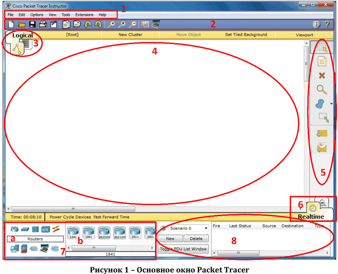
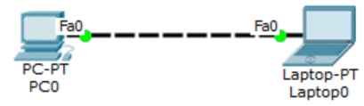
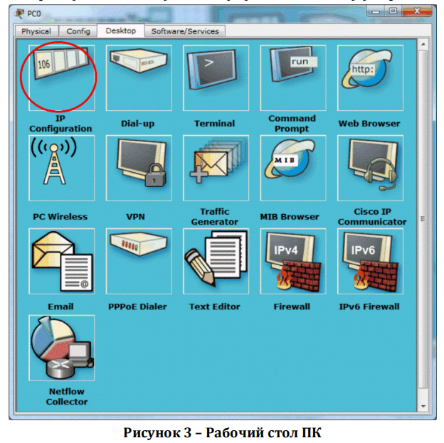
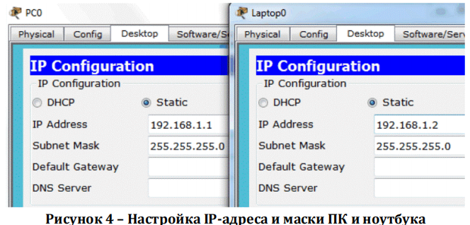
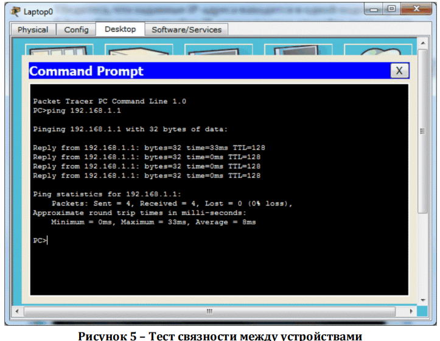

# Начало работы с Packet Tracer

## Введение

Вы начинаете свой путь в мир Cisco — возможно, для подготовки к сдаче экзаменов на промышленные сертификаты CCENT/CCNA — и хотели бы попробовать на вкус всё, что есть в сетях Cisco? При этом не можете позволить себе роскошь реального оборудования. Тогда 
<mark>Packet Tracer — отличная замена для всех, кто нуждается в нескольких реальных устройствах: вы можете разработать сложную топологию из десятков (если не сотен) устройств Cisco и следить за тем, как пакеты передвигаются между ними.</mark> И всё это возможно в пределах вашего ноутбука вне зависимости от вашего местонахождения. Ещё большую пользу эта программа окажет вам, если вы являетесь инструктором или экзаменатором: с помощью Packet Tracer можно создать необходимую топологию с практическими вопросами.

> Packet Tracer — <mark>программный симулятор сетей и устройств Cisco, предназначенный для моделирования работы реального сетевого оборудования и его окружения без использования физических устройств.</mark>

## Протоколы, работающие в Packet Tracer

Симулятор, как следует из значения этого слова, отображает работу реальных сетевых устройств и их окружения. Надо заметить, что и протоколы в Packet Tracer ведут себя почти так же, как если бы они работали на реальном оборудовании. В таблице 1 указаны технологии и протоколы, которые поддерживаются в программе.

Отмеченные звёздочкой (\*) протоколы имеют существенные ограничения: не все их команды и сервисы поддерживаются в Packet Tracer.

**Таблица 1 — Протоколы, поддерживаемые в Packet Tracer**

| Технология | Протоколы |
|---|---|
| LAN | Ethernet (включая CSMA/CD\*), 802.11 a/b/g/n wireless\*, PPPOE |
| Коммутация | VLAN, 802.1q, trunking, VTP, DTP, STP\*, RSTP\*, многоуровневая коммутация\*, EtherChannel, LACP, PAgP |
| TCP/IP | HTTP, HTTPS, DHCP, DHCPv6, Telnet, SSH, TFTP, DNS, TCP\*, UDP, IPv4\*, IPv6\*, ICMP, ICMPv6, ARP, IPv6 ND, FTP, SMTP, POP3, VOIP (H.323) |
| Маршрутизация | Статическая, маршрутизация по умолчанию, RIPv1, RIPv2, EIGRP, OSPF, BGP, inter-VLAN, перераспределение маршрутной информации |
| WAN | HDLC, SLARP, PPP\*, Frame Relay\* |
| Безопасность | IPsec, GRE, ISAKMP, NTP, AAA, RADIUS, TACACS, SNMP, SSH, Syslog, CBAC, Zone-Based Policy Firewall, IPS |
| QoS | Layer 2 QoS, Layer 3 DiffServ QoS, FIFO Hardware queues, Priority Queuing, Custom Queuing, Weighted Fair Queuing, MQC, NBAR\* |
| Прочие технологии | Списки доступа (стандартные, расширенные и именованные), CDP, NAT (статический, динамический, входящий/исходящий и с перегрузкой), NATv6 |

## Обзор графического интерфейса

> Графический интерфейс пользователя (GUI) — совокупность средств и элементов управления, позволяющих пользователю взаимодействовать с программой посредством визуальных образов (окон, кнопок, меню, панелей), а не через командную строку.

Основное рабочее окно Packet Tracer, подобно графическому редактору, делится на несколько составляющих (Рисунок 1). Необходимые пояснения даются ниже.



Рисунок 1 — Основное окно Packet Tracer

1. **Строка меню (Menu Bar).** Этот компонент идентичен для всех программных приложений. Используется для открывания, сохранения, печати, изменения настроек и т. п.
2. **Главная панель инструментов (Main Toolbar)** содержит ярлыки, обеспечивающие быстрый доступ к наиболее часто используемым пунктам меню, таким как Открыть (Open), Сохранить (Save), Масштаб (Zoom), Отменить (Undo), Повторить (Redo) и прочим. В правой части панели находится ярлык для ввода информации о текущей топологии.
3. **Переключатель выбора логической или физической топологии (Logical/Physical Workspace Tabs)** служит для переключения между логической и физической рабочими областями.
4. **Рабочее пространство (Workspace).** Это основная область работы в Packet Tracer. Именно здесь создаётся необходимая топология (схема сети) и отображается симуляция процесса сетевого взаимодействия.
5. **Общая панель инструментов (Common Tools Bar)** обеспечивает возможность выбора инструментов манипуляции со схемой сети, таких как выделение и изменение расположения устройств, размещение надписей и заметок, удаление, изменение размера и выбор передачи простого (Simple PDU) или сложного (Complex PDU) пользовательского блока данных.

> PDU (Protocol Data Unit) — <mark>блок данных протокола, единица информации, передаваемая между сетевыми устройствами на определённом уровне модели OSI.</mark>

6. **Переключатель выбора режима работы (Realtime/Simulation Tabs)** обеспечивает переключение между реальным режимом работы или режимом симуляции сетевого взаимодействия. Данный переключатель также даёт возможность контроля времени и захвата пакетов в сети.
7. **Окно выбора сетевых компонентов (Network Component Box)** <mark>содержит доступное в Packet Tracer сетевое оборудование и оконечные устройства.</mark> Подразделяется на две области:
    - **7a. Окно выбора категории устройства (Device-type Selection Box)** <mark>содержит основные категории устройств (маршрутизаторы, коммутаторы, концентраторы, беспроводные устройства, сетевые кабели, оконечные устройства и прочие).</mark>
    - **7b. Окно выбора конкретного типа устройства (Device-specific Selection Box).** <mark>После выбора категории здесь становятся доступными различные модели устройств.</mark>
8. **Окно создания пользовательских пакетов (User-created Packet Box)** <mark>предназначено для создания пользователями подробных тестов сетевой топологии и отображения их результатов.</mark>

Для успешного дальнейшего изучения Packet Tracer необходимо уверенно ориентироваться в приведённых названиях инструментов и их расположении в окне программы.

## Создание простой схемы сети

После знакомства с интерфейсом программы мы можем приступить к созданию первой топологии. Выполним следующие пункты.

1. В окне выбора сетевых компонентов найдите категорию **Оконечные устройства (End Devices)** и выберите в соседнем окне **Персональный компьютер ПК (Generic PC)** и **Ноутбук (Generic Laptop)**. Перетащите оба устройства в рабочую область Packet Tracer.
2. Кликните **Подключения (Connections)**, затем выберите **Перекрёстный кабель (Copper Cross-Over)**. Вначале кликните на изображении ПК и выберите FastEthernet-интерфейс устройства в открывшемся списке. После этого кликните на изображении ноутбука и также выберите FastEthernet-интерфейс. При правильном подключении индикаторы статуса устройств должны отображаться зелёным цветом, указывающим, что интерфейсы устройств включены.



Рисунок 2 — Простая топология сети

3. Для того <mark>чтобы настроить устройство, например ПК, следует кликнуть на его изображении и затем выбрать вкладку **Рабочий стол (Desktop)**. Выберите инструмент **Конфигурация IP (IP Configuration)** и введите IP-адрес (IP Address) и маску (Subnet Mask) устройства.</mark>



Рисунок 3 — Рабочий стол ПК

> IP-адрес — <mark>уникальный числовой идентификатор устройства в сети, работающей по протоколу IP, используемый для адресации и маршрутизации пакетов.</mark>

> Маска подсети (Subnet Mask) — <mark>числовая маска, определяющая, какая часть IP-адреса относится к адресу сети, а какая — к адресу узла.</mark>

Для схемы можно обойтись без IP-адресов шлюза по умолчанию и DNS-сервера, т. к. в этом нет необходимости (схема состоит только из двух компьютеров и не предполагает выход в Интернет или подключение к другим сетям, а также использование символьных имён).



Рисунок 4 — Настройка IP-адреса и маски ПК и ноутбука

4. Закройте окно настройки ПК. Кликните по изображению ноутбука и выполните таким же образом настройку ноутбука.

Убедитесь, что заданные IP-адреса находятся в одной подсети.

5. Закройте окно настройки IP-адреса и затем откройте инструмент **Командная строка (Command Prompt)**. Воспользовавшись утилитой `ping`, проведите тест связности, как показано на следующем рисунке.

```bash
# Проверка связности с узлом 192.168.1.2
ping 192.168.1.2
```



Рисунок 5 — Тест связности между устройствами

> Ping — утилита диагностики сетевых соединений, отправляющая ICMP-запросы echo-request указанному узлу и измеряющая время отклика для проверки доступности узла.

Рассмотренная схема сети относительно простая. В действительности современная сеть требует наличия сетевого оборудования. Немного усложним нашу топологию, добавив Ethernet-коммутатор.

> Коммутатор (Switch) — сетевое устройство канального уровня модели OSI, предназначенное для соединения нескольких узлов сети в пределах одного сегмента и передачи кадров между ними на основе MAC-адресов.

1. Кликните на категории устройств **Коммутаторы (Switches)** и перенесите из окна выбора конкретного типа устройства в рабочую область любой тип коммутатора (за исключением Switch-PT-Empty).
2. Удалите кабель между ПК и ноутбуком, используя инструмент **Удалить (Delete)** из общей панели инструментов.
3. Кликните на категории **Подключения (Connections)**, затем выберите **Прямой кабель (Copper Straight-Through)** и подключите ПК и ноутбук к коммутатору. Сразу после подключения индикаторы коммутатора будут оранжевого цвета, потому что порты коммутатора находятся в режимах прослушивания и изучения протокола связующего дерева STP (Spanning Tree Protocol).

> STP (Spanning Tree Protocol) — протокол канального уровня, предотвращающий образование петель в сети путём построения логического дерева без петель и блокирования избыточных путей.

Рисунок 6 — Схема сети с коммутатором

4. Как только цвет индикаторов изменится на зелёный (что свидетельствует о нормальной работе портов коммутатора), проведите тест связности между ПК и ноутбуком с помощью утилиты `ping`. Убедитесь, что тест выполнен успешно.
5. Сохраните изменённую топологию под другим именем (меню **File > Save As**). Схема сохраняется в файле с расширением `.pkt`, при этом запоминается текущий статус и настройки устройств.

## Резюме

В данной главе вы научились устанавливать Packet Tracer и использовать его для создания простейших схем сети. Поэкспериментируйте с различными вариантами топологий, используя только ПК, ноутбук и коммутаторы, чтобы самостоятельно закрепить принципы работы с программой. Также вы познакомились со списком протоколов, поддерживаемых Packet Tracer. Используйте этот список всякий раз, как только вы собираетесь опробовать новую технологию, чтобы убедиться, что необходимые протоколы и соответствующие им настройки полностью поддерживаются программой.

В следующей главе вы узнаете о различных типах сетевых устройств и принципах их настройки под конкретные нужды. Мы также разберём, как настраивать устройства через интерфейс командной строки (CLI), а также с помощью графического интерфейса.

## FAQ

**Что такое Packet Tracer?**
Это программный симулятор сетей и устройств Cisco, позволяющий моделировать топологии и наблюдать за передачей пакетов без реального оборудования.

**Нужен ли аккаунт Cisco NetAcad для загрузки Packet Tracer?**
Да, для загрузки необходимо обладать активным статусом пользователя Сетевой академии Cisco на сайте https://www.netacad.com.

**Все ли протоколы реального оборудования поддерживаются в Packet Tracer?**
Нет. Часть протоколов, отмеченных звёздочкой (\*), поддерживается с существенными ограничениями — не все их команды и сервисы реализованы.

**Почему индикаторы портов коммутатора сразу после подключения оранжевые?**
Порты находятся в режимах прослушивания и изучения протокола STP. Когда порты перейдут в нормальное рабочее состояние, индикаторы станут зелёными.

**В каком формате сохраняется топология?**
Топология сохраняется в файле с расширением `.pkt`; при этом запоминается текущий статус и настройки устройств.

**Нужно ли указывать шлюз по умолчанию и DNS-сервер в простой схеме из двух ПК?**
Нет, для схемы без выхода в Интернет и без использования символьных имён это не требуется.

**Какой кабель используется для соединения ПК с ПК и ПК с коммутатором?**
ПК с ПК — перекрёстный кабель (Copper Cross-Over); ПК с коммутатором — прямой кабель (Copper Straight-Through).