<details><summary>Кратко</summary>

# Краткая выжимка

## Раздел 1. Основы

**Задача:** <mark>создать масштабируемую компьютерную сеть с нуля, поддерживающую разнообразные приложения (видеоконференции, видео по запросу, электронную торговлю, распределённые вычисления, цифровые библиотеки). Книга описывает «строительные блоки» и архитектуру для их интеграции.</mark>

**Отличие компьютерных сетей:** <mark>универсальность — строятся из программируемого оборудования общего назначения, передают любые типы данных, а не специализированы под один тип (в отличие от телефонных или кабельных ТВ-сетей).</mark>

**Три точки зрения:** <mark>разработчик приложений, оператор сети, проектировщик сети.</mark>

### Глава 1.1. Приложения
- **Всемирная паутина** — <mark>базовый интерфейс с URL; один клик может вызвать десятки сообщений (DNS-преобразование, установка TCP, HTTP-запрос/ответ, закрытие соединения).</mark>
- **Потоковое аудио/видео** — <mark>непрерывное потребление, недопустимы прерывания (пропуски звука, задержки видео).</mark>
- **Приложения реального времени** (VoIP, видеоконференции) — <mark>жёсткие временные ограничения; задержка «туда-обратно» ~300 мс — верхняя граница терпимости, 100 мс — приемлемо; трафик двунаправленный.</mark>

### Глава 1.2. Требования
**Заинтересованные стороны:** 
- <mark>разработчик приложений</mark> (нужные услуги), 
- <mark>оператор</mark> (удобство администрирования), 
- <mark>проектировщик</mark> (экономичность, эффективность, справедливость, производительность).

**1.2.2. Масштабируемое подключение**
- Каналы: <mark>«точка-точка» и «множественный доступ» (Wi-Fi, сотовая связь — «последняя миля»).</mark>
- Косвенное соединение через коммутируемые сети: <mark>коммутация каналов (телефония) и коммутация пакетов (основной объект изучения).</mark>
- Пакетные сети используют стратегию «хранение и пересылка».
- Понятия: коммутаторы (внутри сети), хосты (конечные узлы), облако (любая сеть), интерсеть/интернет, маршрутизатор/шлюз.
- **Адресация и маршрутизация** — <mark>ключевые задачи; возможны одноадресная, широковещательная и многоадресная рассылка.</mark>
- **Вывод:** сеть определяется рекурсивно — из узлов и линий или из вложенных сетей.

**1.2.3. Экономически эффективное совместное использование ресурсов**
- **Мультиплексирование** — <mark>разделение ресурса между пользователями.</mark>
- <mark>**STDM** (синхронное временное разделение) и **FDM** (частотное) — недостатки: простой канала и фиксированное число потоков.</mark>
- **Статистическое мультиплексирование** — <mark>передача по требованию, без простоев; пакет как единица ограничения размера; буферизация и возможная перегрузка (отбрасывание пакетов);</mark>公平ное распределение (FIFO, круговая выборка, QoS).

**1.2.4. Поддержка общих служб**
- <mark>Сеть — средство взаимодействия прикладных процессов через **логические каналы**.</mark>
- Примеры приложений: FTP/NFS (клиент-сервер), цифровые библиотеки.
- Типы каналов: **«запрос/ответ»** (гарантия доставки, одна копия, конфиденциальность) и **потоковых сообщений** (порядок доставки, возможна потеря кадров, многоадресность).
- Опасность слишком малого числа абстракций («если у вас молоток, всё выглядит как гвоздь»).
- Вопрос распределения функциональности между коммутаторами и конечными хостами.
- **Надёжная доставка:** три класса отказов — битовые ошибки (редки: 1 из 10⁶–10⁷ на меди, 1 из 10¹²–10¹⁴ на оптоволокне), потеря пакетов (перегрузка, ошибки ПО), отказы узлов/линий (обход возможен).
- **Семантический разрыв** — разрыв между ожиданиями приложения и возможностями технологии.

**1.2.5. Управляемость**
- Управление сетью: обновление оборудования, устранение неполадок, добавление функций; автоматизация и самовосстанавливающиеся системы.
- Противоречие **стабильность vs скорость внедрения новых функций**; облачные технологии сместили баланс в сторону большей скорости.

### 1.3.1. Многослойность и протоколы
- **Абстракция** — <mark>сокрытие деталей реализации за чётким интерфейсом; фундаментальный инструмент управления сложностью.</mark>
- **Уровни:** <mark>начинаем с услуг оборудования, добавляем уровни, каждый предоставляет более абстрактные услуги; высокие уровни используют услуги низких.</mark>
- Пример (рис. 1.8): уровень «хост-хост» (абстрагирует топологию) + уровень «процесс-процесс» (абстрагирует потери сообщений).
- **Две пользы многослойности:** <mark>разбиение задачи на компоненты; модульность (изменение одного уровня без переделки остальных).</mark>
- <mark>На одном уровне может быть **несколько альтернативных абстракций**</mark> (например, канал «запрос/ответ» и канал потоковых сообщений).
- **Протокол** — абстрактный объект уровня; определяет два интерфейса:
    - **Сервисный интерфейс** — операции для локальных объектов (например, HTTP GET для браузера).
    - **Пиринговый (одноранговый) интерфейс** — форма и значение сообщений между аналогами протокола на разных машинах.
- Одноранговое общение косвенное (кроме аппаратного уровня): протокол передаёт сообщение протоколу нижнего уровня.
- **Граф протоколов:** узлы — протоколы, рёбра — зависимости. Пример: RRP и MSP (каналы процесс-процесс) зависят от HHP (хост-хост).
- **Спецификация протокола** — <mark>описание интерфейсов (псевдокод, диаграммы состояний, форматы пакетов); модуль — реализация. Разные реализации одной спецификации должны **взаимодействовать**.</mark>
- **Сетевая архитектура** — <mark>набор правил, регулирующих форму и содержание графа протоколов. Стандартизирующие организации: **IETF** и **ISO**.</mark>

### 1.3.2. Инкапсуляция
- Протокол воспринимает сообщение верхнего уровня как неинтерпретированную строку байтов.
- **Заголовок** (небольшая структура данных) прикрепляется к началу сообщения для обмена управляющей информацией; **трейлер** — в конце.
- Остальное — **тело сообщения / полезная нагрузка**. Данные приложения **инкапсулируются** в новом сообщении.
- Процесс повторяется на каждом уровне; при получении заголовки снимаются в обратном порядке, приложение получает исходное сообщение без заголовков.
- Промежуточные узлы (коммутаторы, маршрутизаторы) могут проверять заголовки нижних уровней.
- Низкий уровень может применять простое преобразование ко всему телу (сжатие, шифрование), включая заголовки верхних уровней.

### 1.3.3. Мультиплексирование и демультиплексирование
- Идея мультиплексирования применяется ко всему протокольному графу, не только к коммутаторам.
- **Демукс-ключ** в заголовке идентифицирует приложение/протокол верхнего уровня; на приёмнике сообщение демультиплексируется к нужному получателю.
- Почти каждый протокол поддерживает мультиплексирование (например, HHP различает RRP и MSP).
- **Нет единого соглашения** о демукс-ключе: 8/16/32-битные поля; одно или два поля (одинаковые ключи с обеих сторон или разные для каждого направления).

### 1.3.4. 7-уровневая модель OSI
Эталонная модель (не граф протоколов), сегодня сетей на OSI нет, но терминология широко используется. Снизу вверх:
1. **Физический** — передача сырых битов по линии.
2. **Канальный** — сборка битов в **кадры**; реализуется сетевыми адаптерами и драйверами.
3. **Сетевой** — маршрутизация между узлами; единица — **пакет**.
    - Нижние три уровня реализуются на всех узлах (коммутаторы и хосты).
4. **Транспортный** — канал процесс-процесс; единица — **сообщение**; работает только на конечных хостах.
5. **Сеансовый** — пространство имён для объединения транспортных потоков одного приложения (например, аудио + видео в видеоконференции).
6. **Представления** — формат данных (разрядность целых, порядок байтов, формат видео).
7. **Прикладной** — протоколы вроде HTTP.

### 1.3.5. Архитектура Интернета
Также называется **архитектурой TCP/IP**; эволюционировала из ARPANET (финансирование ARPA, Минобороны США), повлияла на OSI.

**Стек (рис. 1.14–1.15):**
- **Нижний уровень** — множество сетевых протоколов NET1, NET2… (Ethernet, Wi-Fi 802.11), аппаратное + программное обеспечение; могут иметь подуровни.
- **IP** — единственный протокол, объединяющий множество технологий в одну логическую интерсеть.
- **TCP и UDP** — альтернативные логические каналы: TCP — надёжный байтовый поток; UDP — ненадёжная доставка дейтаграмм. Иногда называются **сквозными** (end-to-end) или транспортными протоколами.
- **Прикладные протоколы** — HTTP, FTP, Telnet, SMTP. Важно различать протокол и приложение (разные браузеры используют один HTTP).

**Соответствие OSI:** прикладной — 7-й уровень, транспортный — 4-й, IP — 3-й, каналы/подсети — 2-й.

**Стандартизация:** IETF определяет архитектуру и многие протоколы (TCP, UDP, IP, DNS, BGP); также участвуют IEEE (Ethernet, Wi-Fi), W3C (HTTP/HTML), 3GPP (4G/5G), ITU-T (видеокодирование). **IANA** выдаёт уникальные идентификаторы; входит в **ICANN**.

**Три особенности архитектуры Интернета:**
1. **Нет строгого разделения по уровням** — приложение может обходить транспортные уровни и напрямую использовать IP или базовую сеть; можно определять новые абстракции.
2. **Форма песочных часов** — широкая вверху, узкая посередине (IP), широкая внизу. IP — центральная точка: общий метод обмена пакетами; выше — бесконечное число транспортных протоколов, ниже — бесконечное множество сетевых технологий. Доставка «хост-хост» отделена от сервиса «процесс-процесс».
3. **Культура IETF:** для включения протокола нужна спецификация и минимум одна (предпочтительно две) представительных реализации. Девиз: *«Мы отвергаем королей, президентов и голосования. Мы верим в грубый консенсус и работающий код»* (Дэвид Кларк).

**Главный вывод:** философия песочных часов — узкая талия (минимальный тщательно отобранный набор глобальных возможностей) позволяет сосуществовать и быстро развиваться приложениям сверху и технологиям снизу; это ключ к адаптивности Интернета.

</details>

# Раздел 1. Основы

## Задача: создание сети

Ответ на этот вопрос — основная цель данной книги: описать доступные «строительные блоки», а затем показать, как построить сеть с нуля.

<mark>Что отличает компьютерную сеть от других типов сетей? Вероятно, самая важная характеристика — **универсальность**. Компьютерные сети строятся в основном из программируемого оборудования общего назначения и не оптимизированы под конкретную задачу (телефонные звонки или передачу телевизионных сигналов)</mark>.
<mark>Вместо этого они способны передавать множество различных типов данных и поддерживают широкий и постоянно растущий спектр приложений.</mark> <mark>Современные компьютерные сети практически полностью взяли на себя функции, ранее выполняемые специализированными сетями.</mark> В этом разделе рассматриваются типичные приложения компьютерных сетей и требования, которые должен учитывать проектировщик сети для их поддержки.

Поэтому <mark>необходимо рассматривать сети с разных точек зрения: строителей, операторов, разработчиков приложений.</mark>

В этом разделе затронуты <mark>четыре основных момента.</mark> 
1. Во-первых, исследованы <mark>требования</mark>, которые различные приложения и сообщества людей предъявляют к сети. 
2. Во-вторых, введена идея сетевой <mark>архитектуры</mark>, закладывающая основу для остальной части книги. 
3. В-третьих, представлены ключевые <mark>элементы</mark> реализации компьютерных сетей. 
4. И наконец, определены ключевые <mark>метрики</mark> оценки производительности компьютерных сетей.

---

## Глава 1.1. Приложения

Большинство людей знакомы с Интернетом по его приложениям: Всемирная паутина, электронная почта, социальные сети, потоковое воспроизведение музыки и фильмов, видеоконференции, обмен мгновенными сообщениями, файлообменники — и это лишь несколько примеров. Иными словами, мы взаимодействуем с Интернетом как пользователи сети. <mark>**Пользователи Интернета** — самый многочисленный класс людей, взаимодействующих с Интернетом, но есть и несколько других важных групп.</mark>

Существует <mark>группа людей, которые **создают приложения**</mark> — группа, значительно расширившаяся в последние годы благодаря мощным платформам программирования и новым устройствам, таким как смартфоны, создающим новые возможности для быстрой разработки приложений и вывода их на глобальный рынок.

Есть и те, кто занимается <mark>**эксплуатацией или управлением сетями** — в основном это работа «за кулисами», но критически важная и зачастую очень сложная.</mark> С распространением домашних сетей всё больше людей становятся, пусть и в небольшой степени, сетевыми операторами.

Наконец, есть <mark>те, кто **проектирует и создаёт устройства и протоколы**, из которых в совокупности состоит Интернет.</mark> Эта последняя группа — традиционная целевая аудитория учебников по сетям. Однако на протяжении всей книги мы также будем рассматривать перспективы разработчиков приложений и операторов сетей.

Учёт этих точек зрения позволит лучше понять разнообразные требования, которым должна соответствовать сеть. Разработчики приложений смогут создавать приложения, которые будут работать лучше, если поймут, как работает и взаимодействует с приложениями основная технология. Итак, <mark>прежде чем разбираться, как построить сеть, давайте более внимательно рассмотрим типы приложений, которые поддерживают современные сети.</mark>

---

### Глава 1.1.1. Классы приложений

>В тексте достаточно странная классификация. Вот пример реально существующей:
> 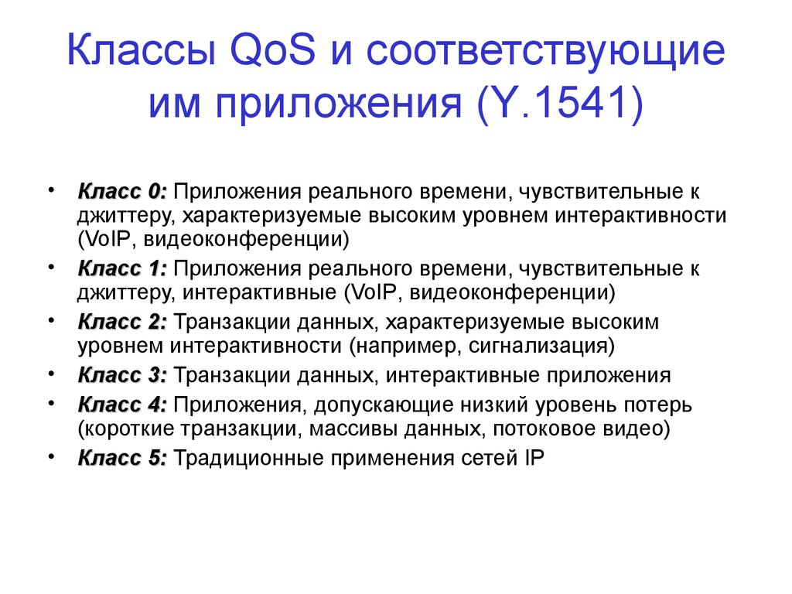

> **Всемирная паутина (World Wide Web)** — <mark>интернет-приложение, превратившее Интернет из малоизвестного инструмента, использовавшегося в основном учёными и инженерами, в массовое явление.</mark>

Сама паутина стала настолько мощной платформой, что многие люди путают её с Интернетом, и утверждать, что паутина — это одно приложение, несколько преувеличенно.

В базовой форме паутина представляет собой интуитивно простой интерфейс. Пользователи просматривают страницы, заполненные текстовыми и графическими объектами, и кликают на объекты, о которых хотят узнать больше, после чего появляется соответствующая новая страница. Каждый выбираемый объект на странице связан с идентификатором для следующей страницы или объекта. Этот идентификатор, называемый <mark>**унифицированным указателем ресурса (URL)**, обеспечивает способ идентификации всех возможных объектов, которые можно просмотреть в веб-браузере.</mark> Например:

```
http://www.cs.princeton.edu/llp/index.html
```

является URL-адресом страницы с информацией об одном из авторов этой книги: строка `http` указывает на необходимость использования **протокола передачи гипертекста (HTTP)** для загрузки страницы, `www.cs.princeton.edu` — имя машины, обслуживающей страницу, а `/llp/index.html` однозначно идентифицирует домашнюю страницу Ларри на этом сайте.

> **HTTP (HyperText Transfer Protocol)** — <mark>протокол прикладного уровня, используемый для передачи гипертекстовых документов (веб-страниц) между клиентом и сервером.</mark>

Однако большинство пользователей Интернета не знают, что при щелчке по одному URL может быть обменяно более десятка сообщений по Интернету, и даже намного больше, если веб-страница сложная и содержит множество встроенных объектов:
1. Этот обмен сообщениями включает <mark>до шести сообщений для преобразования имени сервера (`www.cs.princeton.edu`) в его IP-адрес (`128.112.136.35`),</mark> 
2. <mark>три сообщения для установки соединения по протоколу управления передачей (TCP) между браузером и сервером<mark>, 
3. <mark>четыре сообщения для отправки браузером HTTP-запроса «GET» и ответа сервера с запрашиваемой страницей</mark> (и подтверждения получения каждой стороной) и 
4. <mark>четыре сообщения для завершения соединения TCP.</mark> 

Конечно, это не включает миллионы сообщений, которыми обмениваются узлы Интернета в течение дня, просто чтобы сообщить друг другу, что они существуют и готовы обслуживать веб-страницы, переводить имена в адреса и пересылать сообщения к конечному пункту назначения.

> **TCP (Transmission Control Protocol)** — протокол транспортного уровня, обеспечивающий надёжную доставку данных с установлением соединения.

Ещё один широко распространённый класс приложений Интернета — **передача потокового аудио и видео**. Такие услуги, как видео по запросу и интернет-радио, используют эту технологию. Хотя мы часто начинаем с веб-сайта для инициации потоковой сессии, доставка аудио и видео имеет важные отличия от получения простой веб-страницы с текстом и изображениями. Например, зачастую не нужно загружать весь видеофайл (этот процесс может занять несколько минут), прежде чем смотреть первую сцену. Потоковое аудио и видео предполагает более своевременную передачу сообщений от отправителя к получателю, и у получателя отображается видео или воспроизводится аудио практически по мере его поступления.

> **Потоковая передача (streaming)** — <mark>передача аудио- или видеоданных, при которой получатель начинает воспроизведение практически сразу по мере поступления данных, без необходимости полной загрузки файла.</mark>

<mark>Разница между потоковыми приложениями и более традиционной доставкой текста, графики и изображений заключается в том, что люди потребляют аудио- и видеопотоки непрерывно, и прерывистость — в форме пропущенных звуков или задержек видео — неприемлема. Напротив, обычная (не потоковая) страница может доставляться и читаться частями. Это различие влияет на то, как сеть поддерживает эти разные классы приложений.</mark>

<mark>Другой класс приложений — **приложения для реального времени с аудио и видео**. Они имеют значительно более жёсткие временные ограничения, чем потоковые приложения. При использовании приложений для голосовой связи по IP, таких как Skype, или приложений для видеоконференций, взаимодействие между участниками должно происходить своевременно.</mark> Когда человек на одном конце «делает жест», это действие должно быть отображено на другом конце как можно быстрее[^1].

[^1]: Не совсем «как можно быстрее»… <mark>Исследования человеческого фактора показывают, что 300 мс — разумная верхняя граница задержки сигнала по пути туда и обратно, которую можно терпеть в телефонном разговоре, прежде чем люди начнут жаловаться, а задержка в 100 мс вполне приемлема.</mark>

На данный момент этого краткого обзора нескольких типичных приложений достаточно, чтобы начать рассматривать проблемы, которые необходимо решить, если мы хотим создать сеть, поддерживающую такое разнообразие приложений.

---

## Глава 1.2. Требования

### Глава 1.2.1. Заинтересованные стороны

Давайте рассмотрим, как эти три заинтересованные стороны могут формулировать свои требования к сети:

- **Разработчик приложений** <mark>перечислил бы услуги **(свойства), которые нужны его приложению**: например, гарантию, что каждое сообщение, отправленное приложением, будет доставлено без ошибок в течение определённого времени, или возможность плавного переключения между различными соединениями с сетью по мере перемещения пользователя.</mark>
- **Оператор сети** <mark>перечислил бы характеристики системы, которая **легко администрируется и управляется**: например, возможность легко устранить неисправности, добавлять новые устройства в сеть и правильно настраивать их, а также удобство учёта использования.</mark>
- **Проектировщик сети** <mark>перечислил бы свойства **экономичного проектирования**: например, эффективное использование сетевых ресурсов и их справедливое распределение между различными пользователями. Вопросы производительности также, вероятно, будут важны.</mark>

В этом разделе мы попытались сформулировать требования различных заинтересованных сторон в высокоуровневое введение в основные аспекты, определяющие проектирование сетей, и тем самым выявить вызовы, рассматриваемые в остальной части этой книги.

---

### Глава 1.2.2. Масштабируемое подключение

Начнём с очевидного: <mark>сеть должна обеспечивать соединение между большим количеством компьютеров.</mark> Иногда достаточно построить ограниченную сеть, которая соединяет только несколько выбранных машин. 

- Фактически <mark>по соображениям конфиденциальности и безопасности многие **частные (корпоративные) сети имеют цель ограничить количество подключённых машин.**</mark> 
- <mark>В отличие от этого, **другие сети разработаны таким образом, чтобы иметь возможность подключить все компьютеры в мире.**</mark> 

<mark>Система, спроектированная для поддержания роста до произвольно больших размеров, называется **масштабируемой**.</mark> Используя Интернет в качестве модели, эта книга рассматривает проблему масштабируемости.

> **Масштабируемость (scalability)** — <mark>свойство системы сохранять работоспособность и эффективность при увеличении размера (количества узлов, пользователей, трафика) до произвольно больших значений.</mark>

Чтобы более полно усвоить требования к соединению, мы должны выяснить, как компьютеры соединяются в сети. Соединение происходит на множестве различных уровней. На самом низком уровне сеть может состоять из двух или более компьютеров, напрямую соединённых каким-либо физическим средством, таким как коаксиальный кабель или оптоволокно. <mark>Мы называем такое физическое средство связи **каналом** и часто именуем компьютеры, которые оно соединяет, **узлами**.</mark> (<mark>Иногда узел представляет собой более специализированное устройство</mark>, а не компьютер, но мы пренебрегаем этим различием ради достижения целей нашего обсуждения.) Как показано на рис. 1.2, <mark>физические каналы иногда ограничены парой узлов (такой канал называется **«точка-точка»**),</mark> тогда как <mark>в других случаях более двух узлов могут использовать один физический канал (такой канал называется **«множественным доступом»**).</mark> Беспроводные каналы, как те, которые предоставляются сетями сотовой связи и Wi-Fi, являются важным классом каналов с множественным доступом. <mark>Каналы с множественным доступом ограничены размером: как географическим расстоянием, которое они могут преодолеть, так и количеством узлов, которые они могут соединить.</mark> По этой причине они часто реализуют так называемую «последнюю милю», соединяя конечных пользователей с остальной частью сети.</mark>

> **Канал (link)** — <mark>физическое средство связи, соединяющее два или более узлов сети (коаксиальный кабель, оптоволокно, беспроводная среда).</mark>
>
> **Узел (node)** — <mark>устройство (обычно компьютер), подключённое к сети через один или несколько каналов.
>
> **Канал «точка-точка» (point-to-point)** — <mark>канал, соединяющий ровно два узла.</mark>
>
> **Канал с множественным доступом (multiple-access)** — <mark>канал, который могут совместно использовать более двух узлов.</mark>

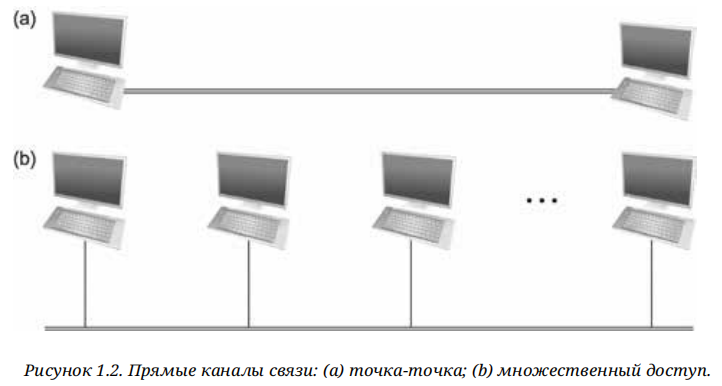

**Рис. 1.2** — Прямые каналы связи: (a) точка-точка; (b) множественный доступ.

<mark>Если бы компьютерные сети были ограничены ситуациями, когда все узлы напрямую связаны друг с другом через общую физическую среду, то либо сети были бы весьма ограничены в количестве подключаемых компьютеров, либо количество проводов, выходящих из каждого узла, быстро стало бы как неуправляемым,</mark> так и очень дорогим. Но соединение между двумя узлами не обязательно означает прямое физическое соединение между ними — косвенное соединение может быть достигнуто между набором «сотрудничающих» узлов. Рассмотрим следующие два примера того, как набор компьютеров может быть косвенно связан.

На рис. 1.3 показана пара узлов, каждый из которых подключён к одному или нескольким каналам «точка-точка». Те узлы, которые подключены как минимум к двум каналам, используют программное обеспечение, которое пересылает данные, полученные по одному каналу, через другой. <mark>Если организовать эти узлы систематически, такие пересылающие узлы формируют **коммутируемую сеть**. Существует множество типов коммутируемых сетей, из которых два наиболее распространённых — **коммутация каналов** и **коммутация пакетов**.</mark> <mark>Первая наиболее известна в телефонной системе, тогда как вторая используется в подавляющем большинстве компьютерных сетей</mark> и будет основным объектом изучения в этой книге. (Коммутация каналов, однако, снова набирает популярность в области оптических сетей, что становится важным, поскольку спрос на пропускную способность сети постоянно растёт.) 
<mark>Важной особенностью пакетных сетей является то, что узлы в такой сети передают друг другу дискретные блоки данных.</mark> <mark>Думайте об этих блоках данных как о фрагментах данных приложения</mark>, таких как файл, электронное письмо или изображение. Мы называем каждый блок данных либо **пакетом**, либо **сообщением**, и пока будем использовать эти термины взаимозаменяемо.

> **Коммутируемая сеть (switched network)** — <mark>сеть, в которой узлы соединены каналами «точка-точка», а промежуточные узлы пересылают данные между каналами.</mark>
>
> **Коммутация каналов (circuit switching)** — <mark>стратегия, при которой перед передачей данных устанавливается выделенный канал через последовательность соединений.</mark>
>
> **Коммутация пакетов (packet switching)** — <mark>стратегия, при которой данные передаются дискретными блоками (пакетами) через сеть без предварительного выделения канала.</mark>
>
> **Пакет (packet)** — <mark>дискретный блок данных, передаваемый по сети; минимальная единица мультиплексирования.</mark>

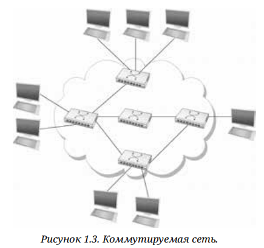

**Рис. 1.3** — Коммутируемая сеть.

<mark>В сетях с коммутацией пакетов обычно используют стратегию, называемую **«хранение и пересылка» (store-and-forward)**. Как следует из названия, каждый узел в сети хранения и пересылки сначала получает полный пакет по какому-либо каналу, сохраняет его во внутренней памяти, а затем пересылает полный пакет следующему узлу.</mark> 

<mark>В отличие от неё, сеть с коммутацией каналов сначала устанавливает выделенный канал через последовательность соединений и затем позволяет исходному узлу передавать поток битов по этому каналу к узлу назначения.</mark> Основная причина использования в компьютерной сети коммутации пакетов, а не коммутации каналов, заключается в эффективности, о которой будет рассказано в следующей главе.

> **«Хранение и пересылка» (store-and-forward)** — <mark>стратегия коммутации пакетов, при которой узел принимает полный пакет, сохраняет его в буфере и затем пересылает следующему узлу.</mark>

<mark>Облако на рис. 1.3 различает узлы внутри, которые реализуют сеть (они обычно называются **коммутаторами**, и их основная функция — хранить и пересылать пакеты), и узлы вне облака, которые используют сеть (они традиционно называются **хостами**, и они поддерживают пользователей и запускают прикладные программы).</mark> Также отметим, что облако является одним из самых важных символов в компьютерных сетях. <mark>В общем, мы используем облако, чтобы обозначить любой тип сети, будь то отдельное соединение «точка-точка», канал с множественным доступом или коммутируемая сеть. Таким образом, всякий раз, когда вы видите облако на рисунке, вы можете думать о нём как о заместителе любой из сетевых технологий, рассматриваемых в этой книге[^2].</mark>

[^2]: Использование облаков для представления сетей предшествует термину облачных вычислений по крайней мере на пару десятилетий, но есть тесная связь между этими двумя понятиями, которые мы рассматриваем в «Перспективах» после каждого раздела.

> **Коммутатор (switch)** — <mark>узел сети, основная функция которого — хранение и пересылка пакетов между каналами.</mark>
>
> **Хост (host)** — <mark>узел сети, поддерживающий пользователей и запускающий прикладные программы.</mark>

<mark>Второй способ, при котором набор компьютеров может быть косвенно подключён, показан на рис. 1.4. В этой ситуации несколько независимых сетей (облаков) соединены для формирования **интерсети**, или просто — **интернета**.</mark> Мы принимаем условность Интернета, обозначая общий термин «интерсеть» с маленькой буквы «и» как «интернет», а TCP/IP Интернет, который мы используем каждый день, с большой буквы «И» как «Интернет». <mark>Узел, подключённый к двум или более сетям, обычно называется **маршрутизатором** или **шлюзом**, и он выполняет ту же роль, что и коммутатор — пересылает сообщения из одной сети в другую.</mark> Обратите внимание, что интерсеть сама по себе может рассматриваться как другой тип сети, что означает, что интерсеть может быть построена из нескольких интерсетей. Таким образом, мы можем рекурсивно строить сети произвольно большого размера, соединяя облака для формирования более крупных облаков. Можно обоснованно утверждать, что идея соединения значительно различающихся сетей была фундаментальной инновацией Интернета и что успешный рост Интернета до глобальных размеров и миллиардов узлов был результатом удачных решений, принятых ранними архитекторами Интернета, которые мы обсудим позже.

> **Интерсеть (internetwork, internet)** — <mark>совокупность соединённых между собой независимых сетей.</mark>
>
> **Маршрутизатор (router)** — <mark>узел, соединяющий две или более сетей и пересылающий пакеты между ними на основе адресов.</mark>

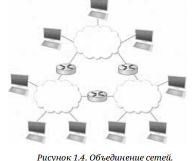

**Рис. 1.4** — Объединение сетей.

Тот факт, что набор хостов напрямую или косвенно подключён друг к другу, не означает, что мы успешно обеспечили связь между хостами. 
<mark>Последним требованием является то, что каждый узел должен иметь возможность указать, с каким из других узлов в сети он хочет общаться. Это достигается путём присвоения каждому узлу **адреса**.</mark> 
Адрес — это строка байтов, которая идентифицирует узел; то есть <mark>сеть может использовать адрес узла для его отличия от других узлов, подключённых к сети.</mark> Когда исходный узел хочет, чтобы сеть доставила сообщение определённому узлу-получателю, он указывает адрес узла-получателя. <mark>Если отправляющий и принимающий узлы не подключены напрямую, то коммутаторы и маршрутизаторы сети используют этот адрес для принятия решения о том, как перенаправить сообщение к узлу-получателю.</mark> 

<mark>Процесс систематического определения того, как перенаправлять сообщения к узлу-получателю на основе его адреса, называется **маршрутизацией**.</mark>

> **Адрес (address)** — <mark>строка байтов, однозначно идентифицирующая узел в сети.</mark>
>
> **Маршрутизация (routing)** — <mark>процесс определения пути пересылки сообщений к узлу-получателю на основе его адреса.</mark>

В этом кратком введении в адресацию и маршрутизацию предполагалось, что :
1. узел-источник хочет отправить сообщение одному узлу назначения (**одноадресная рассылка**). Хотя это наиболее распространённый сценарий, 
2. также возможно, что узел-источник захочет передать сообщение всем узлам сети. 
3. Или же узел-источник может захотеть отправить сообщение некоторому подмножеству других узлов, но не всем.

> **Одноадресная рассылка (unicast)** — <mark>передача сообщения от одного источника одному узлу назначения.</mark>

#### Основные выводы

> Основная идея, которую следует извлечь из этого обсуждения, заключается в том, что сеть можно определить рекурсивно как состоящую из двух или более узлов, соединённых физической линией, или как две или более сети, соединённые узлом. Другими словами, сеть может быть построена из вложенных сетей, где на нижнем уровне сеть реализована с помощью какого-либо физического носителя. Одними из ключевых задач обеспечения сетевой связи являются определение адреса для каждого узла, доступного в сети (будь то логический или физический), и использование таких адресов для пересылки сообщений к соответствующему(им) узлу(ам)-получателю(ям).

---

### Глава 1.2.3. Экономически эффективное совместное использование ресурсов

Как было сказано выше, данная книга сосредоточена на сетях с пакетной коммутацией. <mark>В этой главе объясняется ключевое требование компьютерных сетей — экономическая эффективность, которая приводит нас к выбору стратегии пакетной коммутации.</mark>

При наличии нескольких узлов, косвенно соединённых через вложенные сети, имеется возможность того, чтобы любая пара хостов отправляла сообщения друг другу через последовательность каналов связи и узлов. Конечно, мы хотим делать больше, чем просто поддерживать одну пару взаимодействующих хостов — мы хотим предоставить всем парам хостов возможность обмениваться сообщениями.
<mark>Вопрос в том, как все хосты, которые хотят общаться, могут совместно использовать сеть, особенно если они хотят использовать её одновременно?</mark> И, как будто эта проблема была недостаточно сложной, также надо учесть, как несколько хостов могут совместно задействовать один и тот же канал связи, когда они все хотят использовать его одновременно.

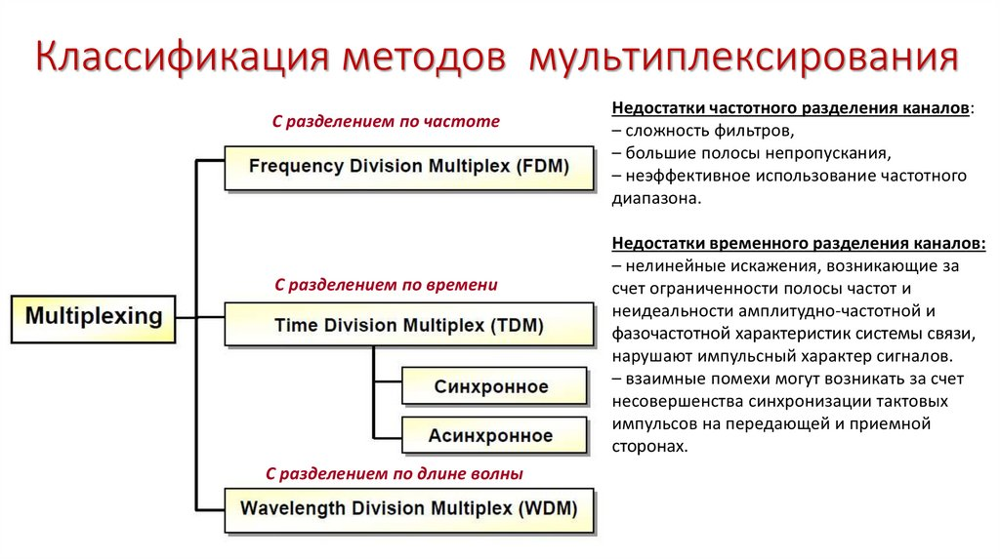

Чтобы объяснить, как хосты совместно используют сеть, нам нужно ввести фундаментальное понятие <mark>**мультиплексирования (multiplexing)**, которое означает, что системный ресурс делится между несколькими пользователями.</mark> 
На интуитивном уровне мультиплексирование можно объяснить на примере многозадачной компьютерной системы, где <mark>один физический процессор используется (мультиплексируется) между несколькими задачами, каждая из которых считает, что у неё есть свой собственный процессор. Точно так же данные, отправляемые несколькими пользователями, могут быть мультиплексированы через физические каналы связи, которые составляют сеть.</mark>

> **Мультиплексирование (multiplexing)** — <mark>разделение системного ресурса (канала связи) между несколькими пользователями (потоками данных).</mark>
>
> **Демультиплексирование (demultiplexing)** — <mark>обратный процесс выделения отдельных потоков данных из общего мультиплексированного канала.</mark>

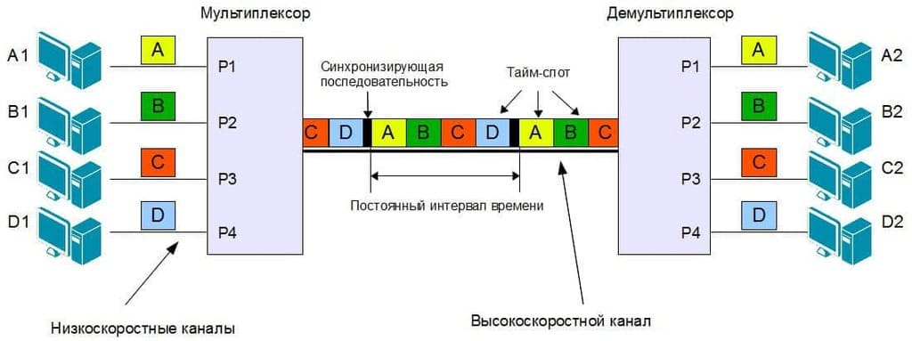

Чтобы понять, как это может работать, рассмотрим простую сеть, изображённую на рис. 1.5, где <mark>три хоста на левой стороне сети (отправители S1–S3) отправляют данные трём хостам на правой стороне (получатели R1–R3), используя коммутируемую сеть, содержащую только один физический канал связи.</mark> 

(Для простоты предположим, что хост S1 отправляет данные хосту R1 и так далее.) <mark>В этой ситуации три потока данных, соответствующие трём парам хостов, мультиплексируются на один физический канал связи коммутатором 1, а затем демультиплексируются обратно в отдельные потоки коммутатором 2.</mark> Обратите внимание, что мы намеренно не уточняем, что именно означает «поток данных». Для целей этого обсуждения предположим, что у каждого хоста на левой стороне есть большой объём данных, которые он хочет отправить своему «партнёру» на правой стороне.

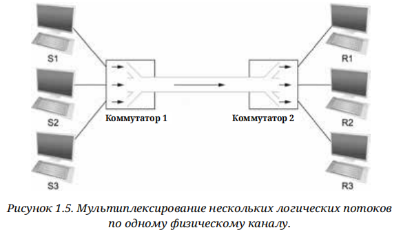

**Рис. 1.5** — Мультиплексирование нескольких логических потоков по одному физическому каналу.

<mark>Существует несколько различных методов для мультиплексирования</mark> некоторого количества потоков на один физический канал связи.: 
1. Один из распространённых методов — **синхронное временное разделение мультиплексирования (synchronous time-division multiplexing, STDM)**. <mark>Идея STDM заключается в разделении времени на равные отрезки и круговом способе предоставления каждому потоку возможности отправлять свои данные по физическому каналу.</mark> Другими словами, во время отрезка 1 передаются данные от S1 к R1; в отрезке 2 передаются данные от S2 к R2; в отрезке 3 S3 отправляет данные R3. Затем первый поток (S1 к R1) снова начинает свою передачу, и процесс повторяется. 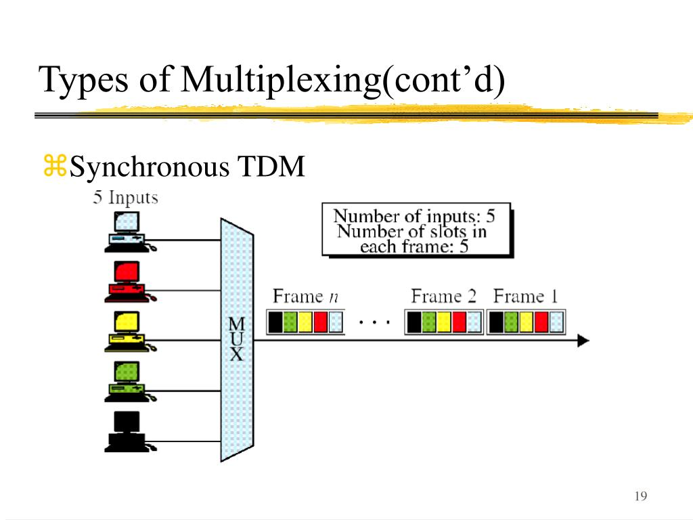
2. Другой метод — это **мультиплексирование по частоте (frequency-division multiplexing, FDM)**. <mark>Идея FDM заключается в передаче каждого потока по физическому каналу на разных частотах, так же, как сигналы различных ТВ-станций передаются на разных частотах в эфире или по коаксиальным телевизионным кабелям. 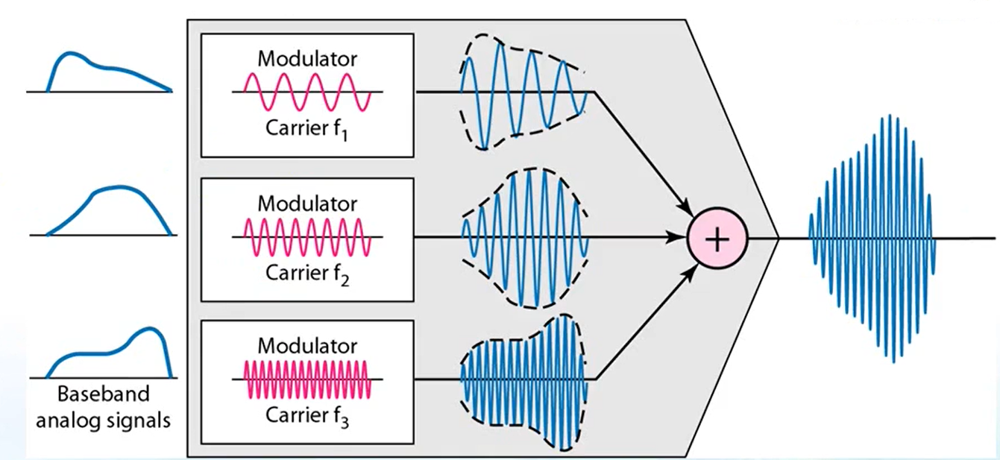</mark>

> **STDM (synchronous time-division multiplexing)** — <mark>метод мультиплексирования, при котором время делится на равные отрезки, поочерёдно выделяемые каждому потоку.</mark>
>
> **FDM (frequency-division multiplexing)** — <mark>метод мультиплексирования, при котором каждому потоку выделяется отдельная полоса частот в общем канале.</mark>

<mark>Несмотря на простоту, и STDM, и FDM имеют два недостатка.</mark> :
1. Во-первых, <mark>если у одного из потоков нет данных для отправки, его доля физического канала (его временной отрезок или частота) остаётся неиспользованной</mark>, даже если у других потоков есть данные для передачи. Например, S3 должен был ждать своей очереди за S1 и S2 в примере, который был рассмотрен ранее, даже если S1 и S2 ничего не отправляли. Для компьютерной коммуникации время простоя канала может быть очень большим (например, учтите время, которое вы тратите на чтение веб-страницы (оставляя канал простаивающим) по сравнению с временем, которое вы тратите на загрузку страницы). 
2. Во-вторых, <mark>как STDM, так и FDM ограничены ситуациями, когда максимальное количество потоков фиксировано и известно заранее.</mark> Непрактично изменять размер отрезка или добавлять дополнительные отрезки в случае STDM или добавлять новые частоты в случае FDM.

Форма мультиплексирования, которая устраняет эти недостатки и используется чаще в этой книге, называется **статистическим мультиплексированием (statistical multiplexing)**. Хотя название полностью не отражает концепции, статистическое мультиплексирование на самом деле имеет довольно простой смысл и основано на двух ключевых идеях. Во-первых, оно похоже на STDM в том смысле, что физический канал используется последовательно во времени — сначала передаются данные одного потока, затем данные другого потока и так далее. В отличие от STDM, данные передаются из каждого потока по требованию, а не в предопределённый временной интервал. Таким образом, если только у одного потока есть данные для отправки, он может передавать эти данные без ожидания своего временного отрезка и, следовательно, без необходимости ожидать, как во время отрезков, которые были выделены для других потоков, те потоки простаивают. Именно избегание времени простоя придаёт эффективность коммутации пакетов.

> **Статистическое мультиплексирование (statistical multiplexing)** — <mark>метод мультиплексирования, при котором данные каждого потока передаются по требованию (по мере поступления), а не в фиксированные временные интервалы, с ограничением максимального размера блока данных (пакета).</mark>

Однако в текущем определении статистическое мультиплексирование не имеет механизма, который гарантирует, что все потоки в конечном итоге получат свой черед передавать данные по физическому каналу. То есть, как только поток начинает отправлять данные, нам нужен какой-то способ ограничить передачу, чтобы другие потоки также могли получить свой черед. Для учёта этой необходимости статистическое мультиплексирование определяет верхнюю границу размера блока данных, который каждому потоку разрешается передавать в данный момент времени. Этот блок данных ограниченного размера обычно называется **пакетом**, чтобы отличать его от произвольно большого сообщения, которое может передать прикладная программа. <mark> Поскольку пакетная коммутация в сети ограничивает максимальный размер пакетов, отправитель может не иметь возможности отправить полное сообщение одним пакетом. В этом случае исходное сообщение может потребоваться разбить на несколько пакетов, а получатель должен будет воссоздать исходное сообщение из этих пакетов.</mark>

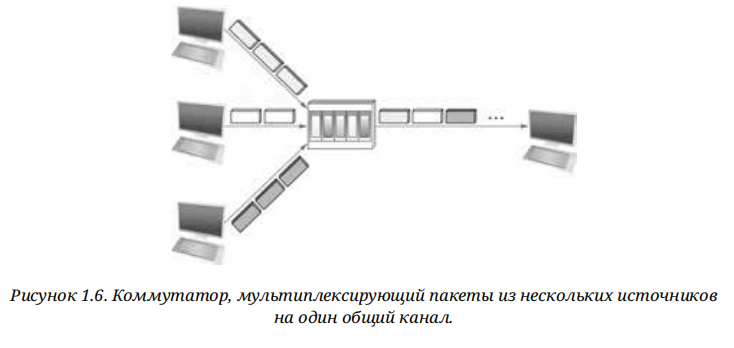

**Рис. 1.6** — Коммутатор, мультиплексирующий пакеты из нескольких источников на один общий канал.

Иными словами, <mark>каждый поток отправляет последовательность пакетов через физический канал, и на каждом этапе принимается решение, какой пакет следует отправить дальше. Заметьте, что если только у одного потока есть данные для отправки, то он может отправлять последовательность пакетов один за другим. Однако если более одного потока имеют данные для передачи, их пакеты чередуются на канале.</mark> На рис. 1.6 показано, как коммутатор мультиплексирует пакеты от нескольких источников на один общий канал.

<mark>Решение о том, какой пакет отправить следующим по общему каналу, может приниматься различными способами.</mark> Например, в сети, состоящей из коммутаторов, соединённых линиями связи, как на рис. 1.5, решение принимается коммутатором, передающим пакеты по общему каналу. (Как мы увидим позже, не во всех сетях с коммутацией пакетов используются коммутаторы, и они могут использовать другие механизмы для определения того, чей пакет попадёт на линию связи следующим.) Каждый коммутатор в сети с коммутацией пакетов принимает это решение независимо, на основе каждого пакета. Один из вопросов, который встаёт перед проектировщиком сети — как сделать так, чтобы это решение было справедливым. Например, коммутатор может быть спроектирован таким образом, чтобы обслуживать пакеты по принципу **«первый пришёл — первый ушёл» (FIFO)**. Другой подход заключается в передаче пакетов от каждого из различных потоков, которые в настоящее время отправляют данные через коммутатор, по принципу **круговой выборки**. Это может быть сделано для того, чтобы определённые потоки получали определённую долю пропускной способности канала или чтобы их пакеты не задерживались в коммутаторе дольше определённого времени. Иногда говорят, что сеть, которая пытается распределить полосу пропускания между определёнными потоками, поддерживает **качество обслуживания (QoS)**.

> **FIFO (first-in, first-out)** — дисциплина обслуживания, при которой пакеты обрабатываются в порядке поступления.
>
> **Круговая выборка (round-robin)** — дисциплина обслуживания, при которой пакеты от разных потоков передаются поочерёдно.
>
> **QoS (Quality of Service)** — <mark>набор механизмов, обеспечивающих заданные характеристики обслуживания (пропускную способность, задержку, потери) для отдельных потоков.</mark>

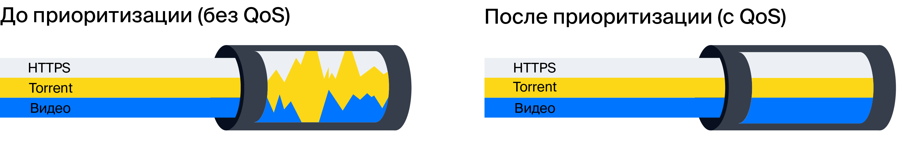

<mark>Также обратите внимание на рис. 1.6, что, поскольку коммутатору приходится мультиплексировать три входящих потока пакетов на один исходящий канал, существует вероятность того, что коммутатор будет получать пакеты быстрее, чем может вместить общий канал. В этом случае коммутатор вынужден буферизировать эти пакеты в своей памяти.</mark> Если коммутатор получает пакеты быстрее, чем может отправить их в течение длительного периода времени, то в конце концов у него закончится буферное пространство, и некоторые пакеты придётся отбросить. Когда коммутатор работает в таком состоянии, говорят, что он **перегружен**.

> **Перегрузка (congestion)** — <mark>состояние, при котором узел получает пакеты быстрее, чем может их передать, что приводит к исчерпанию буферов и отбрасыванию пакетов.</mark>

#### Основные выводы

> В заключение следует сказать, что статистическое мультиплексирование определяет экономически эффективный способ для множества пользователей (например, использование потоков данных между хостами) совместно использовать ресурсы сети (каналы и узлы) с тонкой настройкой. Оно использует пакет как минимальную единицу для выделения каналов сети различным потокам, позволяя каждому коммутатору распределять использование физических каналов на основе пакетов. <mark>Справедливое распределение пропускной способности каналов между разными потоками и управление перегрузкой при её возникновении являются основными задачами статистического мультиплексирования.</mark>

---

### Глава 1.2.4. Поддержка общих служб

Ранее мы сосредоточились на вызовах, связанных с обеспечением экономически выгодного подключения группы хостов, но <mark>рассматривать компьютерную сеть как доставку пакетов между несколькими компьютерами было бы слишком просто.</mark> Если быть более точным, <mark>сеть стоит рассматривать как средство для взаимодействия набора прикладных процессов, распределённых по этим компьютерам.</mark> Другими словами, <mark>следующим требованием компьютерной сети является предоставление возможности для прикладных программ, запущенных на подключённых к сети хостах, взаимодействовать между собой в значимом смысле.</mark> С точки зрения разработчика приложений сеть должна упростить его жизнь.

Когда двум прикладным программам нужно взаимодействовать друг с другом, должно происходить много сложных вещей, кроме простой отправки сообщения с одного хоста на другой. Один из вариантов заключается в том, чтобы разработчики приложений встроили всю эту сложную функциональность в каждую программу. Однако поскольку многие приложения требуют общих сервисов, гораздо логичнее реализовать эти общие сервисы один раз и затем позволить разработчику приложений строить приложение, используя эти сервисы.<mark> Задача для дизайнера сети заключается в определении правильного набора общих сервисов. Цель состоит в том, чтобы скрыть сложность сети от приложения, не ограничивая разработчика приложений.</mark>

Интуитивно <mark>мы рассматриваем сеть как **логические каналы**, по которым процессы на уровне приложений могут взаимодействовать друг с другом; каждый канал предоставляет набор услуг, необходимых данному приложению.</mark> Другими словами, подобно тому, как мы используем облако для абстрактного представления связи между множеством компьютеров, <mark>мы теперь думаем о канале как о соединении одного процесса с другим.</mark> <mark>На рисунке 1.7 показана пара процессов на уровне приложений, общающихся по логическому каналу, который, в свою очередь, реализован поверх облака, соединяющего набор хостов.</mark> Мы можем представить канал как трубу, соединяющую два приложения, так что приложение-отправитель может поместить данные в один конец и ожидать, что они будут доставлены по сети приложению, находящемуся на другом конце трубы.

> **Логический канал (logical channel)** — <mark>абстрактное соединение между двумя прикладными процессами, предоставляющее набор услуг (доставка, порядок, конфиденциальность и т.д.) поверх физической сети.</mark>

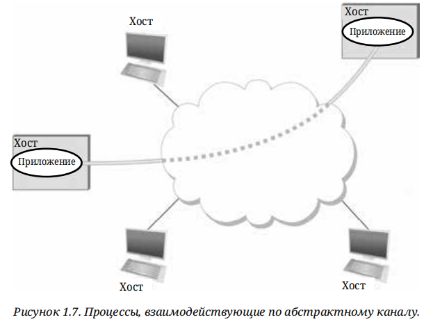

**Рис. 1.7** — Процессы, взаимодействующие по абстрактному каналу.

<mark>Как и любая абстракция, логические каналы «процесса-к-процессу» реализуются поверх коллекции физических «хост-к-хосту» каналов.</mark> Это является основой **слоистости**, краеугольным камнем сетевых архитектур, которые обсуждаются в следующей главе.

> **Слоистость (layering)** — <mark>принцип организации сетевых архитектур, при котором функциональность разбивается на иерархические уровни, каждый из которых предоставляет услуги вышележащему и использует услуги нижележащего.</mark>

<mark>Основная задача здесь — определить, какую функциональность должны предоставлять каналы приложениям. Например, нужно ли приложению гарантировать, что сообщения, отправленные по каналу, будут доставлены, или допустимо, если некоторые сообщения не придут?</mark> Необходимо ли, чтобы сообщения приходили к процессу-получателю в том же порядке, в котором они были отправлены, или получатель не заботится о порядке, в котором приходят сообщения? Нужно ли сети обеспечивать защиту от прослушивания канала третьими лицами или конфиденциальность не представляет интереса? <mark>В общем случае сеть предоставляет различные типы каналов, и каждое приложение выбирает тип, который лучше всего соответствует его потребностям.</mark> В остальной части этой главы иллюстрируется подход к определению полезных каналов.

#### Определение общих шаблонов коммуникации

<mark>Проектирование абстрактных каналов начинается с понимания потребностей в коммуникации представительной коллекции приложений, затем извлечения их общих требований к коммуникации и, наконец, включения функциональности, которая удовлетворяет эти требования в сети.</mark>

Одним из первых приложений, поддерживаемых в любой сети, является программа доступа к файлам, такая как **Протокол передачи файлов (File Transfer Protocol, FTP)** или **Сетевая файловая система (Network File System, NFS)**. Хотя многие детали могут отличаться, например, передаются ли по сети полные файлы или только отдельные блоки файла для чтения/записи в данный момент, коммуникационная составляющая удалённого доступа к файлам характеризуется парой процессов: один запрашивает чтение или запись файла, а второй процесс выполняет этот запрос. Хост, запрашивающий доступ к файлу, называется **клиентом**, а хост, обеспечивающий доступ к файлу, называется **сервером**.

> **FTP (File Transfer Protocol)** — <mark>протокол прикладного уровня для передачи файлов между клиентом и сервером.</mark>
>
> **NFS (Network File System)** — <mark>протокол распределённой файловой системы, позволяющий клиентам обращаться к файлам на удалённом сервере как к локальным.</mark>
>
> **Клиент (client)** — процесс (хост), запрашивающий услугу или ресурс у другого процесса (хоста).
>
> **Сервер (server)** — процесс (хост), предоставляющий услугу или ресурс по запросу клиента.

Чтение файла включает отправку клиентом небольшого запроса на сервер и ответ сервера большим сообщением, содержащим данные файла. Запись работает наоборот: клиент отправляет серверу большое сообщение с данными для записи на диск, и сервер отвечает небольшим сообщением, подтверждающим, что запись на диск выполнена.

Цифровая библиотека является более сложным приложением по сравнению с приложением по передаче файлов, но она требует аналогичных коммуникационных услуг. Например, **Ассоциация вычислительной техники (Association for Computing Machinery, ACM)** управляет крупной цифровой библиотекой литературы по компьютерным наукам на сайте по адресу:

```
http://portal.acm.org/dl.cfm
```

Эта библиотека имеет широкий спектр функций поиска и просмотра, чтобы помочь пользователям найти статьи, которые они ищут, но в конечном итоге большая часть её работы заключается в ответе на запросы пользователей на получение файлов, таких как электронные копии журнальных статей.

Используя доступ к файлам, цифровую библиотеку и два видеоприложения, описанные во введении (видеоконференции и «видео по требованию») <mark>в качестве представительного образца, мы можем предоставить следующие два типа каналов: **каналы «запрос/ответ»** и **каналы потоковых сообщений**.</mark> Канал «запрос/ответ» будет использоваться для приложений передачи файлов и цифровой библиотеки. Он будет гарантировать, что каждое сообщение, отправленное одной стороной, будет получено другой стороной и что будет доставлена только одна копия каждого сообщения. Канал «запрос/ответ» также может защищать конфиденциальность и целостность данных, передаваемых между клиентскими и серверными процессами, чтобы неавторизованные стороны не могли читать или изменять данные.

> **Канал «запрос/ответ» (request/reply channel)** — <mark>логический канал, гарантирующий доставку каждого сообщения ровно один раз и, опционально, конфиденциальность и целостность данных.</mark>
>
> **Канал потоковых сообщений (stream channel)** — <mark>логический канал для передачи потоковых аудио/видеоданных, поддерживающий одно- и двусторонний трафик, гарантирующий порядок доставленных сообщений, но не обязательно их полную доставку</mark>.

... <mark>Наконец, каналу потоковых сообщений может потребоваться поддержка **многоадресной передачи данных**, чтобы несколько сторон могли участвовать в телеконференции или просмотре видео.</mark>

> **Многоадресная передача (multicast)** — <mark>передача сообщения от одного источника группе узлов-получателей.</mark>

<mark>Хотя для проектировщика сети типично стремление к наименьшему числу абстрактных типов каналов, которые могут обслуживать наибольшее число приложений, есть опасность в попытке обойтись слишком малым числом абстракций каналов.</mark> **Проще говоря, если у вас есть молоток, то всё выглядит как гвоздь.** Например, если у вас есть только каналы потока сообщений и запросов/ответов, то возникает соблазн использовать их для следующего приложения, даже если ни один из этих типов не обеспечивает именно ту семантику, которая нужна приложению. <mark>Таким образом, разработчики сетей, вероятно, будут изобретать новые типы каналов и добавлять опции к существующим каналам до тех пор, пока прикладные программисты будут изобретать новые приложения.</mark>

Также следует отметить, что независимо от того, какую функциональность предоставляет данный канал, возникает вопрос, <mark>где эта функциональность реализуется.: 
1. <mark>Во многих случаях проще всего рассматривать подключение от хоста к хосту в основной сети просто как передачу битов, с любой семантикой высокого уровня, предоставляемой на конечных хостах.</mark> <mark>Преимущество такого подхода заключается в том, что он **сохраняет коммутаторы в средней части сети как можно более простыми** (они просто пересылают пакеты)</mark>, 
 <mark>но **это требует от конечных хостов взять на себя значительную часть ответственности** за поддержку семантически богатых каналов между процессами.</mark> 
2. <mark>**Альтернативой является внедрение дополнительной функциональности в коммутаторы,** что позволяет конечным хостам быть «простыми» устройствами (например, телефонными аппаратами).</mark> Мы будем рассматривать вопрос о том, как различные сетевые сервисы распределяются между коммутаторами и конечными хостами, как постоянно появляющуюся проблему в сетевом проектировании.

#### Надёжная доставка сообщений

Как подразумевают рассмотренные выше примеры, <mark>надёжная доставка сообщений является одной из наиболее важных функций, которую может предоставить сеть.</mark> <mark>Однако сложно определить, как обеспечить эту надёжность, не понимая, как могут происходить ошибки в работе сети.</mark>: 
1. Во-первых, <mark>важно осознать, что компьютерные сети существуют не в идеальном мире.</mark> 
   2. Машины выходят из строя и перезагружаются, 
   3. волокна могут быть оборваны, 
   4. электрические помехи могут повредить биты в передаваемых данных, 
   5. коммутаторы могут исчерпать буферное пространство, а 
   6. программное обеспечение, управляющее аппаратным обеспечением, может содержать ошибки и иногда отправлять пакеты в никуда.
<mark>Таким образом, одним из основных требований к сети является восстановление от определённых видов отказов, чтобы приложения не занимались этими проблемами.</mark>

Существует <mark>**три основных класса отказов**, о которых должны беспокоиться проектировщики сетей.</mark>

**1. Битовые ошибки.** <mark>При передаче пакета по физическому каналу могут возникать битовые ошибки; то есть единица может превращаться в ноль или наоборот. Иногда ошибки касаются отдельных битов, но чаще всего возникают серийные ошибки — несколько последовательных битов повреждаются.</mark> Ошибки битов обычно возникают из-за внешних воздействий, таких как удары молнии, скачки напряжения и микроволновые печи, которые мешают передаче данных. Хорошая новость в том, что такие ошибки битов довольно редки и в среднем затрагивают лишь один из каждых $10^6$ до $10^7$ битов на обычном медном кабеле и один из каждых $10^{12}$ до $10^{14}$ битов на обычном оптоволоконном кабеле. <mark>Как мы увидим далее, существуют техники, которые с высокой вероятностью обнаружат эти ошибки битов.</mark> Обнаружив ошибку, иногда можно её исправить — если мы знаем, какой бит или биты повреждены, мы можем просто их поменять, — в других случаях повреждения настолько серьёзны, что необходимо отбросить весь пакет. В таком случае отправитель может быть вынужден повторно отправить пакет.

> **Битовая ошибка (bit error)** — <mark>повреждение одного или нескольких последовательных битов при передаче по физическому каналу.</mark>

**2. Потеря пакетов.** <mark>Второй класс отказов связан с пакетами, а не с отдельными битами; другими словами, сеть теряет полный пакет.</mark> Одной из причин такого отказа может быть наличие неисправимой ошибки бита в пакете, из-за чего его приходится отбросить. Однако <mark>более вероятной причиной является перегрузка одного из узлов,</mark> обрабатывающего пакет — например, коммутатора, пересылающего его с одной линии на другую — из-за чего у него нет места для хранения пакета, и он вынужден его отбросить. Это и есть проблема, о которой мы говорили ранее — проблема перегрузки. Реже встречается ситуация, когда программное обеспечение, работающее на одном из узлов, обрабатывающих пакет, допускает ошибку. <mark>Например, оно может неправильно переслать пакет по неправильной линии, и пакет, таким образом, никогда не достигнет своего конечного пункта назначения. Как мы увидим, одной из основных сложностей при работе с потерянными пакетами является различие между пакетом, который действительно потерян, и пакетом, который просто задерживается в пути к месту назначения.</mark>

**3. Отказы узлов и линков.** <mark>Третий класс отказов связан с уровнем узлов и линков. Другими словами, физическое соединение оборвано, или компьютер, к нему подключённый, вышел из строя.</mark> Это может произойти из-за сбоя программного обеспечения, отключения питания или неосмотрительных действий оператора экскаватора. Часто встречаются отказы из-за неправильной конфигурации устройства сети. Хотя все эти отказы в конечном итоге могут быть устранены, они могут оказать огромное влияние на сеть на продолжительное время. Тем не менее они не обязательно должны полностью парализовать сеть. Например, в пакетно-коммутируемой сети иногда можно обойти неисправный узел или связь. Одной из сложностей при работе с этим третьим классом отказов является различие между компьютером, который вышел из строя, и компьютером, который просто медленно работает, или, в случае со связью, между оборванной связью и связью, которая очень нестабильна и поэтому вводит высокое количество ошибок битов.

#### Основные выводы

> Основная идея, которую следует вынести из этого обсуждения, заключается в том, что определение полезных каналов включает как понимание требований приложений, так и осознание ограничений обычной технологии. Задача состоит в том, чтобы заполнить разрыв между тем, чего ожидает приложение, и тем, что может предоставить обычная технология. Этот разрыв иногда называют **семантическим разрывом**.

> **Семантический разрыв (semantic gap)** — <mark>несоответствие между услугами, которые ожидает приложение, и возможностями, которые может предоставить базовая сетевая технология.</mark>

---

### Глава 1.2.5. Управляемость

<mark>Последнее требование,</mark> которое, как кажется, часто игнорируется или оставляется на последний момент (как и в нашем случае), заключается в том, что <mark>сетью необходимо управлять.</mark>
<mark>**Управление сетью** включает обновление оборудования по мере роста сети для обработки большего трафика или подключения большего числа пользователей, устранение неполадок в сети, когда что-то идёт не так или производительность не соответствует ожиданиям, а также добавление новых функций для поддержки новых приложений.</mark> Исторически сложилось так, что управление сетью было трудоёмким процессом, и хотя вряд ли удастся полностью исключить участие людей, этот аспект всё чаще решается с помощью автоматизации и самовосстанавливающихся систем.

> **Управление сетью (network management)** — <mark>совокупность процессов обновления оборудования, устранения неполадок, добавления новых функций и обеспечения корректной работы сети.</mark>

Это требование частично связано с вопросом масштабируемости, обсуждавшимся ранее, — по мере того как Интернет масштабировался до поддержки миллиардов пользователей и по крайней мере сотен миллионов узлов, проблемы поддержания его корректной работы и правильной настройки новых устройств по мере их добавления становились всё более сложными. Настройка одного маршрутизатора в сети часто является задачей для квалифицированного специалиста; настройка тысяч маршрутизаторов и выяснение причин неправильного поведения такой крупной сети могут стать задачей, выходящей за рамки возможностей одного человека. Поэтому автоматизация становится столь важной.

<mark>Один из способов облегчить управление сетью — избегать изменений. Как только сеть начинает работать, её просто не стоит трогать. Такое мышление выявляет основное противоречие между **стабильностью** и **скоростью внедрения новых функций** (скорость, с которой новые возможности вводятся в сеть).</mark> Придерживание стабильности было подходом, который телекоммуникационная отрасль (не говоря уже об университетских системных администраторах и корпоративных ИТ-отделах) применяла на протяжении многих лет, делая её одной из самых медлительных и избегающих рисков отраслей. Но <mark>недавний взрыв облачных технологий изменил эту динамику, сделав необходимым приведение стабильности и скорости внедрения функций в более сбалансированное состояние.</mark> Влияние облачных технологий на сеть является темой, которая поднимается снова и снова на протяжении всей книги и которой мы уделяем особое внимание в подразделе «Перспектива» после каждого раздела. На данный момент достаточно сказать, что управление быстро развивающейся сетью является центральной задачей в сетевых технологиях сегодня.

> **Стабильность (stability)** — <mark>свойство сети сохранять работоспособность и предсказуемое поведение при изменениях.</mark>
>
> **Скорость внедрения новых функций (feature velocity)** — <mark>скорость, с которой новые возможности и технологии вводятся в сеть.</mark>

## Глава 1.3. Архитектура

Предыдущая глава установила значительный набор требований к проектированию сети: <mark>компьютерная сеть должна обеспечивать общую, экономически эффективную, справедливую и надёжную связь между большим числом компьютеров. Сети не остаются неизменными — они должны эволюционировать с учётом изменений как в базовых технологиях, так и в требованиях приложений. Кроме того, сети должны быть управляемыми людьми с разным уровнем навыков. Проектирование сети, отвечающей этим требованиям, — непростая задача.</mark>

<mark>Чтобы справиться с этой сложностью, разработчики сетей создали общие схемы, называемые **сетевыми архитектурами**, которые направляют проектирование и внедрение сетей.</mark>

> **Сетевая архитектура (network architecture)** — <mark>набор правил, регулирующих форму и содержание графа протоколов, а также распределение функциональности по уровням.</mark>

В этой главе вводятся основные идеи, общие для всех сетевых архитектур, и <mark>рассматриваются две наиболее известные: OSI (7-уровневая) и Интернет-архитектура.</mark>

---

### Глава 1.3.1. Многослойность и протоколы

> **Абстракция (abstraction)** — <mark>сокрытие деталей реализации за чётко определённым интерфейсом.</mark>

<mark>Абстракция — фундаментальный инструмент управления сложными системами. Идея в том, чтобы определить модель, захватывающую важный аспект системы, инкапсулировать её в объекте с интерфейсом для других компонентов и скрыть детали реализации.</mark> Именно это мы делали, вводя идею канала: абстракция для приложений, скрывающая сложность сети.

<mark>Абстракции естественно приводят к **уровням**. Вы начинаете с услуг базового оборудования, затем добавляете последовательность уровней, каждый из которых предоставляет более высокий (более абстрактный) уровень услуг.</mark> Услуги высоких уровней реализуются через услуги низких. <mark>На рис. 1.8 показана простая сеть с двумя уровнями абстракции между приложением и оборудованием: уровень над оборудованием обеспечивает подключение между хостами (абстрагируя сложную топологию), а следующий уровень предоставляет каналы «процесс-процесс» (абстрагируя, например, потерю сообщений).</mark>

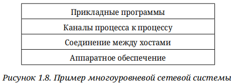

**Рис. 1.8** — Пример многоуровневой сетевой системы.

<mark>Многослойность даёт две полезные функции:</mark>
- **Декомпозиция** — <mark>задача построения сети разбивается на меньшие компоненты.</mark>
- **Модульность** — <mark>новая услуга требует изменения функциональности только на одном уровне.</mark>

Представление системы как линейной последовательности уровней — упрощение. <mark>На каждом уровне может быть множество абстракций с разными услугами, построенных на одних и тех же низкоуровневых абстракциях.</mark> Например, два типа каналов из предыдущей главы — «запрос/ответ» и потоковой передачи — могут быть альтернативными предложениями на одном уровне (рис. 1.9).

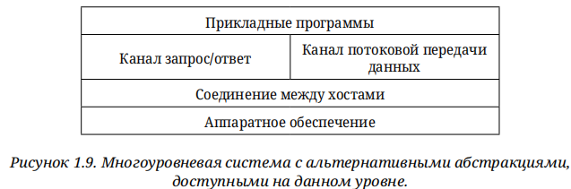

**Рис. 1.9** — Многоуровневая система с альтернативными абстракциями на данном уровне.

> **Протокол (protocol)** — <mark>абстрактный объект, составляющий уровень сетевой системы и предоставляющий услугу связи объектам более высокого уровня.</mark>

<mark>Каждый протокол определяет два интерфейса:<mark>
- **Сервисный интерфейс** — <mark>для локальных объектов, желающих использовать его коммуникационные услуги (операции, которые они могут выполнять).</mark>
- **Пиринговый (одноранговый) интерфейс** — <mark>для аналога протокола на другой машине (форма и значение обмениваемых сообщений).</mark>

> **Пиринговый интерфейс (peer interface)** — интерфейс протокола для взаимодействия с его аналогом на другой машине.


Например, HTTP поддерживает операцию получения HTML-страницы с удалённого сервера (сервисный интерфейс), а его спецификация описывает формат команды GET и ответа сервера (пиринговый интерфейс). Ситуация иллюстрируется на рис. 1.10.

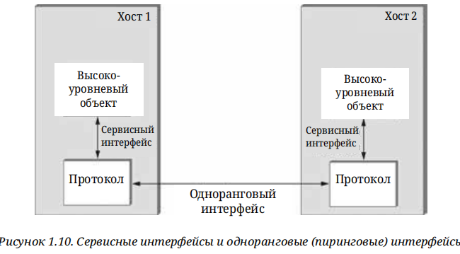

**Рис. 1.10** — Сервисные интерфейсы и одноранговые (пиринговые) интерфейсы.

<mark>За исключением аппаратного уровня, пиринговое общение косвенно: каждый протокол общается с аналогом, передавая сообщения протоколу более низкого уровня. Набор протоколов образует **граф протоколов**: узлы — протоколы, рёбра — отношения зависимости.</mark> На рис. 1.11 показан граф для гипотетической системы: RRP (Request/Reply Protocol) и MSP (Message Stream Protocol) реализуют два типа каналов «процесс-процесс» и оба зависят от HHP (Host-to-Host Protocol), предоставляющего соединение «хост-хост».

> **RRP (Request/Reply Protocol)** — <mark>протокол, реализующий канал «запрос/ответ».</mark>
>
> **MSP (Message Stream Protocol)** — <mark>протокол, реализующий канал потоковой передачи сообщений.</mark>
>
> **HHP (Host-to-Host Protocol)** — <mark>протокол, предоставляющий услугу соединения между хостами.</mark>

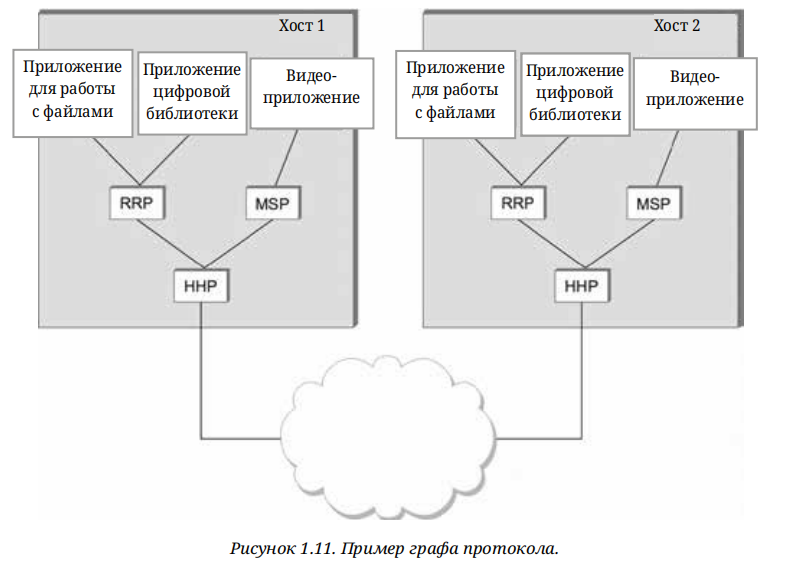

**Рис. 1.11** — Пример графа протокола.

<mark>Если приложение на хосте 1 хочет отправить сообщение аналогу на хосте 2 через RRP, оно просит RRP отправить сообщение от его имени. RRP вызывает услуги HHP, который передаёт сообщение своему аналогу. На хосте 2 HHP передаёт сообщение вверх к RRP, который доставляет его приложению. Говорят, что приложение использует **стек протоколов** RRP/HHP.</mark>

> **Стек протоколов (protocol stack)** — <mark>упорядоченный набор протоколов, используемых приложением для связи.</mark>

Термин «протокол» используется в двух значениях: иногда — абстрактные интерфейсы, иногда — модуль, реализующий их. Для различения первые называют **спецификацией протокола**.

> **Спецификация протокола (protocol specification)** — <mark>формальное описание интерфейсов протокола (псевдокод, диаграммы состояний, форматы пакетов).</mark>

Данный <mark>протокол может быть реализован разными способами при условии соблюдения спецификации.</mark> Считается, что два и более модуля, точно реализующих спецификацию, **взаимодействуют** друг с другом.

<mark>Стандартизирующие организации — **IETF** (Internet Engineering Task Force) и **ISO** (International Standards Organization) — устанавливают правила для конкретного графа протоколов.</mark>

> **IETF (Internet Engineering Task Force)** — организация, разрабатывающая и продвигающая стандарты Интернета.
>
> **ISO (International Standards Organization)** — международная организация по стандартизации.

---

## Глава 1.3.2. Инкапсуляция

Когда приложение отправляет сообщение через RRP, для RRP это неинтерпретированная строка байтов. RRP отвечает за отправку их партнёру, но должно передать управляющую информацию, как обрабатывать сообщение при получении. Для этого RRP прикрепляет **заголовок**.

> **Заголовок (header)** — <mark>небольшая структура данных (от нескольких байтов до десятков байтов), прикрепляемая к началу сообщения для обмена информацией между партнёрами.</mark>

<mark>Иногда информация для пиринговой сети отправляется в конце сообщения — тогда она называется **трейлером**. Остальная часть сообщения — данные приложения — называется **телом сообщения** или **полезной нагрузкой**. Говорят, что данные приложения **инкапсулированы** в новом сообщении, созданном RRP.</mark>

> **Инкапсуляция (encapsulation)** — <mark>включение сообщения вышележащего уровня в тело сообщения нижележащего уровня с добавлением заголовка.</mark>
>
> **Полезная нагрузка (payload)** — <mark>данные приложения, передаваемые от его имени.</mark>

<mark>Процесс повторяется на каждом уровне: HHP инкапсулирует сообщение RRP, прикрепляя свой заголовок. На конечном хосте обработка идёт в обратном порядке: HHP интерпретирует свой заголовок и передаёт тело вверх к RRP,</mark> который выполняет действия по заголовку RRP и передаёт тело приложению. Приложение на хосте 2 получает точно то же сообщение, что передало RRP на хосте 1, не видя заголовков нижних уровней. Процесс иллюстрируется на рис. 1.12. Узлы в сети (коммутаторы, маршрутизаторы) могут проверять заголовок HHP.

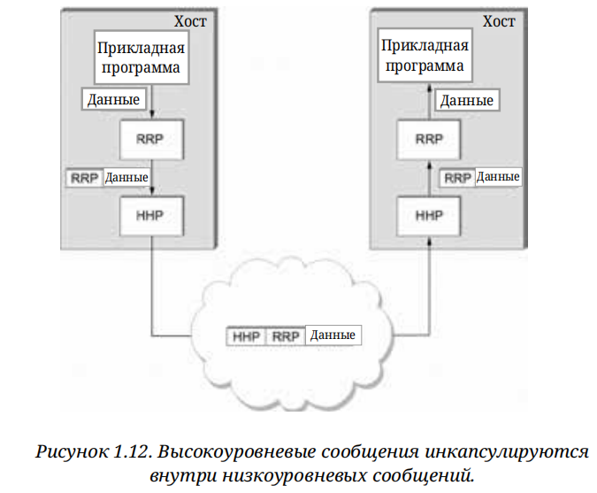

**Рис. 1.12** — Высокоуровневые сообщения инкапсулируются внутри низкоуровневых сообщений.

Когда говорят, что <mark>низкоуровневый протокол не интерпретирует сообщение, имеется в виду, что он не извлекает смысл из данных. Однако иногда он применяет простое преобразование — сжатие или шифрование, — преобразуя всё тело сообщения, включая данные приложения и заголовки верхних уровней.</mark>

---

## Глава 1.3.3. Мультиплексирование и демультиплексирование

<mark>Фундаментальная идея коммутации пакетов — мультиплексирование множества потоков через одну физическую связь — применяется ко всему протокольному графу. На рис. 1.11 RRP можно рассматривать как реализацию логического канала, по которому сообщения от двух приложений мультиплексируются на исходном хосте и демультиплексируются на конечном.</mark>


<mark>Практически заголовок RRP содержит идентификатор, фиксирующий, какому приложению принадлежит сообщение, — **ключ демультиплексирования** (демукс-ключ). На исходном хосте RRP включает ключ в заголовок; на конечном — снимает заголовок, проверяет ключ и демультиплексирует сообщение к правильному приложению.</mark>

> **Ключ демультиплексирования (demux key)** — идентификатор в заголовке протокола, указывающий, какому приложению или протоколу верхнего уровня принадлежит сообщение.

Почти каждый протокол реализует этот механизм. HHP имеет свой демукс-ключ, определяющий, какие сообщения передавать к RRP, а какие — к MSP. Единого соглашения о формате ключа нет: некоторые протоколы используют 8-битное поле (до 256 протоколов верхнего уровня), другие — 16- или 32-битные. Некоторые имеют одно поле демультиплексирования (один ключ с обеих сторон), другие — два (каждая сторона использует разные ключи).

<details><summary>Пояснение</summary>

## Два разных мультиплексирования

**1. Мультиплексирование канала (физическое/линейное).**
Это когда несколько сигналов делят **один физический канал**: частотное (FM-радио: разные станции на разных частотах), временное (TDM: каждый говорит в свой временной слот), волновое (WDM в оптике — разные длины волн в одном волокне). Здесь вопрос: «как несколько потоков уместить в одну трубу?»

**2. Мультиплексирование приложений (логическое, на уровне протоколов).**
Это то, о чём текст. Здесь **канал уже есть**, и по нему одновременно шлют данные **много приложений/протоколов**. Задача обратная: не «уместить в трубу», а **разложить** приходящий поток по адресатам. Отсюда и пара терминов:

- **Мультиплексирование** (на отправляющей стороне) — собрать данные от разных приложений в один поток, пометив каждое сообщение ключом.
- **Демультиплексирование** (на принимающей стороне) — по ключу раздать сообщения обратно по приложениям.

Ключ (демукс-ключ) — это и есть метка, по которой происходит раздача. В TCP/IP это, например, номера портов: браузер, мессенджер и игра шлют через один сетевой интерфейс, а порты говорят, чьи это данные.

</details>

---

## Глава 1.3.4. 7-уровневая модель OSI

ISO одной из первых формально определила общий способ подключения компьютеров. Их архитектура **OSI** (Open Systems Interconnection) определяет разделение сетевой функциональности на семь уровней, где один или несколько протоколов реализуют функциональность уровня. Это не граф протоколов как таковой, а **эталонная модель** для графа протоколов. <mark>Сегодня нет сети, основанной на OSI, но её терминология широко используется.</mark>

> **OSI (Open Systems Interconnection)** — <mark>эталонная 7-уровневая модель сетевой архитектуры, определяющая разделение сетевой функциональности по уровням.</mark>

Уровни OSI (снизу вверх):

1. **Физический уровень** — <mark>передача сырых битов по коммуникационной линии.</mark>
2. **Канальный уровень** — <mark>сборка потока битов в **кадры**; реализуется сетевыми адаптерами и драйверами.</mark>
3. **Сетевой уровень** — <mark>маршрутизация между узлами в сети с коммутацией пакетов; единица данных — **пакет**.</mark>
4. **Транспортный уровень** — <mark>реализует канал «процесс-процесс»; единица данных — **сообщение**.</mark>
5. **Сеансовый уровень** — <mark>пространство имён для объединения транспортных потоков одного приложения (например, аудио и видео в видеоконференции).</mark>
6. **Уровень представления** — <mark>формат данных (разрядность целых чисел, порядок байтов, формат видеопотока).</mark>
7. **Прикладной уровень** — <mark>протоколы приложений (HTTP и др.).

> **Кадр (frame)** — единица данных канального уровня, собираемая из потока битов.
>
> **Пакет (packet)** — единица данных сетевого уровня, обмениваемая между узлами.

<mark>Нижние три уровня реализуются на всех сетевых узлах, включая коммутаторы и хосты.</mark> Транспортный уровень и выше работают только на конечных хостах.

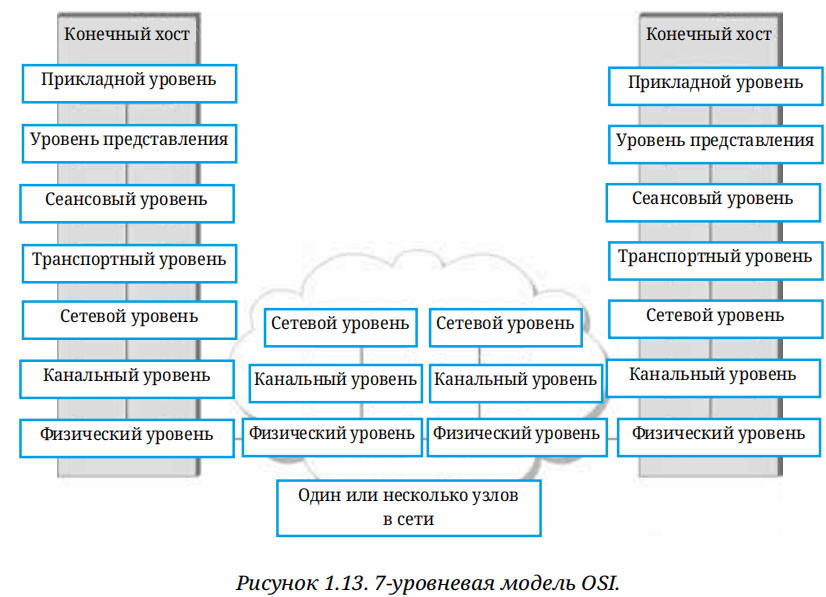

**Рис. 1.13** — 7-уровневая модель OSI.

---

## Глава 1.3.5. Архитектура Интернета

Архитектура Интернета (архитектура TCP/IP) показана на рис. 1.14, альтернативное представление — на рис. 1.15. Она эволюционировала благодаря опыту работы над сетью **ARPANET**, финансировавшейся **ARPA** (Агентство перспективных исследовательских проектов Министерства обороны США). Интернет и ARPANET существовали до OSI и повлияли на её эталонную модель.

> **ARPANET** — <mark>ранняя сеть с коммутацией пакетов, предшественник Интернета.</mark>
>
> **ARPA (Advanced Research Projects Agency)** — агентство Министерства обороны США, финансировавшее исследования, приведшие к созданию ARPANET и Интернета.

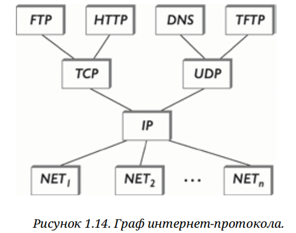

**Рис. 1.14** — Граф интернет-протокола.

Вместо 7-уровневой модели OSI для Интернета часто используется более простая стековая модель:

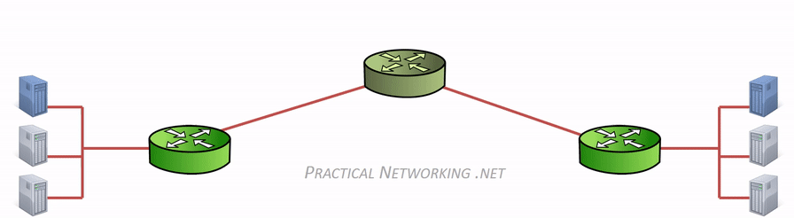

- **Нижний уровень** — множество сетевых протоколов (NET1, NET2, …), реализуемых комбинацией аппаратного и программного обеспечения (Ethernet, Wi-Fi 802.11).
- **IP (Internet Protocol)** — единственный протокол, поддерживающий взаимосвязь множества сетевых технологий в одну логическую интерсеть.
- **TCP и UDP** — два основных транспортных протокола, предоставляющих альтернативные логические каналы: TCP — надёжный байтовый поток, UDP — ненадёжная доставка дейтаграмм. Их также называют **сквозными протоколами**.
- **Прикладные протоколы** — HTTP, FTP, Telnet, SMTP и др.

> **IP (Internet Protocol)** — протокол сетевого уровня, обеспечивающий взаимосвязь множества сетей в единую интерсеть.
>
> **TCP (Transmission Control Protocol)** — транспортный протокол, обеспечивающий надёжную доставку байтового потока.
>
> **UDP (User Datagram Protocol)** — транспортный протокол, обеспечивающий ненадёжную доставку дейтаграмм.
>
> **Дейтаграмма (datagram)** — синоним сообщения в контексте UDP.

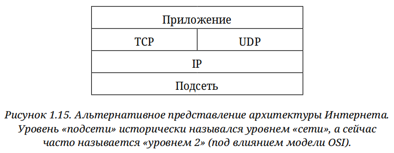

**Рис. 1.15** — Альтернативное представление архитектуры Интернета. Уровень «подсети» исторически назывался уровнем «сети», а сейчас часто называется «уровнем 2» (под влиянием OSI).

Разница между протоколом уровня приложения и самим приложением: множество браузеров (Firefox, Chrome, Safari, Netscape, Mosaic, Internet Explorer) и веб-серверов работают с одним сайтом, потому что все соответствуют одному протоколу — HTTP. Путаница возникает, когда один термин применяется и к приложению, и к протоколу (например, FTP).

Соответствие уровней: прикладной уровень Интернета — 7-й уровень OSI, транспортный — 4-й, IP — 3-й, каналы/подсети ниже IP — 2-й.

### IETF и стандартизация

IETF — основной орган стандартизации, ответственный за архитектуру Интернета и спецификации многих протоколов (TCP, UDP, IP, DNS, BGP). Архитектура также включает протоколы других организаций: Ethernet и Wi-Fi IEEE 802.11, веб-спецификации HTTP/HTML W3C, стандарты 4G/5G 3GPP, стандарты кодирования видео ITU-T.

> **IANA (Internet Assigned Numbers Authority)** — организация, отвечающая за выдачу уникальных идентификаторов, необходимых для работы протоколов; департамент ICANN.
>
> **ICANN (Internet Corporation for Assigned Names and Numbers)** — некоммерческая организация, отвечающая за общее руководство Интернетом.

### Три особенности архитектуры Интернета

1. **Отсутствие строгого разделения по уровням.** Приложение может обходить транспортные уровни и напрямую использовать IP или базовую сеть; программисты свободно определяют новые абстракции каналов поверх любых существующих протоколов.
2. **Форма песочных часов** (рис. 1.14): широкая вверху, узкая посередине, снова широкая внизу. IP — центральная точка архитектуры, определяющая общий метод обмена пакетами среди множества сетей. Выше IP — бесконечное количество транспортных протоколов; ниже — бесконечное множество сетевых технологий. Вопрос доставки «хост-хост» полностью отделён от предоставления сервиса «процесс-процесс».
3. **Требование рабочих реализаций.** Для включения нового протокола в архитектуру нужны спецификация и по крайней мере одна (предпочтительно две) представительных реализации. Это гарантирует эффективную реализуемость протоколов.

Ценность, которую интернет-культура придаёт рабочему программному обеспечению, выражена цитатой на футболках встреч IETF:

> «Мы отвергаем королей, президентов и голосования. Мы верим в грубый консенсус и работающий код.»  
> — Дэвид Кларк

### Основные выводы

> Из трёх атрибутов архитектуры Интернета философия дизайна песочных часов достаточно важна, чтобы повторить её ещё раз. Узкая талия песочных часов представляет собой минимальный и тщательно отобранный набор глобальных возможностей, который позволяет сосуществовать, обмениваться возможностями и быстро развиваться как приложениям более высокого уровня, так и коммуникационным технологиям более низкого уровня. Модель с узкой талией имеет решающее значение для способности Интернета адаптироваться к новым требованиям пользователей и меняющимся технологиям.

---

## FAQ

**Вопрос: Что такое сетевая архитектура?**  
Ответ: Набор правил, регулирующих форму и содержание графа протоколов, а также распределение функциональности по уровням. Примеры: OSI и архитектура Интернета (TCP/IP).

**Вопрос: Зачем нужна многослойность?**  
Ответ: Она разбивает задачу построения сети на меньшие компоненты (декомпозиция) и обеспечивает модульность: новая услуга требует изменения только одного уровня.

**Вопрос: Чем сервисный интерфейс протокола отличается от пирингового?**  
Ответ: Сервисный интерфейс определяет операции, доступные локальным объектам (например, приложению). Пиринговый интерфейс определяет форму и значение сообщений, обмениваемых с аналогом протокола на другой машине.

**Вопрос: Что такое инкапсуляция?**  
Ответ: Включение сообщения вышележащего уровня в тело сообщения нижележащего уровня с добавлением заголовка. При приёме обработка идёт в обратном порядке, и приложение получает исходное сообщение без заголовков нижних уровней.

**Вопрос: Что такое ключ демультиплексирования?**  
Ответ: Идентификатор в заголовке протокола, указывающий, какому приложению или протоколу верхнего уровня принадлежит сообщение. Используется для демультиплексирования на конечном хосте.

**Вопрос: Чем модель OSI отличается от архитектуры Интернета?**  
Ответ: OSI — эталонная 7-уровневая модель, не реализованная как реальная сеть, но давшая широко используемую терминологию. Архитектура Интернета — более простая стековая модель (сеть/IP/TCP-UDP/приложения), реализованная в реальном Интернете.

**Вопрос: Что означает «форма песочных часов» в архитектуре Интернета?**  
Ответ: IP — узкая талия: минимальный набор глобальных возможностей, позволяющий сосуществовать множеству транспортных протоколов выше и множеству сетевых технологий ниже. Это ключ к адаптируемости Интернета.

**Вопрос: Что такое сквозные протоколы?**  
Ответ: TCP и UDP — транспортные протоколы, работающие на конечных хостах и обеспечивающие логические каналы «процесс-процесс» поверх IP.

**Вопрос: Что такое компьютерная сеть и чем она отличается от телефонной сети?**  
Ответ: <mark>Компьютерная сеть — это сеть из программируемого оборудования общего назначения, передающая множество типов данных и поддерживающая широкий спектр приложений. Телефонная сеть специализирована для передачи голоса и использует устройства специального назначения.</mark>

**Вопрос: Что такое масштабируемость сети?**  
Ответ: <mark>Масштабируемость — свойство системы сохранять работоспособность и эффективность при увеличении количества узлов, пользователей и трафика до произвольно больших значений.</mark> Интернет — пример масштабируемой сети.

**Вопрос: Чем коммутация пакетов отличается от коммутации каналов?**  
Ответ: <mark>При коммутации каналов сначала устанавливается выделенный канал через последовательность соединений, и данные передаются потоком битов. При коммутации пакетов данные передаются дискретными блоками (пакетами) по стратегии «хранение и пересылка» без предварительного выделения канала.</mark> Коммутация пакетов эффективнее для компьютерных сетей.

**Вопрос: Что такое статистическое мультиплексирование и почему оно эффективно?**  
Ответ: <mark>Статистическое мультиплексирование — метод разделения канала, при котором данные каждого потока передаются по требованию (по мере поступления), а не в фиксированные интервалы. Эффективность достигается за счёт избегания простоя канала, когда у потока нет данных для передачи.</mark>

**Вопрос: Какие три класса отказов должны учитывать проектировщики сетей?**  
Ответ: <mark>(1) Битовые ошибки — повреждение битов при передаче по физическому каналу; (2) потеря пакетов — отбрасывание полного пакета из-за перегрузки или ошибок; (3) отказы узлов и линков — обрыв соединения или выход из строя компьютера.</mark>

**Вопрос: Что такое семантический разрыв?**  
Ответ: Семантический разрыв — несоответствие между услугами, которые ожидает приложение, и возможностями, которые может предоставить базовая сетевая технология. Задача проектировщика — заполнить этот разрыв.

**Вопрос: Что такое QoS и зачем он нужен?**  
Ответ: QoS (Quality of Service) — <mark>набор механизмов, обеспечивающих заданные характеристики обслуживания (пропускную способность, задержку, потери) для отдельных потоков. QoS нужен, когда сеть должна справедливо распределять пропускную способность между потоками или гарантировать задержку для интерактивных приложений.</mark>

**Вопрос: Какие два типа логических каналов выделяются для типичных приложений?**  
Ответ: Канал «запрос/ответ» (гарантирует доставку каждого сообщения ровно один раз, опционально — конфиденциальность и целостность) и канал потоковых сообщений (поддерживает одно- и двусторонний трафик, гарантирует порядок доставленных сообщений, но не обязательно полную доставку).