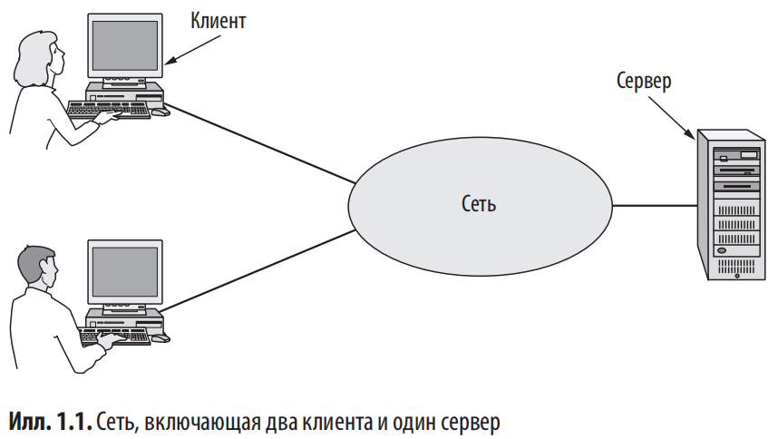
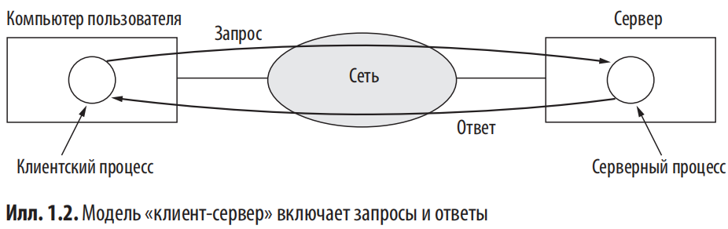
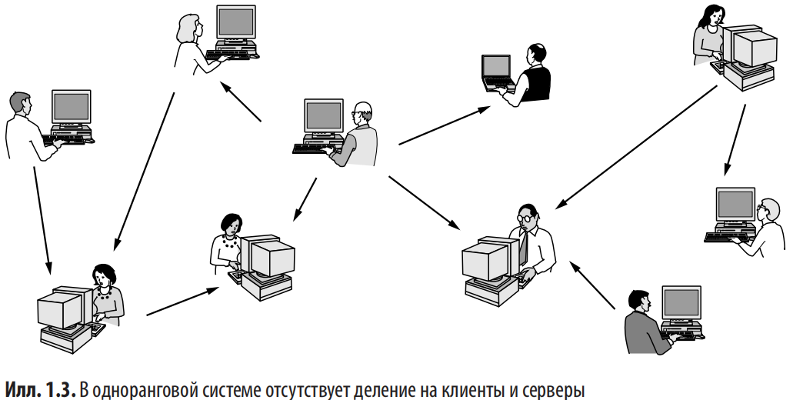
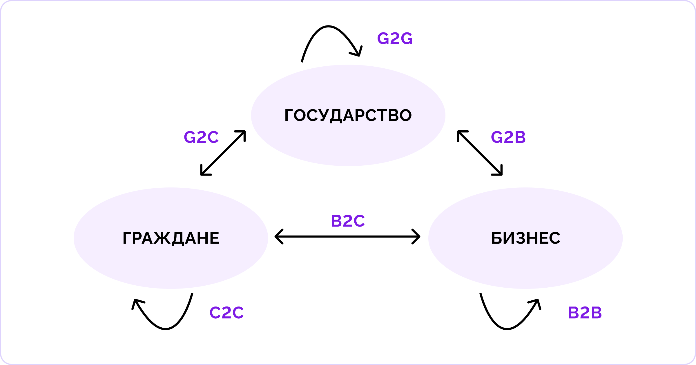

    
Кратко

**Глава 1 — кратко**

XX век — эра информации (телефон, радио, ТВ, компьютеры, интернет); в XXI веке отрасли сливаются. Компьютерная сеть — набор связанных автономных устройств, обменивающихся данными. Применения:

- **Доступ к информации:** браузеры, приложения, СМИ, персонализация; модель «клиент-сервер» (запрос — ответ) и одноранговая (пиринговая) связь (BitTorrent).
- **Общение:** почта, мессенджеры, аудио/видео, соцсети, вики.
- **Электронная коммерция:** покупки, финансы, аукционы (B2C, B2B, G2C, C2C, P2P).
- **Развлечения:** стриминг, IPTV, онлайн-игры, интерактивный контент.
- **Интернет вещей:** датчики, умный дом, счётчики — подключение всех устройств к сети.

# Глава 1. Введение

## 1.1. Контекст и цель книги

Прогресс стирает грань между сбором, передачей, хранением и обработкой информации. Корпорациям нужен доступ к данным любого представительства одним нажатием клавиши, а потребности в сложных технологиях растут быстрее возможностей их реализации.

> Компьютерная сеть (computer network) — <mark style="background-color:#C8E6C9;color:#1A1A1A;">набор взаимосвязанных автономных вычислительных устройств. </mark>  

> Взаимосвязанные компьютеры — <mark style="background-color:#C8E6C9;color:#1A1A1A;">компьютеры, способные обмениваться информацией. </mark> 

Среды передачи: медные провода, оптоволокно, радиоволны (микроволны, инфракрасное излучение, спутники). <mark style="background-color:#C8E6C9;color:#1A1A1A;">Сети объединяются в более крупные; главный пример — интернет. </mark> 

## 1.2. Применение компьютерных сетей

Идея миллиардов компьютеров размером с почтовую марку казалась фантастикой.

<mark style="background-color:#C8E6C9;color:#1A1A1A;">Слияние вычислительной техники и телекоммуникаций изменило организацию систем </mark> : «вычислительный центр» с одним большим компьютером устарел (хотя центры обработки данных с сотнями тысяч серверов стали обыденностью). <mark style="background-color:#C8E6C9;color:#1A1A1A;">На смену пришла система множества связанных компьютеров. </mark> 

### 1.2.1. Доступ к информации

Основной инструмент — веб-браузер; мобильные приложения тоже дают удалённый доступ. 

> Модель «клиент-сервер» (client-server model) —<mark style="background-color:#C8E6C9;color:#1A1A1A;"> модель, в которой клиент явно запрашивает информацию с хранящего её сервера. </mark> 

<mark style="background-color:#C8E6C9;color:#1A1A1A;">В первом приближении участвуют два процесса — на компьютере пользователя и на сервере. Клиентский процесс отправляет сообщение и ждёт ответа; серверный выполняет действия или находит данные и отвечает.</mark>

> Одноранговая (пиринговая) связь (peer-to-peer) — <mark style="background-color:#C8E6C9;color:#1A1A1A;">связь, при которой пользователи слабо связанной группы обмениваются сообщениями <strong> без чёткого деления на клиенты и серверы. </strong>  </mark> 

Рис. 1.3 — В одноранговой системе отсутствует деление на клиенты и серверы

<mark style="background-color:#C8E6C9;color:#1A1A1A;">В системах вроде BitTorrent (Коэн; Cohen, 2003) нет централизованной базы контента: каждый пользователь хранит локальную базу и список участников, обращаясь к любому из них за контентом и именами.</mark>  Пиринг применяется для распространения музыки и видео (пик — 2000-е, Napster; см. Лам и Тань (Lam and Tan, 2001), Македония (Macedonia, 2000)). Законные применения: обмен музыкой общественного достояния, семейными фото и видео, скачивание общедоступного ПО. Электронная почта по сути тоже одноранговая.

### 1.2.2. Общение

Электронная почта используется миллионами ежедневно; вложения аудио и видео обычны.

> Мгновенный обмен сообщениями (instant messaging) — обмен сообщениями в реальном времени между двумя людьми (ведёт начало от программы talk ОС Unix, ~1970 год).

Существуют сервисы группового обмена, например Twitter (короткие сообщения-твиты с видео). Интернет также передаёт аудио (интернет-радио, стриминг) и видео (Netflix, YouTube), обеспечивая дешёвое общение и удалённое обучение.

> Социальная сеть (social network) — сервис общения и доступа к информации, где поток данных определяется публично заявленными взаимоотношениями пользователей.

Пример — Facebook: личные профили и обновления для друзей; другие соцсети позволяют знакомиться с друзьями друзей, отправлять новости и т. п.

> Вики (wiki) — совместно создаваемый и редактируемый сообществом веб-сайт.

Пример — Википедия; существуют тысячи других вики.

### 1.2.3. Электронная коммерция

Пользователи просматривают онлайн-каталоги и заказывают доставку домой; доступна онлайн-техподдержка. Электронная коммерция широко применяется для финансовых услуг: оплата, управление счетами, инвестиции, переводы между счетами и друзьями (финтех-приложения).

Онлайн-аукционы б/у товаров работают по одноранговому принципу: участники одновременно покупатели и продавцы, несмотря на центральный сервер с базой товаров.

Аббревиатуры форм электронной коммерции основаны на созвучии английских «to» и «2»:

| Аббревиатура | Полное название | Пример |
|---|---|---|
| B2C | Бизнес для потребителя (Business-to-consumer) | Заказ книг в интернете |
| B2B | Бизнес для бизнеса (Business-to-business) | Производитель автомобилей заказывает шины у поставщика |
| G2C | Правительство для потребителя (Government-to-consumer) | Бланки налоговых деклараций через интернет |
| C2C | Потребитель для потребителя (Consumer-to-consumer) | Продажа на онлайн-аукционе б/у товаров |
| P2P | Пиринговые сети (Peer-to-peer) | Распространение музыки или файлов; Skype |

### 1.2.4. Развлечения

Онлайн-распространение музыки, фильмов, радио- и телепередач конкурирует с традиционными механизмами. Пользователи находят, покупают и скачивают MP3 и фильмы в высоком качестве. Телешоу приходят через IPTV (на базе IP-технологий взамен кабельного ТВ и радио). Потоковые приложения позволяют слушать интернет-радио и смотреть фильмы и сериалы; контент перемещается между устройствами и выводится на экраны и динамики в квартире (обычно по Wi-Fi).

В будущем вероятны моментальный поиск любого фильма или телепрограммы, интерактивные фильмы с выбором сюжета и интерактивный прямой эфир с участием зрителей. Ещё один вид развлечений — игры: многопользовательские онлайн-симуляторы, виртуальные миры с тысячами игроков и трёхмерной графикой.

### 1.2.5. Интернет вещей

> Повсеместные вычисления (ubiquitous computing) — концепция неразрывного вплетения вычислений в повседневную жизнь (Марк Вайзер, Mark Weiser, 1991).

Дома оснащаются системами безопасности с датчиками на дверях и окнах и другими датчиками умного дома. Интеллектуальные счётчики электроэнергии, газа и воды отправляют показания по сети, экономя средства коммунальных компаний. Датчики дыма могут сигнализировать напрямую пожарным; умные холодильники — заказывать продукты. По мере удешевления датчиков и передачи данных всё больше измерений идёт через сети.

> Интернет вещей (IoT, internet of things) — <mark style="background-color:#C8E6C9;color:#1A1A1A;">подключение практически всех приобретаемых электронных устройств к интернету. </mark> 

Камеры подключаются к беспроводной сети и отправляют фото на ближайший экран; фоторепортёры пересылают снимки редакторам в реальном времени (Wi-Fi → точка доступа → интернет). Приборы, подключаемые к розетке, могут использовать связь по ЛЭП (power-line networks). Объекты, обычно не ассоциирующиеся с компьютерами, тоже считывают и передают информацию: например, душ фиксирует расход воды и отправляет отчёт в приложение экологического мониторинга.

## FAQ

**Что такое компьютерная сеть?**
<mark style="background-color:#C8E6C9;color:#1A1A1A;">Набор взаимосвязанных автономных вычислительных устройств, способных обмениваться информацией. </mark> 

**Чем «клиент-сервер» отличается от одноранговой модели?**

<mark style="background-color:#C8E6C9;color:#1A1A1A;">В первой есть явное деление на запрашивающего клиента и обслуживающего сервера; во второй участники равноправны и обмениваются сообщениями напрямую. </mark>

**Что такое интернет вещей (IoT)?**
Подключение практически всех приобретаемых электронных устройств к интернету для сбора и передачи данных.

**Почему электронная почта считается одноранговой?**
Взаимодействие идёт между равноправными участниками без выделенного сервера-посредника, обслуживающего все запросы.

**Какие среды передачи данных используются?**
Медные провода, оптоволокно, радиоволны (микроволны, инфракрасное излучение, спутники), связь по ЛЭП.

**Что такое мгновенный обмен сообщениями?**
Обмен сообщениями в реальном времени между двумя людьми; ведёт начало от программы talk ОС Unix (~1970 год).

**Что такое вики?**
Совместно создаваемый и редактируемый сообществом веб-сайт; пример — Википедия.

**Что такое повсеместные вычисления?**
Концепция неразрывного вплетения вычислений в повседневную жизнь (Марк Вайзер, 1991).

**Зачем нужны интеллектуальные счётчики?**
Они отправляют показания электроэнергии, газа и воды по сети, экономя средства коммунальных компаний.

**Что такое IPTV?**
IP-телевидение — доставка телешоу по IP-технологиям взамен кабельного ТВ и радио.