

    
Кратко

**1.2. Типы компьютерных сетей — кратко**

Виды: широкополосного доступа, мобильные/беспроводные, дата-центров (CDN), транзитные, корпоративные.

- **Широкополосный доступ.** Главная причина домашнего ПК — интернет. **Закон Меткалфа:** полезность сети ∝ квадрату числа пользователей. Среда — медь, коаксиал, оптоволокно (до 1 Гбит/с); в развивающихся странах преобладает мобильный доступ.
- **Мобильные и беспроводные сети.** Смартфоны/планшеты обогнали ПК. Сотовые сети и Wi-Fi-хот-споты (802.11). Беспроводность ≠ мобильность. Применения: такси (Uber, Lyft), военные сети, складской учёт, возврат арендованных машин. Смартфоны совмещают телефон и ПК; SMS и мессенджеры. GPS/триангуляция Wi-Fi для карт и геотегирования. M-commerce: оплата через SMS, NFC/RFID. **Сенсорные сети:** сбор данных (автодиагностика, миграция зебр, компьютеры 1 мм³), парковочные автоматы.
- **CDN.** Дата-центры из сотен тысяч серверов, облачные вычисления; проблемы масштабирования и пропускной способности. CDN размещает контент близко к пользователю (свои у Google, Facebook, Netflix; Akamai, Cloudflare — для мелких). Реплики выбираются по расстоянию, загрузке и трафику.
- **Транзитные сети.** Передают трафик между сетями за плату; крупные ISP и поставщики контента (Google, Netflix) предпочитают прямое соединение, транзит — резерв. Тенденции: консолидация контента и укрупнение ISP.
- **Корпоративные сети.** Совместное использование ресурсов и информации; VPN для удалённых офисов — освобождение от «тирании географии». Модель «клиент-сервер». Цели: обмен информацией (email, VoIP, видеоконференции, телемедицина) и электронный бизнес (онлайн-каталоги, заказы поставщикам).

# 1.2. Типы компьютерных сетей

Существует <mark style="background-color:#C8E6C9;color:#1A1A1A;">множество видов компьютерных сетей. Основные из них: </mark>  
1. мобильные и 
2. широкополосные сети доступа (обычно обеспечивают выход в интернет), 
3. сети дата-центров (хранят ежедневно используемые данные и приложения), 
4. транзитные сети (соединяют сети доступа с дата-центрами), 
5. корпоративные сети (внутренние сети университетов, компаний и организаций).

Пример классификации:

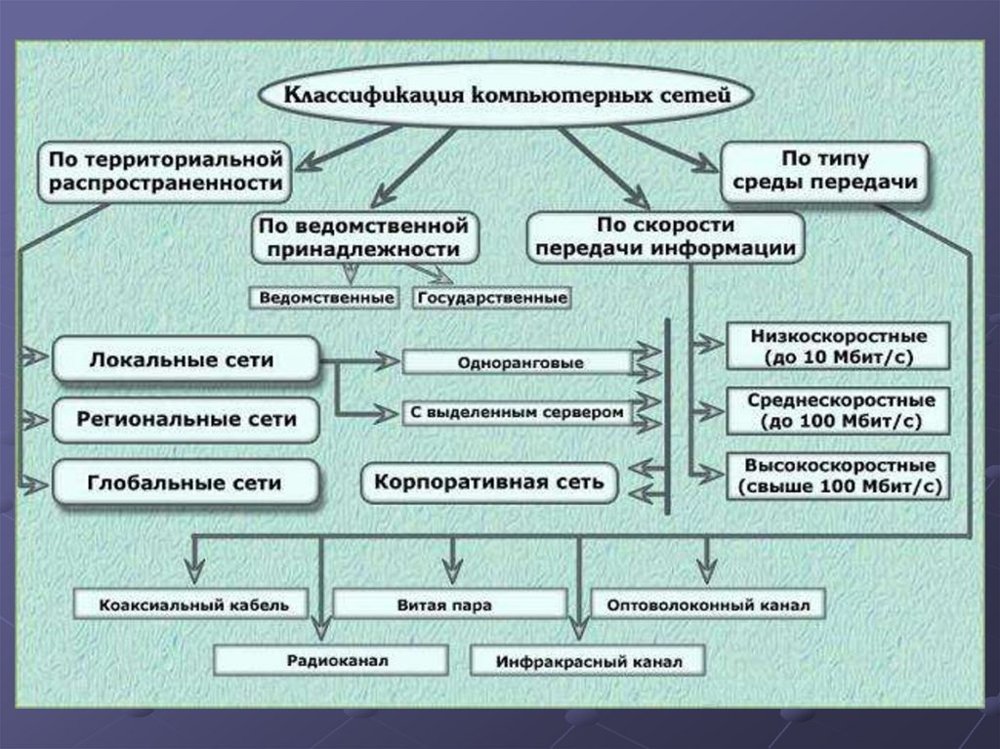

## 1.2.1. Сети широкополосного доступа

> Закон Меткалфа — гипотеза Боба Меткалфа (создателя Ethernet) о том, что <mark style="background-color:#C8E6C9;color:#1A1A1A;">полезность сети пропорциональна квадрату числа её пользователей </mark> (Маленькие сети слишком дорогие по отношению к их полезности), поскольку приближённо равна числу возможных соединений (Гилдер; Gilder, 1993).

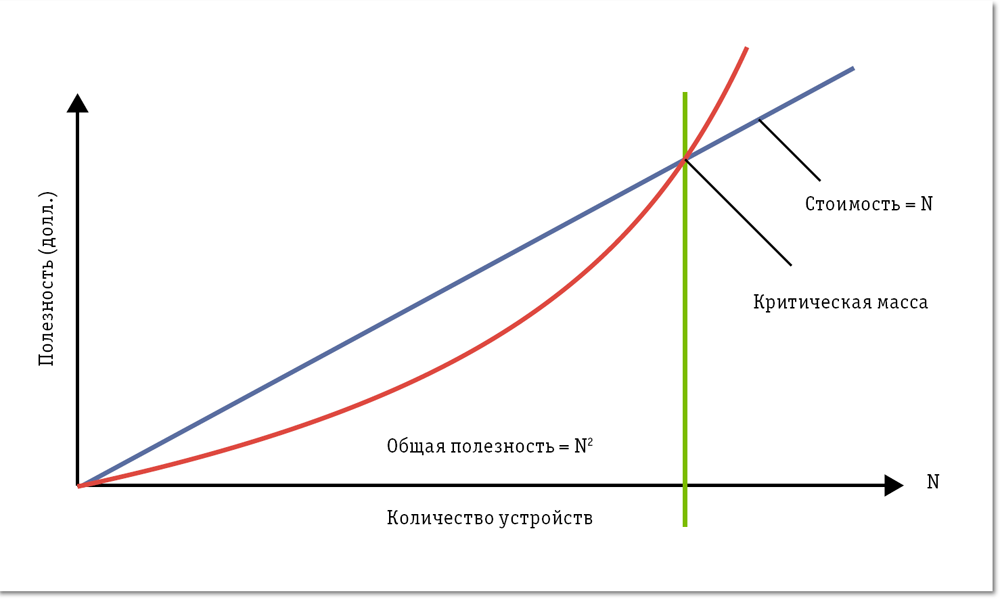

Закон объясняет, как колоссальная популярность интернета связана с его размером.

## 1.2.2. Мобильные и беспроводные сети

> Беспроводной хот-спот (hotspot) — <mark style="background-color:#C8E6C9;color:#1A1A1A;">точка беспроводного доступа на основе стандарта 802.11 для мобильных компьютеров и переносных устройств (телефонов, планшетов). </mark> 

Беспроводные и мобильные сети часто взаимосвязаны, но это не одно и то же (илл. 1.5). Даже ноутбуки зачастую подключаются по проводам — например, в номере отеля через сетевую розетку; теперь это редкость, хотя проводные сети быстрее.

| Беспроводная | Мобильная | Типичные приложения                      |
|--------------|-----------|------------------------------------------|
| Нет          | Нет       | Стационарные компьютеры в офисах         |
| Нет          | Да        | Ноутбук в номере отеля                   |
| Да           | Нет       | Сети в зданиях, где не проложены провода |
| Да           | Да        | Складской учёт с карманным компьютером   |

Сотовые сети и Wi-Fi используют и другие бытовые электроника: планшеты и устройства для чтения книг скачивают купленную книгу, свежий журнал или газету; цифровые фоторамки выводят новое изображение в нужный момент.

> Сенсорная сеть (sensor network) — <mark style="background-color:#C8E6C9;color:#1A1A1A;">сеть из узлов, собирающих и передающих информацию о состоянии окружающего мира; узлы могут встраиваться в машины или телефоны либо быть отдельными маленькими устройствами. </mark> 

|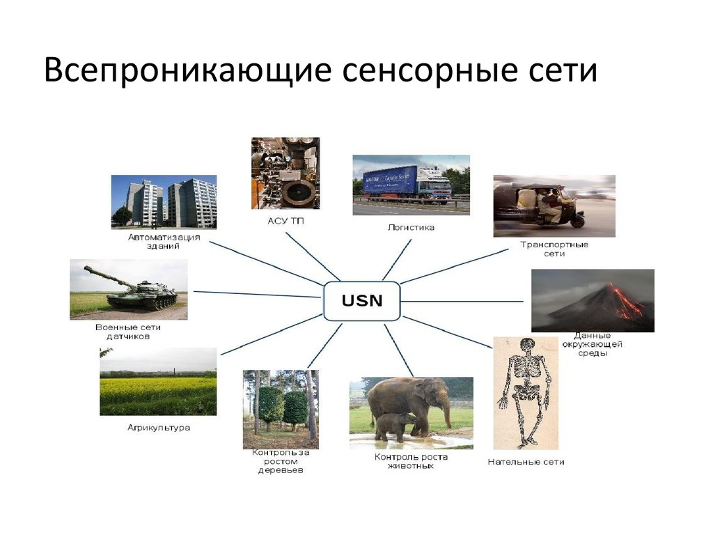   | 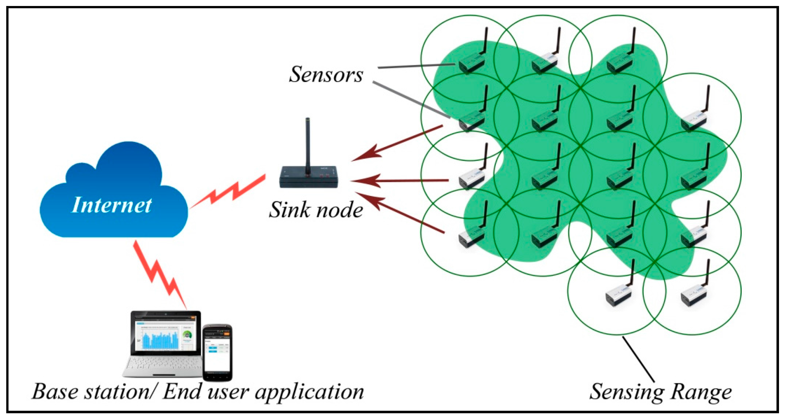  |
|---|---|

Автомобиль может собирать данные о местоположении, скорости, вибрации и КПД топлива из бортовой диагностики и загружать их в базу (Халл и др.; Hull et al., 2006) — так водитель засекает ямы, объезжает пробки, выясняет перерасход бензина.

<mark style="background-color:#C8E6C9;color:#1A1A1A;">Сенсорные сети революционизируют науку, давая массу данных о ранее не наблюдавшихся видах поведения. </mark>  Пример — отслеживание миграции отдельных зебр датчиками (Цзюань и др.; Juang et al., 2002). Исследователи уместили беспроводный компьютер в один кубический миллиметр (Варнеке и др.; Warneke et al., 2001), что позволяет отслеживать даже птиц, грызунов и насекомых.

## 1.2.3. Сети доставки контента

<mark style="background-color:#C8E6C9;color:#1A1A1A;">Многие интернет-сервисы подключены к «облаку» — сетям дата-центров. </mark> 

> Сеть дата-центров (data-center network) — <mark style="background-color:#C8E6C9;color:#1A1A1A;">сеть, объединяющая сотни тысяч или даже миллионы серверов, находящихся в одном месте. </mark> 

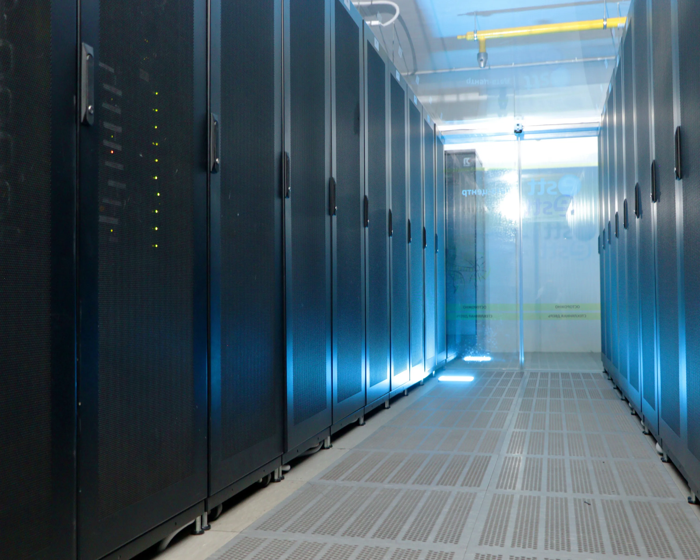

<mark style="background-color:#C8E6C9;color:#1A1A1A;">Серверные стойки располагаются тесными рядами в помещениях длиной более километра. </mark>  Сети дата-центров обслуживают растущие потребности облачных вычислений.

> Облачные вычисления (cloud computing) — <mark style="background-color:#C8E6C9;color:#1A1A1A;">модель предоставления вычислительных ресурсов и сервисов через сеть дата-центров. </mark> 

    
Что это значит

Вместо того чтобы прокладывать кабели и ставить физические коммутаторы и маршрутизаторы, вы создаёте сеть программно: задаёте подсети, IP‑адреса, правила маршрутизации и фаерволы через консоль или API облачного провайдера. Трафик между ресурсами идёт по внутренней сети облака, часто изолированно от публичного интернета.

Частый термин — Virtual Private Cloud (VPC): это как «своя» приватная сеть внутри публичного облака. В разных облаках она называется по‑разному (VCN, VPC и пр.), но суть одна.

Сети дата-центров проектируются под перемещение больших объёмов данных между серверами, а также между дата-центром и остальным интернетом. <mark style="background-color:#C8E6C9;color:#1A1A1A;">Большинство используемых приложений — от веб-сайтов до облачных редакторов заметок — хранят данные в таких сетях. Они сталкиваются с проблемой масштабирования: пропускной способности и электропотребления. </mark> 

> Пропускная способность сегмента сети — скорость передачи данных между двумя серверами сети.

Ранние сети дата-центров строились по простой топологии «дерево» с тремя слоями коммутаторов (доступ, агрегирование, ядро); она плохо масштабировалась и была подвержена сбоям.

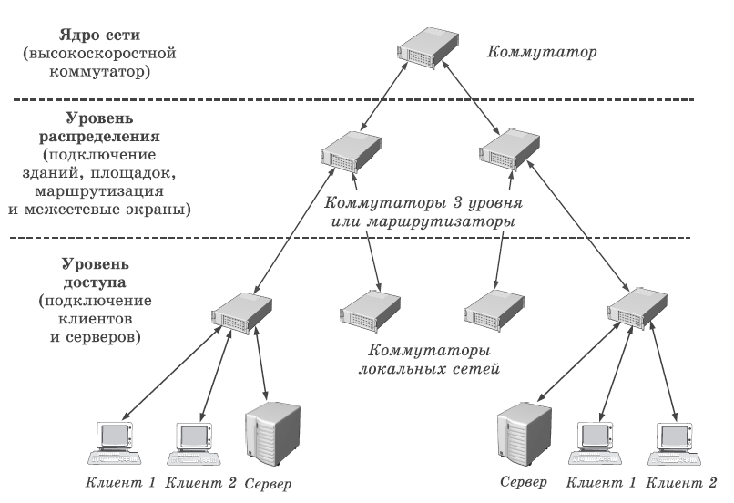

> Сеть доставки контента (CDN, Content Delivery Network) — <mark style="background-color:#C8E6C9;color:#1A1A1A;">большой набор серверов, географически расположенных так, что контент размещается как можно ближе к запрашивающему его пользователю. </mark> 

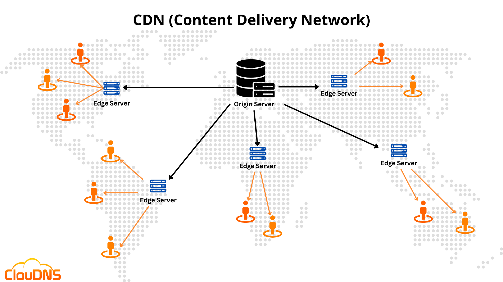

У крупных поставщиков контента (Google, Facebook, Netflix) есть собственные CDN; другие (Akamai, Cloudflare) предоставляют хостинг более мелким сервисам. Контент (от статических файлов до потокового видео) реплицируется по множеству мест CDN; при запросе CDN выбирает реплику с учётом расстояния до клиента, загруженности серверов, интенсивности трафика и перегруженности сети.

## 1.2.4. Транзитные сети

<mark style="background-color:#C8E6C9;color:#1A1A1A;">Данные в интернете проходят через множество независимых сетей. </mark>  Контент сайтов обычно расположен в сетях дата-центров, а пользователи обращаются к нему из сетей доступа; контент проходит от дата-центра до сети доступа, затем до устройства пользователя.

> Транзитная сеть (transit network) — <mark style="background-color:#C8E6C9;color:#1A1A1A;">сеть, через которую передаётся трафик между поставщиком контента и интернет-провайдером, если они не связаны напрямую. </mark> 

Транзитные сети обычно взимают плату за сквозную передачу трафика как с ISP, так и с поставщика контента. Если сеть контента и сеть доступа обмениваются достаточным трафиком, им выгодно прямое взаимоподключение — характерно для серьёзных ISP и крупных поставщиков контента (Google, Netflix); для этого нужно создавать и поддерживать сетевую инфраструктуру прямого соединения, зачастую в нескольких географических точках.

    
Пояснение

Представь, что интернет — это система дорог, а данные (фильмы, сайты, картинки) — это грузовики с товаром.

**1. Транзитные сети — это платные дороги (магистрали).**
Есть большие компании-владельцы «платных дорог» (транзитные провайдеры, например Level 3, Cogent). Они соединяют между собой всех остальных. Если ты хочешь, чтобы твои грузовики доехали до любого места, ты платишь им за проезд. Они берут деньги с **обеих сторон**:
- С провайдера (ISP), который раздаёт интернет обычным людям (типа твоего домашнего интернета).
- С поставщика контента (например, серверов, где лежит видео).

**2. В чём проблема?**
Допустим, Google (поставщик контента) отправляет видео пользователям провайдера «Рога и Копыта» (ISP). Оба платят транзитной сети за то, чтобы грузовики ехали по её дорогам. Это накладно для обоих.

**3. Что такое прямое взаимоподключение (peering)?**
Это когда две компании прокладывают **свою собственную короткую дорогу** напрямую между своими складами, минуя платную магистраль. Они просто соединяют кабель в одном месте (или в нескольких городах) и гоняют трафик бесплатно.

**Условие:** это выгодно, только если трафика между ними **много** (например, Google и крупный ISP гоняют друг другу терабайты). Тогда экономия на транзите окупает расходы на прокладку и обслуживание этой «прямой дороги» (а она нужна в разных городах, чтобы не гонять всё через одну точку).

**Итог:** «Дурацкое» объяснение — это как если бы два соседа, которые каждый день возят друг другу тяжёлые сумки через платный мост, скинулись и построили между домами свою тропинку. Мост (транзит) остаётся для остальных, а они экономят.

> ISP (Internet Service Provider — интернет-провайдер) — <mark style="background-color:#C8E6C9;color:#1A1A1A;">организация, предоставляющая доступ в интернет. </mark>

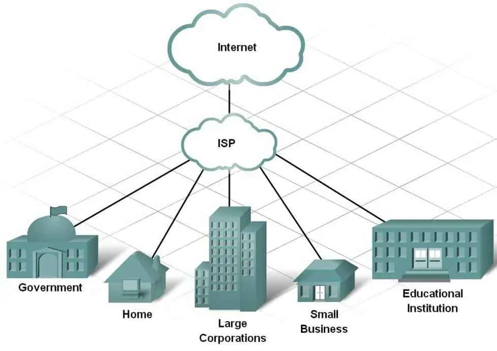

<mark style="background-color:#C8E6C9;color:#1A1A1A;">Транзитные сети традиционно называют опорными, или магистральными, сетями (backbone networks), поскольку их задача — перемещение трафика между двумя конечными точками. Много лет они приносили огромный доход: все остальные сети нуждались в них и платили за соединение с остальным интернетом. </mark> 

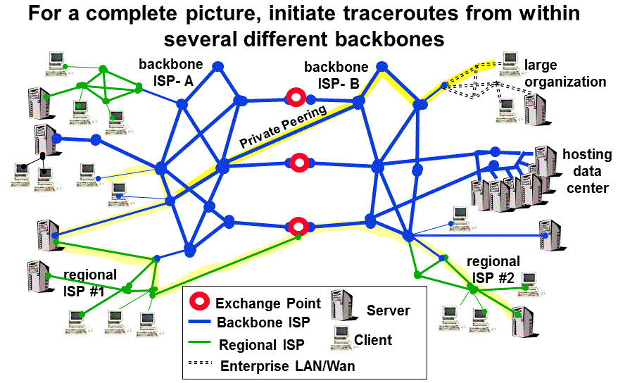

В последнее десятилетие возникли две тенденции. Первая — консолидация контента у нескольких крупных поставщиков и сетей доставки содержимого, размещающих данные в облаке. Вторая — расширение зон обслуживания сетей доступа ISP: многие из небольших региональных провайдеров охватывают целые страны (или несколько), что расширяет географию соединений и абонентскую базу. <mark style="background-color:#C8E6C9;color:#1A1A1A;">По мере роста сетей доступа и поставщиков контента крупные сети всё меньше полагаются на транзит, предпочитая прямое соединение, а транзит оставляя резервным вариантом. </mark> 

    
Еще раз для дураков (для меня)

Понял, давай ещё проще и по частям — с картинкой в голове.

## Кто есть кто

- **ISP (интернет-провайдер)** — тот, кто проводит тебе интернет в квартиру. Например, «Ростелеком», Comcast, местный городской провайдер.
- **Поставщик контента** — тот, у кого лежит то, что ты смотришь: YouTube (Google), Netflix, соцсети, игровые серверы.
- **Транзитная (магистральная) сеть** — «дорога между городами». Она не раздаёт интернет людям и не хранит видео. Её бизнес — **перевозить чужие данные** из точки А в точку Б и брать за это деньги **с обоих концов**.

## Как было раньше (и почему транзит был золотой жилой)

Представь три города: **Контент** — **Магистраль** — **Пользователь**.

Раньше связать Контент с Пользователем можно было только через Магистраль. Магистраль говорила: «Плати мне и ты, Контент, и ты, Провайдер, — иначе ваши данные никуда не поедут». Все платили, магистраль богатела. Это и есть **транзит**: сеть пропускает через себя чужой трафик за деньги.

## Что изменилось — две тенденции

**1. Контент собрался в кучу.**
Раньше сайтов было миллион, и трафик был размазан. Теперь 80% трафика — это несколько гигантов: Google/YouTube, Netflix, Meta, Cloudflare. Они сидят в облаках и раздают **огромные** объёмы.

**2. Провайдеры выросли.**
Мелкий региональный провайдер раньше обслуживал один город. Теперь многие покрывают целую страну или несколько — у них миллионы абонентов и куча точек, где можно воткнуться кабелем.

## Почему им теперь выгодно соединяться напрямую

Смотри: Google гонит Netflix-видео миллионам абонентов провайдера X. **Обе стороны** платят магистрали за проезд этих гигабайтов. Но трафика между ними **так много**, что дешевле:

- проложить **свой кабель напрямую** между сетью Google и сетью провайдера X,
- причём **в нескольких городах** (чтобы не гнать всё через одну точку — иначе получится бутылочное горлышко).

Это и есть **прямое взаимоподключение (peering)**: две сети соединяются напрямую и **гоняют трафик друг другу бесплатно**. Магистраль им больше не нужна — а значит, и платить ей не надо.

**Но есть условие:** это окупается, только если трафика **много**. Прокладка и обслуживание кабеля в нескольких городах стоят денег — если гонять по нему три байта в день, ты в убытке. Поэтому так делают только «серьёзные» ISP и крупные поставщики контента. Мелкому сайту и мелкому провайдеру дешевле просто заплатить транзиту.

## Что в итоге

Магистрали **не исчезли** — просто крупные игроки перестали быть их главными клиентами. Они соединяются напрямую, а транзит держат **на всякий случай** (резерв): если прямой кабель порвался — трафик пошёл по старой платной дороге. Транзит превратился из «единственного пути» в «запасной аэродром».

**Одной фразой:** раньше все ездили по платному мосту, потому что другой дороги не было; теперь те, у кого трафика больше всех, построили себе прямой тоннель и платят мосту только за страховку.

    
Моя интерпретация

То есть вот так
Есть пользователи, если провайдер и сам првайдер цепляется к интернету, через транзит (BACKBONE).
Так вот: Хосты слились в один дата-центр, который решил, что дотянет свои сети до провайдера , чтобы не платить BackBone

## 1.2.5. Корпоративные сети

<mark style="background-color:#C8E6C9;color:#1A1A1A;">В большинстве организаций (компаний, университетов) много компьютеров для задач от проектирования продукта до платёжной ведомости. Обычно они подключены к общей сети, что позволяет совместно использовать </mark>  данные, информацию и вычислительные ресурсы.

> Совместное использование ресурсов (resource sharing) — предоставление программ, оборудования и прежде всего данных в доступ другим пользователям сети независимо от физического расположения ресурсов и пользователей.

<mark style="background-color:#C8E6C9;color:#1A1A1A;">Простейший пример — совместное использование принтера </mark> : высокопроизводительный сетевой принтер экономичнее, быстрее и проще в обслуживании, чем парк личных принтеров.

Совместное использование информации, вероятно, важнее совместного использования материальных ресурсов. Большинство компаний даёт сотрудникам онлайн-доступ к данным о клиентах и товарах, складской информации, финансовым и налоговым отчётам. Банк не проработал бы и пяти минут при отказе всех компьютеров; современная фабрика с управляемым компьютером конвейером — и пяти секунд. Даже турагентству или юридической фирме из трёх человек сети необходимы для быстрого доступа к информации и документам.

<mark style="background-color:#C8E6C9;color:#1A1A1A;">У мелких компаний компьютеры могут быть в одном офисе; у крупных корпораций — в десятках офисов и фабрик в нескольких странах. </mark>  Сотруднику отдела сбыта в Нью-Йорке может понадобиться база данных склада в Сингапуре.

|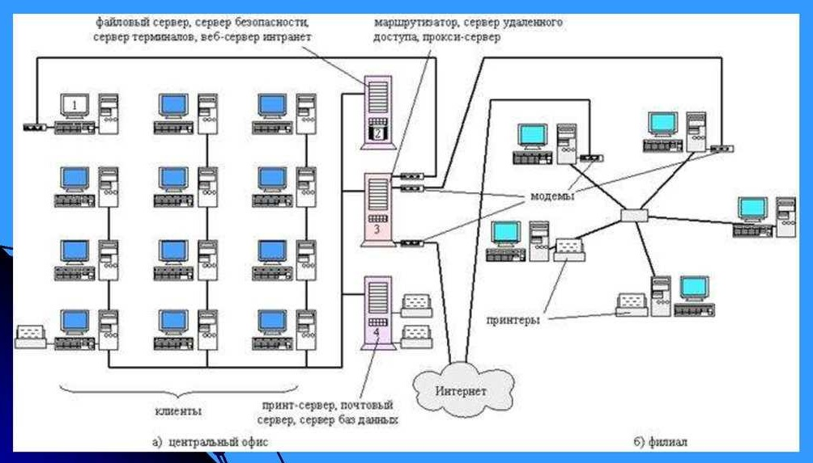   | 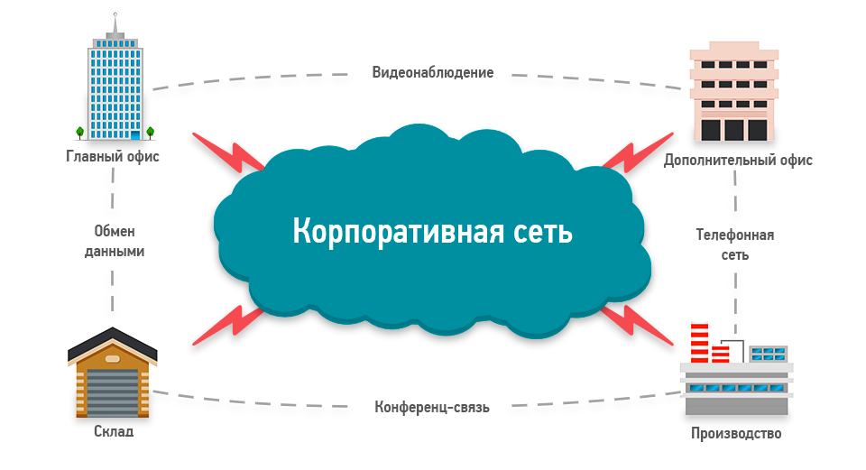  |
|---|---|

> VPN (Virtual Private Network — виртуальная частная сеть) — <mark style="background-color:#C8E6C9;color:#1A1A1A;">технология соединения географически удалённых сетей в одну логическую сеть. </mark> 

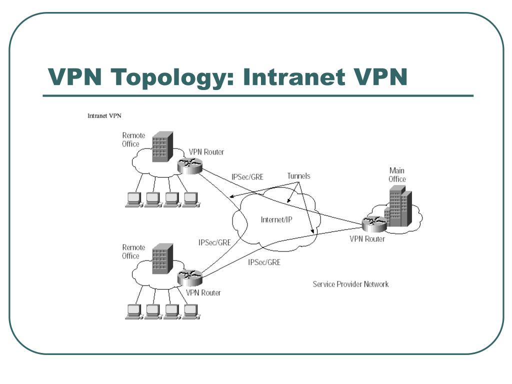

<mark style="background-color:#C8E6C9;color:#1A1A1A;">Пользователь за 15 000 км от данных должен обращаться к ним так, как будто находится в том же офисе, — освобождение от «тирании географии». </mark> 

Информационную систему компании можно представить как одну или несколько баз со всеми данными компании и сотрудников с удалённым доступом к ним.

> Сервер (server) — мощный компьютер, на котором хранятся данные; чаще всего размещается в централизованной серверной комнате и обслуживается системным администратором.

> Клиент, или рабочая станция (client) — более простой компьютер сотрудника на его рабочем столе, с помощью которого он получает доступ к удалённым данным (например, для работы с электронными таблицами).

Иногда клиентом называют человека, использующего рабочую станцию, но из контекста обычно понятно, о чём речь. Рабочие станции и серверы объединяются сетью (илл. 1.1); на этом уровне сеть показывается простым овалом без подробностей, а детали обозначаются при необходимости.

Вторая цель корпоративной сети связана с человеческим фактором.

> Среда обмена информацией (communication medium) — среда, которую компьютерная сеть предоставляет сотрудникам для обмена информацией.

Практически в каждой компании с хотя бы двумя компьютерами для повседневного обмена используется электронная почта; сотрудники жалуются, сколько писем приходится читать, но начальству достаточно одной кнопки, чтобы отправить сообщение всем подчинённым сразу. Сети могут заменить телефонную компанию:

> IP-телефония (IP telephony), или VoIP (Voice over IP — передача голоса по IP, или по интернет-протоколу) — <mark style="background-color:#C8E6C9;color:#1A1A1A;">технология телефонной связи через компьютерную сеть; на обоих концах линии может использоваться телефон с поддержкой VoIP или компьютер сотрудника. </mark> 

Компании рассматривают VoIP как способ сэкономить на телефонных счетах.

Сети совершенствуют коммуникацию: к аудио добавляется видео, чтобы сотрудники вне офиса видели друг друга во время совещания, — это снижает затраты (денежные и временные) на путешествия.

> Демонстрация рабочего стола (desktop sharing) — технология, позволяющая удалённым сотрудникам видеть экраны компьютеров коллег и взаимодействовать с ними.

Сотрудники могут читать общую информационную «доску» и писать на ней, совместно создавать отчёт: правки одного сразу видны остальным, а не через несколько дней. Это ускоряет и упрощает (порой делает возможным) сотрудничество разбросанных групп. Более амбициозные формы удалённого согласования, такие как телемедицина (например, удалённый мониторинг пациентов), лишь начинают появляться, но потенциально могут сыграть намного более важную роль. Иногда говорят, что в гонке между обменом информацией и перевозками победит что-то одно, а второе безнадёжно устареет.

Третья цель для многих компаний — электронное ведение бизнеса, прежде всего с покупателями и поставщиками. Авиалинии, книжные магазины и ритейл обнаружили, что покупателям нравится покупать не выходя из дома, поэтому компании предоставляют онлайн-каталоги и принимают заказы через интернет. Производители автомобилей, самолётов, компьютеров закупают комплектующие у множества поставщиков и собирают части воедино; сети позволяют размещать заказы в электронной форме, что снижает потребность в больших складах и повышает производительность.

## FAQ

**Какие основные виды компьютерных сетей выделяются?**
<mark style="background-color:#C8E6C9;color:#1A1A1A;">Мобильные и широкополосные сети доступа, сети дата-центров, транзитные сети и корпоративные сети. </mark> 

**Что такое закон Меткалфа?**
Полезность сети пропорциональна квадрату числа её пользователей, так как приближённо равна числу возможных соединений (Гилдер, 1993).

**Чем беспроводная сеть отличается от мобильной?**
Беспроводная использует радиосвязь вместо проводов, мобильная предполагает перемещение устройства; они могут сочетаться независимо (см. илл. 1.5).

**Что такое хот-спот?**
Точка беспроводного доступа по стандарту 802.11 для мобильных компьютеров и переносных устройств.

**Что такое SMS?**
Short Message Service — сервис коротких сообщений через сотовые сети.

**Что такое GPS?**
Global Positioning System — система глобального позиционирования, напрямую определяющая местоположение устройства.

**Что такое геотегирование?**
Проставление фотографиям и видео меток, соответствующих месту съёмки.

**Что такое NFC?**
Near Field Communication — беспроводная связь малого радиуса действия, позволяющая телефону работать как бесконтактная (RFID) платёжная карта.

**Что такое мобильная коммерция (m-commerce)?**
Коммерческая деятельность через мобильные устройства: оплата SMS, билеты, мелкие покупки, платежи телефоном.

**Что такое сенсорная сеть?**
<mark style="background-color:#C8E6C9;color:#1A1A1A;">Сеть узлов, собирающих и передающих информацию о состоянии окружающего мира; узлы могут встраиваться в машины, телефоны или быть отдельными устройствами. </mark> 

**Что такое сеть дата-центров?**
<mark style="background-color:#C8E6C9;color:#1A1A1A;">Сеть, объединяющая сотни тысяч или миллионы серверов в одном месте и обслуживающая облачные вычисления. </mark> 

**Что такое облачные вычисления?**
Модель предоставления вычислительных ресурсов и сервисов через сеть дата-центров.

**Что такое пропускная способность сегмента сети?**
Скорость передачи данных между двумя серверами сети.

**Что такое CDN?**
Content Delivery Network — сеть доставки контента: набор серверов, географически расположенных так, чтобы контент был как можно ближе к пользователю.

**Что такое транзитная сеть?**
<mark style="background-color:#C8E6C9;color:#1A1A1A;">Сеть, передающая трафик между поставщиком контента и ISP, если они не связаны напрямую; обычно взимает плату за сквозную передачу. </mark> 

**Что такое ISP?**
Internet Service Provider — <mark style="background-color:#C8E6C9;color:#1A1A1A;">интернет-провайдер, организация, предоставляющая доступ в интернет. </mark> 

**Что такое магистральная (backbone) сеть?**
<mark style="background-color:#C8E6C9;color:#1A1A1A;">Традиционное название транзитной сети, чья задача — перемещение трафика между двумя конечными точками. </mark> 

**Что такое совместное использование ресурсов?**
Предоставление программ, оборудования и данных в доступ другим пользователям сети независимо от физического расположения.

**Что такое VPN?**
Virtual Private Network — <mark style="background-color:#C8E6C9;color:#1A1A1A;">виртуальная частная сеть, соединяющая географически удалённые сети в одну логическую. </mark> 

**Что такое сервер и клиент (рабочая станция)?**
Сервер — мощный компьютер с данными в централизованной серверной; клиент — более простой компьютер сотрудника для доступа к удалённым данным.

**Что такое VoIP (IP-телефония)?**
Voice over IP — передача голоса по интернет-протоколу через компьютерную сеть вместо телефонной компании.

**Что такое демонстрация рабочего стола (desktop sharing)?**
Технология, позволяющая удалённым сотрудникам видеть экраны компьютеров коллег и взаимодействовать с ними.