

    
Кратко

**1.3. Сетевые технологии: от локальных до глобальных — кратко**

- **PAN (персональные сети).** Обмен между устройствами одного человека: наушники, часы, гарнитура — со смартфоном. Пример — **Bluetooth** (парадигма «главный — подчинённый»), избавляющий от проводов.
- **LAN (локальные сети).** Частная сеть в здании/на территории; совместное использование ресурсов. **Беспроводные LAN:** точка доступа (AP) или ячеистая сеть (mesh); стандарт **IEEE 802.11 (Wi-Fi)** — от 11 Мбит/с до 7 Гбит/с. **Проводные LAN:** медь, коаксиал, оптоволокно; 100 Мбит/с — 40 Гбит/с, низкая задержка и потери. **Ethernet (IEEE 802.3)** с коммутаторами (switched Ethernet); алгоритм против зацикливания (Перлман, 1985). **VLAN** — логическое разделение одной физической LAN. Классическая Ethernet — общая шина с арбитражем при конфликтах. Выделение канала: статическое (временные слоты) или динамическое — централизованное (базовая станция) и децентрализованное.
- **Домашние сети.** Множество устройств (IoT): смартфоны, термостаты, сигнализация, лампы, камеры, холодильники; удалённый мониторинг. Отличия: простота установки, критичность безопасности и надёжности (риск взлома сигнализации), разнородность оборудования и требование совместимости, дешевизна. Обычно беспроводные — удобнее и дешевле, но страдают производительность и безопасность (радиоволны проходят через стены, часть данных не шифруется). **Сети по ЛЭП** (powerline) передают данные по электропроводке.
- **MAN (городские сети).** Охватывают город; классический пример — кабельное ТВ, ставшее двусторонним интернетом (головная станция CMTS). Также WiMAX (802.16), LTE, 5G.
- **WAN (глобальные сети).** Страна, континент. Состоят из **хостов** и **подсети** (линии передачи + коммутирующие элементы/маршрутизаторы); алгоритмы маршрутизации и пересылки. Отличие от LAN: за хосты и подсеть отвечают разные люди; маршрутизаторы соединяют разнотехнологичные части — отсюда интерсети. **VPN** — связь филиалов через интернет (гибкость, но нет контроля базовых ресурсов). **Спутниковые сети** — широковещательные, для удалённых районов. **Сотовые сети:** 1G аналог (голос) → 2G цифра (голос) → 3G (голос+данные) → 4G (полностью цифра) → 5G (выше скорость, ниже задержки); радиус — километры, скорость ~100 Мбит/с. **SD-WAN** — программно-определяемая WAN с единым SLA; пример **SDN**.
- **Объединённые сети (интерсети).** Набор взаимосвязанных сетей; глобальный интернет — лишь одна из них. Соединяются **шлюзами**; оптимальный уровень — сетевой, то есть **маршрутизатор**.

# 1.3. Сетевые технологии: от локальных до глобальных

Сети варьируются от небольших персональных до крупных глобальных. Ниже — технологии, позволяющие реализовывать сети разных размеров и масштабов.

## 1.3.1. Персональные сети

> Персональная сеть (PAN, Personal Area Network) — <mark style="background-color:#C8E6C9;color:#1A1A1A;">сеть, обеспечивающая обмен информацией между устройствами, используемыми одним человеком. </mark> 

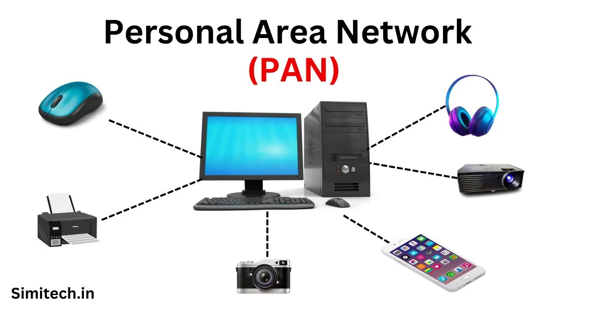

<mark style="background-color:#C8E6C9;color:#1A1A1A;">Чтобы помочь таким пользователям, несколько компаний разработали беспроводную сеть малого радиуса действия Bluetooth: если все устройства поддерживают Bluetooth, достаточно включить их и положить рядом — они сами установят соединение. </mark> 

> Bluetooth — <mark style="background-color:#C8E6C9;color:#1A1A1A;">беспроводная сеть малого радиуса действия, разработанная группой компаний для устранения кабельных соединений между устройствами. </mark> 

В простейшем варианте Bluetooth-сети используют парадигму «главный — подчинённый» (master — slave), приведённую на илл. 1.6. Системный блок (ПК) обычно играет роль главного узла и взаимодействует с мышью или клавиатурой, играющими подчинённую роль. Главный узел сообщает подчинённым, какие адреса использовать, когда и в течение какого промежутка времени осуществлять передачу данных, какие частоты использовать и т. д. Подробнее Bluetooth обсуждается в главе 4.

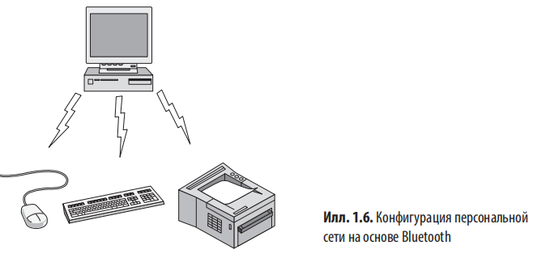

Рис. 1.6 — Конфигурация персональной сети на основе Bluetooth

<mark style="background-color:#C8E6C9;color:#1A1A1A;">Для создания PAN используется множество других технологий ближнего радиуса действия; </mark>  они также представлены в главе 4.

## 1.3.2. Локальные сети

> Локальная сеть (LAN, Local Area Network) — <mark style="background-color:#C8E6C9;color:#1A1A1A;">частная сеть, функционирующая в отдельном здании и на прилегающей территории (дом, офис или завод). </mark> 

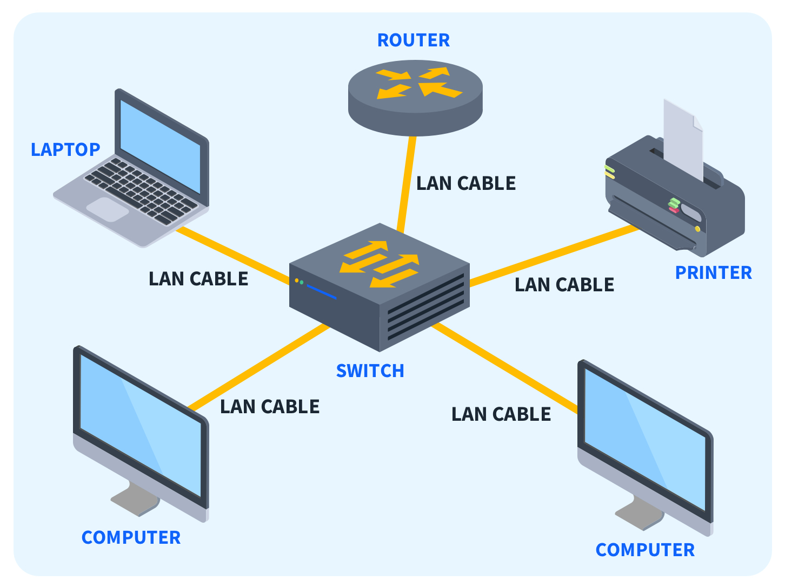

LAN широко применяется для соединения персональных компьютеров и бытовой электроники, позволяя совместно использовать ресурсы (например, принтеры) и обмениваться информацией.

Беспроводные LAN сегодня применяются повсеместно. Изначально они были популярны в жилых помещениях, старых офисных зданиях, кафе и других местах, где прокладка кабелей обошлась бы слишком дорого. В таких системах компьютеры обмениваются информацией с помощью встроенного радиомодема и антенны, обращаясь к специальному устройству.

> Точка доступа (AP, Access Point), беспроводный маршрутизатор (wireless router) или базовая станция (base station) — <mark style="background-color:#C8E6C9;color:#1A1A1A;">устройство, осуществляющее передачу пакетов данных между беспроводными компьютерами, а также между компьютером и интернетом. </mark> 

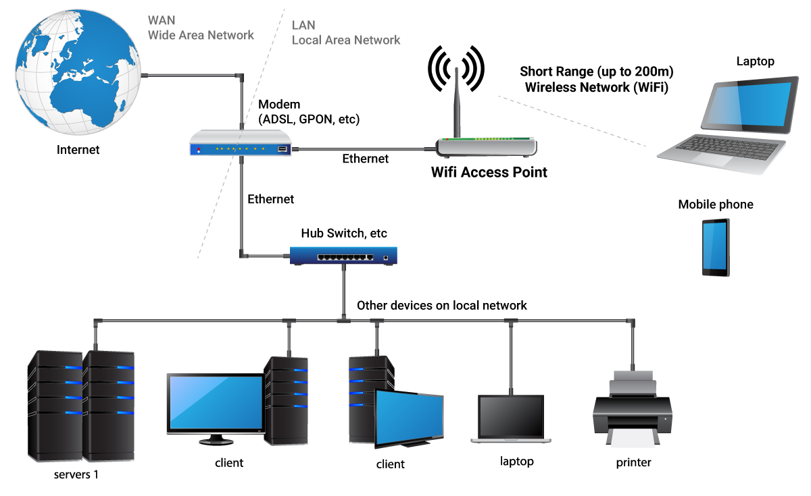

Точка доступа напоминает популярного ребёнка в школе: все хотят с ней «поговорить».

> Ячеистая сеть (mesh network) — <mark style="background-color:#C8E6C9;color:#1A1A1A;">конфигурация, в которой близко расположенные устройства обмениваются пакетами, иногда выступая в роли передатчиков. </mark> 

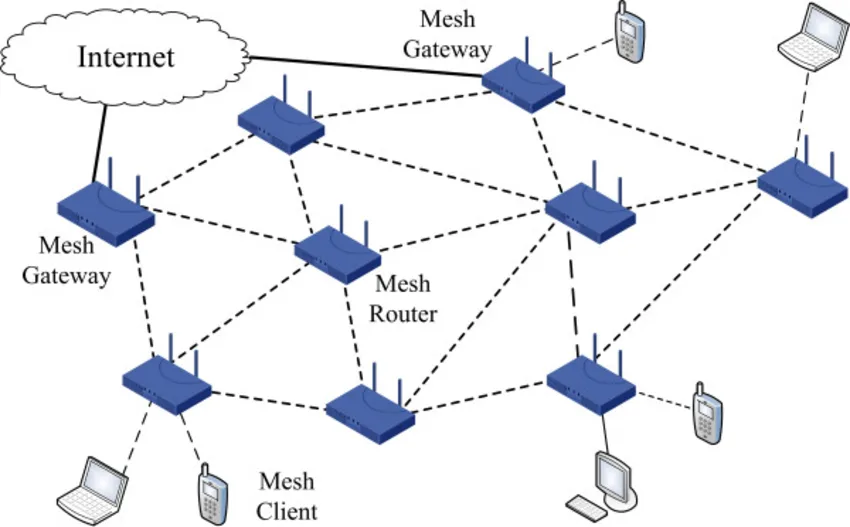

В большинство ячеистых сетей входит специальный набор узлов, единственная функция которых — передача трафика. Ячеистые сети часто применяются в развивающихся регионах, где развертывать соединение по всей территории неудобно и дорого, а также растёт их популярность как решения для домашних сетей, особенно в больших зданиях.

> IEEE 802.11 (Wi-Fi) — один из самых популярных стандартов беспроводных LAN, работающий со скоростью от 11 Мбит/с (802.11b) до 7 Гбит/с (802.11ad).

В книге скорость передачи данных по линии измеряется в мегабитах в секунду, где 1 Мбит/с = 1 000 000 бит/с, и гигабитах в секунду, где 1 Гбит/с = 1 000 000 000 бит/с. Степени двойки используются только при описании хранения информации: 1 МБ памяти равен $2^{20}$, то есть 1 048 576 байт. Стандарт 802.11 подробнее обсуждается в главе 4.

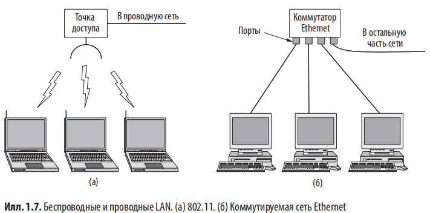

Рис. 1.7 — Беспроводные и проводные LAN: (а) 802.11; (б) коммутируемая сеть Ethernet

В проводных LAN используется множество технологий передачи; наиболее распространённые физические среды — медные провода, коаксиальный кабель и оптоволокно. Размеры LAN ограниченны, поэтому наихудшее время прохождения сигнала имеет предел и известно заранее — это помогает разрабатывать сетевые протоколы. <mark style="background-color:#C8E6C9;color:#1A1A1A;">Обычно проводные LAN работают на скорости от 100 Мбит/с до 40 Гбит/с, отличаются низкой задержкой (не более десятков миллисекунд, зачастую намного меньше), ошибки передачи редки. Проводные LAN обычно обладают меньшей задержкой и процентом потери пакетов, а также более высокой пропускной способностью, чем беспроводные </mark> ; разрыв со временем сократился, но передавать сигналы по проводам или оптоволокну намного проще, чем по воздуху.

Многие проводные LAN включают двухточечные соединения.

> IEEE 802.3 (Ethernet) — <mark style="background-color:#C8E6C9;color:#1A1A1A;">однозначно самая популярная разновидность проводной LAN. </mark> 

На илл. 1.7 (б) показан пример коммутируемой сети Ethernet (switched Ethernet). Любой компьютер может использовать протокол Ethernet и подключаться к устройству, называемому коммутатором, посредством двухточечного соединения.

> Коммутатор (switch) — <mark style="background-color:#C8E6C9;color:#1A1A1A;">устройство, передающее пакеты между связанными с ним компьютерами; каждый пакет содержит адрес, по которому коммутатор определяет, на какой компьютер отправить данные. </mark> 

Коммутатор содержит несколько портов, каждый из которых может быть подключён к одному устройству (компьютеру или другому коммутатору). <mark style="background-color:#C8E6C9;color:#1A1A1A;">Для создания более крупных LAN коммутаторы подключают друг к другу через порты. На случай зацикливания все коммутаторы в мире используют соответствующий алгоритм против зацикливания </mark>  (Перлман; Perlman, 1985). За выбор пути пакета отвечает протокол; как это происходит на деле, показано в главе 4.

<mark style="background-color:#C8E6C9;color:#1A1A1A;">Одну физически большую LAN можно разбить на две меньших логических — например, если компьютеры инженерного и финансового отделов физически находятся в одной сети, поскольку размещаются в одном крыле здания. </mark> 

> Виртуальная LAN (VLAN, Virtual LAN) — <mark style="background-color:#C8E6C9;color:#1A1A1A;">логическое разделение одной физической LAN на несколько независимых, при котором каждый порт помечается своим «цветом» (например, финансовый отдел — зелёным, инженерный — красным). </mark> 

    
VPN и VLAN

VPN — Virtual Private Network (виртуальная частная сеть)

Это **защищённый туннель через публичный интернет**.
**Ключевое:** VPN — про **безопасность и приватность через недоверенную сеть**.

VLAN — Virtual Local Area Network (виртуальная локальная сеть)

Это **логическое разделение одного физического коммутатора на несколько независимых «кусков»**. **Ключевое:** VLAN — про **разделение и порядок внутри своей сети**, а не про шифрование.

Их часто путают из-за похожих букв, но это **разные вещи из разных миров**:

- **VLAN** — «как разложить вещи по полкам внутри шкафа».
- **VPN** — «как перевезти вещи в бронированном грузовике через опасный город».

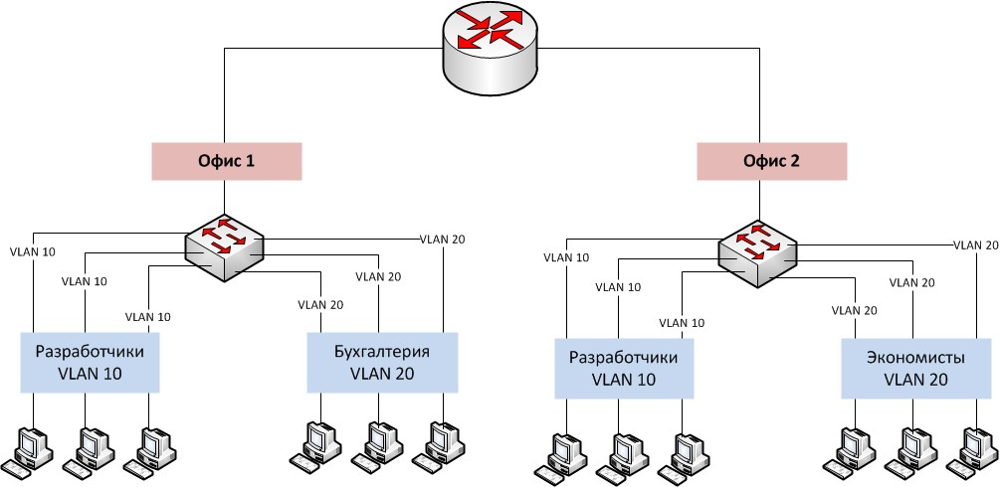

<mark style="background-color:#C8E6C9;color:#1A1A1A;">Коммутатор направляет пакеты так, что компьютеры на зелёных портах отделены от подключённых к красным: зелёный порт не получает широковещательные пакеты, отправляемые на красный, как будто это две физически отдельные LAN. </mark>  VLAN подробнее рассматривается в конце главы 4.

Существуют и другие топологии проводных LAN.

> Классическая Ethernet (classic Ethernet) — <mark style="background-color:#C8E6C9;color:#1A1A1A;">первоначальная архитектура Ethernet с широковещательной передачей всех пакетов по одному линейному кабелю, где успешно передавать сигнал могла только одна машина за раз, а для разрешения конфликтов использовался распределённый механизм арбитража. </mark> 

CSMA/CD

| 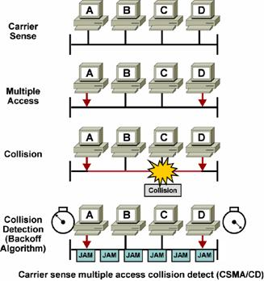 | 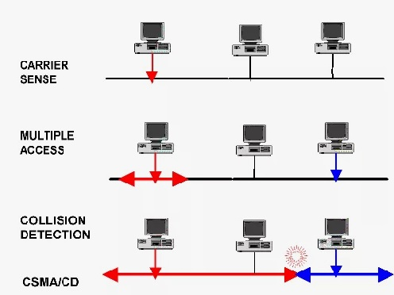 |
|------------------------|-------------------------|

Алгоритм был прост: компьютеры могли передавать в любое время, когда кабель не использовался; при конфликте двух или более пакетов каждый компьютер ожидал случайный промежуток времени и повторял попытку. Коммутируемая сеть Ethernet — современный вариант этой архитектуры; подробнее — в главе 4.

И беспроводные, и проводные широковещательные LAN могут выделять ресурсы статически или динамически. Типичный вариант статического выделения — разбиение времени на дискретные интервалы и циклический алгоритм, при котором каждая машина передаёт только в свой временной слот. При статическом выделении возможности канала тратятся впустую, если машине нечего передавать или получать в отведённый слот, поэтому большинство систем выделяют каналы динамически (по требованию).

Методы динамического выделения ресурсов для общего канала делятся на централизованные и децентрализованные. При централизованном методе за определение очерёдности вещания отвечает единая структура, например базовая станция в сотовых сетях: при получении нескольких пакетов она расставляет их в порядке, соответствующем внутреннему алгоритму. При децентрализованном методе центральной структуры нет; каждая машина сама определяет, когда передавать данные. Может показаться, что это приведёт к хаосу, но позднее изучаются алгоритмы наведения порядка (при условии, что все машины соблюдают установленные правила).

    
Способы разделить канал

    Кратко:

**Два способа делить общий канал (проводной или беспроводной):**

- **Статически** — заранее по расписанию. Пример: время делят на слоты, каждая машина говорит только в свой. Минус: если машине нечего передавать — слот пропадает, канал простаивает впустую. Поэтому так делают редко.
- **Динамически (по требованию)** — канал дают тому, кому он сейчас нужен. Так делает большинство систем.

**Динамическое выделение бывает двух типов:**

- **Централизованное** — есть главный, кто решает, кто когда говорит. Пример: базовая станция в сотовой сети — собрала пакеты и расставила их по своему алгоритму.
- **Децентрализованное** — главного нет, каждая машина сама решает, когда передавать. Выглядит как хаос, но работает, если все соблюдают общие правила (алгоритмы наведения порядка — изучаются дальше).

## 1.3.3. Домашние сети

> Домашняя сеть (home network) —<mark style="background-color:#C8E6C9;color:#1A1A1A;"> LAN для домашних пользователей, включающая широкий диапазон подключённых к интернету устройств и требующая чрезвычайной простоты управления, надёжности и безопасности, особенно в руках неспециалистов. </mark> 

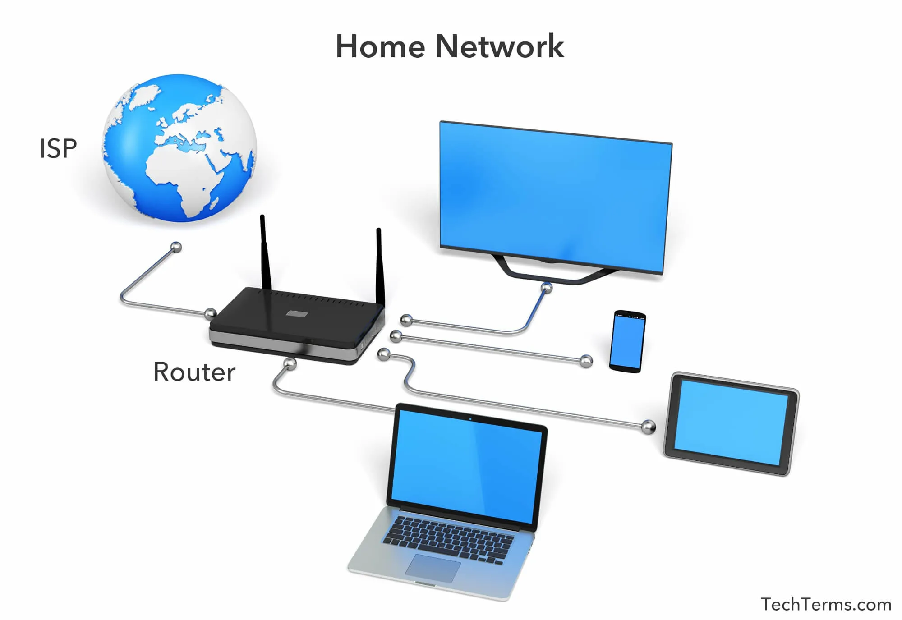

Много лет назад домашняя сеть могла состоять из пары ноутбуков, соединённых беспроводной LAN. <mark style="background-color:#C8E6C9;color:#1A1A1A;">Сегодня она может включать смартфоны, беспроводные принтеры, термостаты, охранную и пожарную сигнализацию, лампочки, камеры, телевизоры, стереосистемы, умные колонки, холодильники и многое другое. </mark>  Развитие интернета вещей позволяет подключить к сети практически любой бытовой прибор или электронное устройство (включая датчики), что ставит новые задачи по проектированию, управлению и обеспечению безопасности. Всё чаще встречается удалённый мониторинг квартир для охраны помещений или присмотра за пожилыми людьми; многие готовы потратить определённую сумму, чтобы обезопасить жизнь престарелых родителей.

Домашняя сеть — просто ещё одна <mark style="background-color:#C8E6C9;color:#1A1A1A;">разновидность LAN, но на практике заметно отличается по нескольким причинам. </mark> 

**Требования к домашним сетям (в отличие от корпоративных):**

**1. Простота.** <mark style="background-color:#C8E6C9;color:#1A1A1A;">Должно работать из коробки </mark> , без чтения 50-страничного мануала и звонков в поддержку — иначе устройство вернут.

**2. Безопасность и надёжность.** <mark style="background-color:#C8E6C9;color:#1A1A1A;">Плохо защищённый IoT — это не «потеря файлов», а реальный вред: отключённая с телефона сигнализация, замёрзшие трубы, удалённое управление через вредоносные скрипты. </mark>  Даже шифрованный трафик выдаёт приватность метаданными (тип устройства, объём и время передачи).

**3. Органичное развитие.** <mark style="background-color:#C8E6C9;color:#1A1A1A;">Сеть собирается из разношёрстных устройств разных лет и брендов </mark> , которые должны совместимо работать друг с другом (лампы одного — через помощника другого). Устройства живут в сети годами, поэтому «войны интерфейсов» недопустимы.

**4. Удешевление.** <mark style="background-color:#C8E6C9;color:#1A1A1A;">Прибыль маленькая, все давят на цену. А безопасность, надёжность и совместимость стоят денег. </mark>  Отсюда конфликт: и производителю, и потребителю нужен стимул соблюдать общий стандарт.

**Мысль:** домашняя сеть — не уменьшенная корпоративная. Она разнородная, собирается годами, стоит копейки — и при этом должна быть простой, безопасной и совместимой. Это главный вызов.

<mark style="background-color:#C8E6C9;color:#1A1A1A;">Домашние сети обычно беспроводные — они удобнее и дешевле, поскольку не нужно прокладывать или, что хуже, перепрокладывать провода; </mark>  по мере роста числа устройств устанавливать сетевые порты везде, где есть розетки электропитания, всё труднее. <mark style="background-color:#C8E6C9;color:#1A1A1A;">Однако использование дома исключительно беспроводных сетей порождает проблемы производительности и безопасности. </mark>  
1. Во-первых, <mark style="background-color:#C8E6C9;color:#1A1A1A;">из-за роста объёмов трафика и числа подключённых устройств страдает производительность, а пользователи традиционно винят интернет-провайдеров </mark>  (которым это не слишком нравится). 
2. Во-вторых, радиоволны могут проходить через стены (в основном диапазон 2,4 ГГц, в меньшей степени — 5 ГГц); <mark style="background-color:#C8E6C9;color:#1A1A1A;">хотя безопасность беспроводных сетей за последнее десятилетие существенно выросла, они всё ещё подвергаются множеству атак с перехватом информации </mark> , а определённые данные (например, аппаратные адреса устройств и объём трафика) остаются незашифрованными. В главе 8 обсуждается шифрование для защиты информации, но для неопытных пользователей эта задача не из простых.

> Сеть на основе линий электропередач (powerline network) — сеть, позволяющая электрическим приборам транслировать информацию по всему дому через электропроводку.

Телевизор так или иначе приходится включать в розетку — тогда он подключается и к интернету. Такие сети способны одновременно передавать электропитание и информационный сигнал, в том числе благодаря использованию разных диапазонов частот.

## 1.3.4. Городские сети

> Городская сеть (Metropolitan Area Network, MAN) — <mark style="background-color:#C8E6C9;color:#1A1A1A;">сеть, охватывающая целый город. </mark> 

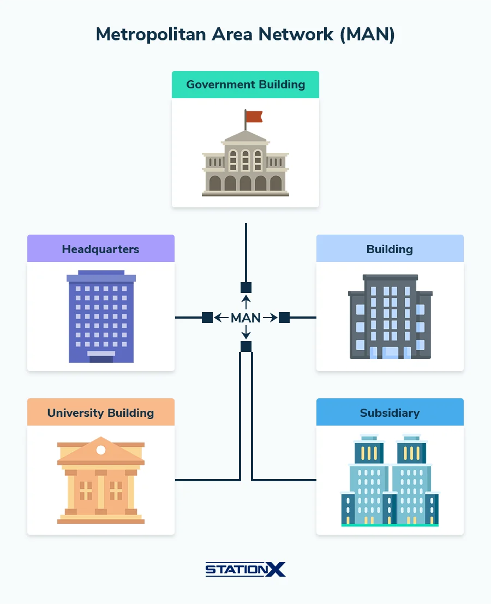

Самый известный пример — сети кабельного телевидения, эволюционировавшие из систем коллективного приёма: в районах с плохим качеством приёма на ближайшем холме размещалась большая антенна, а сигнал направлялся в дома абонентов.

Сначала эти сети создавались локально, под конкретные условия, затем крупные компании стали получать контракты от местных властей на подключение целых городов. Следующим шагом стало создание телепрограмм и даже каналов специально для кабельного телевидения — зачастую узкоспециализированных: новостных, спортивных, кулинарных, по садоводству и т. д. С момента появления и до второй половины 1990-х они предназначались исключительно для телевизионного приёма.

Когда аудитория интернета стала массовой, операторы кабельных сетей поняли, что при небольшой модификации системы могут предоставлять двусторонний интернет в неиспользуемых частях спектра. Так кабельные ТВ-сети начали превращаться из простого способа телевещания в городские сети (илл. 1.8).

> Головная станция кабельной сети (cable head-end), то есть оконечная система кабельных модемов (CMTS, Cable Modem Termination System) — централизованная станция, в которую поступают телевизионный сигнал и интернет для последующего распределения по домам пользователей.

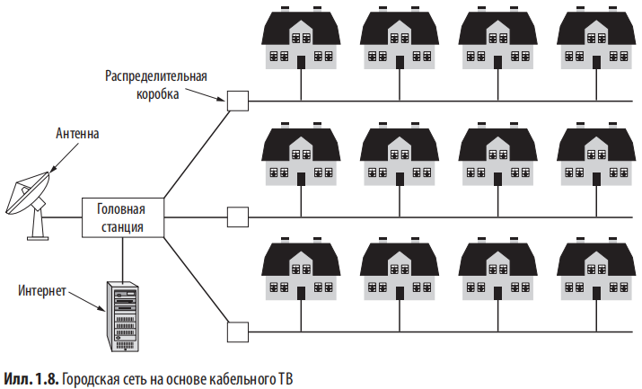

Рис. 1.8 — Городская сеть на основе кабельного ТВ

Кабельное телевидение — не единственная разновидность MAN. Недавние разработки в области высокоскоростного беспроводного доступа привели к появлению ещё одной MAN.

> WiMAX (IEEE 802.16) — стандарт высокоскоростного беспроводного доступа в интернет, описывающий городскую сеть; широкого распространения не получил.

В книге представлены и другие беспроводные технологии: LTE (стандарт «долгосрочного развития», Long Term Evolution) и 5G.

## 1.3.5. Глобальные сети

> Глобальная сеть (WAN, Wide Area Network) — <mark style="background-color:#C8E6C9;color:#1A1A1A;">сеть, охватывающая значительные географические площади, зачастую целую страну, континент или даже несколько континентов. </mark> 

<mark style="background-color:#C8E6C9;color:#1A1A1A;">WAN может обслуживать частную компанию (корпоративная WAN) или предлагаться как коммерческая услуга (транзитная сеть). </mark> 

<mark style="background-color:#C8E6C9;color:#1A1A1A;">Рассмотрим проводные WAN на примере компании с филиалами в разных городах. WAN на илл. 1.9 соединяет филиалы в Перте, Мельбурне и Брисбене. </mark>  В каждом филиале есть несколько компьютеров для прикладных программ.

> Хост (host) — компьютер, на котором выполняются пользовательские (прикладные) программы.

> Подсеть связи (communication subnet), или просто подсеть (subnet) — оставшаяся часть сети, соединяющая хосты и осуществляющая передачу сообщений между ними, подобно тому как телефонная система передаёт слова от говорящего слушающему.

<mark style="background-color:#C8E6C9;color:#1A1A1A;">В большинстве случаев подсеть состоит из двух компонентов: линий передачи и коммутирующих элементов. </mark> 

> Линии передачи (transmission lines) — <mark style="background-color:#C8E6C9;color:#1A1A1A;">компонент подсети, отвечающий за перемещение битов информации между устройствами; в их основе могут лежать медные провода, коаксиальный кабель, оптоволокно или каналы радиосвязи. </mark> 

У большинства организаций нет своих линий передачи, поэтому им приходится использовать существующие линии телекоммуникационных компаний.

> Коммутирующие элементы (switching elements), или просто коммутаторы (switches) — специализированные устройства, соединяющие две или более линии передачи; при поступлении данных по входящей линии коммутатор выбирает исходящую линию для их отправки.

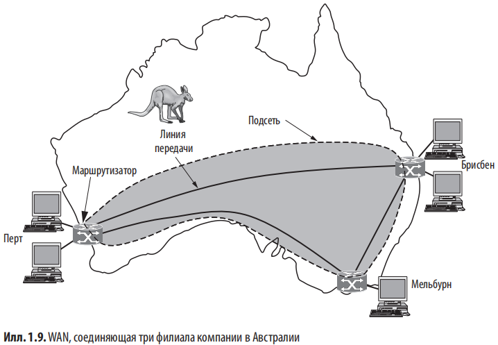

Рис. 1.9 — WAN, соединяющая три филиала компании в Австралии

<mark style="background-color:#C8E6C9;color:#1A1A1A;">Большинство WAN состоит из множества линий передачи, каждая из которых связывает пару маршрутизаторов. </mark> 

> Маршрутизатор (router) — <mark style="background-color:#C8E6C9;color:#1A1A1A;">устройство, соединяющее линии передачи; два маршрутизатора, не связанные линией передачи, обязательно связываются через другие маршрутизаторы. </mark> 

> Алгоритм маршрутизации (routing algorithm) — <mark style="background-color:#C8E6C9;color:#1A1A1A;">алгоритм поиска наилучшего пути в сети, где может быть множество путей между двумя маршрутизаторами. </mark> 

> Алгоритм пересылки данных (forwarding algorithm) — алгоритм, который каждый маршрутизатор использует, чтобы определить пункт назначения передачи пакета.

Оба алгоритма подробнее обсуждаются в главе 5.

*Комментарий к термину «подсеть».* Изначально под ним понимался исключительно набор маршрутизаторов и линий передачи, производивших перемещение пакетов из хоста-источника в хост-получатель. Недавно термин приобрёл второе, более актуальное значение, связанное с сетевой адресацией (глава 5); до тех пор ограничимся исходным значением.

<mark style="background-color:#C8E6C9;color:#1A1A1A;">Может показаться, что WAN — большая проводная LAN, но между ними есть важные различия помимо длины проводов. </mark> 

**1. За хосты и подсеть отвечают разные люди.**
В WAN это обычно так: за компьютеры (хосты) отвечают сами сотрудники, за сеть — IT-отдел, а иногда вообще сторонний провайдер или телефонная компания. Разделение «коммуникация (подсеть)» и «прикладное (хосты)» сильно упрощает архитектуру.

**2. Маршрутизатор соединяет разные технологии.**
Офис может быть на коммутируемом Ethernet, а магистраль — на SONET. Поэтому WAN часто — это **интерсеть (internetwork)**: объединение нескольких разных сетей.

**3. К подсети можно подключить что угодно.**
Хоть отдельный компьютер (как в LAN), хоть целую локальную сеть. Для подсети разницы нет — так из маленьких сетей и собираются большие.

**Одной фразой:** <mark style="background-color:#C8E6C9;color:#1A1A1A;">WAN — это набор разнородных сетей, где за разные части отвечают разные люди, а маршрутизаторы их склеивают; при этом для подсети неважно, подключён к ней один компьютер или целая сеть. </mark> 

### Виртуальные частные сети и SD-WAN

<mark style="background-color:#C8E6C9;color:#1A1A1A;">Вместо аренды выделенных линий организация может связать филиалы, подключив их к интернету: офисы соединяются посредством виртуальных каналов, использующих базовые возможности интернета. </mark> 

> Виртуальная частная сеть (VPN, virtual private network) — <mark style="background-color:#C8E6C9;color:#1A1A1A;">схема соединения филиалов через интернет посредством виртуальных каналов </mark> , использующих базовые возможности интернета (илл. 1.10).

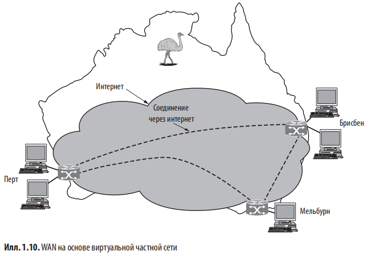

В отличие от сетей с выделенными физическими соединениями, у VPN есть свойственное виртуализации преимущество — гибкое переиспользование ресурсов (интернет-соединений), и столь же типичный недостаток — отсутствие контроля базовых ресурсов. Возможности выделенного соединения чётко понятны; в случае VPN производительность может меняться в зависимости от быстродействия интернет-соединения. Обслуживание сети может производить коммерческий интернет-провайдер (ISP); эта схема соединения сайтов WAN друг с другом и с остальным интернетом показана на илл. 1.11.

Остальные виды WAN активно используют беспроводные технологии.

> Спутниковая сеть — WAN, в которой у всех наземных компьютеров есть антенны, посредством которых они обмениваются данными с находящимся на орбите спутником.

<mark style="background-color:#C8E6C9;color:#1A1A1A;">Все компьютеры «видят» исходящие от спутника данные, а в некоторых случаях — и данные, отправляемые на спутник другими компьютерами системы. Спутниковые сети по своей природе широковещательны; они наиболее удобны при необходимости широкого вещания или при отсутствии наземной инфраструктуры (например, для нефтяников, исследующих удалённую пустыню). </mark> 

> Сеть сотовой связи — WAN, использующая беспроводные технологии; уже насчитывает пять поколений.

Первое поколение было аналоговым и предназначалось исключительно для голосовой связи. Второе — цифровым и также только для передачи голоса. Третье — цифровым для передачи голоса и данных. Четвёртое — чисто цифровым, даже при передаче голоса. Пятое (также чисто цифровое) отличается намного более высоким быстродействием и более короткими задержками.

Любая сотовая базовая станция покрывает гораздо большую площадь, чем беспроводная LAN: радиус действия исчисляется километрами, а не десятками метров. Базовые станции соединяются друг с другом опорной сетью, обычно проводной. Скорость передачи данных в сотовых сетях обычно порядка 100 Мбит/с — намного меньше, чем в беспроводных LAN (до 7 Гбит/с). Подробнее — в главе 2.

> Программно-определяемая WAN (SD-WAN) — WAN, в которой для всей сети обеспечивается единое соглашение о качестве предоставления услуги (SLA, Service Level Agreement) при использовании различных дополняющих друг друга технологий.

Например, может использоваться сочетание дорогостоящих арендованных выделенных линий и вспомогательных, более дешёвых стандартных интернет-соединений. Заключённая в ПО логика перепрограммирует коммутирующие элементы в реальном времени для оптимизации стоимости и быстродействия.

> Программно-определяемая сеть (SDN, Software-Defined Network) — общее описание сетевых архитектур, в которых сеть контролируется путём сочетания программируемых коммутаторов с логикой управления, реализованной в виде отдельной программы.

SD-WAN — пример SDN, технологии, активно набирающей обороты в последнее десятилетие.

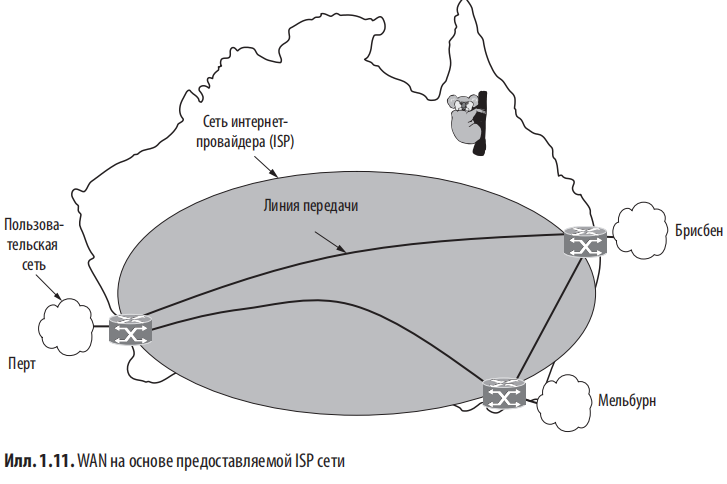

Рис. 1.11 — WAN на основе предоставляемой ISP сети

    
Кратенько

**1. VPN** — соединяем офисы через обычный интернет, а не через дорогие арендованные линии. Дёшево и гибко, но скорость «плавает» — интернет не свой.

**2. Спутник** — антенна → спутник → антенна. Все слышат всех (широковещание). Для пустыни, где нет вышек.

**3. Сотовая связь** — 5 поколений:
- 1G, 2G — только голос.
- 3G — голос + данные.
- 4G — всё цифра.
- 5G — то же, но быстрее.
  Вышка кроет километры (Wi-Fi — метры), скорость ~100 Мбит/с (Wi-Fi — до 7 Гбит/с).

**4. SD-WAN** — смешиваем дорогие линии и дешёвый интернет, а программа решает, что куда пустить. Единое качество (SLA) для всей сети.

**5. SDN** — сетью управляет программа, а не человек с отверткой. SD-WAN — частный случай.

**Итого:** VPN — дёшево вместо аренды. Спутник — где нет вышек. Сотовая — для мобильных. SD-WAN/SDN — программа сама рулит смесью.

## 1.3.6. Объединённые сети

В мире существует множество сетей, нередко использующих разные технологии аппаратного и программного обеспечения, но люди, использующие различные сети, хотят общаться между собой. Для этого <mark style="background-color:#C8E6C9;color:#1A1A1A;">нужна возможность соединения зачастую несовместимых сетей. </mark> 

> Объединённая сеть (internetwork), или просто интерсеть (internet) — <mark style="background-color:#C8E6C9;color:#1A1A1A;">набор взаимосвязанных между собой сетей. </mark> 

<mark style="background-color:#C8E6C9;color:#1A1A1A;">Глобальный интернет — лишь одна из многих интерсетей. Интернет соединяет поставщиков контента, сети доступа, корпоративные, домашние и многие другие сети; подробнее он обсуждается далее в книге. </mark> 

Сеть представляет собой сочетание подсети и хостов, но термин «сеть» часто применяется в более расплывчатом (и вводящем в заблуждение) смысле: сетью можно считать подсеть (как в случае с сетью ISP на илл. 1.11), а интерсеть — тоже сетью (как в случае WAN на илл. 1.9). Мы будем следовать этой логике, а там, где нужно отличать сеть от других архитектур, придерживаться определения сети как набора вычислительных устройств, соединённых при помощи одной и той же технологии.

Объединённая сеть подразумевает взаимосвязи отдельных, независимо функционирующих сетей. Соединение LAN и WAN или двух LAN — обычный способ формирования интерсети. Уточним терминологию: если две или более независимые сети платят за взаимное соединение либо используют принципиально разные базовые технологии (например, широковещание и двухточечное соединение либо проводную и беспроводную технологии), то речь, вероятно, идёт об интерсети.

> Шлюз (gateway) — устройство, реализующее соединение между двумя или более сетями и обеспечивающее необходимые преобразования с точки зрения аппаратного и программного обеспечения.

Шлюзы различаются по уровню в иерархии протокола, на котором они функционируют (уровни и иерархии протоколов рассмотрены в следующем разделе). Высшие уровни сильнее связаны с приложениями (например, Web), низшие — с каналами передачи (например, Ethernet). Весь смысл интерсети — в соединении компьютеров из разных сетей, поэтому слишком низкоуровневый шлюз нежелателен (не сработает для различных типов сетей), а излишне высокого уровня — тоже (соединение будет работать только для определённых приложений). Оптимальный уровень, золотую середину, часто называют сетевым уровнем. Шлюзом, производящим коммутацию пакетов на сетевом уровне, служит маршрутизатор. Как правило, интерсети соединяются шлюзами сетевого уровня — маршрутизаторами; впрочем, даже отдельная крупная сеть обычно содержит много маршрутизаторов.

    
Кратко

Кратко и «тупо»:

**1. Зачем всё это.** Сетей много, технологии у них разные, а людям надо общаться между собой. Значит, нужна возможность их соединить.

**2. Интерсеть (internetwork).** Просто **набор соединённых сетей**. Глобальный интернет — лишь одна из многих интерсетей.

**3. Термин «сеть» — расплывчатый.** Им называют и подсеть (сеть ISP), и интерсеть (WAN). Договоримся: сеть = устройства, соединённые **одной технологией**.

**4. Когда это интерсеть.** Если две сети **независимы** (платят друг другу за соединение) или используют **разные технологии** (провод/беспровод, широковещание/точка-точка) — это интерсеть.

**5. Шлюз (gateway).** Устройство, которое соединяет две сети и **переводит** между ними (железо + софт).

**6. На каком уровне шлюз.**
- Слишком низко — не сработает для разных сетей.
- Слишком высоко — заработает только для конкретных приложений.
- **Золотая середина — сетевой уровень.** Шлюз на нём = **маршрутизатор**.

**Итого:** интерсеть — это несколько разных сетей, склеенных шлюзами. Лучший шлюз — маршрутизатор (сетевой уровень), потому что ниже — не универсально, выше — слишком узко.

## FAQ

**Что такое PAN?**
Personal Area Network — персональная сеть для обмена информацией между устройствами, используемыми одним человеком (наушники, часы, гарнитура).

**Что такое Bluetooth?**
Беспроводная сеть малого радиуса действия, устраняющая кабельные соединения между устройствами; в простейшем варианте использует парадигму «главный — подчинённый» (master — slave).

**Что такое LAN?**
Local Area Network — частная сеть в отдельном здании и на прилегающей территории (дом, офис, завод).

**Что такое точка доступа (AP)?**
Устройство (беспроводный маршрутизатор, базовая станция), передающее пакеты между беспроводными компьютерами, а также между компьютером и интернетом.

**Что такое ячеистая сеть (mesh network)?**
Конфигурация, в которой близко расположенные устройства обмениваются пакетами, иногда выступая передатчиками; часто включает специальные узлы только для передачи трафика.

**Что такое Wi-Fi?**
IEEE 802.11 — популярный стандарт беспроводных LAN со скоростью от 11 Мбит/с (802.11b) до 7 Гбит/с (802.11ad).

**Что такое Ethernet?**
IEEE 802.3 — самая популярная разновидность проводной LAN; в коммутируемой сети компьютеры подключаются к коммутатору двухточечным соединением.

**Что такое коммутатор (switch)?**
Устройство, передающее пакеты между связанными с ним компьютерами по адресу в пакете.

**Что такое VLAN?**
Virtual LAN — логическое разделение одной физической LAN на несколько независимых с помощью пометки портов «цветами».

**Что такое классическая Ethernet?**
Первоначальная архитектура Ethernet с широковещательной передачей по одному линейному кабелю и распределённым арбитражем для разрешения конфликтов.

**Чем статическое выделение ресурсов отличается от динамического?**
Статическое разбивает время на слоты по циклическому алгоритму и тратит канал впустую, если машине нечего передавать; динамическое выделяет канал по требованию.

**Какие бывают методы динамического выделения канала?**
Централизованные (очерёдность определяет единая структура, например базовая станция) и децентрализованные (каждая машина сама решает, когда передавать).

**Что такое домашняя сеть?**
LAN для домашних пользователей с широким диапазоном устройств, требующая простоты управления, надёжности и безопасности.

**Что такое сеть на основе линий электропередач (powerline network)?**
Сеть, передающая информацию через электропроводку дома одновременно с электропитанием (за счёт разных диапазонов частот).

**Что такое MAN?**
Metropolitan Area Network — городская сеть, охватывающая целый город; классический пример — сети кабельного телевидения.

**Что такое головная станция (CMTS)?**
Cable Modem Termination System — централизованная станция кабельной сети, куда поступают ТВ-сигнал и интернет для распределения по домам.

**Что такое WiMAX?**
IEEE 802.16 — стандарт высокоскоростного беспроводного доступа, описывающий городскую сеть; широкого распространения не получил.

**Что такое WAN?**
Wide Area Network — глобальная сеть, охватывающая страну, континент или несколько континентов; может быть корпоративной или коммерческой.

**Что такое хост (host)?**
Компьютер, на котором выполняются пользовательские (прикладные) программы.

**Что такое подсеть (subnet)?**
Часть сети, соединяющая хосты и передающая сообщения между ними; состоит из линий передачи и коммутирующих элементов.

**Что такое линии передачи и коммутирующие элементы?**
Линии передачи перемещают биты между устройствами (медь, коаксиал, оптоволокно, радиосвязь); коммутирующие элементы (коммутаторы) соединяют две или более линий и выбирают исходящую линию.

**Что такое маршрутизатор (router)?**
Устройство, соединяющее линии передачи; маршрутизаторы, не связанные напрямую, связываются через другие маршрутизаторы.

**Чем алгоритм маршрутизации отличается от алгоритма пересылки?**
Маршрутизация ищет наилучший путь в сети; пересылка определяет пункт назначения передачи пакета на конкретном маршрутизаторе.

**Чем WAN отличается от LAN?**
Помимо длины: за хосты и подсеть в WAN обычно отвечают разные люди, маршрутизаторы соединяют разные технологии, а к подсети подключаются целые локальные сети.

**Что такое VPN?**
Virtual Private Network — соединение филиалов через интернет виртуальными каналами; даёт гибкое переиспользование ресурсов, но без контроля базовых ресурсов.

**Что такое спутниковая сеть?**
WAN, где наземные компьютеры обмениваются данными со спутником на орбите; по природе широковещательна, удобна при отсутствии наземной инфраструктуры.

**Сколько поколений у сотовой связи и чем они различаются?**
Пять: 1G — аналог, только голос; 2G — цифра, только голос; 3G — цифра, голос и данные; 4G — чисто цифра, включая голос; 5G — чисто цифра с более высоким быстродействием и короткими задержками.

**Что такое SD-WAN?**
Программно-определяемая WAN, обеспечивающая единое соглашение об уровне обслуживания (SLA) при сочетании разных технологий, например дорогих выделенных линий и дешёвых интернет-соединений.

**Что такое SDN?**
Software-Defined Network — архитектура, в которой сеть контролируется сочетанием программируемых коммутаторов с логикой управления в виде отдельной программы.

**Что такое интерсеть (internetwork)?**
Набор взаимосвязанных сетей; глобальный интернет — лишь одна из многих интерсетей.

**Что такое шлюз (gateway)?**
Устройство, соединяющее две или более сетей и обеспечивающее необходимые аппаратные и программные преобразования; шлюзом сетевого уровня служит маршрутизатор.