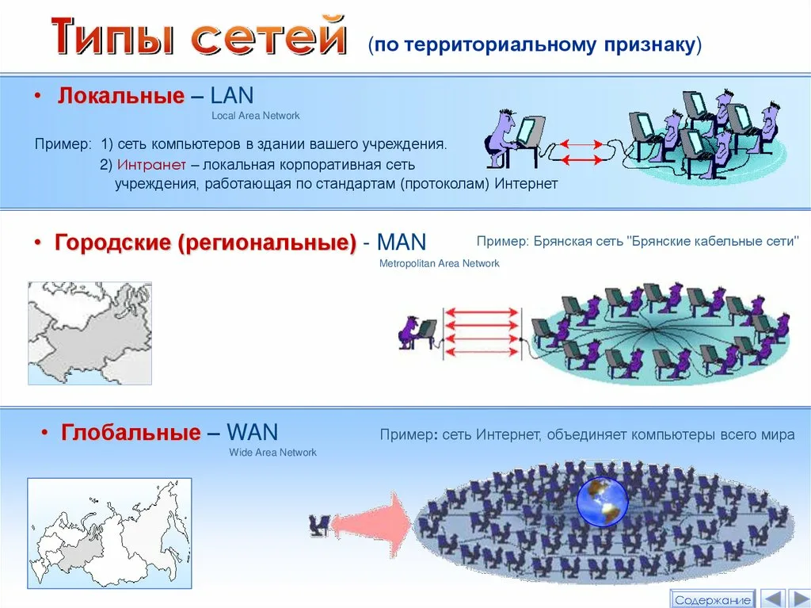
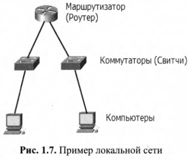
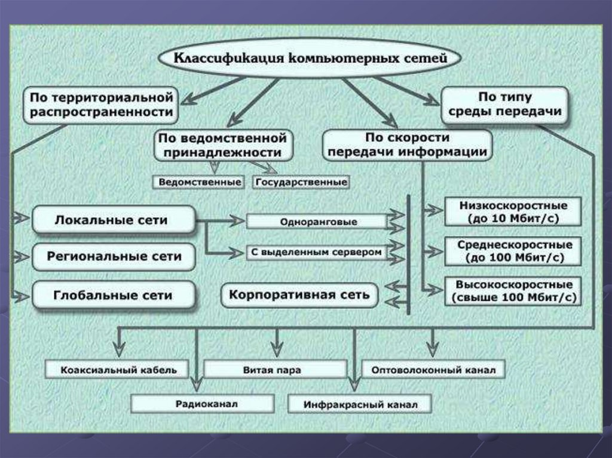
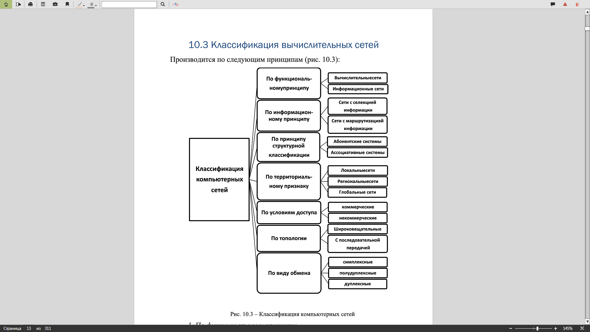
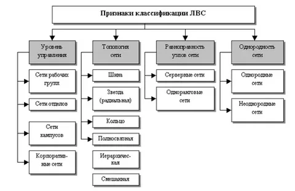

## 1.1 История

Сеть - группа компьютеров и/или иных сетевых устройсвт, обедененных для обмена информацией и совместного использования ресурсов

## 1.2 CPT

CPT - ПО для моделирования сетей, которое позволяет создавать и настраивать сети, практиковаться в устранении проблем сетевых топологий. Пользователь может просматривать сетевую активность в режиме реального времени и анализировать производительность сети.

Есть коммутаторы, маршрутизаторы, концентраторы, серверы и беспроводные устройства.

## 1.4 Что такое сеть?

Сеть - набор сетевых устройств, которые соединины каким-либо проводным или беспроводными линиями связи и могут обмениваться данными друг с другом.

Типы сетей по территориальному признаку:

Независимо от размера сети ей необходимы следующие компоненты:

1. Компьютеры. Конечные устройства сети, которые получают или передают данные
2. Соединительные устройства. Позволяют передавать данные из одной точки сети в другую. Это такие приборы, как сетевые адаптеры, сетевые среды (Кабели, эфир), через которые происходит передача сигнала от одного устройства локальной сети к другому.
3. Сетевые устройства. Концентраторы, коммутаторы, маршрутизаторы.

Вот пример такой сети (маршрутизатор соединяет два сегмента сети):

ПК - устройства, которые передают данные по сети. Каждый пк имеет сетевую кару, в которую вставляется кабель с RJ-45

Коммутаторы выполняют коммутацию данных внутри локальной сети. Маршрутизатор служит для соединения сете между собой и выбор оптимального маршрута между ними.

### Характеристики сетей

Сети описываются и сравниваются между собой , используя следующие характеристики:
1. Скорость. Насколько быстро данные передаются по сети (Скорость передачи данных).
2. Стоимость. Общая стоимость сетевых компонентов, установки, настройки и технического обслуживания.
3. Безопасность. Степень безопасности данных, передаваемых оп сети.
4. Доступность. Вероятность того, что сеть будет доступна для передачи данных. Желательно, чтобы она была доступна 24/7 356 дней в году.
5. Масштабируемость. Насколько шорошо сеть может расти, чтобы удовлетворить потребности все большего числа пользователей
6. Надежность. Среднее время между отказами
7. Сетевая топология. В сетях принято различать два типа топологий: физическая топология (кабели, сетевые устройства, пк) и логическая - описывает пути, по которым сигнал передается по физической топологии.

## 1.5 Резюме

По расстоянию между устройствами:

- LAN (ЛВС - локальная вычислительная сеть) -  это группа компьютеров, серверов и периферийных устройств (принтеров, сканеров), объединенных между собой в пределах ограниченной территории (офис, здание, предприятие или квартира).
- Глобальная сеть - сеть, объединяющая ПК из разных городов и государств

По типу передачи данных:

- Проводные 
- Беспроводные 
  - Bluetooth
  - WiFi
  - Мобильная связь

С точки зрения распределения ролей:

- Одноранговые 
- Клиент - сервер

В одноранговых все равноправны - кадый модет отдавать и забирать данные, в клиент-сервер такого равноправия нет.

Сетевой администратор (Network Administrator) — это IT-специалист, который отвечает за бесперебойную работу, настройку и безопасность компьютерной сети компании или предприятия

Крч, достаточно много признаков для классификации, вот примеры:

Вот такую нашел для ЛВС:

