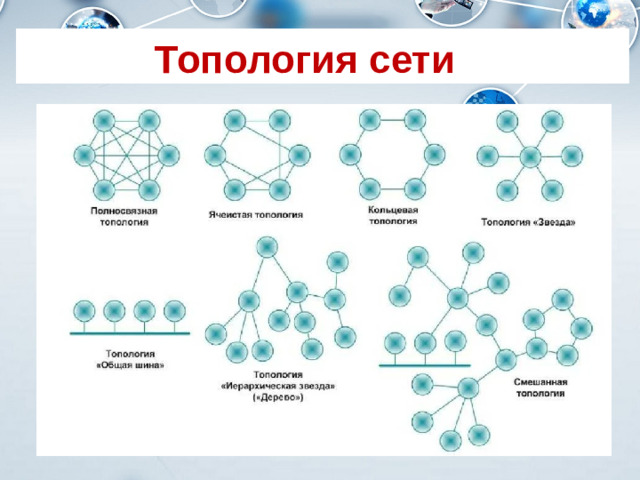
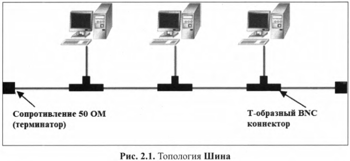
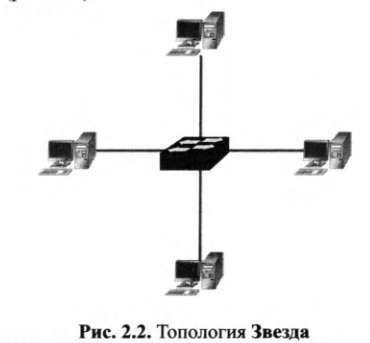
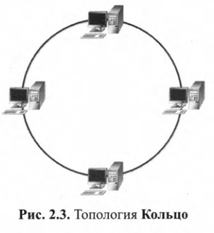

## Типы топологий

Физическая топология описывает физическое расположение устройств и кабелей. Для каждого типа физической топологии необходимо подбирвать соответствующий тип кабеля.

Три основные категории топологий:

1. Шина. В классической шине хосты соединяются физически одим кабелем (коаксиальный). Ну или, я так понима, что концентратор - тоже хаб.
2. Кольцо. Последнее устройство присоединяется к первому с образованием окружности.
3. Звезда. Компьютеры соединены через центральное устройство.

Звезда - самая распространенная топология.

Логическая топология описывает логический путь, по которым сигналы передаются от одного узла на другой.

Физическая и логическая топологии могут совпадать, так и различаться.

Примеры:
1. Шина физически = шина логически
2. Звезда физически может быть, например логическм "Кольцом"

## 2.2 Топология "Шина"

Топология «шина» — это сетевая архитектура, в которой все узлы (компьютеры, серверы, периферия) подключены параллельно к единому магистральному кабелю (называемому «шиной» или «backbone»). Каждый узел имеет собственный интерфейс подключения к шине (T-коннектор), а на обоих концах кабеля устанавливаются терминаторы для поглощения сигнала и предотвращения его отражения.

Достоинства:

1. Простота
2. Дешевизна
3. Отказ одного устройства никак не сказывается на других

Недостатки:

1. Небольшой размер из-за ограничения длинны сегментов
2. Обрыв кабеля может убить сеть
3. Ограниченная длина кабеля.
4. *Коллизии**: при большой нагрузке и множестве узлов производительность падает из-за столкновений пакетов.
5. **Сложность диагностики**: трудно локализовать неисправность (нужно проверять всю шину).
6.  **Ограниченная масштабируемость**: чем длиннее шина и больше узлов, тем хуже сигнал и больше коллизий.
7. **Низкая безопасность**: все узлы «слышат» весь трафик (легко перехватить данные).

## 2.3 Звезда 

Топология «звезда» (Star Topology) — это способ соединения устройств в сеть, при котором каждый узел подключён отдельным кабелем к центральному устройству (коммутатору, концентратору или точке доступа), которое управляет передачей данных между узлами.

Ключевое отличие от шины: 
нет общей среды — каждый узел имеет свой выделенный канал до центра.
**Точка-точка** - Соединение «узел ↔ центр» является выделенным, без коллизий на физическом уровне (в случае коммутатора). 
**Коммутация в центре** - Коммутатор хранит MAC-таблицу и отправляет кадр **только целевому порту** (unicast), а не всем. 

Достоинства:
- Простота масштабирования
- Выделенный канал для каждого узла
- Отказ одного узла (не центрального) не влияет на работу сети
- **Простота диагностики**: неисправность локализуется на конкретном кабеле или порту.
- **Высокая производительность**: в коммутируемой звезде каждый узел получает **выделенную полосу** (нет коллизий, в отличие от шины).
- **Безопасность**: коммутатор отправляет кадр только адресату, остальные узлы его не «слышат» (в отличие от шины).

Недостатки:
- Много кабеля (Дорого)
- Слабое место - центральный узел
- **Ограничение по портам**: количество узлов ограничено числом портов коммутатора (решается каскадированием, но это уже другая топология — «расширенная звезда»).

## 2.4 Кольцо

Топология «кольцо» (Ring Topology) — это способ соединения устройств в сеть, при котором каждый узел подключён к двум соседним узлам, образуя замкнутый контур (кольцо). Данные передаются по кольцу от узла к узлу в одном направлении (или в двух — в двойном кольце), пока не достигнут адресата.

Передача данных происходит по эстафете: узел принимает кадр от соседа, проверяет адрес, и если кадр не ему — передаёт дальше по кольцу. Замкнутость обеспечивает альтернативный путь (в двойном кольце) и детерминированный порядок доступа.

особенности

| Характеристика | Описание |
|---|---|
| **Замкнутый контур** | Каждый узел соединён с двумя соседями; последний узел замыкается на первый. |
| **Однонаправленная передача** | В простом кольце данные идут в одном направлении (по часовой стрелке). |
| **Двойное кольцо** | В отказоустойчивых вариантах (FDDI, SDH) — два кольца с противоположными направлениями. |
| **Детерминированный доступ** | Часто используется **токен** (маркер права передачи) — узел передаёт только при наличии токена. Нет коллизий. |
| **Ретрансляция** | Каждый узел **усиливает и повторяет** сигнал, что позволяет покрывать большие расстояния. |
| **Отказ узла** | В простом кольце обрыв узла **разрывает кольцо** и парализует сеть. В двойном кольце — трафик перенаправляется по второму кольцу. |

Достоинства: 

- **Нет коллизий**: токен-доступ гарантирует, что в среде одновременно передаёт только один узел.
- **Детерминированная задержка**: время доступа предсказуемо — важно для реального времени (промышленность, АСУ ТП).
- **Ретрансляция сигнала**: каждый узел усиливает сигнал, что позволяет строить протяжённые сети без дополнительных повторителей.
- **Экономия кабеля**: меньше кабеля, чем в звезде (каждый узел соединён только с двумя соседями).
- **Отказоустойчивость в двойном кольце**: при обрыве одного кольца трафик идёт по второму (самовосстановление).

Недостатки:

- **Единая точка отказа в простом кольце**: обрыв кабеля или выход узла из строя **разрывает кольцо** — вся сеть падает.
- **Задержка растёт с числом узлов**: кадр проходит через каждый узел, поэтому чем больше узлов, тем выше задержка.
- **Сложность добавления узла**: чтобы включить новый узел, нужно **разорвать кольцо** (остановить сеть) — в отличие от шины или звезды.
- **Сложная диагностика**: неисправность трудно локализовать, нужно проверять всё кольцо.
- **Зависимость от токена**: потеря или дублирование токена парализует сеть (нужны механизмы восстановления).

## Cравнение 

| Критерий | 🔵 Шина (Bus) | ⭐ Звезда (Star) | 🔄 Кольцо (Ring) |
|---|---|---|---|
| **Принцип соединения** | Все узлы параллельно на одном общем кабеле | Каждый узел отдельным кабелем к центральному устройству | Каждый узел соединён с двумя соседями в замкнутую цепь |
| **Среда передачи** | Общая (разделяемая) | Выделенная (точка-точка до центра) | Последовательная (два соседа) |
| **Центральное устройство** | Нет | Есть (коммутатор/хаб/точка доступа) — обязательное | Нет (в простом кольце); в двойном — нет, но есть логический центр управления |
| **Направление передачи** | В обе стороны от передатчика | От узла к центру и от центра к узлу | Однонаправленное (простое) или двунаправленное (двойное) |
| **Метод доступа** | Случайный (CSMA/CD) | Коммутация в центре (нет коллизий) | Детерминированный (токен) |
| **Коллизии** | Есть | Нет (в коммутируемой звезде) | Нет |
| **Отказ узла** | Не влияет на сеть | Не влияет на сеть | **Разрывает кольцо** (простое); не влияет (двойное) |
| **Отказ кабеля** | **Вся сеть падает** | Только один узел | **Вся сеть падает** (простое); самовосстановление (двойное) |
| **Единая точка отказа** | Общий кабель / терминатор | Центральное устройство | Любой узел/кабель (простое) |
| **Задержка** | Растёт с нагрузкой (коллизии) | Низкая, предсказуемая | Растёт с числом узлов (реTRANSMISSION) |
| **Производительность** | Падает при высокой нагрузке | Высокая (выделенная полоса) | Средняя (детерминированная) |
| **Масштабируемость** | Плохая | Хорошая | Средняя |
| **Добавление узла** | Простое (T-коннектор) | Простое (свободный порт) | **Требует разрыва кольца** (простое) |
| **Стоимость** | Низкая (минимум кабеля) | Выше (коммутатор + кабели) | Средняя |
| **Диагностика** | Сложная (вся шина) | Простая (порт/кабель) | Сложная (всё кольцо) |
| **Безопасность** | Низкая (все слышат трафик) | Высокая (unicast через коммутатор) | Средняя (кадр проходит через все узлы) |
| **Ретрансляция сигнала** | Нет (затухание на концах) | Нет (центр усиливает) | **Да** (каждый узел повторяет) |
| **Типичное применение** | Ранние ЛВС (10Base-2/5), CAN-шина | Современные ЛВС, Wi-Fi, ЦОД | Магистрали операторов (SDH/FDDI), промышленные сети |
| **Статус сегодня** | Устарела (кроме встраиваемых) | **Доминирует** | Ниша: магистрали и реальное время |

Ключевое различие в одной фразе

> **Шина** делит **один общий кабель** между всеми (борьба за доступ).  
> **Звезда** даёт **каждому свой кабель** до центра (коммутация).  
> **Кольцо** соединяет узлы **в цепь** и передаёт кадр **по эстафете** (детерминизм).

