## 3.1 История

OSI — это эталонная (reference) модель, а не протокол. Она задаёт стандарт взаимодействия открытых систем: каждый уровень предоставляет услуги вышестоящему и использует услуги нижестоящего, что упрощает проектирование сетей и обеспечивает совместимость оборудования разных производителей.

## 3.2 Уровни 

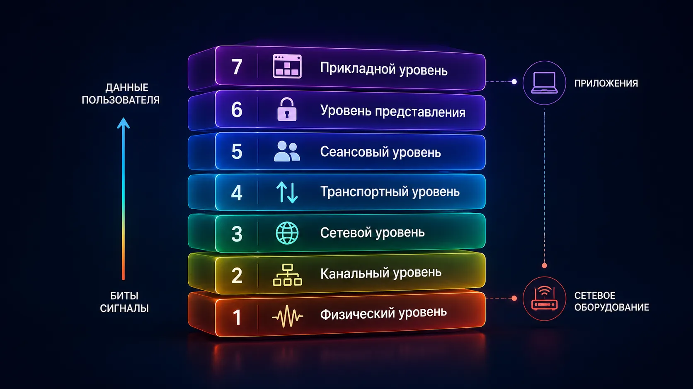

Все сетевые процессы делятся условно на 7 уровней

---

### 3.2.1 Физический уровень

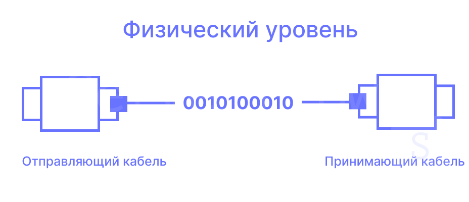

**Определение:** Физический уровень — нижний уровень модели OSI, <mark><strong>отвечающий за передачу сырых битов (0 и 1) по физической среде</strong></mark>: электрическими, оптическими или радиосигналами.

**Как уровень представлен.** 
- **Среда** — витая пара (Cat 5e/6), коаксиал, оптоволокно, радиоканал. 
- **Коннекторы и разъёмы** — RJ-45, SC, LC, BNC, порты RS-232, SFP-трансиверы. 
- **Устройства** — сетевые карты (электрическая часть), повторители, концентраторы, патч-панели, антенны Wi-Fi. 
- **Стандарты** — 10BASE-T, 1000BASE-T, 802.11ax (радиочасть), V.35, USB (физический слой).

| 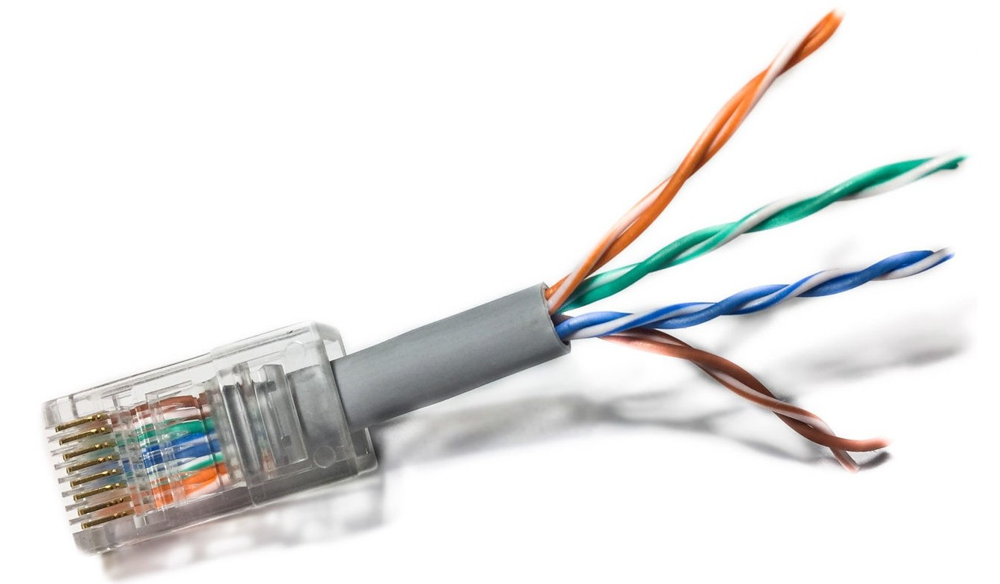  |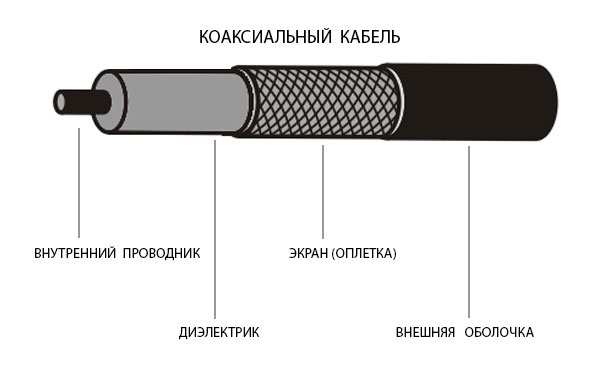   | 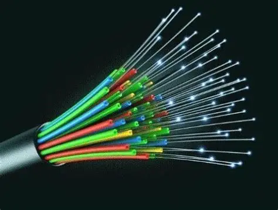  | 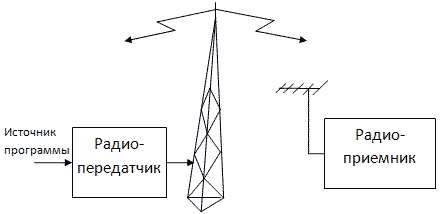  |
|---|---|---|---|
|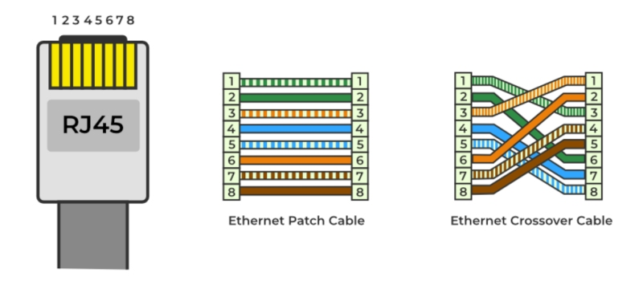   |  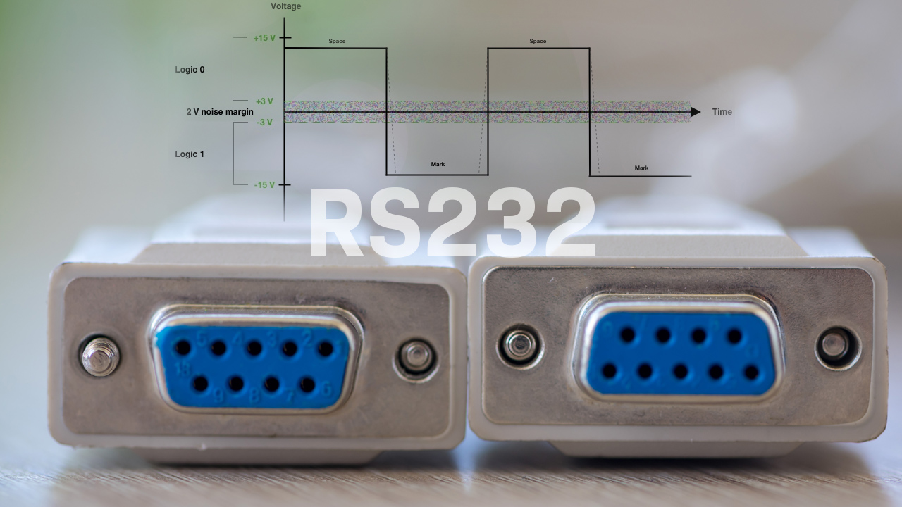| 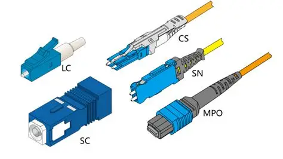  | 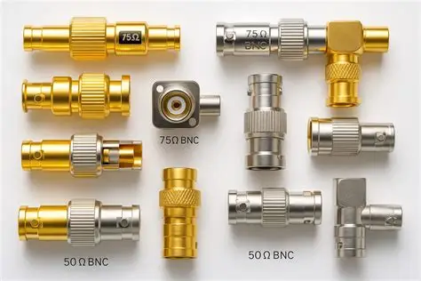  |
| 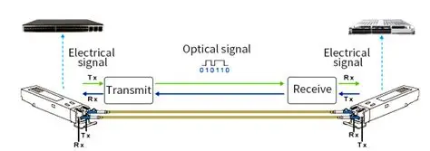  | 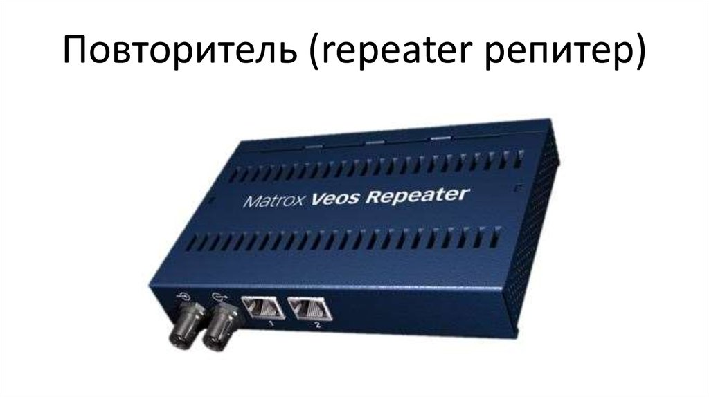  | 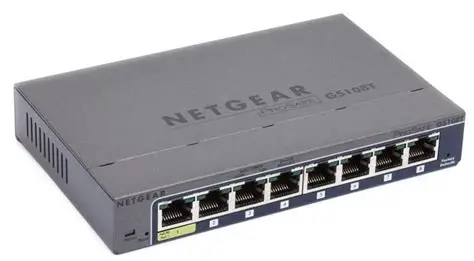  | 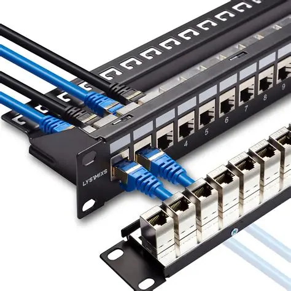  |

**Что на уровне происходит.** 
- <mark>Преобразование битов в физические сигналы и обратно</mark>; 
- <mark>задание параметров среды</mark> (уровни напряжения, длина волны, битрейт, импеданс); 
- <mark>синхронизация тактирования</mark> передатчика и приёмника; 
- определение <mark>режима передачи</mark> (simplex / half-duplex / full-duplex) и физической топологии; 
- <mark>установление и разрыв физического соединения</mark>, регенерация ослабленного сигнала. 

Типовые проблемы — обрыв кабеля, затухание, помехи, неверная распиновка.

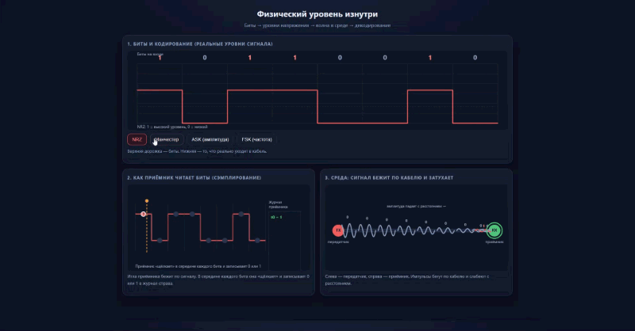

**Как отличить от других уровней.** Маркер — <mark>речь идёт о «сырых» битах и среде, без какого-либо формата кадра.</mark> Граница с канальным: физический передаёт отдельные биты, канальный собирает их в кадры с MAC-адресами и проверкой ошибок. Пример путаницы: «кабель неисправен» — физический уровень; «кадр не дошёл из-за коллизии» — уже канальный.

---

### 3.2.2 Канальный уровень (Data Link)

**Определение:** Канальный уровень — уровень модели OSI, <mark>отвечающий за надёжную доставку кадров между соседними устройствами в пределах одного локального сегмента сети.</mark>

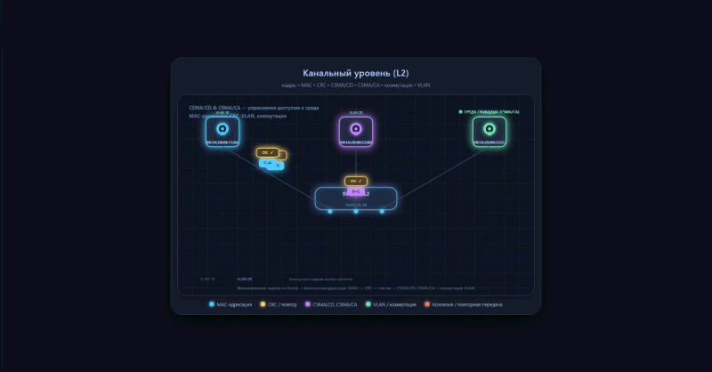

**Как уровень представлен.** 
- **Устройства** — <mark>коммутаторы, мосты, сетевые карты</mark> (MAC-часть), 
- точки доступа Wi-Fi (частично). 
- Протоколы и стандарты — Ethernet (802.3), Wi-Fi (802.11 MAC), PPP, HDLC, ARP (на стыке с сетевым), VLAN (802.1Q).

| 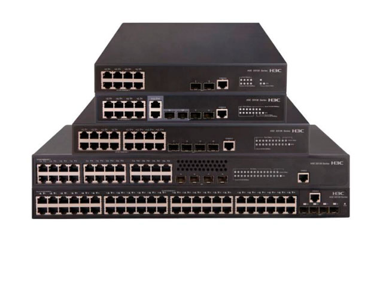  | 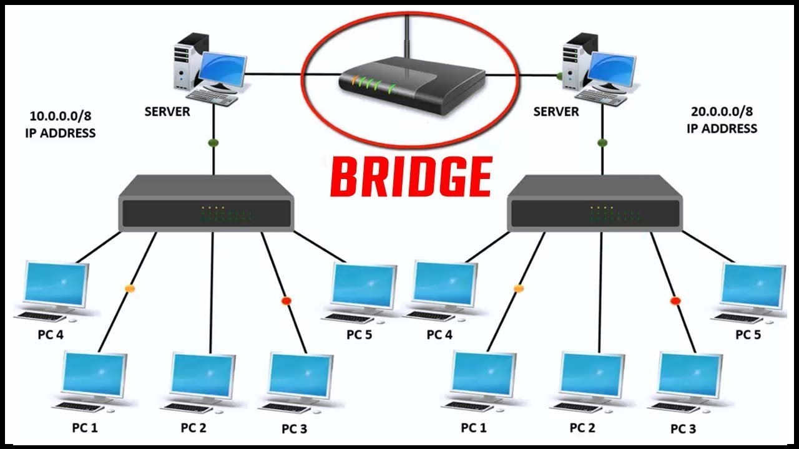  | 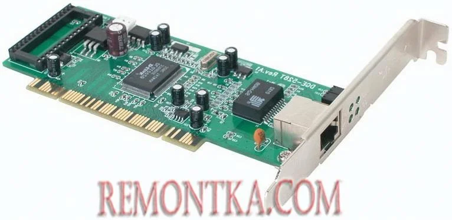  |  
|---|---|---|

**Формат данных** — <mark>кадр с MAC-адресами источника/назначения и контрольной суммой (FCS/CRC).</mark>

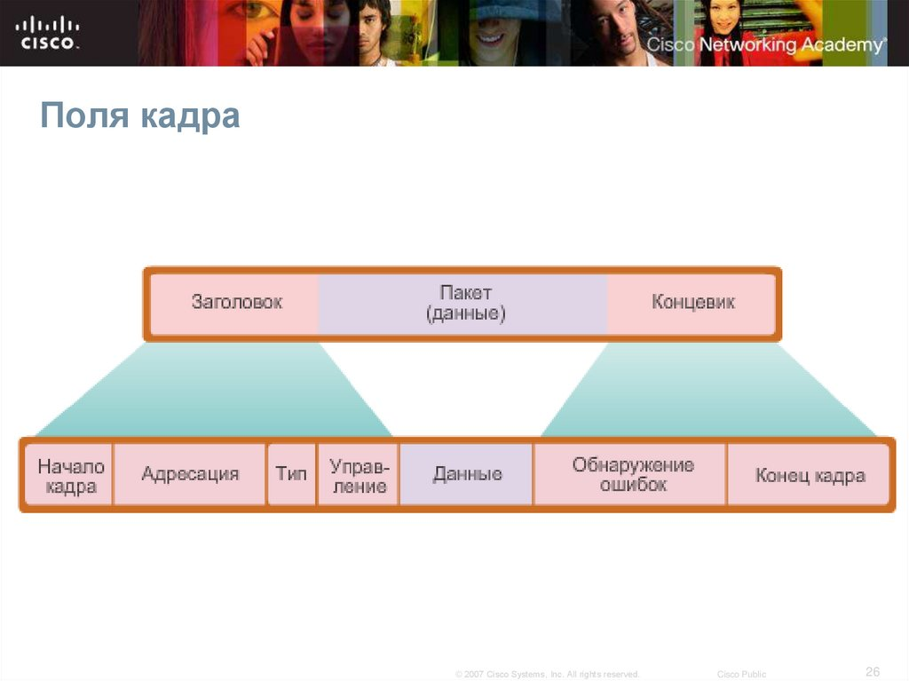

**Что на уровне происходит.** <mark>Формирование кадров из битов</mark> и обратная сборка; физическая <mark>адресация через MAC-адреса</mark>; обнаружение и коррекция ошибок передачи (CRC, повторная передача); управление доступом к общей среде (CSMA/CD, CSMA/CA); коммутация кадров внутри локального сегмента, поддержка VLAN. 

<mark>Решаемая проблема — **как надёжно доставить кадр соседнему устройству и разделить среду между несколькими передатчиками**.</mark>

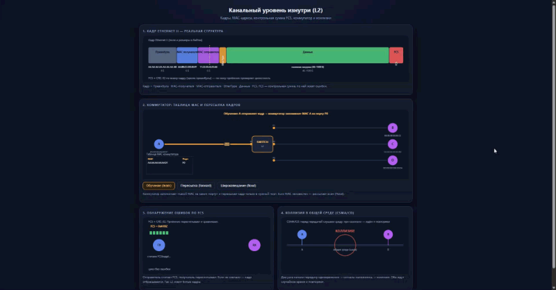

**Как отличить от других уровней.** <mark>Маркер — MAC-адреса и кадры, работа в пределах одного сегмента/локальной сети.</mark> 

**Граница с физическим:** здесь уже <mark>есть структура кадра и адреса, а не просто биты.</mark> 

**Граница с сетевым:** канальный <mark>доставляет кадр соседу, сетевой маршрутизирует пакет через несколько сетей по IP.</mark> Пример путаницы: «коммутатор переслал кадр» — канальный; «маршрутизатор переслал пакет» — сетевой.

---

### 3.2.3 Сетевой уровень (Network)

**Определение:** Сетевой уровень — уровень модели OSI, <mark>отвечающий за логическую адресацию и маршрутизацию пакетов между разными сетями.</mark>

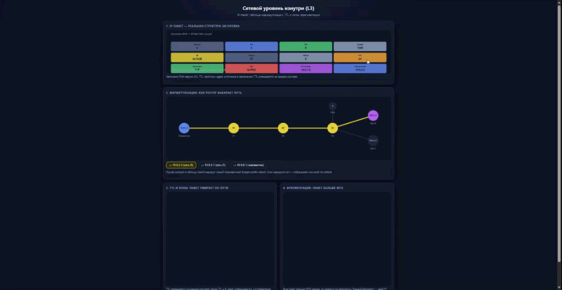

**Как уровень представлен.** Устройства — маршрутизаторы, L3-коммутаторы, межсетевые экраны (частично). Протоколы — IP (IPv4/IPv6), ICMP, ARP (стык), OSPF, BGP, RIP, IPsec (частично). 

| 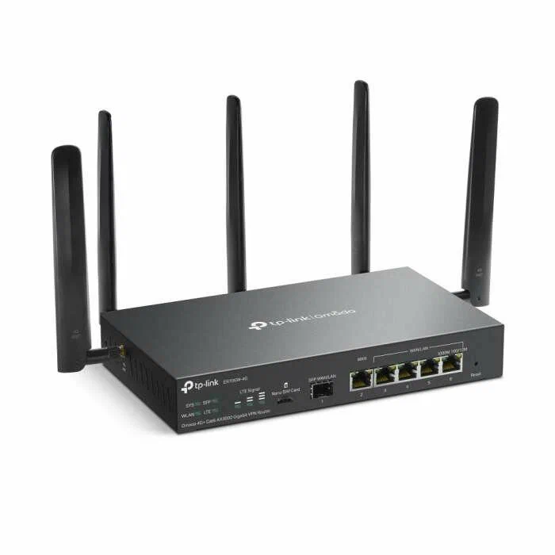  | 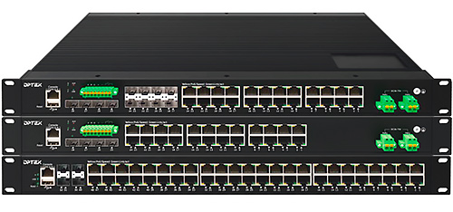  | 
|---|---|

Формат данных — пакет с IP-адресами источника/назначения. Утилиты — ping, traceroute.

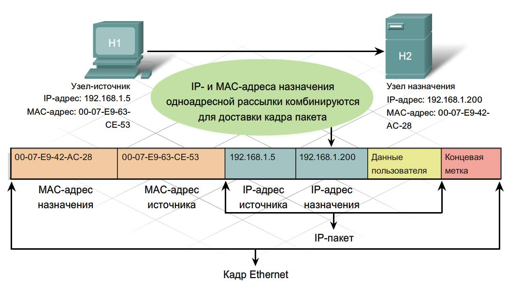

**Что на уровне происходит.** <mark>Логическая адресация через IP-адреса; маршрутизация — выбор пути пакета через несколько сетей</mark>; фрагментация и сборка пакетов, управление TTL; интернетирование — связывание разнородных сетей. <mark>Решаемая проблема — как доставить пакет от источника к получателю через множество промежуточных сетей, не зная физической топологии.</mark>

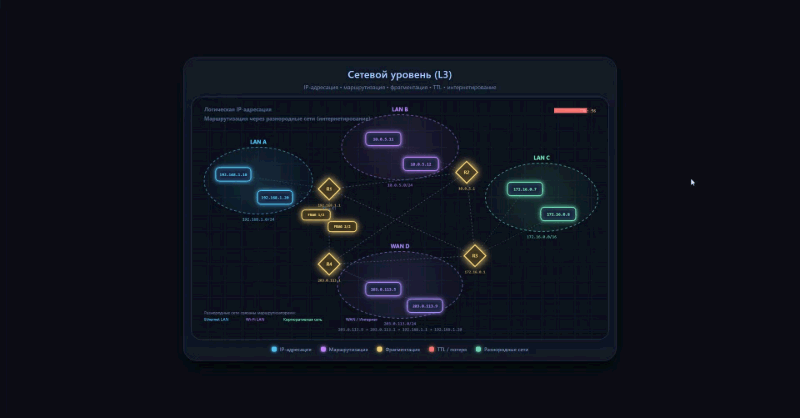

**Как отличить от других уровней.** Маркер — IP-адреса и маршрутизация между сетями. Граница с канальным: канальный работает с MAC внутри одного сегмента, сетевой — с IP через границы сетей. Граница с транспортным:<mark> сетевой доставляет пакет до хоста, но не гарантирует порядок и целостность потока — это уже транспортный.</mark> Пример путаницы: «пакет потерялся по пути» — сетевой; «сегмент пришёл не по порядку» — транспортный.

---

### 3.2.4 Транспортный уровень (Transport)

**Определение:** Транспортный уровень — уровень модели OSI, <mark>обеспечивающий передачу данных между процессами на хостах</mark> с нужной степенью надёжности.

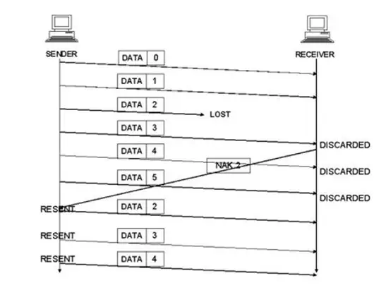

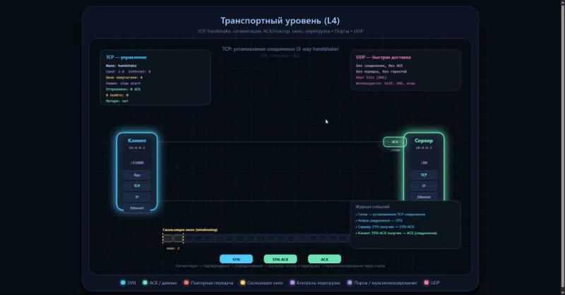

**Как уровень представлен.** <mark>Реализация — в операционной системе</mark> (стек TCP/IP), <mark>в приложениях и библиотеках.</mark> Протоколы — TCP, UDP, QUIC, SCTP. Формат данных — сегмент (TCP) или датаграмма (UDP) с портами источника/назначения. Понятия — сокеты, порты (80, 443, 53).

**Что на уровне происходит.** Сегментация потока данных и сборка на приёмнике; установление, поддержание и завершение соединения (TCP handshake); <mark>обеспечение надёжности — подтверждения, повторная передача, упорядочивание;</mark> контроль потока (windowing) и перегрузки (congestion control); <mark>мультиплексирование приложений через порты;</mark> UDP — быстрая доставка без гарантий. Решаемая проблема — как обеспечить надёжную (или быструю) передачу между процессами, скрывая детали сети.

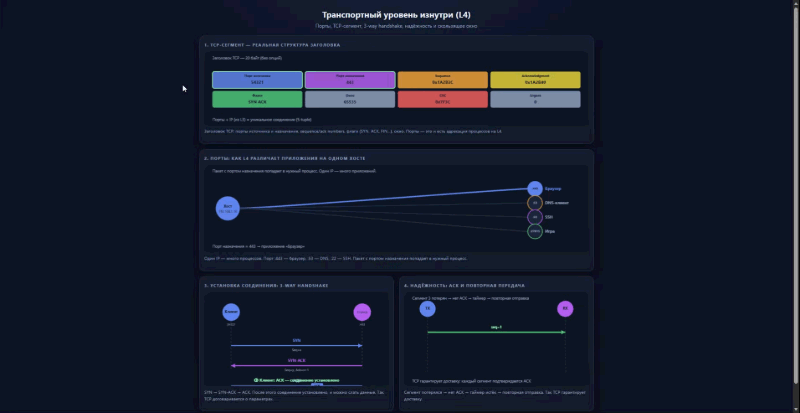

**Как отличить от других уровней.** Маркер — порты и сквозное соединение между приложениями. Граница с сетевым:<mark> сетевой доставляет пакет до хоста (IP), транспортный — до конкретного процесса (порт) и отвечает за порядок/надёжность.</mark> Граница с сеансовым: транспортный не управляет диалогом приложения, только передачей. Пример путаницы: «пакет не дошёл до хоста» — сетевой; «данные дошли, но не в том порядке» — транспортный.

---

### 3.2.5 Сеансовый уровень (Session)

**Определение:** Сеансовый уровень — уровень модели OSI, <mark>управляющий установлением, поддержанием и завершением диалога (сеанса) между приложениями.</mark>

**Как уровень представлен.** <mark>Реализация — в приложениях и библиотеках</mark> (в чистом виде выделяется редко). Примеры — RPC, NetBIOS, PPTP, SIP (управление сессиями VoIP), сессии в TLS/SSH (частично), cookies/сессии в веб-приложениях, API сокетов. Формат — управляющие сообщения установления/поддержания/завершения диалога.

**Что на уровне происходит.** Установка, управление и завершение сеансов связи между приложениями; синхронизация диалога (кто когда говорит); организация контрольных точек (checkpoints) для возобновления после сбоя; управление блокировками и токенами. Решаемая проблема — как организовать длительный диалог между приложениями, корректно его начать, приостановить и завершить.

**Как отличить от других уровней.** Маркер — управление диалогом/сессией, а не передачей данных. Граница с транспортным: транспортный обеспечивает передачу сегментов, сеансовый — логику диалога поверх неё. Граница с представления: сеансовый управляет когда и как долго идёт обмен, представления — в каком виде кодируются данные. Пример путаницы: «TCP-соединение установлено» — транспортный; «сессия SSH поддерживается и возобновляется» — сеансовый.

### 3.2.6 Уровень представления (Presentation)

**Определение:** Уровень представления — уровень модели OSI,<mark> отвечающий за преобразование данных к виду, понятному принимающему приложению (кодирование, сжатие, шифрование).</mark>

**Как уровень представлен.** <mark>Реализация — библиотеки кодирования/шифрования/сжатия в ОС и приложениях.</mark> Примеры — TLS/SSL (шифрование), ASCII/UTF-8/Unicode, JPEG/PNG/GIF, MP3/MP4, gzip, JSON/XML, MIME, ASN.1, сериализация (protobuf). Особенность — часто «встроен» в прикладные протоколы (HTTPS = HTTP + TLS).

**Что на уровне происходит.** Кодирование символов (UTF-8) и преобразование форматов (EBCDIC↔ASCII); сжатие (gzip) и распаковка данных; шифрование и дешифрование (TLS); сериализация структур данных (JSON, ASN.1). Решаемая проблема — как обеспечить одинаковое понимание данных разными системами независимо от их внутреннего представления.

**Как отличить от других уровней.** Маркер — формат, кодировка, шифрование, сжатие, то есть «как выглядят данные». Граница с сеансовым: сеансовый управляет диалогом, представления — формой данных. Граница с прикладным: прикладной определяет что делать (HTTP-запрос, отправка письма), представления — в каком виде это закодировано. Пример путаницы: «браузер отправил HTTP-запрос» — прикладной; «тело запроса сжато gzip и зашифровано TLS» — представления.

### 3.2.7 Прикладной уровень (Application)

**Определение:** Прикладной уровень — верхний уровень модели OSI, предоставляющий <mark>сетевые услуги конечным пользователям и приложениям и определяющий семантику их взаимодействия.</mark>

**Как уровень представлен.** <mark>Приложения и сервисы — браузеры, почтовые клиенты, веб-серверы (nginx, Apache), DNS-серверы.</mark> Протоколы — HTTP/HTTPS, FTP, SMTP/IMAP/POP3, DNS, DHCP, SSH, Telnet, SNMP, WebSocket, gRPC. Интерфейсы — API и пользовательские интерфейсы. Формат — сообщения протоколов прикладного уровня (HTTP-запрос/ответ, DNS-запрос).

**Что на уровне происходит.** Предоставление сетевых услуг: веб-доступ, электронная почта, передача файлов, разрешение имён (DNS), удалённый доступ, обмен сообщениями; <mark>определение семантики взаимодействия — что означает запрос и ответ, какие команды и коды существуют.</mark> Решаемая проблема — как приложения разных систем могут обмениваться осмысленными данными для конкретных задач пользователя.

**Как отличить от других уровней.** Маркер — сетевой сервис для пользователя/приложения, то есть «что делается». Граница с представления: прикладной задаёт смысл и структуру сообщения, представления — кодировку/шифрование/сжатие этого сообщения. Граница с сеансовым: прикладной — конкретная услуга, сеансовый — управление диалогом. Пример путаницы: «пользователь открыл сайт» — прикладной (HTTP); «данные зашифрованы TLS» — представления; «сессия поддерживается» — сеансовый.

## 3.3 Инкапсуляция

Инкапсуляция в сетях — это процесс «упаковки» данных одного уровня сетевой модели в данные другого, более низкого уровня. Каждый уровень добавляет к передаваемым данным свой заголовок (header), а иногда и трейлер (trailer), формируя таким образом новую единицу данных.

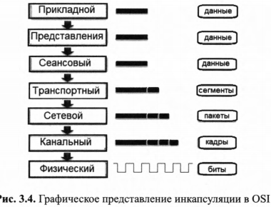

## 3.4 Деинкапсуляция

Деинкапсуляция — это обратный инкапсуляции процесс: снятие заголовков (и трейлеров) уровней модели OSI по мере продвижения данных снизу вверх, от физической среды к приложению. Если инкапсуляция — это «упаковка» данных при отправке, то деинкапсуляция — «распаковка» при приёме.

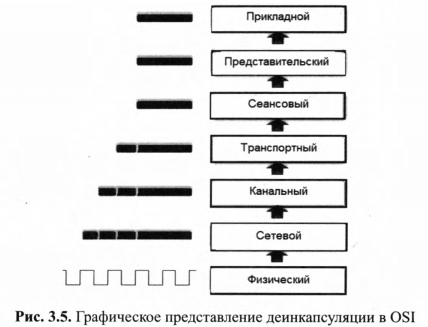

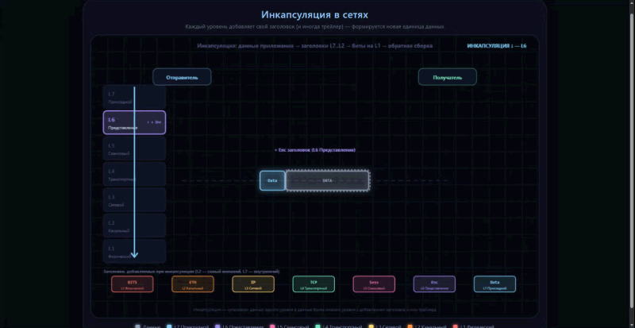

## 3.5 Обмен между узлами

Каждый уровень получателя обменивается данными с соответствующим уровнем на отправителе

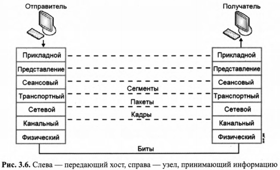

PDU (packet data unit) - элемент информации протокола. Низкий уровень использует PDU более верхнего уровня для инкапсуляции