## Семейство TCP/IP

Каждое устройство в сети имеет свой IP (Уникальный 32 битный идентификатор).

IP бывает двух версий: IPv4 , IPv6

Для обеспечения масштабирования и упрощения администрирования существует протокол автоматического получения IP.

## Структура IP

IP (Я так понимаю IPv4) состоит из 4 байтов: 192.68.50.2. Значения байтов записываются в 10 форме и разделяются точкой. Каждый байт принимает значение от 0 до 255.

IP адреса состоят из двух частей: сетевой и хвостовой.

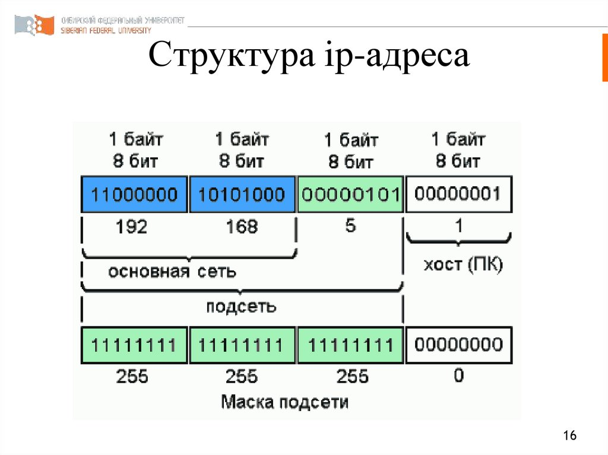

<details><summary><strong>Альт</strong></summary><table><tr><td>

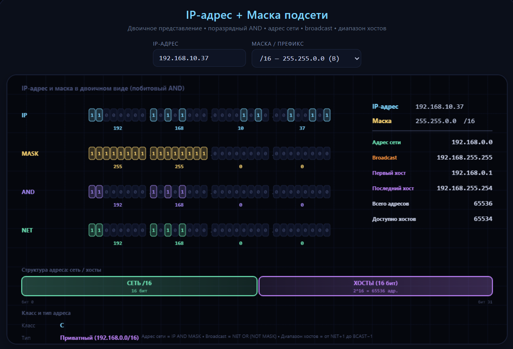

</td></tr></table></details>

Сеть и хвост - что-то вроде город, улица и номер дома (при отправке письма).

Для разделения на сетевую и хвостовую часть используется маска подсети. Пример:

| Маска: 255.0.0.0, 8 бит под сеть | Маска: 255.255.0.0, 16 бит под сеть | 
|----------------------------------|-------------------------------------|
| 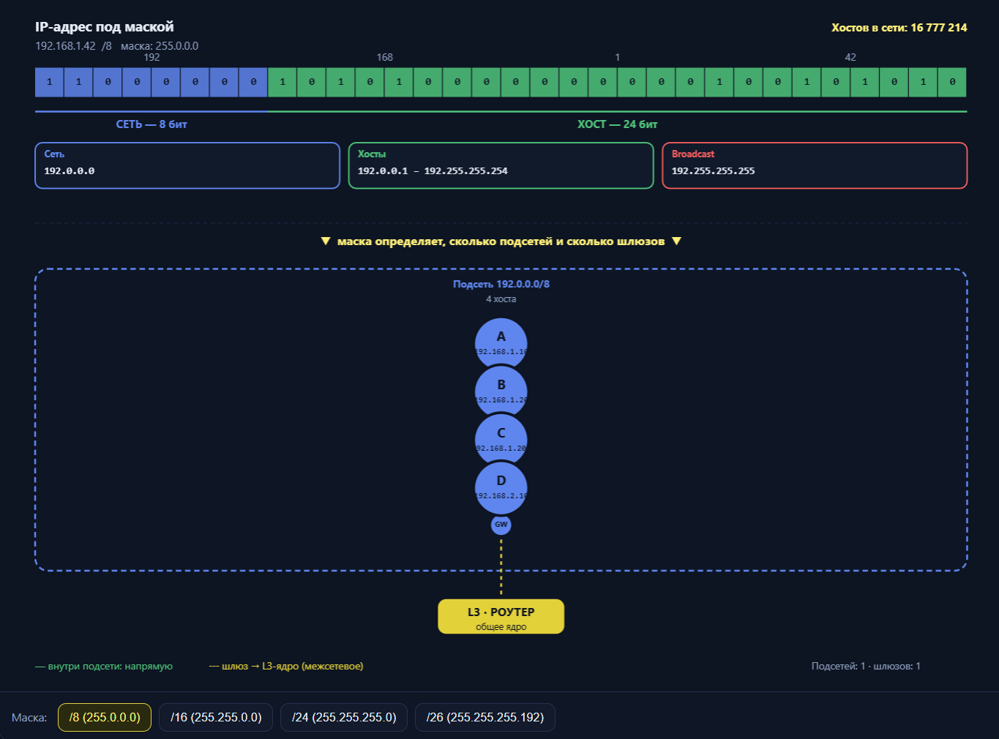            | 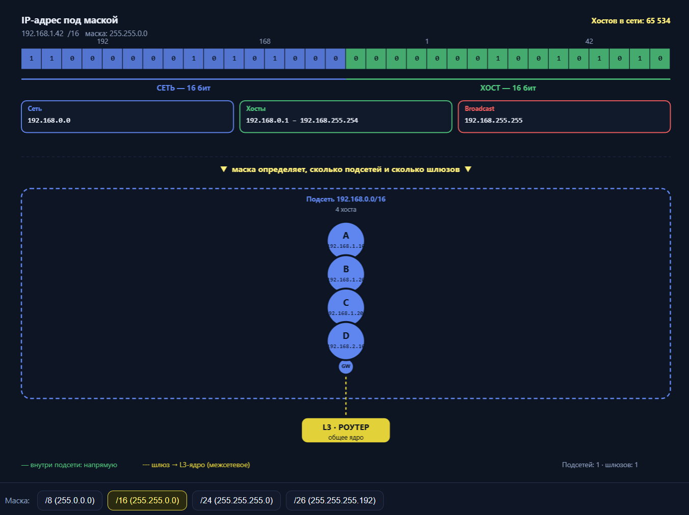               | 


Маска: 255.255.255.0, 24 бит под сеть | Маска: 255.255.255.192, 26 бит под сеть |
---------------------------------------|-----------------------------------------|
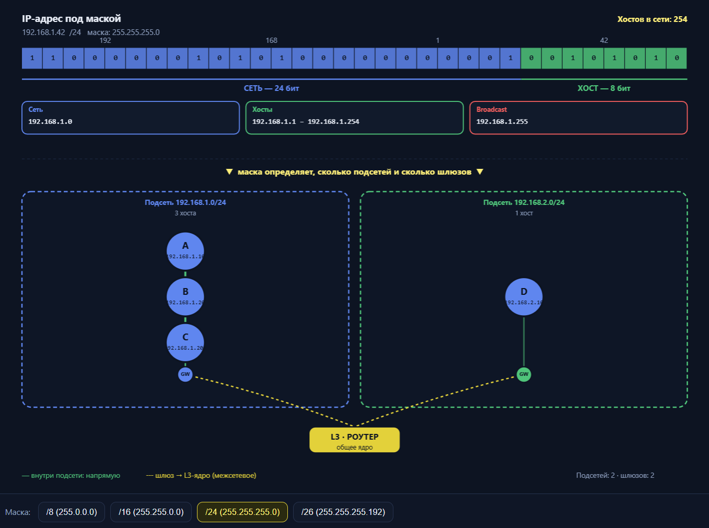                 | 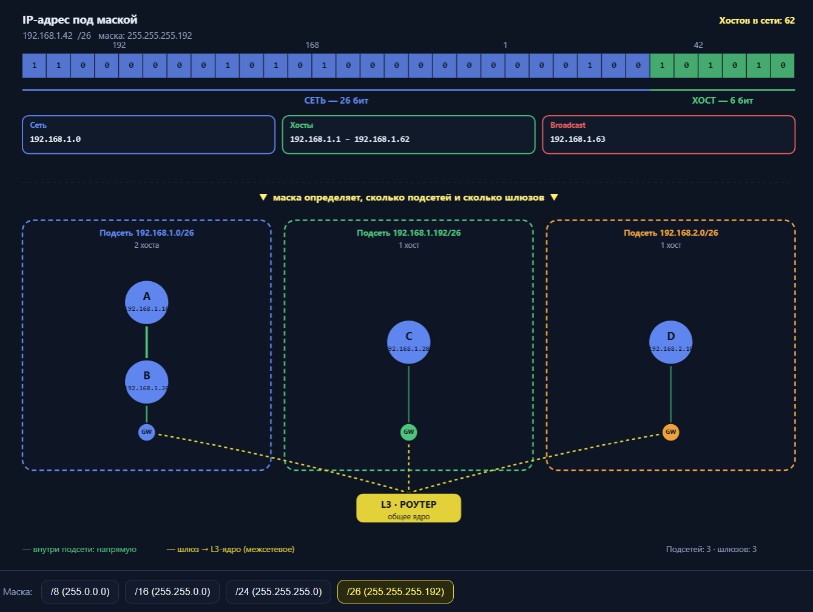                   |
## Как узнать адрес СЕТИ по ip и маске

IP-адрес вместе с маской задаёт сеть (подсеть), к которой принадлежит этот IP, и границы этой подсети. Это не адрес маршрутизатора, а описание диапазона адресов.

```
IP:    192.168.1.10
Маска: 255.255.255.0  (/24)
```

- **Адрес сети:** 192.168.1.0 — первый адрес диапазона (идентификатор подсети).
- **Broadcast:** 192.168.1.255 — последний адрес.
- **Диапазон хостов:** 192.168.1.1 – 192.168.1.254.
- Сам хост `192.168.1.10` — один из адресов внутри этой подсети.

Хост по своей паре IP+маска понимает:
1. **Какие адреса локальны** — если IP назначения попадает в ту же подсеть, шлём напрямую (через ARP, L2).
2. **Какие адреса не локальны** — если IP назначения вне подсети, шлём **шлюзу по умолчанию**, то есть маршрутизатору.

То есть маска помогает хосту решить: «отправлять напрямую или через роутер». (еще для каждой подсети свой шлюз, но при этом физически это может быть один роутер) 

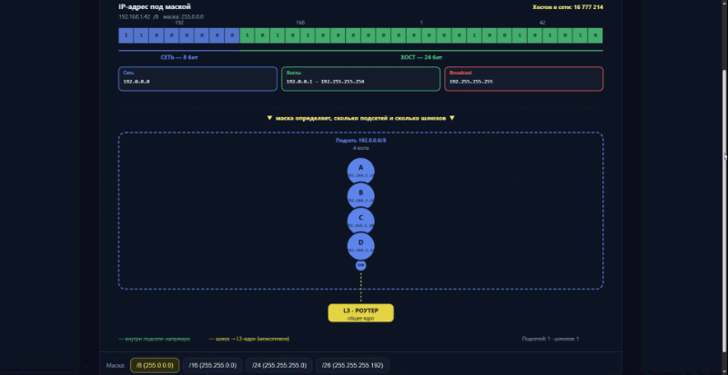

## IP адресация

IP адрес однозначно идентифицирует каждый узел в ip сети. Каждый хост должен иметь уникальный IP.

- Сетевая часть IP идентифицирует СЕТЬ компонентом которой является данный узел сети
- Хвостовая часть определяет конечную точку.

## Классы IP

Классы IP — это историческая схема разделения IPv4-адресов на классы (A, B, C, D, E), введённая в раннем Интернете. Класс определялся первыми битами адреса и задавал фиксированную маску для сети. Сегодня в чистом виде не используется — на смену пришла бесклассовая адресация (CIDR)

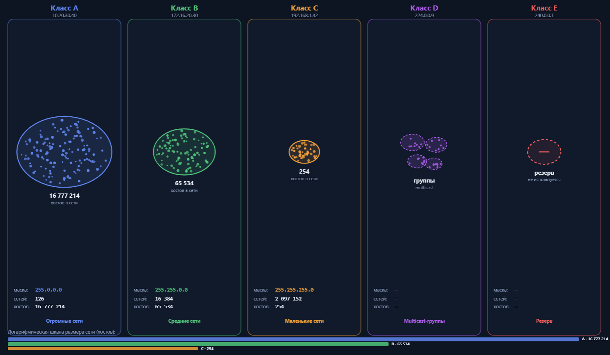

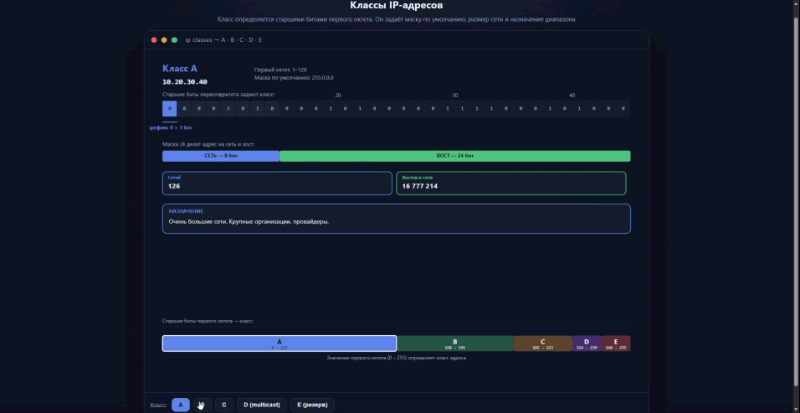

### Класс А

Для обозначения сети используется только первый октет (8 бит). Остальные три октета — адресация хостов. Первый бит всегда `0`, поэтому первый октет может быть от 0 до 127 (`01111111`). При этом 127 зарезервирован под loopback (localhost), а 0 — под «эту сеть», так что реально рабочий диапазон — **1–126**.

- **Маска:** 255.0.0.0 (/8)
- **Сетей:** 126, **хостов в каждой:** ~16,7 млн
- **Назначение:** очень крупные сети, провайдеры.

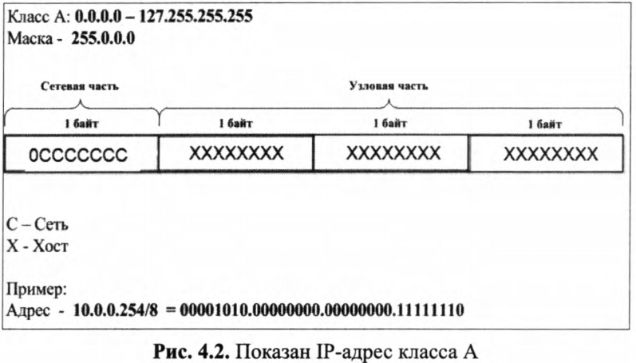

### Класс B

Для сети отводятся первые **два октета** (16 бит). Первые два бита всегда `10`, поэтому первый октет — от 128 до 191 (`10111111`). Остальные два октета — хосты.

- **Маска:** 255.255.0.0 (/16)
- **Сетей:** ~16 тыс., **хостов в каждой:** ~65 тыс.
- **Назначение:** средние и крупные организации.

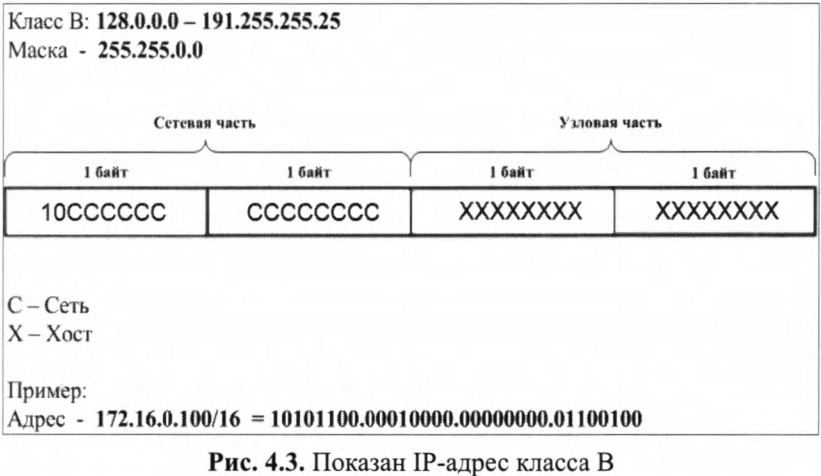

### Класс C

Для сети — первые **три октета** (24 бита). Первые три бита всегда `110`, поэтому первый октет — от 192 до 223 (`11011111`). Последний октет — хосты.

- **Маска:** 255.255.255.0 (/24)
- **Сетей:** ~2 млн, **хостов в каждой:** 254
- **Назначение:** малые сети, типичная домашняя/офисная подсеть.

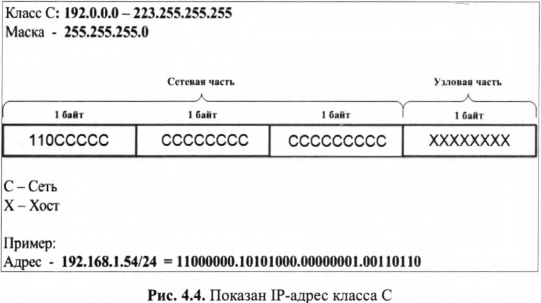

### Класс D

Первые четыре бита — `1110`, первый октет — **224–239**. Под сеть/хост не делится, маски нет.

- **Назначение:** **мультикаст** (групповая рассылка: IPTV, OSPF, RIP, потоковое видео).

### Класс E

Первые четыре бита — `1111`, первый октет — **240–255**.

- **Назначение:** зарезервирован для экспериментов и будущего использования; в обычных сетях не применяется.


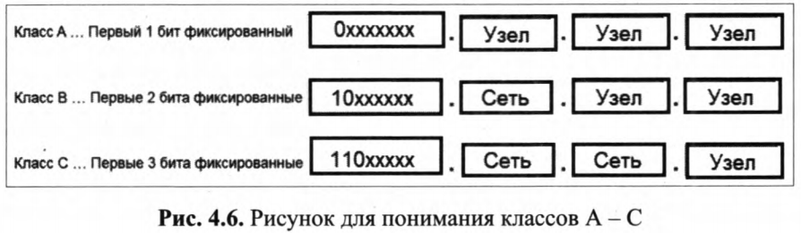


### Проблема классовой модели

- **Негибкость:** если организации нужно 300 хостов, класс C (/24, 254 хоста) мал, а класс B (/16, 65 тыс.) — расточителен. Адреса расходовались впустую.
- **Быстрое истощение IPv4** из-за неэффективного распределения.
- **Нет гибкой маски:** нельзя было взять, например, /22.

### Что пришло на смену

**CIDR (Classless Inter-Domain Routing, 1993)** — бесклассовая адресация. Маска задаётся **явно префиксом** (/22, /26, /30 и т.д.) и может быть любой длины. Это позволило:

- гибко нарезать адресное пространство под реальные нужды;
- агрегировать маршруты (summarization);
- существенно замедлить истощение IPv4.

Дополнительно появились **VLSM** (маски переменной длины) и **приватные адреса + NAT**.

## Зарезервированные IP

### Loopback (localhost)

**127.0.0.0/8** — весь диапазон от 127.0.0.1 до 127.255.255.254. Пакет, отправленный на такой адрес, **не уходит в сеть** — он обрабатывается самим хостом.

### Broadcast

Адрес, по которому пакет получают **все хосты в подсети**.

- **Направленный (directed) broadcast** — последний адрес подсети: для 192.168.1.0/24 это **192.168.1.255**. Вычисляется как «все биты хоста = 1».
- **Ограниченный (limited) broadcast** — **255.255.255.255**, не выходит за пределы локального сегмента (используется, например, в DHCP Discover).
- Пакеты на broadcast не маршрутизируются через роутер (по умолчанию).

### Адрес сети и «эта сеть»

- **Адрес сети** — первый адрес подсети (все биты хоста = 0): 192.168.1.0/24. Обозначает саму подсеть, хосту не назначается.
- **0.0.0.0** — «неизвестный/любой адрес»: используется как адрес источника до получения IP (DHCP), как «любой интерфейс» при прослушивании портов (0.0.0.0:80), как маршрут по умолчанию в таблице маршрутизации.

### Частные (private) адреса — RFC 1918

Не маршрутизируются в публичном Интернете, используются внутри локальных сетей. Выход в Интернет — через **NAT**.

| Диапазон | Маска | Класс (исторически) | Число адресов |
|---|---|---|---|
| **10.0.0.0 – 10.255.255.255** | /8 | A | ~16,7 млн |
| **172.16.0.0 – 172.31.255.255** | /12 | B | ~1 млн |
| **192.168.0.0 – 192.168.255.255** | /16 | C | ~65 тыс. |

Именно эти адреса ты видишь дома (192.168.x.x) и в офисах (10.x.x.x).

### Публичные адреса

Все остальные адреса IPv4, которые **глобально маршрутизируются** в Интернете и уникальны в мировом масштабе. Выдаются провайдерами (RIR: RIPE, ARIN, APNIC и т.д.). Публичный адрес может быть **статическим** (постоянным) или **динамическим** (меняется, например, при переподключении).


<table><tr><td>

NAT (Network Address Translation) — это технология преобразования сетевых адресов, которая используется в сетях TCP/IP для изменения IP-адресов в заголовках пакетов, проходящих через маршрутизатор. Основная цель NAT — экономия публичных IP-адресов и обеспечение конфиденциальности внутренней сети.

Когда устройство в локальной сети отправляет пакет в интернет, маршрутизатор заменяет его внутренний IP-адрес на свой внешний (публичный) IP-адрес. Также изменяется номер порта, чтобы маршрутизатор мог различать пакеты, возвращающиеся к разным устройствам. Эта информация временно сохраняется в таблице маршрутизатора.

Nat подменяет внутренний ip на свой и пробрасывает порт. То есть, например, роутер подменяет ip адрес, любого узла домашней сети на свой и добавляет нужный порт, чтобы суметь обратно идентифицировать узел

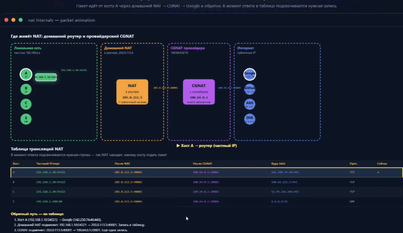

</td></tr></table>

## Бесклассовые адреса (CIDR)

CIDR (Classless Inter-Domain Routing) — бесклассовая междоменная маршрутизация. Это способ записи IP-адресов и масок, пришедший на смену классам A/B/C в 1993 году. Суть: маска задаётся явно числом битов (префиксом), а не выводится из класса адреса.

Итак, классы отличаются количеством хостов. Со временем от классов отказались. CIDR позволяет более гибко управлять блоками ip адресов. Здесь адрес состоит не из двух, а из ТРЕХ частей:

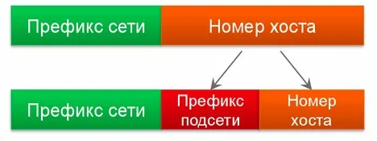

Еще картинка:

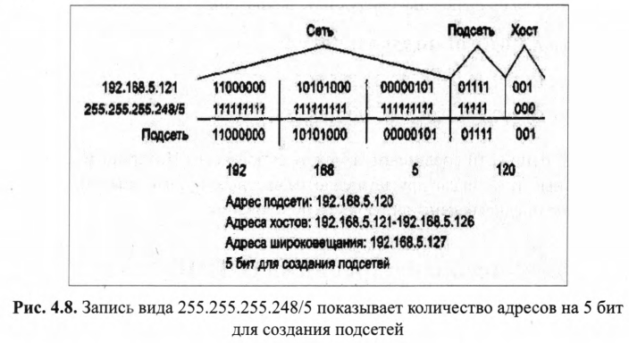

<table><tr><td>

Не совсем понял
Чем оно отличается то от обычной? Только тем, что мы теперь не исползуем классы?

Да, по сути — именно тем, что перестали использовать классы. Но это не «косметическое» отличие, а очень практическое. Давай покажу на примере, в чём разница.

### Как было с классами

Маска **жёстко привязана к классу** и выводится из первого октета. Выбирать её нельзя.

Допустим, организации нужно **300 хостов**. Варианты:

- **Класс C** (`/24`): максимум 254 хоста — **не хватает**.
- **Класс B** (`/16`): 65 534 хоста — **берём, но 65 тысяч адресов улетают в мусор**.

То есть в классовой модели ты **не можешь попросить ровно 300 адресов**. Только «коробки» фиксированного размера: /8, /16, /24. И между ними — пропасть.

### Как стало с CIDR

Маску можно **задать любую** — /22, /23, /25, /26, /30. Ты выбираешь ровно столько, сколько нужно.

Для 300 хостов берёшь **`/23`** (512 адресов, 510 хостов) — близко к нужному, без гигантских потерь. Или `/23` на 510, или два `/24`. Главное — **префикс не обязан быть кратным 8 и не привязан к первому октету**.

## Ключевое отличие — не «отмена классов», а «маска стала параметром»

</td></tr></table>

<details><summary><strong>Как устроны CIDR, как отменяют классы и как создаются подсети</strong></summary><table><tr><td>

Хорошо, покажу на конкретных адресах — и станет видно, что класс **ничего не решает** в CIDR.

## Пример 1: адрес 10.1.5.10/24

Смотрим на первый октет: **10**. Исторически это класс A.

**В классовой модели:**
- Класс A → маска /8 → сеть `10.0.0.0/8`.
- Хост `10.1.5.10` лежит в сети `10.0.0.0/8`.

**В CIDR (маска /24):**
- Сеть = IP AND маска = `10.1.5.0/24`.
- Класс A «говорит» /8, но **никто его не слушает**. Префикс /24 задаёт границу: сеть `10.1.5.0`, хосты `.1–.254`.

**Вывод:** класс A предсказал бы /8, а реальная сеть — /24. Класс **не определяет сеть**.

## Пример 2: адрес 172.16.5.10/26

Первый октет **172** → исторически класс B (диапазон 128–191).

**Классовая модель:**
- Класс B → /16 → сеть `172.16.0.0/16`.

**CIDR (/26):**
- Маска /26 = `255.255.255.192`.
- IP AND маска:
  ```
  172.16.5.10   = ...00000101.00001010
  255.255.255.192 = ...11000000
  --------------------------------
  172.16.5.0    → сеть 172.16.5.0/26
  ```
- Хосты: `172.16.5.1 – 172.16.5.62`.

**Вывод:** класс B сказал бы «сеть 172.16.0.0/16», но CIDR даёт `172.16.5.0/26`. Опять класс не у дел.

## Пример 3: адрес 192.168.1.100/22

Первый октет **192** → исторически класс C (маска /24).

**Классовая модель:**
- Класс C → /24 → сеть `192.168.1.0/24`.

**CIDR (/22):**
- /22 = `255.255.252.0`.
- IP AND маска:
  ```
  192.168.1.100  = 192.168.00000001.01100100
  255.255.252.0  = 255.255.11111100.00000000
  --------------------------------
  192.168.0.0    → сеть 192.168.0.0/22
  ```
- Сеть **шире**, чем класс C! Хосты: `192.168.0.1 – 192.168.3.254`.

**Вывод:** класс C сказал бы «/24», а CIDR даёт «/22» — сеть **больше** классовой. Класс снова не определяет границу.

## Где тут «подсеть»

Слово «подсеть» — **относительное**. Оно значит «сеть с более длинным префиксом внутри более крупного блока». Пример:

```
10.0.0.0/8          ← крупный блок («сеть» провайдера)
  10.1.0.0/16       ← подсеть внутри /8
    10.1.5.0/24     ← подсеть внутри /16
      10.1.5.10     ← хост
```

- `10.1.5.0/24` — подсеть **относительно** `10.0.0.0/8`.
- Но **не потому, что класс A**, а потому что /24 длиннее /8.
- Если бы провайдер дал тебе `10.1.5.0/24`, ты мог бы нарезать её на `10.1.5.0/26`, `10.1.5.64/26` и т.д. — это тоже «подсети», и класс тут вообще ни при чём.

## Ключевая таблица

| Адрес | Класс (историч.) | Маска класса | Реальная сеть в CIDR | Совпадает? |
|---|---|---|---|---|
| 10.1.5.10/24 | A | /8 | 10.1.5.0/24 | Нет |
| 172.16.5.10/26 | B | /16 | 172.16.5.0/26 | Нет |
| 192.168.1.100/22 | C | /24 | 192.168.0.0/22 | Нет |

Во всех случаях **сеть определяется префиксом, а не классом**. Класс — просто историческая метка по первому октету, которая в CIDR **не участвует** в вычислении границы сети.

## Ответ на твой вопрос

> «Классы всё равно используются, но только для определения сети?»

**Нет.** В CIDR классы **не используются** для определения сети вообще. Сеть определяет **только маска**. «Подсеть» возникает не из-за класса, а из-за того, что префикс длиннее родительского блока. Класс — это просто ярлык вроде «этот адрес исторически из класса A», и на маршрутизацию он не влияет.

</td></tr></table></details>

