## Ethernet

Классификация сетей по размеру (по возрастанию):

Сети выбвают LAN (local) и WAN (wide) :

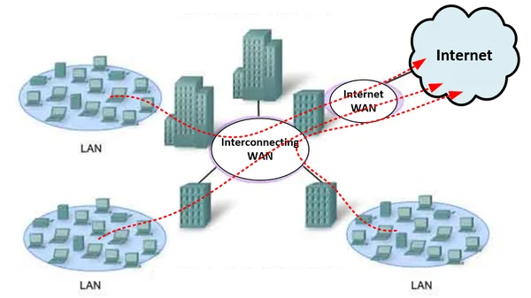

На самом деле выделяют еще PAN (personal) и MAN (metropolitan):

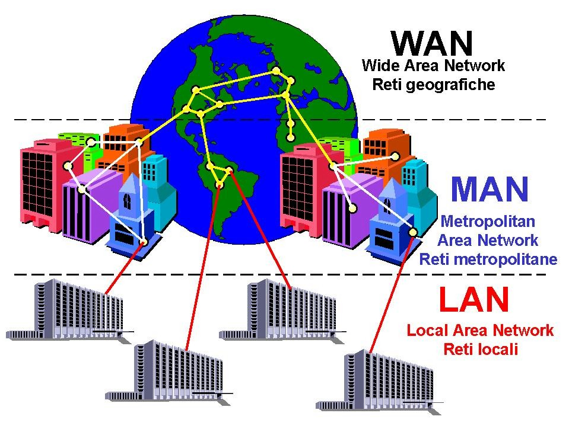

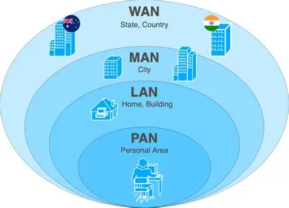

p.s. AN - area network

| Тип | Расшифровка | Масштаб | Пример |
|---|---|---|---|
| **PAN** | Personal Area Network | ~1–10 м | Bluetooth-наушники, USB-хаб, связка телефон↔часы |
| **LAN** | Local Area Network | помещение / здание / кампус | домашняя сеть, офис, школьный класс |
| **MAN** | Metropolitan Area Network | город (~5–50 км) | городская сеть провайдера, сеть между офисами в одном городе |
| **WAN** | Wide Area Network | страна / континент / мир | интернет, сеть филиалов компании между городами |

Сети классифицируют по масштабу: PAN (личная) → LAN (локальная) → MAN (городская) → WAN (глобальная). Более крупная категория обычно соединяет более мелкие (WAN соединяет LAN/MAN, MAN соединяет LAN), но это не жёсткое правило «кирпичиков», а описание охвата

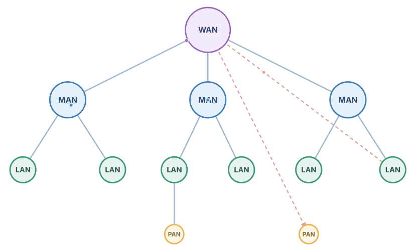

<strong>Уточнение</strong>
<table><tr><td>

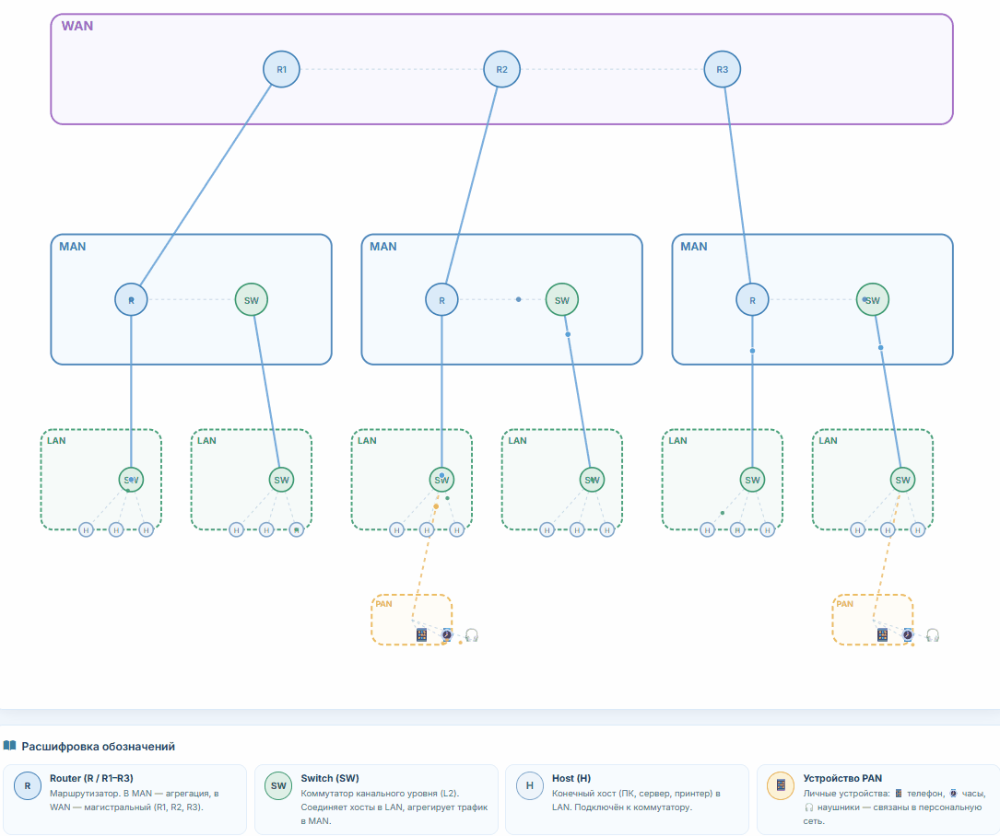

</td></tr></table>

Какие стандарты где используются:

| Тип | Основные стандарты / технологии | Ключевые (основные) |
|---|---|---|
| **PAN** | IEEE 802.15.1 (**Bluetooth**), IEEE 802.15.4 (**Zigbee**, Thread), **NFC** (ISO/IEC 14443, 18092), **USB** (2.0/3.x/4), **IrDA**, **ANT+**, **UWB** (IEEE 802.15.4z) | **Bluetooth**, **USB**, **NFC** |
| **LAN** | IEEE **802.3 (Ethernet)**, IEEE **802.11 (Wi-Fi / WLAN)**, IEEE 802.1Q (VLAN), **ARP**; опц.: 802.1X, PoE (802.3af/at/bt) | **Ethernet (802.3)**, **Wi-Fi (802.11)** |
| **MAN** | **Metro Ethernet** (MEF, IEEE 802.3ah/802.1ad), **MPLS**, **DWDM**, **SDH/SONET**, **WiMAX** (IEEE 802.16), **GPON/EPON** (ITU-T G.984 / IEEE 802.3ah) | **Metro Ethernet**, **MPLS**, **DWDM** |
| **WAN** | **MPLS**, **SD-WAN**, **VPN** (IPsec, SSL/TLS), **BGP** (маршрутизация), **PPP/HDLC**, **Frame Relay**, **ATM**, **xDSL**, **DOCSIS**, **4G LTE / 5G** (3GPP), **спутник** (DVB-S2, Starlink), магистральная **оптика (OTN, DWDM)** | **MPLS**, **BGP**, **VPN**, **5G/LTE**, **оптика (OTN/DWDM)** |

Для ЛАН были разработаны следующие стандарты: TokenRing, FDDI, Ethernet. На данный момент наиболее часто использующейся является Ethernet.
На данные момент есть следующие стандарты:

- Ethernet 10Base-T (10 мбит/c по витой паре, категория кабеля 3 и выше)
- FastEthernet 100Base-T (100 мбит/c по витой паре, категории 5 и выше)
- GigabitEthernet 1000Base-T (1000 мбит/с по витой паре категории 5 и выше)
- 10GigabitEthernet 10GBase-T (10000 мбит/c по витой паре категории 6 и выше)

Биты, передающиеся по локальной сети Ethernet образуют кадры. Под кадром понимается контейнер, в который помещается данные и другая служебная информация для передачи по сети. Кадр содержит данные заголовка, конца передачи и передаваемые данные.

Кадр выглядит так:

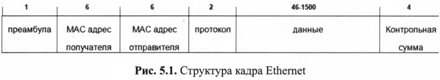

1. Преамбула - 7 байтов для разделения кадров и синхронизации передачи
2. Адрес получателя - MAC адрес получателя.
3. Адрес отправителя - MAC адрес отправителя.
4. Тип протокола - идентификация протокола высшего уровня.
5. Данные - ...
6. Контрольная сумма (FCS) - Контрольная сумма. Включает механизм проверки, позволяющий гарантировать кадра без повреждений. При получении вычисляется контрольная сумма и сравнивается с FCS.

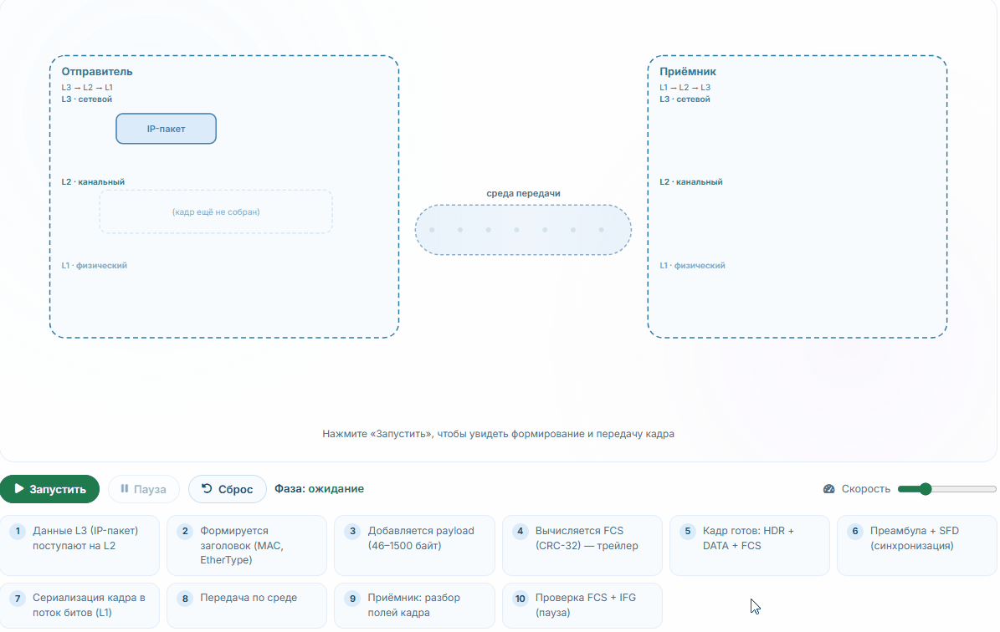

## Адресация в Ethernet

Передача данных бывает следующей: индивидуальная, широковещательная, групповая.

1. Индивидуальная - Кадр передается конкретному узлу. В одноадресной передаче участвуют только один отправитель и один получатель. Преобладающая форма передачи
2. Широковещательная - Кадр отправляется по всем остальным адресам. Отправка одного сообщения всем устройствам в локальной сети.
3. Групповая - передается группе устройств. Для этого НЕОБХОДИМО БЫТЬ ЧЛЕНОМ МНОГОАДРЕСНОЙ ГРУППЫ.

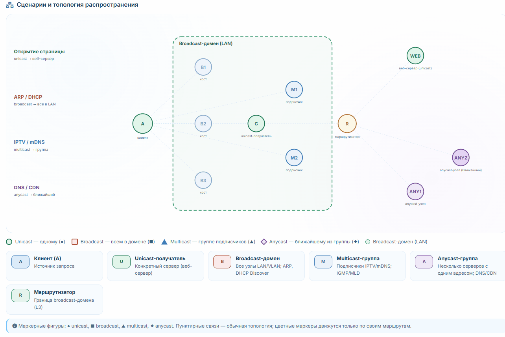

## MAC адресация 

Каждое устройство в сети должно иметь уникальный MAC адрес, чтобы учавствовать в сети.

Адрес состоит из 48 бит (6 байтов) и всегда записывается в шестнадцатеричном виде. MAC используется для идентификации на канальном уровне. Первая половина адреса (3 байта) идентифицирует производителя, вторая назначается произвольно.

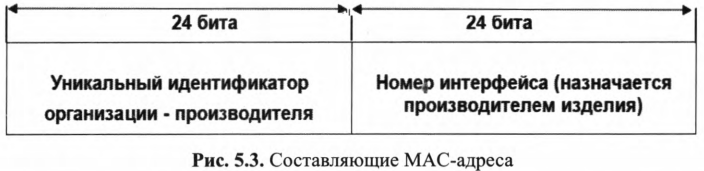

Зачем нужен IP и MAC? MAC и IP нужны вместе: MAC доставляет кадр внутри сегмента (плоская адресация, не маршрутизируется), IP — между сетями (иерархическая адресация, маршрутизируется). На каждом хопе маршрутизатор переписывает L2-заголовок (новые MAC источника/назначения), но IP-адреса концов сохраняются (кроме NAT).

При поступлении кадра сетевое устройство должно определить адресован ли кадр ему. Если кадр адресован ему, то он передаст на сетевой уровень, иначе уничтожает. Данная процедура происходит на каждом уровне:

- На канальном MAC адрес.
- На сетевом IP.
- На транспортном порт.

## Кабели и сегменты

Cегмент — это логически обособленная часть сети (L2-домен / broadcast-домен / коллизионный домен — в зависимости от контекста), а не обязательно «один кабель».

в современном Ethernet на коммутаторах каждый порт — отдельный коллизионный домен, а «непрерывный кабель» уже не определяет сегмент. Коммутатор разрывает коллизионные домены. Поэтому «сегмент = непрерывный кабель» — это про хабы и повторители, а не про современные сети.

Сегмент — это **не уровень OSI**, а **понятие о границе распространения трафика**. Исторически он определялся **физически** (непрерывный кабель, коллизионный домен), но это было следствием технологии (хабы, повторители), а не «привязки к L1».

- **Классический Ethernet на хабе:** сегмент = коллизионный домен = **L1/L2-граница** (физическая среда + канальный доступ). Коллизии — это L2-явление (CSMA/CD), хотя среда — L1.
- **Коммутатор:** разрывает коллизионные домены, но **не** разрывает broadcast-домен. Сегмент начинает определяться **не кабелем**, а **границей broadcast** — это уже **L2-понятие**.
- **VLAN:** broadcast-домен задаётся **логически** (тег 802.1Q), независимо от физики. Сегмент становится **чисто L2-логическим**.

**Вывод:** сегмент **всегда был про L2** (граница распространения кадров/broadcast), но **раньше совпадал с физическим куском кабеля**, а **теперь может быть логическим** (VLAN). Это не «переход на более высокие уровни» (L3+), а **отвязка L2-сегмента от физической топологии**. VLAN — это всё ещё **L2** (тег 802.1Q — канальный уровень), а не «более высокий уровень».

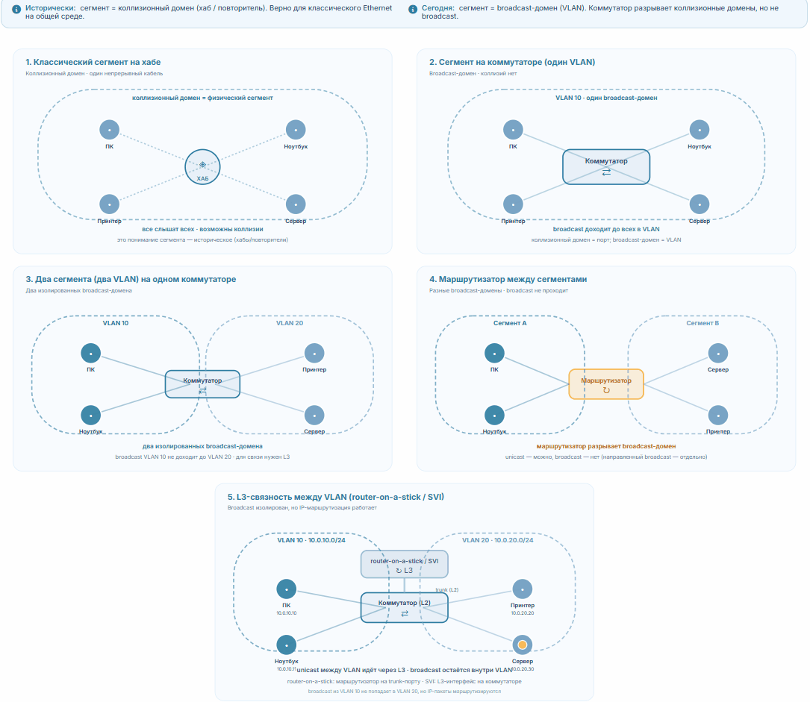

Важно понимать разницу между сегментом и подсетью.

Подсеть - разделение сети по IP. Компьютеры, входящие в одну подсеть, принадлежат одному диапазону IP адресов. Подсеть может совпадать с сегментом, а может нет.

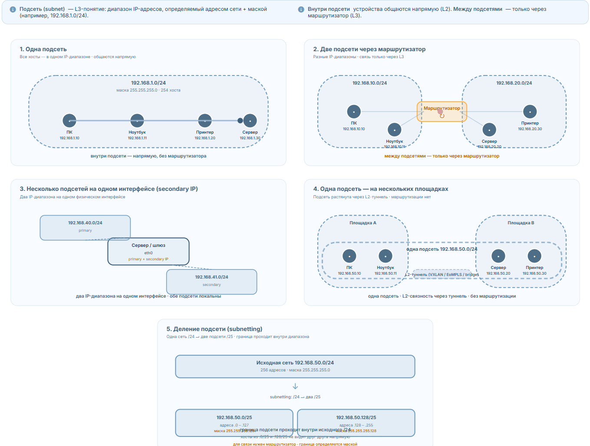

Длина сегмента ЛВС Ethernet - одна из важных характеристик. Ethernet может действовать на ограниченном расстоянии , за пределами которого передача данных ухудшается из-за шумов в линии, ослабления уровня сигнала. Тип кабеля , скорость передачи данных и метод модуляции влияют на максимальную длину сегмента. Для каждой спецификации Ethernet определен необходимый тип кабеля, скорость передачи данных и метод модуляции, которые в свою очередь определяют максимальную длину сегмента:

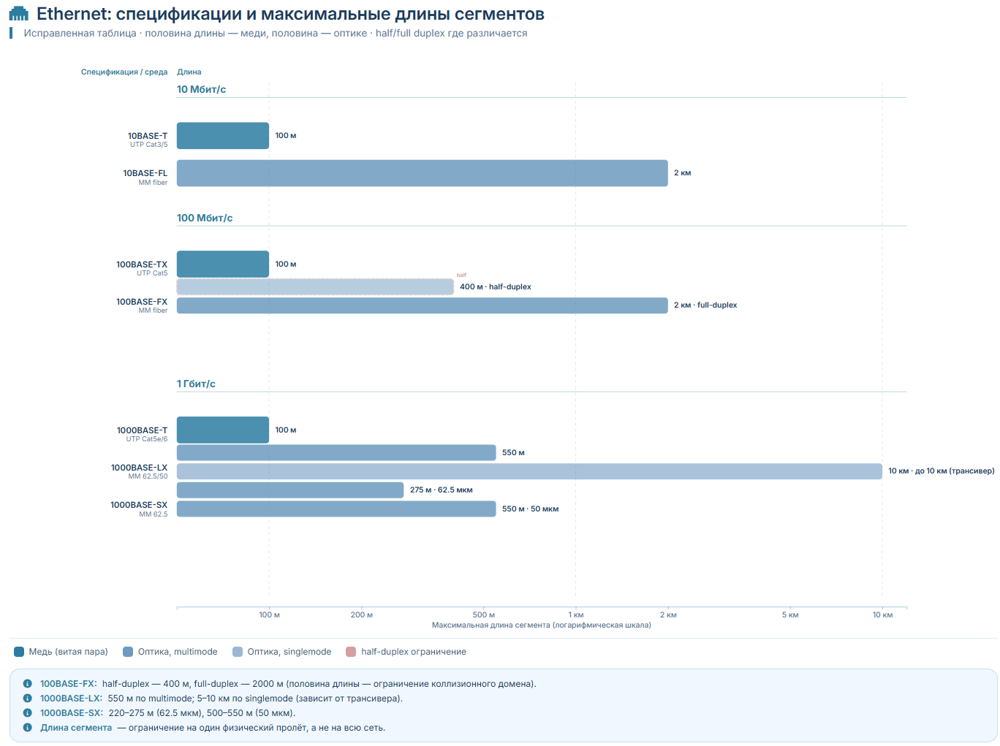

## Увеличение длины сегмента

Классический Ethernet (10 Мбит/с, half-duplex, CSMA/CD) можно удлинять повторителями и концентраторами. Повторитель регенерирует сигнал (2 порта); концентратор — это многопортовый повторитель, транслирующий сигнал на все порты, кроме входного. Все порты концентратора образуют один коллизионный домен, поэтому количество повторителей в цепочке ограничено — правило 5-4-3 (5 сегментов, 4 повторителя, 3 сегмента с устройствами), что связано с ограничением RTT для корректной работы CSMA/CD. Концентратор удлиняет сеть и расширяет коллизионный домен, но не создаёт новый сегмент (не разграничивает домен). Сегодня повторители/хабы устарели: длину наращивают коммутаторами (каждый порт — отдельный коллизионный домен) и оптикой, а ограничения 5-4-3 относятся только к 10 Мбит/с.

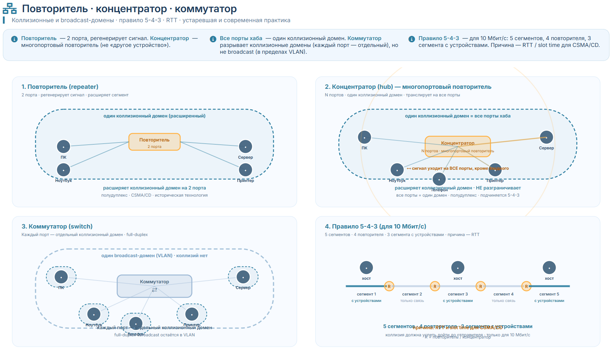

<strong>Еще раз про сегменты</strong>
<table><tr><td>

### Еще раз про сегменты

> «Концентратор **удлиняет** сеть и **расширяет** коллизионный домен, но **не создаёт новый сегмент** (не разграничивает домен)»

Здесь «сегмент» — это **broadcast-домен / L2-сегмент** (современное понимание). То есть я имел в виду: концентратор не создаёт новую L2-границу, все порты остаются в одном broadcast-домене.

Но в пункте про правило 5-4-3 я писал:

> «**5** сегментов максимум, **4** повторителя, **3** сегмента с подключёнными устройствами»

Здесь «сегмент» — это **физический сегмент** (кусок кабеля между повторителями), то есть **коллизионный домен на участке**.

**Это два разных «сегмента»**, и я не оговорил переход. Виноват.

#### Три разных «сегмента», которые живут в литературе

| Смысл | Что это | Где встречается |
|---|---|---|
| **Физический сегмент** | непрерывный кусок кабеля между устройствами/повторителями | правило 5-4-3, классический Ethernet, документация по кабелям |
| **Коллизионный домен** | область, где кадры могут столкнуться (хаб + все порты) | историческое «сегмент = коллизионный домен» |
| **L2-сегмент = broadcast-домен** | группа устройств, получающих broadcast друг друга (= VLAN) | современное понимание, ваша визуализация, заметка |

Плюс **TCP-сегмент** — вообще из другой оперы (L4), к Ethernet-сегментам отношения не имеет.

</td></tr></table>

## Коллизии

Коллизия — это одновременная передача двух (или более) устройств в одной общей среде, из-за которой их сигналы накладываются друг на друга и искажаются. В результате ни один кадр не доходит корректно, и передачу нужно повторить.

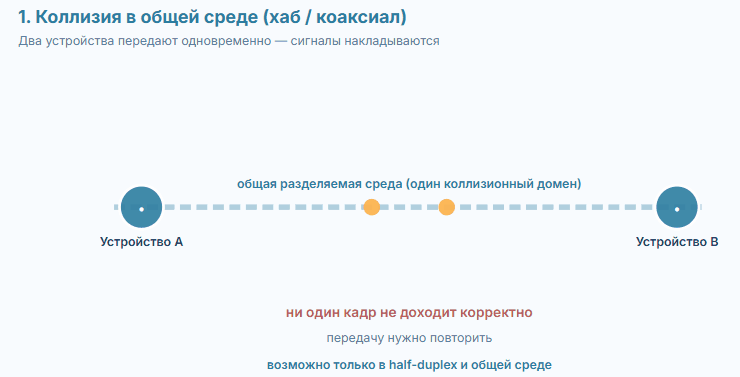

### Что вызывает коллизию

Коллизия — явление **классического Ethernet на разделяемой среде**:

- **Хабы / повторители** — все порты в **одном коллизионном домене**, среда общая.
- **Коаксиальный кабель** (10BASE-5/2) — общая шина.
- **Half-duplex** — устройство либо передаёт, либо принимает, но не одновременно.
- **Wi-Fi** — тоже разделяемая среда (радио), коллизии возможны (но механизм другой — CSMA/CA).

**Где коллизий нет:**

- **Коммутатор (switch)** — каждый порт **отдельный коллизионный домен**; в **full-duplex** передача и приём идут по разным парам одновременно → коллизий нет.
- **Маршрутизатор** — разрывает домен.
- **Оптика point-to-point** — отдельные линии.

### CSMA/CD

Классический Ethernet использует **CSMA/CD** (Carrier Sense Multiple Access with Collision Detection):

1. **Carrier Sense** — устройство «слушает» среду. Если свободна — начинает передачу.
2. **Multiple Access** — среда общая, доступ у всех.
3. **Collision Detection** — во время передачи устройство **продолжает слушать** и сравнивает свой сигнал с тем, что в среде. Если они **не совпадают** → коллизия.
4. При коллизии:
- отправляется **jam-сигнал** (32 бита), чтобы все точно заметили коллизию;
- устройства **прекращают передачу**;
- ждут **случайный интервал** (backoff, binary exponential backoff) и **повторяют**.

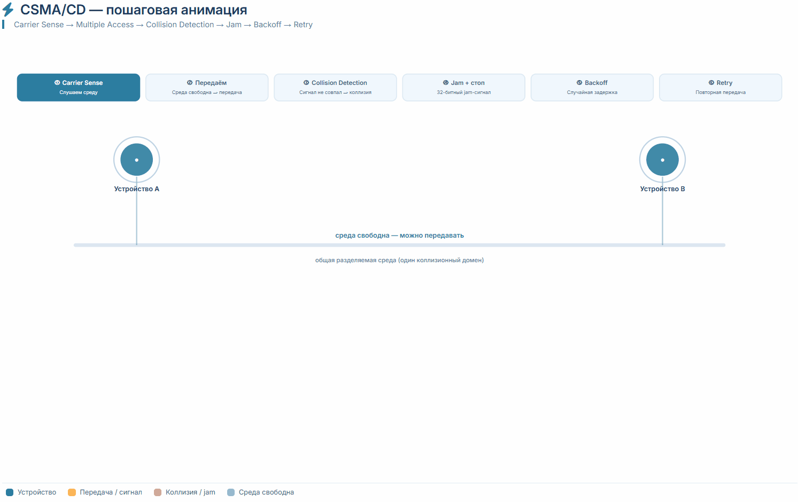

## Как возникают перегрузки в сети

Подобно растущему городу, который сталкивается с пробками, сети сталкиваются с проблемами перегрузки с ростом.
Наиболее распространенные причины:

1. Рост вычислительных мощностей компьютерных и сетевых технологий. ( я так понимаю, что скорости все растут )
2. Современные ЦП, шины и переферийные устройства быстрее, чем те, что использовались в первых ЛВС, поэтому они могут передавать по сети больше данных.
3. Увеличивающийся объем сетевого трафика. Еще и broad/multi -cast существует.
4. Приложения требовательные к полосе пропускания

## Как подключиться к ЛВС?

### Сетевая карта

На пк сетевая карта, которая соединяется последовательно к сети и паралельно к процессору через материнку. Имеет МАК установленный заводом изготовителем.

### Соединители

Разъем RJ45 aka 8c8p. Гнездо "мама" располагается на сетевых устройствах, а коннектор на кабеле. Проводники в UPT изолированны и попарно скрученны для уменьшения электромагнитных помех. 

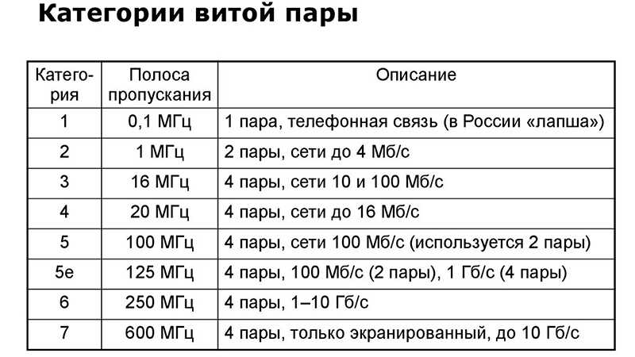

## Резюме

Передача данных происходит на канальном (2) уровне OSI.

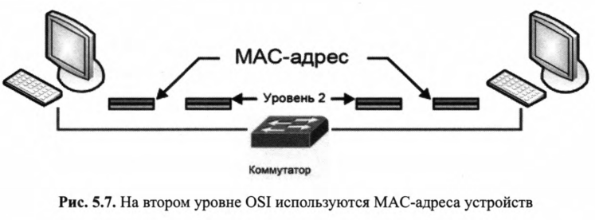

На 3 уровне используется IP адресация.

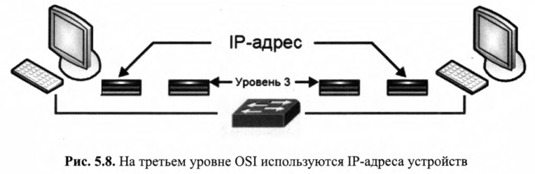