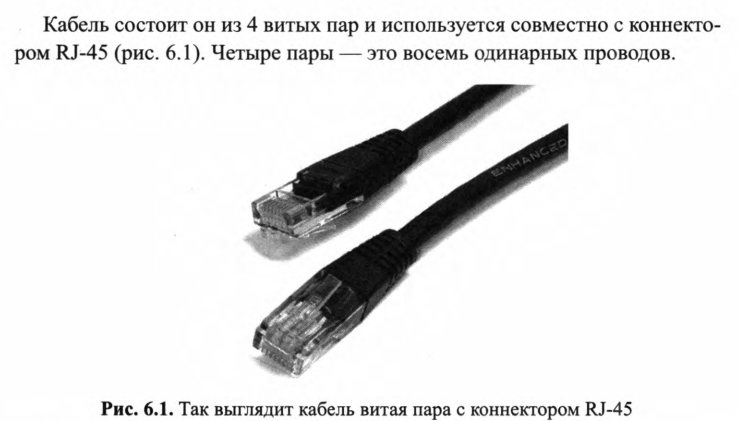
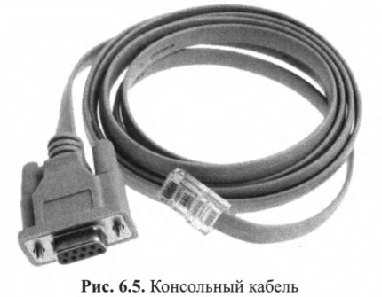
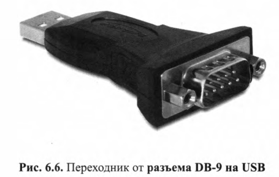
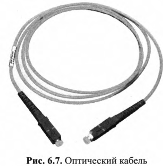
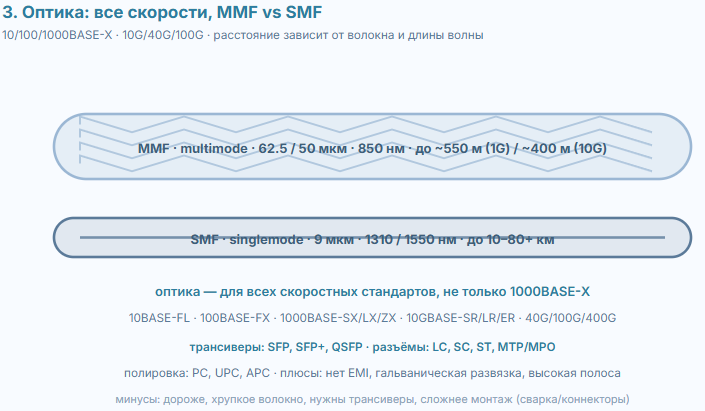
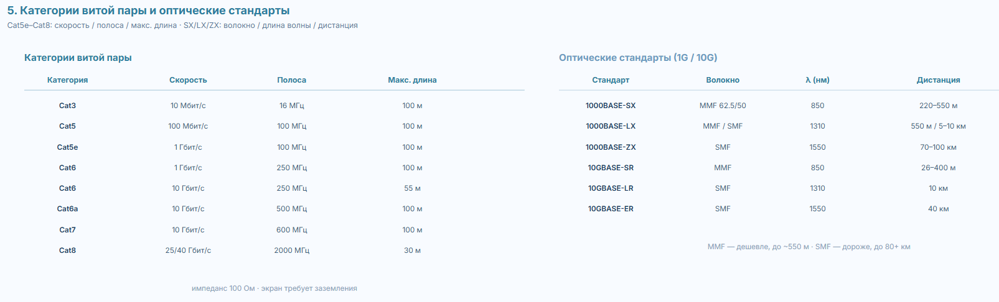
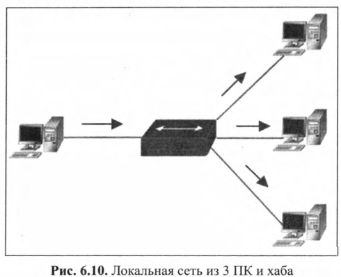
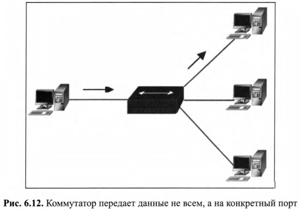
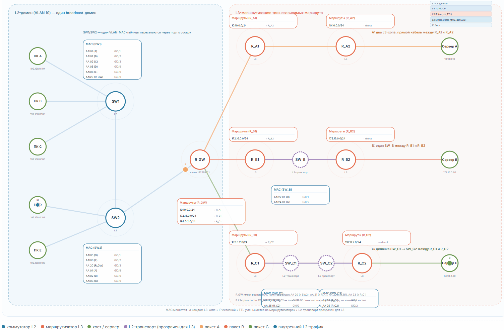

## Витая пара

Двух типвов (на самом деле больше): UTP, STP. 

## Консольный кабель

Rollover - консольный серийный кабель, который используется для настройки оборудования через терминал, то есть посредствам командной строки.

Второй конец имеет разъем DB - 9 , который подключается к ПК. Ноутбуки часто не имеют DB - 9, поэтому приходится использовать еще и переходники с DB - 9 на USB.

## Оптика 

Применяются для 1000Base-X и поддерживают большие расстояния.

## Сетевые устройства

### Физический уровень

В сети работает много устройств , которые работают на разных уровнях OSI. 

Концентраторы, репитеры, кабели работают на физическом уровне, не производя никакого анализа данных

### Канальный 

Коммутаторы используются в локальной сети и объединют в одну сеть компьютеры, принтеры и сервера.

Они , как правило, работают только на 2 (канальном) уровне OSI, однако есть и те, что умеют на 3 (сетевом).

Помимио усиления сигнала коммутаторы анализируют заголовок кадра и перенаправляют их определенным хостам на на основе МАК.

Коммутатор содержит таблицу адресов и периодически ее обновляет. Коммутаторы работают в полнодуплексном режиме. Также они способны проверить поступивший кадр на наличие ошибок.

### Сетевой 

Маршрутизатор работает на 3 уровне OSI и оперирует IP адресами. Он способен перенаправлять пакеты через сотни сетевых устройств, находящихся в разных частях света.

Они не знают где конкретно находится конкретный хост. Они используют IP адрес сети для маршрутизации и таким образром узнают сеть, в которой расположен хост. Дальше в работу вступает коммутатор. Маршрутизаторы используются как в локальных так и глобальных сетях.

Коммутатор хранит таблицу портов и хостов. Маршрутизатор содержит таблицу маршрутизации, в которой хранятся записи об адресах сетей (не хостов) и адреса портов, через которые нужно перенаправялть пакеты. После того как пакет передан маршрутизатору похуй, что с ним дальше происходит.

Маршрут может проходить через сотни маршрутизаторов, и каждый выполняет одни и те же действия, то есть проверяет таблицу и если есть такой адрес в таблице, то кидает на нужный порт. Если в маршрутизаторе нет записи об адресе, то пакет будет уничтожен и будет сгенерированно сообщение, что сеть не доступна. Для LAN таблицу маршрутизации можно создать вручную, для больших сетей таблицы создаются автоматически с помощью специальных протоколов. 

### Фаервол

Работает на 3, 4  и 7 уровне OSI. Основные функции - разрешить или заблокировать трафик на основе адресов и портов (TCP/UDP).

Как физические устройства устанавливаются сразу после маршрутизатора. Фаерволы препятствуют проникновению в сеть нежелательного трафика.

