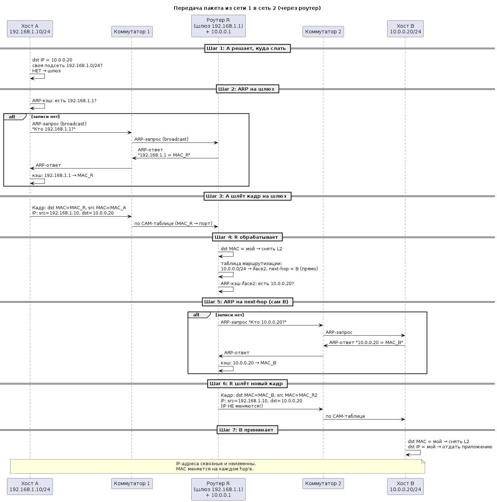
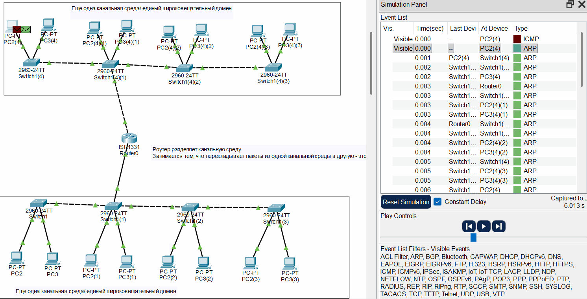
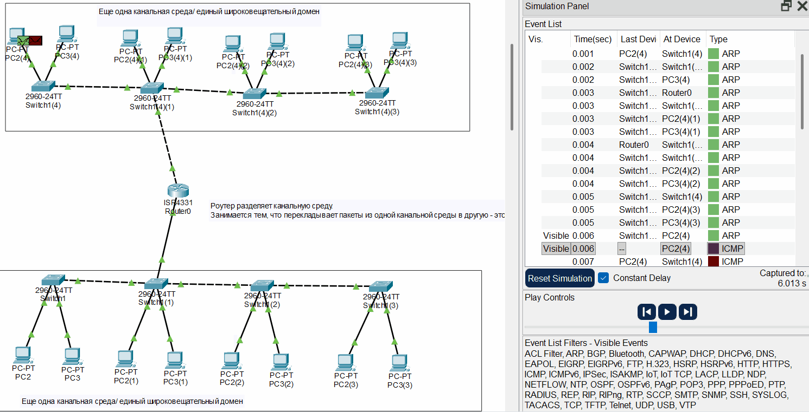
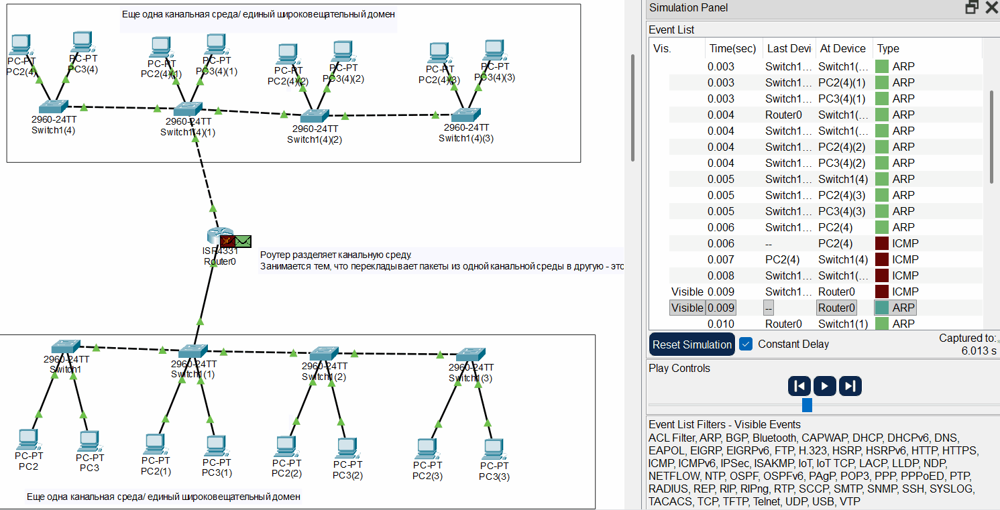
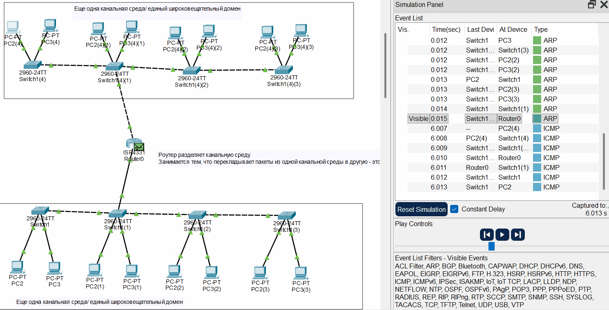
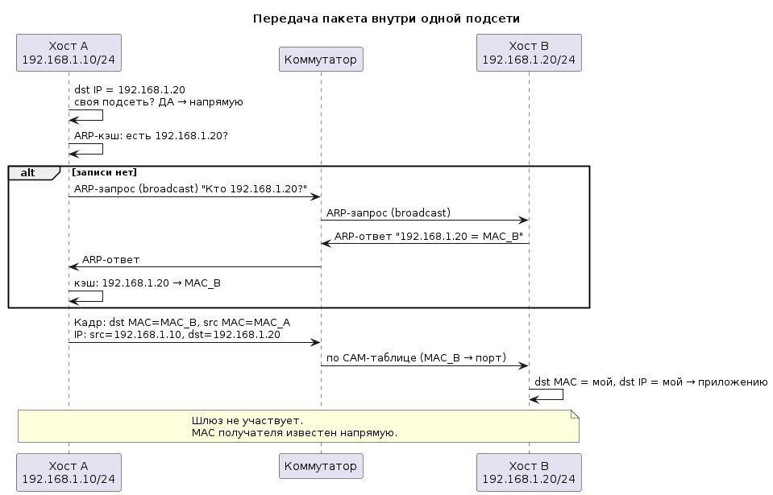
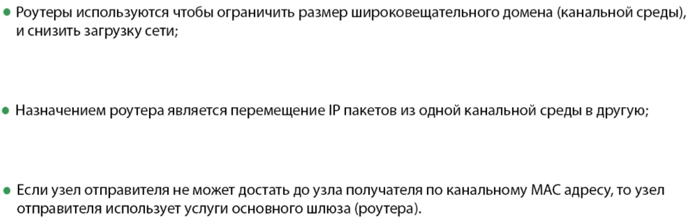

# Передача между двумя сетями через один маршрутизатор — текстом

## Исходная картина

Есть две подсети:

- **Сеть 1:** `192.168.1.0/24`, в ней хост **A** с адресом `192.168.1.10`, шлюз по умолчанию — `192.168.1.1`.
- **Сеть 2:** `10.0.0.0/24`, в ней хост **B** с адресом `10.0.0.20`, шлюз — `10.0.0.1`.
- **Маршрутизатор R** имеет два интерфейса: `192.168.1.1` (смотрит в сеть 1) и `10.0.0.1` (смотрит в сеть 2). Каждый интерфейс — отдельная канальная среда, свой broadcast-домен. R знает обе сети напрямую (connected routes).

A хочет отправить данные B. Проследим путь.

## Шаг 1. A решает, куда слать

A формирует IP-пакет: **src IP = 192.168.1.10, dst IP = 10.0.0.20**. Затем сравнивает dst IP со своей маской `/24` и видит: `10.0.0.20` **не в подсети** `192.168.1.0/24`. Значит, напрямую доставить нельзя — шлём на шлюз по умолчанию `192.168.1.1`.

Важно: **IP-адрес назначения остаётся `10.0.0.20`**, он не подменяется на адрес шлюза. Меняется только то, кому физически отдать кадр.

## Шаг 2. A узнаёт MAC шлюза (ARP)

A проверяет свой ARP-кэш: есть ли запись для `192.168.1.1`? Если нет (или протухла) — шлёт **ARP-запрос broadcast'ом**: «Кто такой `192.168.1.1`? Скажите MAC». Этот запрос уходит во всю сеть 1, его слышат все, но отвечает только R: «`192.168.1.1` — это MAC_R1». A кладёт пару `192.168.1.1 → MAC_R1` в кэш.

Обратите внимание: **ARP идёт на IP шлюза, а не на IP хоста B.** A вообще не знает и не пытается узнать MAC хоста B — B в другой сети, его MAC в этом сегменте не виден.

## Шаг 3. A отправляет кадр

A собирает кадр:

- **dst MAC = MAC_R1** (шлюз),
- **src MAC = MAC_A**,
- внутри — IP-пакет с **src IP = 192.168.1.10, dst IP = 10.0.0.20** (не меняются).

Кадр уходит в сеть 1. Коммутаторы (если есть) пересылают его по CAM-таблице: `MAC_R1 → порт, где сидит роутер`. Они смотрят только MAC, IP им безразличен.

## Шаг 4. R принимает кадр

R видит: **dst MAC = его собственный MAC интерфейса** `192.168.1.1`. Значит, кадр адресован ему → он **снимает L2-заголовок** и поднимает IP-пакет на L3. Старый кадр «умирает» здесь.

R смотрит **dst IP = 10.0.0.20**. Это не его собственный адрес, значит, пакет надо **маршрутизировать**. R лезет в **таблицу маршрутизации** и находит: сеть `10.0.0.0/24` подключена напрямую к интерфейсу `10.0.0.1`, next-hop — сам хост B (B прямо в этом сегменте, промежуточных роутеров нет).

## Шаг 5. R узнаёт MAC следующего узла (ARP на next-hop)

Теперь R нужно отдать пакет хосту B, но физически — по MAC. R проверяет ARP-кэш своего интерфейса `10.0.0.1`: есть ли `10.0.0.20`? Если нет — шлёт **ARP-запрос в сеть 2**: «Кто такой `10.0.0.20`?». B отвечает: «Это я, MAC_B». R кладёт `10.0.0.20 → MAC_B` в кэш.

ТУТ ИНТЕРЕСНО, ЧТО, ЕСЛИ МАРШРУТИЗАТОР ТРАТИ ВРЕМЯ НА ARP, ТО ПЕРВЫЙ ПАКЕТ ПРОСТО УМИРАЕТ

Здесь ключевой момент: R резолвит MAC **следующего узла**. В данном случае next-hop — это сам B, поэтому ARP идёт на IP B. Но если бы между R и B стоял ещё один роутер, R делал бы ARP на **IP этого роутера**, а не на IP B — и MAC хоста B он бы вообще не знал.

## Шаг 6. R собирает новый кадр и отправляет

R формирует **новый L2-кадр** (старый он уже выбросил):

- **dst MAC = MAC_B**,
- **src MAC = MAC_R2** (MAC интерфейса `10.0.0.1`),
- внутри — **тот же самый IP-пакет**: src IP = `192.168.1.10`, dst IP = `10.0.0.20`, **ничего не изменилось**.

Кадр уходит в сеть 2, коммутаторы пересылают его по MAC_B до порта, где сидит B.

## Шаг 7. B принимает

B видит: dst MAC = его MAC → снимает L2. Смотрит dst IP = `10.0.0.20` = его адрес → отдаёт данные приложению. Готово.

## Что в итоге произошло с адресами

| Параметр | На участке A → R | На участке R → B |
|---|---|---|
| dst MAC | MAC_R1 (шлюз) | MAC_B (получатель) |
| src MAC | MAC_A | MAC_R2 (интерфейс роутера) |
| src IP | 192.168.1.10 | 192.168.1.10 (**не изменился**) |
| dst IP | 10.0.0.20 | 10.0.0.20 (**не изменился**) |

**IP-адреса сквозные и неизменные. MAC пересобирается на каждом участке под следующего соседа.** Роутер — это точка, где старый кадр умирает и рождается новый, а IP-пакет перекладывается из одного L2-конверта в другой без изменений.

## Кто что знал по MAC

- **A** знал MAC только шлюза (и то после ARP). MAC хоста B он не знал и не узнавал.
- **R** знал MAC хоста A (из входящего кадра как src MAC) и MAC хоста B (после ARP в сети 2). Но это MAC его непосредственных соседей по сегментам.
- **B** знал MAC только своего шлюза (для обратного трафика) — MAC хоста A ему не нужен и не виден.
- **Коммутаторы** вообще не оперировали IP — только MAC→порт.

## Суть в двух предложениях

Хост A видит, что получатель в чужой сети, и шлёт пакет на шлюз: в кадре стоит **MAC роутера**, а внутри — **IP конечного получателя**. Роутер принимает кадр (по своему MAC), по **IP-назначению** через таблицу маршрутизации решает, куда вести пакет, резолвит через ARP **MAC следующего узла** в нужном сегменте и отправляет **новый кадр** с этим MAC — при этом **IP-адреса отправителя и получателя не меняются ни на одном шаге**.

## Одна канальная среда

Хост накладывает маску на ip адрес хоста назначения, и если видит, что одна подсеть, то ARPом (или с помощью таблицы) отправляет на MAC этой сети (ШЛЮЗ НЕ НУЖЕН)

## Зачем нужен Роутер

Кста, частным хостам можно назначить публичный ip, но они один хер не будут работать через инет, но будут в ЛВС. Т.к. есть NAN и провайдер (который такой адрес не запишет в табличку)