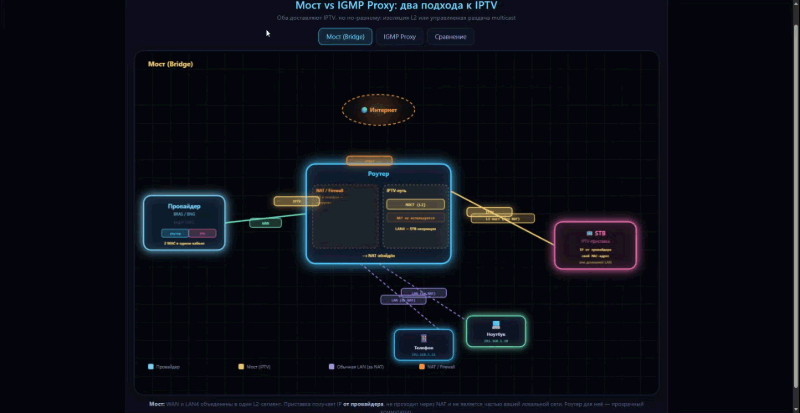
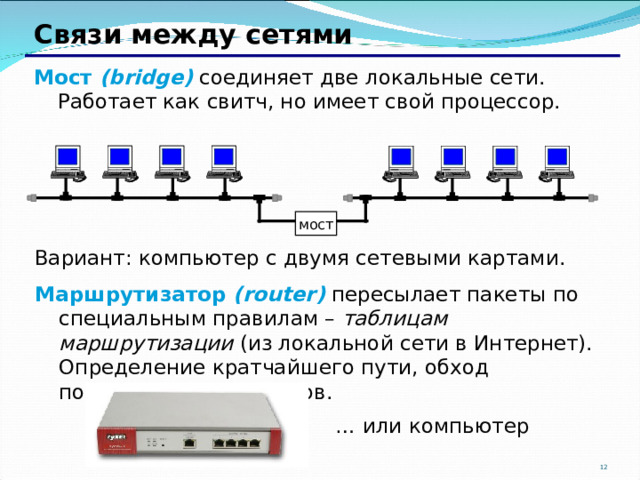
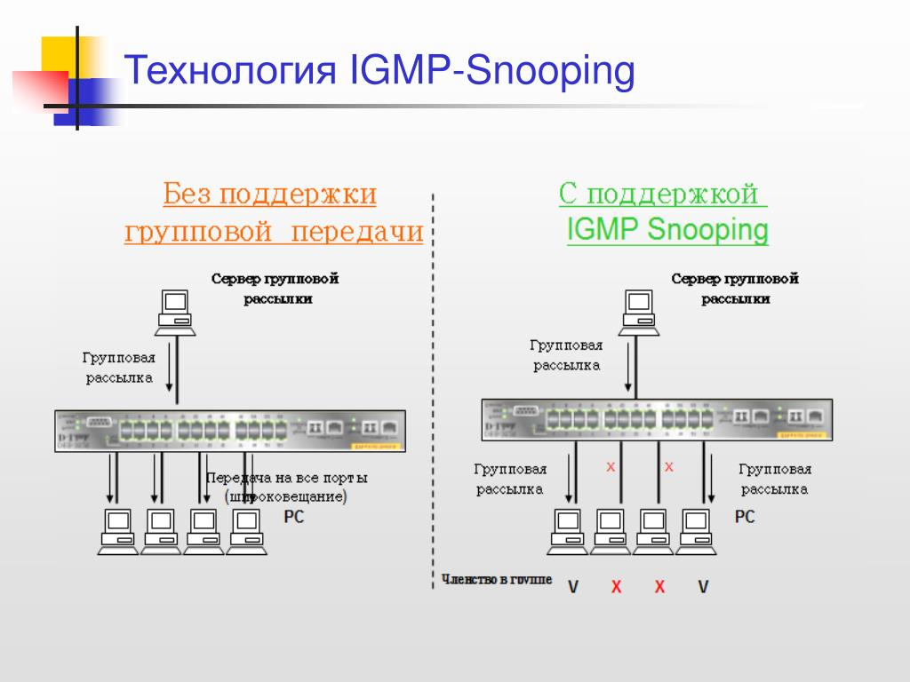
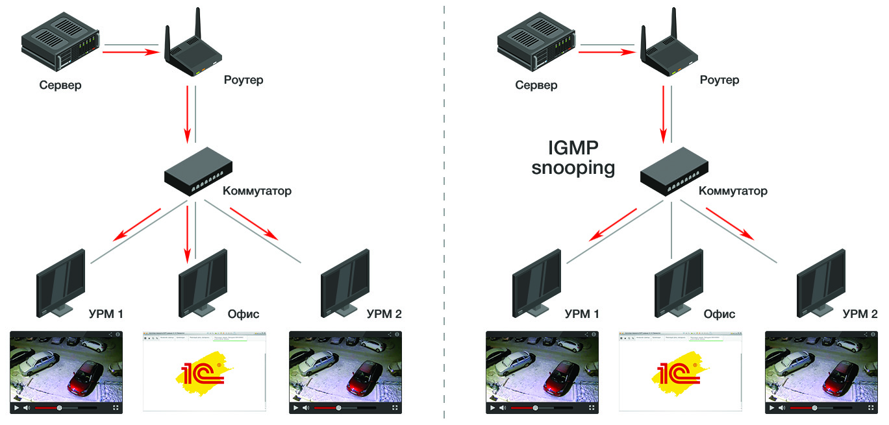
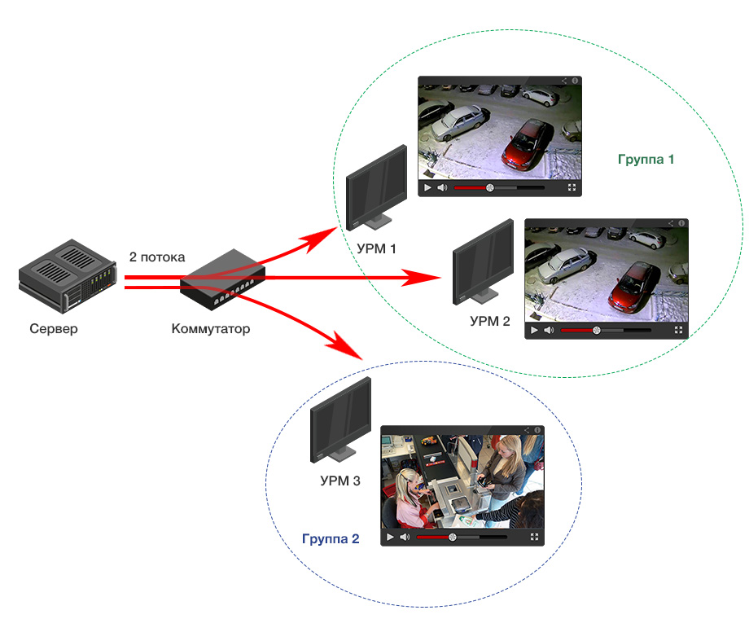
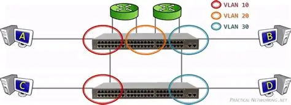
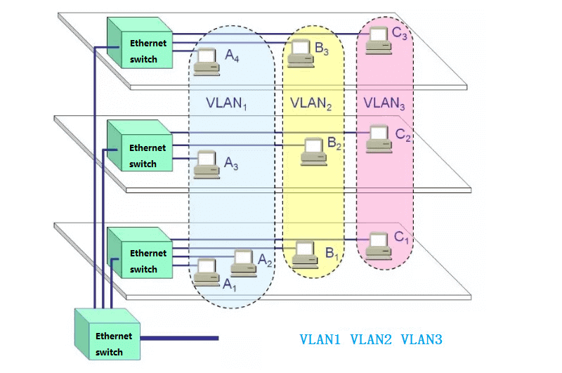

# Настройка IPTV на роутере: мост, IGMP, VLAN — с разбором ваших формулировок

Ниже — полный материал, интегрированный с вашими вопросами. Ваши формулировки выделены цитатами, после каждой — анализ: что верно, что нет, и как правильно.

---

## 1. Мост (Bridge)

### Что это
**Мост** — <mark>режим, при котором определённые порты роутера (или Wi-Fi) объединяются в одну логическую сеть (L2-сегмент) с портом WAN. Роутер в этом случае **не маршрутизирует** трафик между этими портами, а просто «пробрасывает» кадры как коммутатор.</mark>



### Зачем нужно для IPTV
IPTV-трафик от провайдера часто требует, чтобы <mark>STB-приставка получила IP-адрес **напрямую от провайдера** (DHCP провайдера, а не роутера). В режиме моста приставка «видит» провайдерскую сеть напрямую, в обход NAT и файрвола роутера.</mark>

### Как работает
- Выделяется порт (например, LAN4) под приставку.
- Этот порт «мостится» с WAN.
- Трафик IPTV идёт в обход NAT и файрвола роутера.
- Приставка получает адрес от провайдера.

**Схема:**
```
Провайдер ──── WAN [роутер] LAN4 ──── Приставка
                 │
                 └── LAN1-3, Wi-Fi ──── ваша локальная сеть (NAT)
```



<mark>Для приставки роутер — «прозрачный» участок пути до провайдера. Для провайдера это выглядит так, будто к его сети подключены **два независимых устройства** через один коммутатор: </mark>MAC роутера (интернет) и MAC приставки (IPTV).

### Плюсы
- Простота.
- Приставка работает «как у провайдера задумано».
- Нет проблем с multicast/NAT.

### Минусы
- Порт занят только под IPTV.
- Приставка не изолирована от провайдерской сети (потенциально видна соседям по L2).
- Не всегда работает, если провайдер требует VLAN-теги.

### Когда использовать
Когда провайдер даёт IPTV **без VLAN**, и приставка должна получить адрес напрямую от провайдера.

---

### 🔍 Разбор вашей формулировки №1

> **«То есть, как я понял, мост предполагает, что провайдер видит напрямую приставку. То есть она не часть локальной сети, а как будто напрямую цепляется провайдеру. То есть провайдер видит роутер, который еще определяет локальную сеть и приставку?»**

**Что верно:**
- ✅ «Провайдер видит напрямую приставку» — да, по MAC-адресу приставка видна в сети провайдера.
- ✅ «Она не часть локальной сети» — да, приставка в отдельном L2-сегменте, ваши устройства её не видят, и она не видит их.
- ✅ «Как будто напрямую цепляется провайдеру» — точная аналогия.

**Что неточно:**
- ⚠️ «Провайдер видит роутер, который ещё определяет локальную сеть **и приставку**» — здесь смешаны две вещи. Для провайдера приставка — **не «часть роутера»**, а **отдельное устройство** в его сети. Роутер для неё — просто коммутатор. Провайдер не «видит роутер, который определяет приставку» — он видит **два независимых MAC-адреса** в одном кабеле.
- ⚠️ «Роутер определяет локальную сеть и приставку» — роутер определяет (маршрутизирует, NAT-ит) **только локальную сеть**. Приставку он **не маршрутизирует** — он её «пробрасывает» насквозь.

**Исправленная формулировка:**
> «Мост предполагает, что приставка для провайдера выглядит как отдельное устройство, подключённое к его сети напрямую. Приставка не входит в мою локальную сеть — она изолирована. Роутер при этом маршрутизирует только локальную сеть, а для приставки работает как прозрачный коммутатор».

---

<details><summary><strong>Еще мысли</strong></summary><table><tr><td>

# Можно ли сократить: «Мост = роутер как коммутатор»?

**Коротко: почти да, но с одной важной оговоркой.** Формула хорошая как мнемоника, но неполная.

---

## Где формула верна

✅ **Для трафика приставки** роутер в режиме моста действительно работает **как коммутатор**: принимает кадры на WAN, отдаёт в LAN-порт приставки, не маршрутизирует, не NAT-ит, не фильтрует. Прозрачный проброс L2.

✅ **Как мнемоника** — отлично: «мост = роутер притворяется свитчем для этого порта».

---

## Где формула ломается

⚠️ **Роутер — не «весь коммутатор», а коммутатор только для избранных портов.** Остальные порты (LAN1-3, Wi-Fi) продолжают маршрутизироваться и NAT-иться как обычно. То есть роутер одновременно:

- для приставки — **коммутатор** (мост WAN ↔ LAN4);
- для вашей локальной сети — **маршрутизатор** (NAT, файрвол, DHCP).

⚠️ **Мост бывает не только «WAN ↔ LAN-порт»**. Мост можно построить:
- между VLAN-интерфейсом на WAN и LAN-портом;
- между двумя LAN-портами;
- между Wi-Fi и LAN и т.д.

То есть «мост» — это **пара интерфейсов, объединённых в один L2-сегмент**, а не «роутер целиком превратился в свитч».

⚠️ **DHCP и L2-видимость.** В режиме моста приставка получает IP **от провайдера**, а не от роутера. Роутер для неё не DHCP-сервер, не шлюз — только прозрачный участок пути. Это следствие, которое формула «коммутатор» не передаёт.

---

## Точная сокращённая формулировка

Вариант 1 (мнемоника):
> **«Мост = роутер работает коммутатором для выделенного порта»**

Вариант 2 (точнее):
> **«Мост = два интерфейса объединены в один L2-сегмент; для трафика между ними роутер — прозрачный коммутатор, без NAT и маршрутизации»**

Вариант 3 (совсем коротко, для себя):
> **«Мост = прозрачный проброс L2 между WAN и портом приставки»**

---

## Сравнение с IGMP для контраста

Чтобы формула не путалась с IGMP:

| | Мост | IGMP Proxy |
|---|---|---|
| Роль роутера | **Коммутатор** (L2-проброс) | **Маршрутизатор** (L3, принимает и раздаёт multicast) |
| Приставка получает IP от | Провайдера | Роутера |
| NAT для IPTV | Нет | Да (или отдельная подсеть) |

---

**Итог:** «Мост = роутер как коммутатор» — **годная короткая формула**, если держать в голове: (1) коммутатор только для выделенных интерфейсов, (2) остальная часть роутера продолжает маршрутизировать, (3) приставка получает IP от провайдера, а не от роутера.

</td></tr></table></details>

## 2. IGMP (Internet Group Management Protocol)

### Что это
**IGMP** — <mark>протокол управления **multicast-группами** в IPv4. IPTV — это почти всегда multicast (один поток — много зрителей). IGMP позволяет хосту (приставке) сообщить сети: «я хочу получать поток группы X» (**IGMP Join**) и «больше не хочу» (**IGMP Leave**).</mark>

Провайдер кидает все каналы в сеть как multicast — хочешь получай, хочешь не получай

Почти так, но с важной поправкой: провайдер НЕ кидает все каналы постоянно. Он отдаёт поток только когда есть подписчик. Это ключевое отличие multicast от «broadcast-всегда».







### Что именно делает IGMP
IGMP решает **две задачи**:

1. **IGMP Proxy** — «проксирует» запросы от приставки к провайдеру. Приставка шлёт Join в LAN → роутер передаёт его в WAN от своего имени → получает поток → раздаёт в LAN.
2. **IGMP Snooping** — коммутатор «подслушивает» IGMP-сообщения и отправляет multicast **только в те порты, где есть подписчики** (а не во все).

То есть IGMP — это про то, **КТО ХОЧЕТ получать поток**, а не про то, «куда его кидать».

### Как работает
- Включаете IGMP Proxy на роутере.
- Указываете upstream (WAN) и downstream (LAN) интерфейсы.
- Приставка шлёт IGMP Join → роутер передаёт провайдеру → поток приходит → роутер раздаёт в LAN.
- Приставка шлёт IGMP Leave → роутер сообщает провайдеру → поток прекращается.

### Плюсы
- Multicast не затапливает сеть.
- Работает с большинством провайдеров.
- Не требует выделенного порта (можно смотреть IPTV по Wi-Fi, с нескольких устройств).
- Приставка остаётся в локальной сети (получает IP от роутера).

### Минусы
- Не все роутеры корректно реализуют IGMP Proxy (особенно дешёвые).
- Иногда нужна настройка IGMP version (v2/v3).
- Если провайдер использует VLAN для IPTV — одного IGMP недостаточно.

### Когда использовать
Всегда, когда есть multicast IPTV (а это почти всегда). IGMP Proxy — базовый механизм.

---

### 🔍 Разбор вашей формулировки №2

> **«То есть протокол говорит, что весь мультикаст кидать на определенный порт, а остальные не трогаю.»**

**Что верно:**
- ✅ Вы ухватили суть **IGMP Snooping** — «кидать multicast только туда, где есть подписчики, остальные порты не трогать».

**Что неточно:**
- ⚠️ «Весь мультикаст кидать на определённый порт» — нет. IGMP работает **по группам**: приставка подписывается на **конкретную группу** (например, 239.1.1.1 — канал «Первый»), и только этот поток идёт в её порт. Другие группы в этот порт не идут, если на них нет подписки.
- ⚠️ IGMP — это **не про порты**, а про **группы**. Порты — это уже следствие работы snooping.
- ⚠️ Вы описали только одну из двух функций (snooping), упустив **proxy** — а именно proxy чаще всего и настраивают на роутере для IPTV.

**Исправленная формулировка:**
> «IGMP позволяет приставке сказать: “я хочу получать вот эту конкретную multicast-группу”. Роутер (IGMP Proxy) передаёт эту просьбу провайдеру и получает поток. А IGMP Snooping следит, чтобы поток шёл только в те порты, где есть подписчики на эту группу, — остальные порты не трогает».

> **«А разве тогда не должны быть настроены и мост и IGMP? Или IGMP подразумевает “мост”?»**

**Что верно:**
- ✅ Вопрос логичный — кажется, что раз мост «пробрасывает», а IGMP «управляет», то нужно и то, и другое.

**Что неточно:**
- ❌ **IGMP не подразумевает мост.** Это **альтернативные** способы доставки IPTV:

| | Мост | IGMP Proxy |
|---|---|---|
| Как приставка получает IP | От провайдера (DHCP через мост) | От роутера (обычный LAN, NAT) |
| Как идёт multicast | Прозрачно через мост (L2) | Роутер сам принимает и раздаёт (L3) |
| Нужен ли NAT для IPTV | Нет | Да (или отдельная подсеть) |
| Кто «виноват», если не работает | Провайдер (мост прозрачен) | Роутер (IGMP Proxy) |

- ⚠️ «Мост и IGMP вместе» бывает, но **не для одного и того же потока**. Например, провайдер отдаёт IPTV в VLAN 20: можно сделать VLAN-интерфейс → **мост** с портом приставки, **или** VLAN-интерфейс → **IGMP Proxy**. Но не «мост + IGMP для одной приставки» — это взаимоисключающие подходы.

**Исправленная формулировка:**
> «Мост и IGMP — это два разных способа доставить IPTV до приставки, и обычно выбирают один. Мост — “пробросить сеть провайдера до приставки напрямую”. IGMP Proxy — “роутер сам принимает multicast и раздаёт в локальную сеть”. IGMP не подразумевает мост — наоборот, при IGMP Proxy мост не нужен».

<details><summary><strong>Мысли</strong></summary><table><tr><td>

# Каждую приставку в отдельную мультикаст-группу или в одну?

**Короткий ответ: в одну и ту же группу.** Мультикаст-группа — это **канал**, а не «подключение приставки». Все приставки, смотрящие один и тот же канал, подписаны на **одну группу**.

---

## Как это устроено

**Мультикаст-группа = телеканал (поток).** Например:
- `239.1.1.1` — «Первый»
- `239.1.1.2` — «Россия 1»
- `239.1.1.3` — «НТВ»

Когда **две приставки** смотрят «Первый»:
- обе шлют **IGMP Join на 239.1.1.1**;
- провайдер/роутер шлёт **один поток** группы 239.1.1.1;
- коммутатор с IGMP Snooping раздаёт этот **один поток** в **оба порта**, где есть подписчики.

То есть группа одна, а получателей — сколько угодно. Это и есть смысл multicast: **один поток — много зрителей**, а не копия потока на каждую приставку.

---

## Почему не «каждой приставке своя группа»

- Группа определяется **контентом** (каналом), а не устройством. Приставка не «владеет» группой — она **подписывается** на неё и может отписаться.
- Если бы каждой приставке давали свою группу, провайдеру пришлось бы гнать **отдельный поток на каждого зрителя** — это уже не multicast, а unicast, и он убил бы канал провайдера.
- Одна и та же приставка **переключается между группами**: смотрит «Первый» (Join 239.1.1.1) → переключила на «НТВ» (Leave 239.1.1.1, Join 239.1.1.3). Группа меняется по каналу, а не по устройству.

---

## Что происходит на роутере (IGMP Proxy + Snooping)

1. Приставка A: Join 239.1.1.1 → роутер передаёт провайдеру → поток пошёл.
2. Приставка B: Join 239.1.1.1 → роутер **видит, что уже подписан** на эту группу → провайдеру повторно не шлёт (или шлёт, но провайдер всё равно отдаёт один поток) → раздаёт поток в порт B.
3. Приставка A: Leave 239.1.1.1 → но B ещё смотрит → роутер **не отписывается** у провайдера, продолжает получать поток для B.
4. Приставка B: Leave 239.1.1.1 → подписчиков больше нет → роутер шлёт Leave провайдеру → поток прекращается.

Это ключевая логика: **роутер держит подписку, пока есть хоть один подписчик на группу**.

---

## Нюансы

- **Разные каналы — разные группы.** Две приставки на разных каналах = две разные группы = два потока. Это нормально.
- **Одна приставка может быть в нескольких группах одновременно** (например, PIP — «картинка в картинке», или запись одного канала при просмотре другого). Тогда она шлёт Join на обе группы.
- **IGMP version:** v2 и v3 по-разному обрабатывают «source-specific» подписки, но логика «группа = канал» сохраняется.
- **VLAN не меняет картину:** VLAN — это сегмент, внутри которого группа раздаётся; группа всё равно одна на канал.

---

## Итог

| Вопрос | Ответ |
|---|---|
| Каждой приставке своя группа? | **Нет** |
| Одна группа на канал? | **Да** |
| Сколько приставок может быть в одной группе? | **Сколько угодно** |
| Что меняется при переключении канала? | **Группа** (Leave старой, Join новой) |
| Кто «владеет» группой? | **Никто** — это адрес потока, а не устройство |

**Формула:** *«Мультикаст-группа — это канал. Приставки подписываются на канал, а не получают свою группу. Один поток — много зрителей».*

</td></tr></table></details>

---

## 3. VLAN (Virtual LAN)

### Что это
**VLAN** — <mark>технология виртуального разделения сети на изолированные L2-сегменты. Кадры помечаются тегом (802.1Q) с номером VLAN. Устройства без этого тега «не видят» трафик чужого VLAN.</mark>





### Зачем нужно для IPTV
Многие провайдеры отдают **интернет и IPTV в разных VLAN** на одном физическом порту (WAN). Например:
- VLAN 10 — интернет
- VLAN 20 — IPTV

Роутер должен уметь:
- **Принимать тегированные кадры** на WAN.
- **Разделять** их: интернет — в NAT/роутинг, IPTV — в мост или IGMP-прокси.
- **Отдавать** IPTV в нужный порт (обычно нетегированно, если приставка не умеет VLAN).

### Как работает (типичная схема)
```
Один роутер, один WAN-кабель:
  VLAN 10 (интернет) ──── NAT ──── LAN 1-3, Wi-Fi
  VLAN 20 (IPTV)     ──── мост ──── LAN 4 (приставка)
```
Для провайдера это **два разных потока** в одном кабеле. Для роутера — **два разных интерфейса**. Порты LAN 1-3 и LAN 4 оказываются в **разных L2-сегментах** — устройства из одного не видят устройства из другого.

### Плюсы
- Работает с провайдерами, которые используют VLAN (большинство в РФ и Европе).
- Чёткое разделение интернет/IPTV.
- Можно совместить с IGMP Proxy или мостом.

### Минусы
- Требует поддержки VLAN на роутере (не все прошивки умеют).
- Сложнее в настройке.
- Нужно знать номера VLAN от провайдера.

### Когда использовать
Когда провайдер выдаёт IPTV в отдельном VLAN (уточняется в договоре или техподдержке).

---

### 🔍 Разбор вашей формулировки №3

> **«То есть VLAN позволяет выделить разные хосты (группы портов) в “разные” сети?»**

**Что верно:**
- ✅ «Разные хосты (группы портов) в разные сети» — да, это точная суть VLAN. Один физический коммутатор логически делится на несколько независимых «свитчей».

**Что можно уточнить:**
- ⚠️ VLAN делит **не хосты, а порты/интерфейсы** (и, как следствие, устройства за ними). Устройство можно перекинуть в другой VLAN, но само по себе устройство VLAN не «имеет» — его назначают порту или тегу.
- ⚠️ VLAN — это **L2-изоляция**. Устройства в разных VLAN не видят друг друга на канальном уровне, но маршрутизация между ними возможна (если настроить L3).
- ⚠️ VLAN — это **инструмент разделения**, а мост и IGMP — **способы доставки IPTV** внутри этого разделения. Их не надо путать: VLAN отвечает на вопрос «в какой сегмент?», мост/IGMP — «как доставить поток?».

**Исправленная формулировка:**
> «VLAN позволяет логически разделить один физический коммутатор на несколько независимых L2-сетей. Порты (и устройства за ними) попадают в разные сегменты и не видят друг друга напрямую. VLAN — это инструмент разделения, а мост и IGMP — способы доставки IPTV внутри этого разделения».

---

## 4. Главный вопрос: «IPTV надо вытащить из локальной сети?»

> **«Я как понял, в любом случае, IPTV необходимо вытащить из локальной сети и дать прямой доступ провайдеру, не закрывая в приватной локальной сети, правильно?»**

### 🔍 Разбор

**Что верно:**
- ✅ Вы уловили важную мысль: **IPTV-трафик не должен смешиваться с вашей приватной локальной сетью** в плане NAT/файрвола — либо через изоляцию, либо через управляемую раздачу.

**Что неточно:**
- ❌ **«В любом случае вытащить»** — нет. Это **один из двух** подходов. Второй — **оставить в локальной сети**, но управлять раздачей через IGMP Proxy.
- ⚠️ «Дать прямой доступ провайдеру» — это только подход с мостом. При IGMP Proxy приставка **не получает прямой доступ** к провайдеру — она общается с роутером, а роутер — с провайдером.

### Правильная картина

**Не «в любом случае вытащить», а «выбрать способ»:**

| Цель | Решение |
|---|---|
| Приставка должна получить IP от провайдера | **Мост** (+ VLAN, если нужно) |
| Смотреть IPTV с нескольких устройств / по Wi-Fi | **IGMP Proxy** (+ VLAN, если нужно) |
| Провайдер отдаёт IPTV в отдельном VLAN | **VLAN** обязателен, дальше — мост или IGMP |
| Просто «чтобы работало как у провайдера» | **Мост** (самый простой) |

**Общее правило:** IPTV-трафик **не должен смешиваться** с вашей приватной локальной сетью в плане NAT/файрвола — либо через **изоляцию** (мост), либо через **управляемую раздачу** (IGMP Proxy). Но «вытащить из локальной сети» — это только один из двух вариантов.

**Исправленная формулировка:**
> «IPTV-трафик не должен бесконтрольно смешиваться с приватной локальной сетью. Но есть два способа: либо полностью изолировать его (мост — приставка получает IP от провайдера и не входит в мою сеть), либо оставить в локальной сети, но управлять раздачей через IGMP Proxy (приставка получает IP от роутера). “Вытащить” — это только вариант с мостом».

---

## Как всё сочетается на практике

| Сценарий провайдера | Что настроить |
|---|---|
| IPTV без VLAN, приставка получает IP напрямую | **Мост** (WAN ↔ LAN-порт приставки) |
| IPTV multicast без VLAN | **IGMP Proxy** (WAN ↔ LAN) |
| IPTV в отдельном VLAN | **VLAN-интерфейс на WAN** + мост или IGMP Proxy |
| IPTV в VLAN + multicast | **VLAN + IGMP Proxy** (самый частый случай) |
| Приставка сама умеет VLAN | VLAN-тег на порту приставки (редко) |

### Пример: VLAN + IGMP Proxy (самый распространённый)
1. Узнаёте у провайдера VLAN для IPTV (например, 20) и тип (multicast).
2. Создаёте VLAN-интерфейс на WAN с тегом 20.
3. Включаете IGMP Proxy: upstream — VLAN-интерфейс, downstream — LAN.
4. Приставка подключается к LAN-порту, шлёт IGMP Join, получает поток.

### Пример: мост с VLAN
1. Создаёте VLAN-интерфейс на WAN (тег 20).
2. Создаёте мост между этим VLAN-интерфейсом и LAN-портом приставки.
3. Приставка получает IP от провайдера напрямую (DHCP через мост).

---

## Частые проблемы

- **IPTV не работает, интернет работает** → скорее всего, нужен VLAN-тег или IGMP Proxy.
- **Multicast «затапливает» Wi-Fi** → включить IGMP Snooping, ограничить multicast.
- **Приставка не получает IP** → проверить мост: DHCP должен проходить с WAN.
- **Поток идёт, но «рассыпается»** → проверить IGMP version (v2 vs v3), MTU, нагрузку на роутер.
- **Работает только на одном порту** → нормально для моста; для нескольких приставок — IGMP Proxy.

---

## Итоговая сводка ваших формулировок

| Ваша формулировка | Вердикт | Ключевая поправка |
|---|---|---|
| «Провайдер видит приставку напрямую, она не часть локальной сети» | ✅ Верно | Провайдер видит **два независимых MAC**, а не «роутер, который определяет приставку» |
| «IGMP говорит: весь мультикаст кидать на определённый порт» | ⚠️ Частично | IGMP — про **конкретные группы**, а не «весь мультикаст»; и это только snooping, есть ещё proxy |
| «Нужны и мост, и IGMP? Или IGMP подразумевает мост?» | ❌ Неточно | Это **альтернативы**, а не дополнения; IGMP не подразумевает мост |
| «VLAN выделяет хосты (группы портов) в разные сети» | ✅ Верно | VLAN делит **порты/интерфейсы**, а не «хосты»; это L2-изоляция |
| «В любом случае IPTV надо вытащить из локальной сети» | ❌ Неточно | Есть **два пути**: изоляция (мост) **или** управляемая раздача (IGMP Proxy) |

---

Если скажете, какой у вас роутер (OpenWrt, Keenetic, MikroTik, Asus и т.д.) и что требует провайдер — могу дать конкретные шаги настройки под вашу модель.

<details><summary><strong>Как сочетаются</strong></summary><table><tr><td>

# Да, правильно — с одной оговоркой

**Короткий ответ: да, VLAN настраивается отдельно и независимо, а IGMP или мост — это уже выбор способа доставки IPTV внутри этого VLAN (или без него).**

---

## Логика настройки: два независимых вопроса

Настройка распадается на **два вопроса**, и они не заменяют друг друга:

### Вопрос 1: «Есть ли VLAN у провайдера?»
- **Да** → нужно создать VLAN-интерфейс (тег 802.1Q) на WAN. Это **отдельная настройка**, без неё роутер просто не увидит IPTV-трафик.
- **Нет** → VLAN не настраивается, IPTV идёт в общем трафике.

### Вопрос 2: «Как доставить IPTV до приставки?»
- **Мост** → пробросить VLAN-интерфейс (или WAN) до порта приставки.
- **IGMP Proxy** → настроить подписку/раздачу multicast из VLAN-интерфейса (или WAN) в LAN.

---

## Матрица сочетаний

| Провайдер | Что настраивать | Что НЕ настраивать |
|---|---|---|
| Без VLAN, приставка получает IP напрямую | **Мост** (WAN ↔ LAN-порт) | VLAN, IGMP |
| Без VLAN, multicast | **IGMP Proxy** (WAN ↔ LAN) | VLAN, мост |
| С VLAN, приставка получает IP напрямую | **VLAN** + **Мост** (VLAN-интерфейс ↔ LAN-порт) | IGMP |
| С VLAN, multicast | **VLAN** + **IGMP Proxy** (VLAN-интерфейс ↔ LAN) | Мост |

---

## Ключевая мысль

**VLAN и «IGMP/Мост» — это не «И» в смысле «обязательно оба», а «И» в смысле «независимые слои»:**

- VLAN — **если провайдер его использует** (уточняется у провайдера).
- IGMP **или** мост — **всегда нужен один из двух** (это способ доставки).

То есть:

> **VLAN — опционально (зависит от провайдера). IGMP или мост — обязательно (выбор способа). Они не заменяют друг друга, а настраиваются на разных шагах.**

---

## Пример пошагово (провайдер с VLAN + multicast)

1. **Шаг 1 — VLAN:** создать VLAN-интерфейс на WAN с тегом провайдера (например, 20).
2. **Шаг 2 — доставка:** настроить IGMP Proxy: upstream = VLAN 20, downstream = LAN.
3. **Шаг 3 — приставка:** подключить к LAN, она шлёт IGMP Join → поток идёт.

Если бы провайдер не использовал VLAN, шаг 1 пропускался бы, а шаг 2 делался бы с WAN напрямую.

---

**Итог:** да, вы понимаете правильно — **VLAN (если есть) и IGMP/мост настраиваются вместе, но это два разных шага, а не альтернативы.**

</td></tr></table></details>