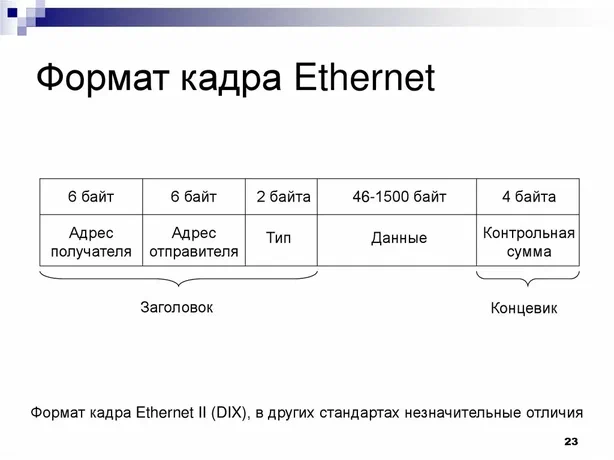

# Jumbo Frames: гигантские кадры в Ethernet

**Jumbo Frame** (от англ. *jumbo* — «гигантский» и *frame* — «кадр») — это технология в компьютерных сетях, позволяющая передавать Ethernet-кадры с размером полезной нагрузки (MTU, Maximum Transmission Unit), превышающим стандартный лимит Ethernet в 1500 байт.

---

## Принцип работы

Стандартный Ethernet-кадр состоит из заголовка, поля данных и контрольной суммы (FCS). Его общий размер не превышает **1518 байт**, при этом на полезную нагрузку (payload) приходится до **1500 байт**.

Jumbo Frames увеличивают размер полезной нагрузки. На практике чаще всего используют значение до **9000 байт**. Некоторые производители поддерживают и более крупные кадры — так называемые **Super Jumbo Frames** (до 16 128 байт), — однако из-за проблем с совместимостью они применяются редко.

Благодаря увеличенному размеру кадра один большой блок данных (например, 64 КБ) передаётся меньшим количеством кадров. Это снижает нагрузку на центральный процессор (CPU) сетевых устройств и серверов: уменьшается количество обрабатываемых пакетов и объём служебной информации (заголовков). Кроме того, повышается эффективность использования канала связи.

---

## Когда это полезно

Jumbo Frames особенно эффективны в следующих сценариях:

- **Системы хранения данных** (Storage networks): iSCSI, NFS, Ceph. При стандартном MTU один блок данных разбивается на несколько пакетов, что увеличивает нагрузку на сервер. С Jumbo Frame блок помещается в один-два кадра.
- **Резервное копирование** (backup-трафик): непрерывный поток данных. Крупные кадры снижают нагрузку на сервер за счёт уменьшения количества прерываний.
- **Высокопроизводительные вычисления** (HPC): в MPI-приложениях Jumbo Frames сокращают число пакетов и снижают задержки на их обработку.

---

## Ограничения и риски

Для корректной работы Jumbo Frames необходимо, чтобы **все устройства на пути передачи данных** — сетевые карты, коммутаторы, маршрутизаторы и конечные хосты — поддерживали и были настроены на одинаковый размер MTU.

Если кадр с Jumbo Frame попадёт в сеть со стандартным MTU, он будет либо фрагментирован (что создаст дополнительную нагрузку на устройства), либо отброшен (если установлен флаг **DF** — *Don't Fragment*).

### Где можно применять

- В изолированных сегментах — например, в крупных ЦОД или транспортных сетях.
- В некоторых национальных исследовательских и образовательных сетях (Internet2, National LambdaRail, ESnet и др.).

### Где лучше не использовать

- В коммерческих сетях большинства интернет-провайдеров, так как они могут не пропускать такие кадры.

---

> **Важно:** термин «Jumbo Frames» не является официальным стандартом IEEE. Это неформальное обозначение, появившееся в 1990-х годах среди производителей сетевого оборудования (например, Alteon WebSystems).

---

**Итог:** Jumbo Frames — мощный инструмент для оптимизации определённых типов трафика, но его применение требует тщательной проверки совместимости всего сетевого оборудования.

---

## Что можно добавить

Вот несколько идей, которые сделают материал полнее и полезнее:

1. **Историческая справка.** Когда и кем технология была предложена (Alteon WebSystems, конец 1990-х), как развивалась, почему так и не стала стандартом IEEE.
2. **Сравнительная таблица** «стандартный кадр vs Jumbo Frame»: размер payload, общий размер кадра, overhead (доля служебных данных), количество кадров для передачи 64 КБ.
3. **Расчёт выигрыша в overhead.** Например: при MTU 1500 служебные данные составляют ~2,7% кадра, при MTU 9000 — ~0,3%. Это наглядно показывает экономию.
4. **Практические команды настройки** для Linux (`ip link set dev eth0 mtu 9000`), Windows (`netsh interface ipv4 set subinterface ... mtu=9000`), а также для коммутаторов Cisco/Juniper.
5. **Диагностика проблем.** Как проверить, проходит ли Jumbo Frame по пути: `ping -M do -s 8972`, `tracepath`, анализ счётчиков ошибок на интерфейсах.
6. **Влияние на latency.** Jumbo Frames снижают CPU-нагрузку, но увеличивают время передачи одного кадра — это важно для latency-чувствительных приложений (VoIP, игровой трафик). Стоит упомянуть компромисс.
7. **Jumbo Frames в виртуализации и облаках.** Особенности настройки в VMware vSphere, Hyper-V, Kubernetes/CNI (например, Calico, Cilium), где MTU часто приходится уменьшать из-за инкапсуляции (VXLAN, Geneve).
8. **Энергоэффективность.** Меньше пакетов — меньше прерываний — ниже энергопотребление CPU; это актуально для ЦОД.
9. **Совместимость с VLAN и QinQ.** Как тегирование влияет на эффективный MTU (нужно учитывать 4 байта на тег).
10. **Ссылки на первоисточники** (RFC, документация производителей) для углублённого изучения.

Если хотите, могу подготовить версию с таблицей и командами настройки — скажите, для какой ОС/платформы.