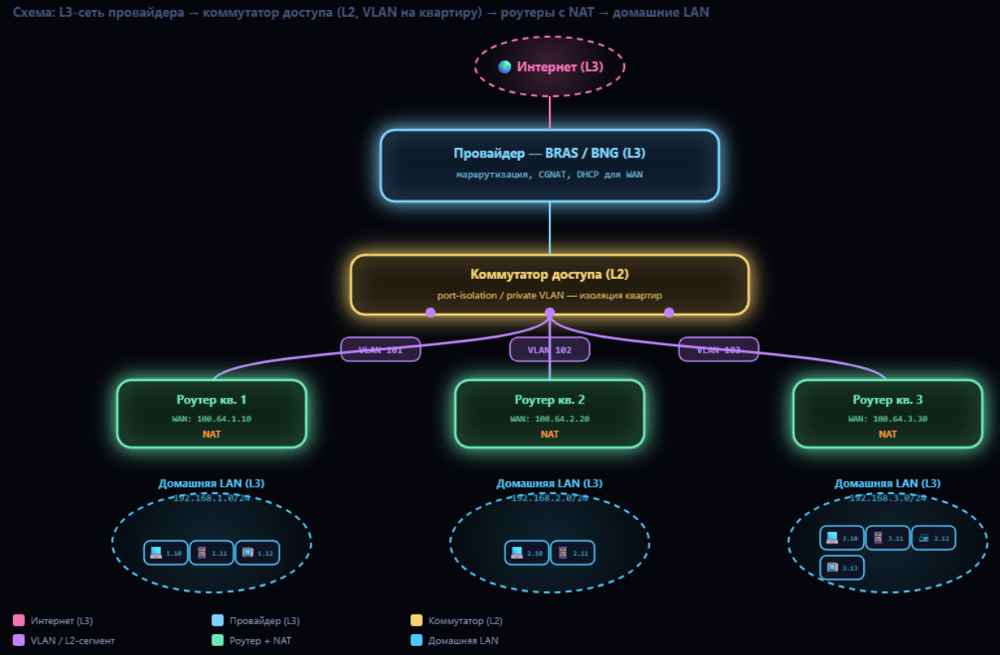

Хорошо, чуть глубже — но всё ещё без хардкора.

## Схема с уровнями

```
Провайдер (BRAS/BNG — большое L3-устройство)
        │
[Коммутатор доступа в доме]   ← L2, разводит по квартирам
        │  (витая пара / оптика)
[Твой роутер]                 ← граница: WAN снаружи, LAN внутри
        │
[Устройства: 192.168.1.x]
```

## Коммутатор провайдера: что он реально делает

Это **L2-устройство** (коммутатор доступа). Он не «строит сеть на дом» в смысле L3. Его задачи:

- **Физически развести** линию от провайдера по квартирам.
- **Изолировать абонентов друг от друга** на L2. Делается через **отдельный VLAN на каждый порт** (или private VLAN / port isolation). Тогда broadcast-домен у каждой квартиры свой, соседи не видят друг друга.
- Иногда **терминировать L2-протоколы** доступа (PPPoE, DHCP snooping, QinQ) — но это уже детали.

Итог: коммутатор даёт каждой квартире **изолированный L2-сегмент до провайдера** — как будто отдельный провод. Это не «LAN дома», а **access-сегмент**.

Управляющий IP `10.43.87.90` — это адрес **самого коммутатора** в служебной сети провайдера. К твоей квартире и твоему NAT он отношения не имеет.

## Твой роутер: две стороны

1. **WAN-интерфейс** — смотрит в сторону провайдера. Получает **один адрес** от провайдера:
    - либо **публичный** (редко, обычно за доп. плату),
    - либо **приватный из CGNAT** (`100.64.0.0/10`) — тогда провайдер тоже делает NAT.
2. **LAN-интерфейс** — строит **твою домашнюю сеть** `192.168.1.0/24`:
    - свой DHCP,
    - свой NAT (подменяет `192.168.1.x` на WAN-IP),
    - свои правила файрвола.

## Где тут «вложенность»

Не «LAN в LAN», а **цепочка NAT**:

```
Твои устройства (192.168.1.x)
        ↓ NAT твоего роутера
WAN-IP роутера (публичный или 100.64.x.x)
        ↓ (если CGNAT) NAT провайдера
Публичный IP провайдера
        ↓
Интернет
```

- **Домашняя LAN** спрятана за NAT роутера — снаружи виден только WAN-IP.
- **Сеть провайдера** — отдельная L3-сеть; если там CGNAT, то за ним ещё один слой NAT.
- **Коммутатор** в этой цепочке — просто L2-транспорт, он не участвует в NAT и не «строит LAN».

## Что важно не путать

| Понятие | Что это |
|---|---|
| Коммутатор в доме | L2, изолирует квартиры, разводит линию |
| `10.43.87.90` |管理-IP коммутатора, служебная сеть провайдера |
| WAN твоего роутера | один адрес от провайдера (публичный или CGNAT) |
| LAN твоего роутера | `192.168.1.0/24`, твоя домашняя сеть за NAT |
| CGNAT провайдера | возможный второй слой NAT на стороне провайдера |

## Короткий итог

- Коммутатор **не создаёт общую LAN на дом** — он даёт каждой квартире **изолированный L2-сегмент** до провайдера.
- Роутер **создаёт твою LAN** и прячет её за NAT.
- Между ними — **L3-сеть провайдера** (иногда с CGNAT), а не «LAN внутри LAN».
- `10.43.87.90` — служебный адрес оборудования, к твоей домашней сети отношения не имеет.