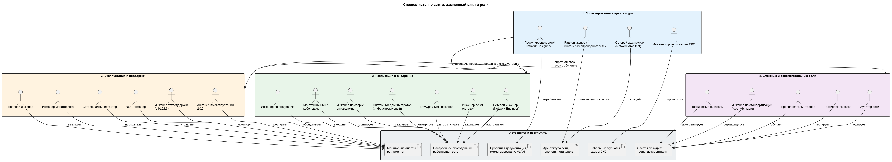

Конечно. Ниже — диаграмма в PlantUML, которая показывает **всех специалистов, участвующих в жизненном цикле сети**, сгруппированных по фазам и связанных с типовыми артефактами/результатами. После кода — пояснения.

---

## 📝 Пояснения к диаграмме

### 1. Структура
Диаграмма разбита на **четыре пакета (package)**, соответствующие фазам жизненного цикла сети, и **один пакет артефактов** — то, что каждая роль производит или с чем работает.

### 2. Фаза «Проектирование и архитектура»
Здесь рождается «замысел» сети:
- **Архитектор** создаёт верхнеуровневую архитектуру и стандарты (артефакт A1).
- **Проектировщик** детализирует её до схем адресации, VLAN, маршрутизации (A2).
- **Проектировщик СКС** отвечает за физику: кабельные трассы, шкафы (A3).
- **Радиоинженер** планирует беспроводное покрытие (A1).

> 💡 Ключевая мысль: на этой фазе **ничего ещё не настроено**, но заложены все решения, которые определят эксплуатацию.

### 3. Фаза «Реализация и внедрение»
Здесь проект превращается в работающую сеть (A4):
- **Сетевой инженер** — центральная фигура: настраивает оборудование.
- **Инженер по внедрению** выполняет монтаж и первичную настройку по проекту.
- **Монтажник СКС** и **сварщик оптоволокна** делают физическую часть.
- **Сисадмин** интегрирует сеть с серверами, DNS, DHCP.
- **DevOps/SRE** автоматизирует развёртывание (IaC, CI/CD).
- **Инженер по ИБ** обеспечивает защиту (firewall, VPN, сегментация).

> 💡 Важно: в небольших компаниях эти роли часто совмещает **один человек** — «сетевой инженер-универсал».

### 4. Фаза «Эксплуатация и поддержка»
Здесь сеть живёт и обслуживается (A5):
- **Сетевой администратор** — ежедневное управление.
- **NOC-инженер** — круглосуточный мониторинг и первая реакция.
- **Техподдержка L1/L2/L3** — обработка заявок пользователей.
- **Инженер ЦОД** — физическая инфраструктура дата-центра.
- **Полевой инженер** — выезды на объекты.
- **Инженер мониторинга** — настройка Zabbix/Grafana/алертов.

> 💡 Ключевая мысль: эксплуатация — это **непрерывный процесс**, а не разовый проект.

### 5. Смежные роли
Эти специалисты работают **сквозь все фазы** (A6):
- **Тестировщик** проверяет производительность и отказоустойчивость.
- **Аудитор** обследует существующую сеть и даёт рекомендации.
- **Технический писатель** документирует.
- **Инженер по стандартизации** обеспечивает соответствие ISO/IEEE/RFC.
- **Преподаватель** обучает персонал и готовит к сертификациям.

### 6. Связи между фазами
Стрелки `P1 → P2 → P3` показывают **передачу результатов**: проект → внедрение → эксплуатация. Обратная стрелка `P3 → P4` символизирует **обратную связь**: аудит, обучение, доработка документации — то, что питает следующие итерации.

### 7. Как читать диаграмму
- **Акторы (actor)** — люди/роли.
- **Артефакты (artifact)** — результаты труда.
- **Стрелки** — кто что создаёт или с чем работает.
- **Пакеты** — фазы жизненного цикла.

---

## 🎯 Главный вывод

Диаграмма показывает, что **«сеть» — это не один специалист, а конвейер ролей**. В маленькой компании этот конвейер сжимается до 1–2 человек, в крупной — до десятков. Понимание этой карты помогает:
- правильно **распределять ответственность** в команде;
- видеть **узкие места** (например, нет аудитора — сеть деградирует незаметно);
- строить **карьерный трек** (от монтажника → к сетевому инженеру → к архитектору).

Если хотите, могу сделать **упрощённую версию** диаграммы (только 5–7 ключевых ролей) или **версию для маленькой компании**, где все роли совмещены.