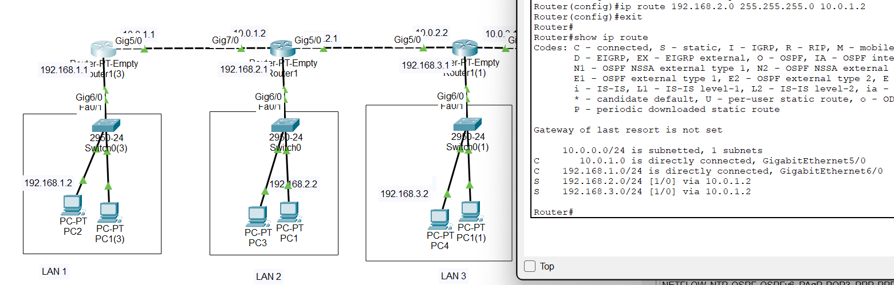
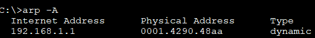

# Как пакет идёт от хоста A к хосту B: рассказ по шагам

Ниже — тот же сценарий, но собранный заново: без таблиц-простыней, с расшифровкой каждого сокращения и протокола, нормальным языком.

Доп. к тексту ниже:

То есть у каждого порта роутера свой IP (У коммутатора нет IP, а у маршрутизатора может быть несколько IP на одном порту (VLAN), но это не суть)
Он смотрит на все свои порты применяет маску и если видит, что напряму такая сеть не на порту, то обращается к таблицу маршрутизации.
То есть он пытается понять, подключена ли такая сеть напрямую, если нет, то ищет, маршруты в таблице маршрутизации.

Получается, если бы у каждого элемента сети были глаза, то они видели бы только ближайший узел (физическое подключение). Остальных они не знают, только как бы предполагают их наличие где-то за пределами ближайших узлов

### Кто что «знает»: короткая таблица

| Элемент | Физически видит | Знает в своей сети (L2) | Знает про маршруты (L3) |
|---|---|---|---|
| **Хост** | свой порт | всех, кто ответил на ARP (по MAC) | только шлюз по умолчанию |
| **Коммутатор** | все свои порты | MAC-адреса в своей сети (MAC-таблица, выучивает из кадров) | ничего — не маршрутизирует |
| **Маршрутизатор** | все свои порты | всех в каждой из своих сетей (через ARP) | только сети из своей таблицы маршрутизации: напрямую подключённые + статические + выученные (OSPF/BGP) + маршрут по умолчанию |

**Оговорка про «новую сеть»:** пока устройство не получило запись (ARP-ответ, кадр с новым MAC, маршрут от админа или протокола) — оно об этом не знает. «Знание» появляется только после обмена или настройки, а не само по себе.

**Одной фразой:** хост знает свою сеть и шлюз; коммутатор — MAC в своей сети; маршрутизатор — всех в своих сетях и те маршруты, что есть в его таблице (не «все сети вообще»).

### Как выглядят эти знания

#### Маршрутизатор



1. C - напрямую сидящие на порту
2. S - статические. Те, что мы сами прописали. Какая сеть и куда кидать (via - через какую)

#### Хост 




---

## Сначала — кто у нас есть

Представьте пять сетей, выстроенных в цепочку:

```
[Хост A] ── [R1] ── (сеть 12) ── [R2] ── (сеть 2) ── [R3] ── (сеть 23) ── [R4] ── [Хост B]
```

- **Хост A** — компьютер в сети 1, который хочет пропинговать хост B.
- **Хост B** — компьютер в сети 3.
- **R1, R2, R3, R4** — маршрутизаторы. R1 — шлюз для сети 1, R4 — шлюз для сети 3. R2 и R3 оба подключены к сети 2.
- **Сеть 1** и **сеть 3** — обычные локальные сети (LAN, Local Area Network — локальная сеть), в каждой свой хост и свой шлюз.
- **Сеть 2** — тоже полноценная LAN, в ней есть свои хосты (нам они в этом сценарии не нужны, но они есть). R2 и R3 — просто два участника этой сети.
- **Сеть 12** и **сеть 23** — транзитные сети: короткие линии «точка-точка» между двумя маршрутизаторами. Своих хостов там нет, только два интерфейса.

**Расшифровки, которые пригодятся дальше:**

- **IP** (Internet Protocol) — адрес устройства в сети, по которому пакет находит получателя через несколько сетей.
- **MAC** (Media Access Control) — «паспортный» адрес сетевой карты, по которому кадр доставляется **внутри одной сети**.
- **ARP** (Address Resolution Protocol) — протокол, которым устройство спрашивает: «У кого IP такой-то? Скажите свой MAC».
- **ICMP** (Internet Control Message Protocol) — служебный протокол; именно им работает `ping` (Echo Request / Echo Reply).
- **Шлюз по умолчанию** (default gateway) — маршрутизатор, которому хост отдаёт пакеты «наружу», если получатель не в его сети.
- **Таблица маршрутизации** — список правил вида «сеть X достижима через R такой-то».

---

## Шаг 1. Хост A понимает, что B — не сосед

Хост A хочет пинговать B. Он берёт **свою маску подсети** (mask — число, которое говорит, какая часть IP-адреса обозначает «сеть», а какая — «устройство») и применяет её к своему IP и к IP хоста B.

Проще говоря: он сравнивает, **в одной ли они сети**. У A — сеть 1, у B — сеть 3. **Разные сети.** Значит, напрямую B не достать — надо отдавать пакет **шлюзу по умолчанию**, то есть R1.

> Здесь A ещё не знает MAC-адрес R1. Он знает только IP шлюза. Дальше — ARP.

---

## Шаг 2. A спрашивает: «Кто такой R1?»

A отправляет **ARP-запрос** — широковещательный (broadcast) вопрос на весь свою сеть 1: «У кого IP такой-то (IP R1)? Скажите свой MAC».

Слово **broadcast** означает «всем-всем-всем в этой сети». Такой запрос **не выходит за пределы сети 1** — маршрутизаторы его не пропускают. Это важно: ARP работает **только внутри одной сети**.

---

## Шаг 3. R1 отвечает своим MAC

R1 слышит вопрос, понимает, что спрашивают его, и отвечает **лично** (unicast — «одному»): «Это я, мой MAC такой-то». Хост A записывает пару «IP R1 → MAC R1» в свою **ARP-таблицу** — маленький блокнотик, чтобы в следующий раз не спрашивать.

---

## Шаг 4. A отправляет пакет на R1

Теперь A собирает **IP-пакет**: внутри написано «от A — к B» (IP источника — A, IP назначения — B). Потом упаковывает этот пакет в **Ethernet-кадр**: «от MAC A — к MAC R1». И отправляет в сеть 1.

**Важно не перепутать:** в пакете адрес назначения — **B** (сквозной адрес), а в кадре адрес назначения — **R1** (адрес следующего шага в этой сети). Это две разные вещи: IP ведёт пакет через весь путь, MAC — только до соседа в текущей сети.

---

## Шаг 5. R1 принимает кадр и решает, куда дальше

R1 видит: кадр адресован ему (MAC совпал) → принимает. Снимает Ethernet-обёртку, достаёт IP-пакет, смотрит **IP назначения — B**.

Дальше R1 **смотрит в свою таблицу маршрутизации**: «Сеть 3 мне достижима через R2». То есть следующий шаг — R2. Если бы маршрута не было, R1 отправил бы хосту A сообщение ICMP «сеть недостижима» (Destination Network Unreachable). Но маршрут есть.

R1 делает **ARP до R2 в сети 12** (в этой транзитной сети слышит только R2, больше никого нет), получает MAC R2, собирает новый кадр: «от MAC R1 — к MAC R2», и отправляет.

---

## Шаг 6. R2 принимает и решает, куда дальше

R2 видит: кадр ему → принимает, снимает обёртку, смотрит IP назначения — B. В таблице маршрутизации: «Сеть 3 — через R3». Следующий шаг — R3.

**Но R3 находится в сети 2, а сеть 2 — это общая LAN с другими хостами.** Поэтому R2 делает **ARP до R3 в сети 2** — это широковещательный запрос, который **услышат все устройства сети 2** (включая чужие компьютеры), но ответит только R3. R2 получает MAC R3, собирает кадр «от MAC R2 — к MAC R3» и отправляет.

> Вот здесь отличие от транзитной сети: если бы сеть 2 была просто проводом между R2 и R3, ARP услышал бы только R3. А в LAN его слышат все — это нормальный «шум» Ethernet.

---

## Шаг 7. R3 принимает и решает, куда дальше

R3 видит: кадр ему → принимает, снимает обёртку, смотрит IP назначения — B. В таблице: «Сеть 3 — через R4». Следующий шаг — R4.

R3 делает **ARP до R4 в сети 23** (транзитная сеть, слышит только R4), получает MAC R4, собирает кадр «от MAC R3 — к MAC R4» и отправляет.

---

## Шаг 8. R4 доставляет пакет хосту B

R4 видит: кадр ему → принимает, снимает обёртку, смотрит IP назначения — B. В таблице: «Сеть 3 — **напрямую подключена**». Значит, B — сосед в сети 3. R4 делает **ARP до B в сети 3** (broadcast в сети 3), получает MAC B, собирает кадр «от MAC R4 — к MAC B» и отправляет.

Хост B принимает кадр, видит свой MAC, снимает обёртку, достаёт IP-пакет, видит **ICMP Echo Request** («пинг») — и формирует **ICMP Echo Reply** («понг»).

---

## Шаг 9. Обратный путь

Ответ идёт **тем же путём в обратную сторону**: B → R4 → R3 → R2 → R1 → A. На каждом шаге — свой ARP в своей сети (если записи ещё нет). IP источника и назначения в пакете **не меняются** (от B к A), а MAC-адреса в кадрах — свои для каждого шага.

> Обратный путь **не обязан** быть тем же самым — IP это допускает (называется «асимметричная маршрутизация»). Но в простой сети, как у нас, маршруты симметричны.

---

## Что происходит с адресами на всём пути

Одна фраза, которую стоит запомнить:

> **IP-адреса — сквозные, MAC-адреса — локальные.**

- **IP источника (A) и IP назначения (B)** не меняются на всём пути (если нет NAT — преобразования адресов; у нас его нет).
- **MAC источника и MAC назначения** меняются на каждом шаге: в каждой сети свои соседи, свои MAC.

Таблица для наглядности:

| Шаг | Кто отправляет | IP от | IP кому | MAC от | MAC кому |
|---|---|---|---|---|---|
| 1 | A | A | B | A | R1 |
| 2 | R1 | A | B | R1 | R2 |
| 3 | R2 | A | B | R2 | R3 |
| 4 | R3 | A | B | R3 | R4 |
| 5 | R4 | A | B | R4 | B |

---

## Где на пути делается ARP

ARP делается **в каждой сети отдельно**, только если нужной записи ещё нет в ARP-таблице:

1. A → R1: ARP в **сети 1** (LAN, слышат все хосты сети 1).
2. R1 → R2: ARP в **сети 12** (транзит, слышит только R2).
3. R2 → R3: ARP в **сети 2** (LAN, слышат все хосты сети 2, отвечает R3).
4. R3 → R4: ARP в **сети 23** (транзит, слышит только R4).
5. R4 → B: ARP в **сети 3** (LAN, слышат все хосты сети 3).

**Ключевая мысль:** ARP **не идёт сквозным потоком через все маршрутизаторы**. Маршрутизатор — это **граница broadcast-домена**: он обрывает широковещательный запрос и запускает свой ARP в следующей сети. Поэтому ARP «перезапускается» в каждой сети заново.

---

## Что должно быть в таблицах маршрутизации

Чтобы пакет дошёл, **каждый маршрутизатор должен знать маршрут до сети 3** (и обратно — до сети 1). Откуда он это знает:

- **Статические маршруты** — администратор прописал вручную.
- **Динамическая маршрутизация** — протоколы вроде **OSPF** (Open Shortest Path First — «открытый кратчайший путь», внутри одной организации) или **BGP** (Border Gateway Protocol — «пограничный протокол», между провайдерами) сами обмениваются информацией и строят таблицы. Еше есть RIP (устаревший)

Например, у R1 таблица может выглядеть так:

- Сеть 1 — напрямую (интерфейс в сети 1).
- Сеть 12 — напрямую (интерфейс в сети 12).
- Сеть 2 — через R2 (следующий шаг — R2).
- Сеть 23 — через R2.
- Сеть 3 — через R2.

R1 **не знает всю карту города** — он знает только «следующий шаг» для каждой сети. Дальше R2 знает свой следующий шаг, и так далее. Это называется **маршрутизация по шагам** (hop-by-hop): каждый маршрутизатор принимает решение только за себя.

---

## Три заблуждения, которых стоит избегать

1. **«ARP идёт от хоста A до хоста B через все маршрутизаторы»** — нет. ARP работает **только внутри одной сети**. Маршрутизатор его не пропускает.
2. **«Хост A видит MAC хоста B»** — нет. A видит только MAC R1. MAC B появится только в последнем кадре (R4 → B).
3. **«IP-адрес меняется на каждом шаге»** — нет. IP источника и назначения сквозные, меняются только MAC.

---

## Короткое резюме

1. A понимает, что B в другой сети, и отдаёт пакет шлюзу R1.
2. Чтобы отдать пакет, A делает ARP до R1 **в сети 1**.
3. R1 принимает, смотрит таблицу маршрутизации, делает ARP до R2 **в сети 12**.
4. R2 — ARP до R3 **в сети 2** (общая LAN, слышат все).
5. R3 — ARP до R4 **в сети 23**.
6. R4 — ARP до B **в сети 3**.
7. B отвечает, и ответ идёт обратно тем же путём.
8. На всём пути **IP-адреса не меняются, MAC-адреса меняются на каждом шаге**, ARP делается **в каждой сети отдельно**.

Всё держится на двух вещах: **таблица маршрутизации** говорит, **куда** отправить пакет дальше, а **ARP** говорит, **какому MAC** в текущей сети его отдать.