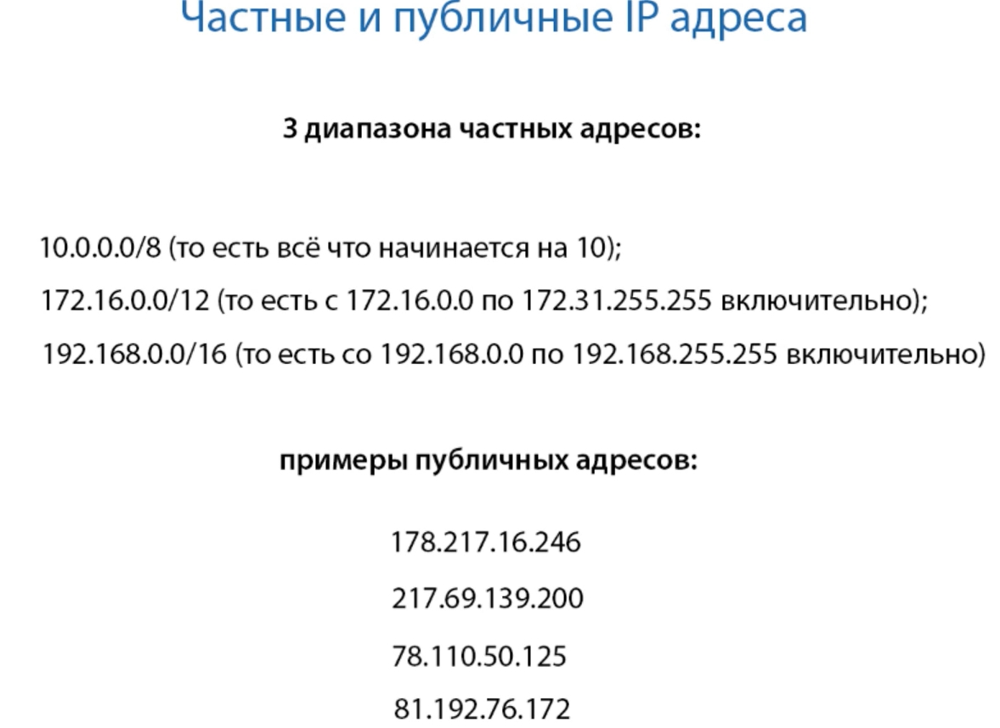
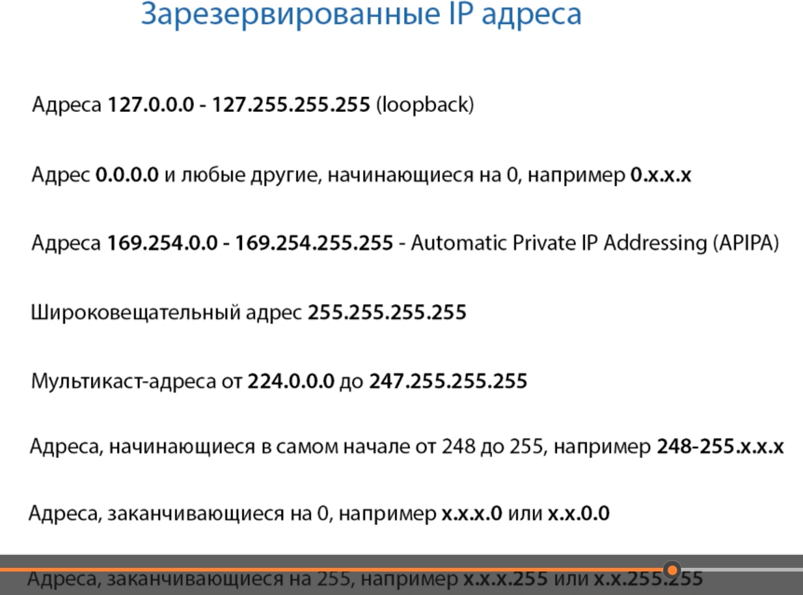

К частным ip низя обратиться из интернета, они доступны только в ЛВС организации. Можно назначить вообще любой.

Публичные ip маршрутизируются в интернете и к ним можно обратиться из любой точки света. Нельзя назначить руками, публичные ip регулируются и выдаются различными организациями

Как выдается ip? Я прошу у провайдера, провайдеру дает адреса local internet regestry, lir берет у r (regional) ir, RIR берет у IANA, а IANA у ICANN

Можно получаить провайдер независимый IP, запросив напрямую у LIR

Кста, частным хостам можно назначить публичный ip, но они один хер не будут работать через инет, но будут в ЛВС. Т.к. есть NAN и провайдер (который такой адрес не запишет в табличку)

Зарезервированные адреса (их назначать низя)

