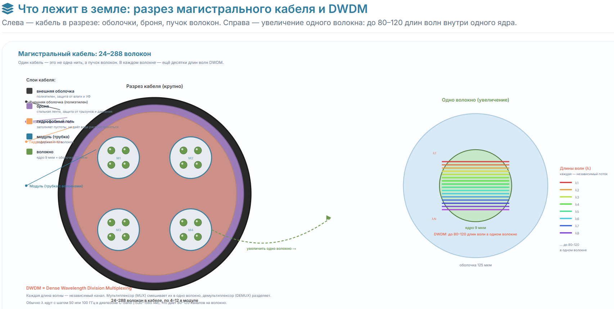
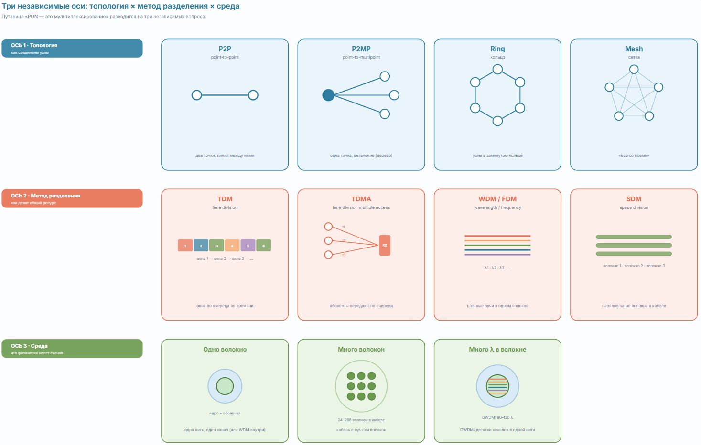

# Как провайдер раскидывает оптику по городу: рассказ по шагам

Представь, что ты — провайдер, и тебе нужно подключить к интернету весь город. Начнём с того, что лежит в земле, и постепенно дойдём до квартиры.

---

## Шаг 1. Магистральный кабель между районами

Ты прокладываешь по городу **магистральный оптический кабель**. Внутри него — не одно волокно, а **много**: обычно от 24 до 288 штук. Каждое волокно — это тонкая стеклянная нить толщиной с волос, по которой бежит свет.

Зачем так много? Потому что **каждое волокно — это отдельный независимый канал**. По одному волокну можно пустить 100 Гбит/с, по другому — ещё 100, по третьему — ещё. Они не мешают друг другу, потому что физически разделены. Это называется **пространственным разделением (SDM)** — просто «много волокон в одном кабеле».

Но и это ещё не всё. По **одному** волокну можно пустить не один поток, а **много одновременно** — с помощью **DWDM**. Это когда в одно волокно «закачивают» десятки световых лучей разного цвета (разной длины волны), и каждый цвет несёт свой независимый поток данных. Как будто по одной трубе едут поезда разных цветов, и каждый едет по своему расписанию, не мешая остальным.

Так что в магистральном кабеле из 100 волокон, где в каждом волокне 80 «цветов» по 400 Гбит/с, суммарная ёмкость — **3,2 Пбит/с**. Это уровень современных магистралей между городами.



---

## Шаг 2. От магистрали — к районам

Магистраль не идёт напрямую в каждый дом — это было бы безумно дорого. Вместо этого ты строишь **узлы связи** (по-английски — PoP, Point of Presence) в разных районах города.

От магистрального кабеля ты **ответвляешь** часть волокон и тянешь их до районного узла. Там стоит **оборудование агрегации** — коммутаторы и маршрутизаторы, которые собирают трафик со всего района и передают его дальше в магистраль.

Здесь важно понять слово **«агрегация»**. Это когда много мелких потоков собираются в один большой. Например, от десяти домов идут десять волокон по 10 Гбит/с — коммутатор агрегации собирает их в один uplink на 100 Гбит/с и отправляет в магистраль. Как будто десять ручейков сливаются в одну реку.

---

## Шаг 3. От района — к домам

От районного узла ты тянешь оптику к **жилым домам**. И вот здесь есть два принципиально разных подхода.

### Подход А: «каждому дому — своё волокно» (Metro Ethernet, FTTB)

Ты тянешь от узла **отдельное волокно до каждого дома**. В подвале дома ставишь **коммутатор доступа**, к которому подключаются квартиры витой парой. Коммутатор дома соединён с районным узлом оптикой.

Это просто, надёжно и даёт каждому дому **выделенную полосу**. Но дорого: на каждый дом — своё волокно, свой коммутатор, своё питание.

### Подход Б: «одно волокно — на много домов» (PON, GPON)

Ты тянешь **одно волокно** от узла и по пути **разветвляешь** его **пассивными сплиттерами**. Сплиттер — это маленькая стеклянная коробочка без питания, которая просто делит световой сигнал: один вход, несколько выходов (1:2, 1:4, 1:8, 1:16, 1:32, 1:64, 1:128).

То есть одно волокно от станции провайдера (OLT) идёт до сплиттера в подъезде, а оттуда — **64 отдельных волокна** в 64 квартиры. И все 64 абонента **сидят на одном волокне**.

«Но как же они не мешают друг другу?» — спросишь ты. А вот как:

- **От провайдера к абонентам (downstream):** провайдер передаёт **непрерывный поток** кадров, и в этом потоке **каждому абоненту выделено своё временное окно**. Все 64 абонента «слышат» весь поток, но каждый берёт только те кадры, что адресованы ему. Это **TDM** — мультиплексирование по времени.
- **От абонентов к провайдеру (upstream):** абоненты передают **по очереди**, каждый в своё временное окно, чтобы не было столкновений. Провайдер (OLT) выдаёт им «разрешения на передачу». Это **TDMA** — множественный доступ по времени.

Именно так работает **GPON** — самая распространённая технология «оптика в квартиру» (FTTH). Скорость: 2,5 Гбит/с вниз, 1,25 Гбит/с вверх на **всё дерево** из 64 (или 128) абонентов. Каждому достаётся доля — в среднем 39 Мбит/с, но в часы пик может быть меньше, а ночью — больше.

Более новая версия — **XGS-PON** — даёт 10 Гбит/с вниз и 10 Гбит/с вверх на дерево. Ещё новее — **NG-PON2** — добавляет WDM: разные длины волн разным группам абонентов, плюс TDM внутри каждой группы.



---

## Шаг 4. От дома — в квартиру

Если это FTTH (оптика в квартиру), то от сплиттера в подъезде идёт тонкое оптическое волокно прямо в квартиру, и там заканчивается **ONT** — маленькой коробочкой (часто совмещённой с роутером). ONT превращает оптический сигнал в электрический и раздаёт интернет по Wi-Fi и витой паре.

Если это FTTB (оптика в дом), то от коммутатора в подвале до квартиры идёт **витая пара** (Cat5e/Cat6), и в квартире стоит обычный роутер.

---

## Шаг 5. От квартиры — обратно в мир

Теперь соберём весь путь трафика от твоего ноутбука до интернета:

```
[Ноутбук] ──Wi-Fi── [Роутер/ONT в квартире]
                          │
                          │ оптика (если FTTH) или витая пара (если FTTB)
                          ▼
                    [Сплиттер в подъезде]  ← пассивный, без питания
                          │
                          │ одно волокно на 64 квартиры
                          ▼
                    [OLT на узле связи района]  ← «голова» PON
                          │
                          │ оптика (10G/100G)
                          ▼
                    [Коммутатор агрегации района]
                          │
                          │ оптика (100G/400G)
                          ▼
                    [BNG/BRAS]  ← выдаёт IP, применяет политики, CGNAT
                          │
                          │ граница автономной системы провайдера
                          ▼
                    [WAN: BGP, магистрали, интернет]
```

На каждом шаге — своя технология и своя агрегация:

- **В квартире** — LAN: Ethernet, Wi-Fi, приватные IP, NAT.
- **В подъезде** — пассивный сплиттер: делит мощность, не требует питания.
- **На узле района** — OLT: «голова» PON, управляет временными окнами.
- **В районе** — коммутатор агрегации: собирает волокна от домов в один uplink.
- **У провайдера** — BNG/BRAS: агрегирует трафик всех абонентов, выдаёт IP, применяет шейпинг и CGNAT.
- **На границе AS** — маршрутизатор: выводит трафик в WAN через BGP.

---

## Шаг 6. Что в итоге лежит в земле

Возвращаемся к твоему вопросу «провайдер раскидал по городу оптику, в оптике столько-то волокон». Вот что реально лежит:

- **Магистральный кабель между районами:** 24–288 волокон, по каждому — DWDM на 80–120 длин волн, каждая 100G/400G. Суммарно — десятки Тбит/с.
- **Кабель от района до домов:** 12–48 волокон, обычно без DWDM (или с лёгким CWDM), по каждому — 10G/100G Ethernet или PON.
- **Внутри дома:** от сплиттера до квартир — одно волокно на 32–128 квартир (PON), либо витая пара от коммутатора в подвале (FTTB).
- **В квартире:** витая пара и Wi-Fi.

И **на каждом уровне своя агрегация**: сплиттеры собирают абонентов на одно волокно, коммутаторы агрегации собирают дома в район, BNG собирает район в город, магистральные маршрутизаторы собирают город в WAN.

---

## Короткий итог

Провайдер не тянет отдельное волокно в каждую квартиру от самой магистрали — это было бы слишком дорого. Вместо этого:

1. **Магистраль** (много волокон + DWDM) идёт между районами.
2. **Районные узлы** агрегируют трафик домов.
3. **До домов** идёт оптика либо выделенными волокнами (Metro Ethernet), либо одним волокном с пассивными сплиттерами (PON/GPON).
4. **В доме** — либо коммутатор (FTTB), либо сплиттер (FTTH).
5. **В квартире** — ONT/роутер, дальше Wi-Fi и витая пара.

А «мультиплексирование» — это просто способ, которым на каждом шаге делят ёмкость: по времени (TDM/TDMA в PON), по цвету (WDM/DWDM в магистрали) или по волокнам (SDM — просто много волокон в кабеле). Всё вместе и даёт городу интернет.