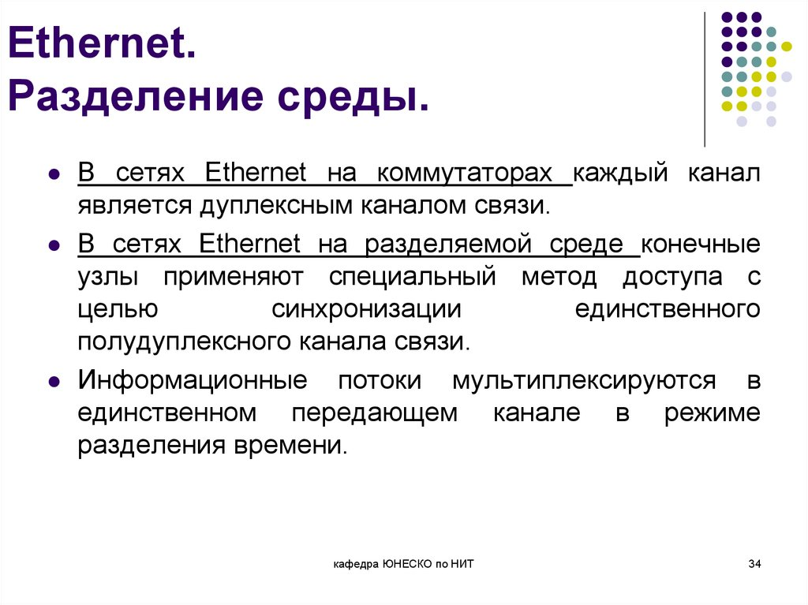

Отличный вопрос — он бьёт в самую суть того, как вообще возможна передача данных по одной среде. Разберём по порядку: **что такое разделение среды**, **какие есть способы**, и **как это связано с мультиплексированием**.

---

## 1. Что такое «разделение среды» (media sharing)

**Среда передачи** (кабель, оптоволокно, радиоканал) — это физический ресурс, который либо **один** (точка-точка), либо **общий** для нескольких устройств (шина, радиоволна, оптика с пассивным делением).

**Разделение среды** — это набор правил и механизмов, которые позволяют **нескольким устройствам или потокам использовать одну и ту же среду без взаимных помех**. Без разделения одновременная передача двух сигналов в одной среде даёт **коллизию** (в электрическом кабеле) или **интерференцию** (в радио).

Ключевая мысль: разделение среды — это **ответ на вопрос «как поделить один ресурс между многими?»**. И вот тут в игру вступает мультиплексирование.

---

## 2. Два уровня, на которых происходит разделение

Важно различать **два разных «дележа»**, которые часто путают:

| Уровень | Кто делит | Что делят | Механизм |
|---|---|---|---|
| **Физический / канальный (L1–L2)** | Устройства (узлы) | Доступ к среде | CSMA/CD, CSMA/CA, токен, TDMA, FDMA |
| **Мультиплексирование (L1–L2 и выше)** | Потоки/каналы | Пропускную способность среды | TDM, FDM, WDM, CDM, статистическое |

**Разделение среды между устройствами** — это «кто сейчас имеет право передавать».  
**Мультиплексирование** — это «как в одной среде уместить несколько независимых потоков одновременно».

Они связаны, но это **не одно и то же**. Ниже — как именно они пересекаются.

---

## 3. Способы разделения среды между устройствами (multiple access)

Это то, что решает проблему «шины»: все висят на одном кабеле — кто говорит первым?

### 3.1. Случайный доступ (contention-based)
- **CSMA/CD** (Ethernet на шине): узел слушает канал, передаёт, при коллизии — пауза и повтор.
- **CSMA/CA** (Wi-Fi): слушает, ждёт, передаёт с подтверждением.
- **Плюс**: просто, эффективно при низкой нагрузке.
- **Минус**: коллизии растут с нагрузкой, нет гарантий задержки.

### 3.2. Детерминированный доступ (controlled access)
- **Токен-шина / токен-кольцо**: право передачи передаётся по эстафете (токену). Нет коллизий, есть гарантия доступа.
- **Опрос (polling)**: мастер опрашивает узлы по очереди.
- **Плюс**: предсказуемость, подходит для реального времени.
- **Минус**: накладные расходы, уязвимость к отказу мастера/токена.

### 3.3. Разделение по частоте/времени/коду (это уже граница с мультиплексированием)
- **FDMA**: каждому устройству — своя полоса частот.
- **TDMA**: каждому устройству — свой временной слот.
- **CDMA**: каждому — свой код.

> 💡 Вот здесь разделение среды **плавно переходит** в мультиплексирование: когда мы делим среду не «по праву доступа», а **выделяем каждому устройству свой кусочек ресурса** (частоту, время, код) — это уже мультиплексирование.

---

## 4. Что такое мультиплексирование

**Мультиплексирование (multiplexing)** — это объединение нескольких независимых потоков данных в **один составной поток** для передачи по одной среде, с возможностью **демультиплексирования** на приёмной стороне.

### Основные виды

| Вид | Что делит | Пример |
|---|---|---|
| **FDM** (частотное) | Полосу частот | Радио, ADSL, кабельное ТВ |
| **TDM** (временное) | Время | E1/T1, SDH, GSM |
| **WDM/DWDM** (по длине волны) | Оптический спектр | Магистральное оптоволокно |
| **CDM** (кодовое) | Коды | 3G, GPS |
| **Статистическое** (packet-based) | Пакеты/очереди | Ethernet, IP, ATM |

---

## 5. Как разделение среды связано с мультиплексированием

Вот главная связь — в трёх тезисах.

### 🔗 Связь 1: мультиплексирование — это «продвинутое» разделение среды
Разделение среды отвечает на вопрос **«кто получает доступ к среде»**. Мультиплексирование отвечает на вопрос **«как в одной среде одновременно уживаются несколько потоков»**. По сути, мультиплексирование — это **формализованный, управляемый способ разделения среды**, где каждому потоку выделен свой «слот» ресурса (частота, время, код, длина волны). То есть:

> **Мультиплексирование = разделение среды, возведённое в ранг технологии с гарантированным выделением ресурса.**

### 🔗 Связь 2: разделение среды работает на уровне «доступа», мультиплексирование — на уровне «агрегации»
- **CSMA/CD** — это разделение среды **между устройствами** (кто говорит).
- **TDM/FDM** — это разделение среды **между потоками** (что и когда говорится).

В шине Ethernet устройства **соревнуются** за среду (случайный доступ). В TDM-системе (например, SDH) устройства **получают гарантированные слоты** — это уже мультиплексирование. Оба решают одну проблему — «как поделить кабель», но с разными гарантиями.

### 🔗 Связь 3: современные сети совмещают оба механизма
Возьмём оптику с **DWDM**:
- **DWDM** мультиплексирует десятки длин волн в одном волокне (разделение по длине волны).
- Внутри каждой волны может работать **TDM** (разделение по времени).
- А поверх — **статистическое мультиплексирование** пакетов (Ethernet/IP).

Или Wi-Fi:
- **CSMA/CA** — разделение среды между станциями (доступ).
- **OFDM** — мультиплексирование поднесущих внутри канала (частотное разделение).
- **MU-MIMO** — пространственное разделение (SDMA).

То есть **разделение среды и мультиплексирование — это слои одного пирога**: сначала решаем, кто вообще может transmit (доступ), потом — как упаковать несколько потоков в этот доступ (мультиплексирование).

---

## 6. Наглядная аналогия

Представьте **одну полосу шоссе** (среда):
- **Разделение среды** — правила, кто и когда выезжает на полосу: светофор (детерминированно) или «кто первый встал» (случайно).
- **Мультиплексирование** — как в одной полосе едут машины разных маршрутов: по очереди (TDM), по выделенной полосе (FDM), с разными номерами (CDM).
- **Статистическое мультиплексирование** — машины едут «по мере появления», полоса загружается динамически.

---

## 7. Резюме одной таблицей

| Понятие | Вопрос, на который отвечает | Уровень | Примеры |
|---|---|---|---|
| **Разделение среды** | Кто получает доступ к среде? | L1–L2 | CSMA/CD, токен, polling |
| **Мультиплексирование** | Как несколько потоков уживаются в одной среде? | L1–L2 и выше | TDM, FDM, WDM, CDM, stat-mux |
| **Связь** | Мультиплексирование — это управляемое разделение среды с выделением ресурса каждому потоку | — | DWDM + TDM + packet mux |

---

## 💡 Главный вывод

**Разделение среды** и **мультиплексирование** — две стороны одной медали «как поделить один физический ресурс». Разделение среды — это **борьба за доступ** (кто говорит), мультиплексирование — это **упаковка потоков** (что и как говорится одновременно). В шине Ethernet вы сначала решаете коллизии (разделение), а потом передаёте кадр (данные). В DWDM вы сначала делите спектр на волны (мультиплексирование), а внутри каждой волны можете ещё раз делить время (TDM). Современные сети **совмещают оба механизма на разных уровнях**.

Если хотите, могу нарисовать **PlantUML-схему**, где на одной диаграмме показано, как разделение среды (CSMA/CD, токен) и мультиплексирование (TDM/FDM/WDM) накладываются друг на друга по уровням OSI.

Картинка:

