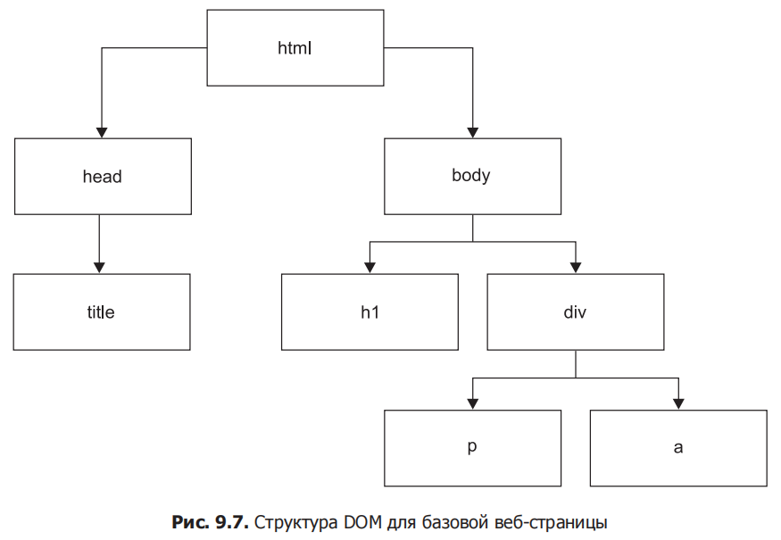

<details><summary>Кратко</summary>

## Краткая выжимка: Объектная модель документа (Глава 9)

### Ускоренный курс HTML
<mark>HTML — язык разметки, описывающий содержимое веб-страницы. Состоит из **элементов** — фрагментов между **тегами** `<...>`.</mark>

**Правила:**
- <mark>Каждый открытый тег должен быть закрыт: `<p>...</p>`.</mark>
- <mark>Внутренние элементы (дочерние) закрываются перед внешними (родительскими).</mark>
- Некоторые элементы самозакрывающиеся: `<br>`, `<input />`.

**Базовые элементы:**

| Тег                                  | Назначение                         |
|--------------------------------------|------------------------------------|
| `<html>`                             | Корневой элемент страницы          |
| `<head>`                             | Метаданные (title, скрипты, стили) |
| `<body>`                             | Видимое содержимое                 |
| `<h1>`–`<h6>`                        | Заголовки                          |
| `<p>`                                | Абзац                              |
| `<a>`                                | Ссылка                             |
| `<div>`                              | Блок-контейнер                     |
| `<span>`                             | Встроенный контейнер               |
| `<ul>` / `<ol>` / `<li>`             | Списки                             |
| `<table>` / `<tr>` / `<td>` / `<th>` | Таблицы                            |
| `<button>`                           | Кнопка                             |
| `<input>`                            | Поле ввода                         |
| `<form>`                             | Форма                              |

**Пример:**
```html
<!DOCTYPE html>
<html>
<head>
  <title>Tab in the browser</title>
</head>
<body>
  <h1>DOM</h1>
  <div>
    <p>Hello web!</p>
    <a href="https://google.com">Here's a link!</a>
  </div>
</body>
</html>
```

### Атрибуты HTML
Задают свойства элемента: `<a href="https://google.com">Ask Google</a>`.

| Атрибут | Описание |
|---|---|
| `id` | Уникальный идентификатор |
| `name` | Имя элемента |
| `class` | Класс для стилей/JS |
| `value` | Начальное значение |
| `style` | Встроенные стили |
| `href` | Ссылка (для `<a>`) |
| `src` | Источник (для `<script>`, ``) |

### BOM (Browser Object Model)
**Объектная модель браузера** — <mark>позволяет JavaScript взаимодействовать с браузером. Представлена объектом `window`.</mark>

**Доступ к консоли:** F12 или правый клик → Inspect → вкладка Console.

**Просмотр объекта:** `console.dir(window)` — показывает все свойства.

**Ключевые объекты BOM:**

| Объект | Назначение |
|---|---|
| `history` | История навигации (`history.go(-1)`, `history.length`) |
| `navigator` | Информация о браузере и ОС (`navigator.userAgent`) |
| `location` | URL текущей страницы (`location.href`, `location.protocol`) |
| `document` | DOM — содержимое страницы |

**Примеры:**
```javascript
window.history.length;
window.history.go(-1);       // назад
console.dir(window.navigator);
console.dir(window.location);
location.href;               // текущий URL
location.protocol;           // "https:" или "http:"
```

### DOM (Document Object Model)
**Объектная модель документа** — <mark>представление HTML-структуры в виде дерева. Корень — `html`, дети — `head` и `body`, у каждого свои дочерние элементы.</mark>

**Пример дерева:**
```
html
├── head
│   └── title
└── body
    ├── h1
    └── div
        ├── p
        └── a
```

**Просмотр DOM:** `console.dir(document)`.

### Выбор элементов страницы
Два основных метода:

**`document.querySelector(selector)`** — первый совпадающий элемент (или `null`):
```javascript
const el = document.querySelector("h1");           // по тегу
const el2 = document.querySelector("#myId");       // по id
const el3 = document.querySelector(".output");     // по классу
```

**`document.querySelectorAll(selector)`** — все совпадающие элементы (NodeList):
```javascript
const els = document.querySelectorAll(".output");
console.log(els);  // список всех элементов с классом output
```

**Селекторы:**

| Синтаксис | Значение |
|---|---|
| `"h1"` | По тегу |
| `".className"` | По классу |
| `"#idName"` | По id |
| `"div p"` | Вложенный селектор |

### Управление элементами
После выбора элемента можно:
- Изменить текст: `el.textContent = "Новый текст"`
- Добавить класс: `el.classList.add("red")`
- Изменить id: `el.id = "tester"`
- Изменить стиль: `el.style.backgroundColor = "red"`
- Получить URL: `document.URL`

**Пример:**
```javascript
const el = document.querySelector(".output");
el.textContent = "Hello!";
el.classList.add("red");
el.id = "tester";
el.style.backgroundColor = "red";
```

### Практические задания
- Просмотр `window`, `history`, `navigator`, `location` в консоли.
- Выбор элементов через `querySelector` / `querySelectorAll`.
- Изменение содержимого, стилей и атрибутов элементов.
- Управление HTML-структурой через JavaScript (проект: выбор `ul`, изменение `id` у `div`, смена цветов через цикл).

### Итог
- **HTML** — <mark>структура страницы: элементы, теги, атрибуты, вложенность.</mark>
- **BOM** — <mark>объект `window` и его дочерние объекты (`history`, `navigator`, `location`, `document`) для взаимодействия с браузером.</mark>
- **DOM** — <mark>дерево HTML-элементов, доступное через `document`.</mark>
- **Выбор элементов**: <mark>`querySelector` (первый) и `querySelectorAll` (все).</mark>
- **Управление элементами**: <mark>изменение текста, классов, id, стилей через JavaScript.</mark>
- <mark>DOM превращает статические страницы в **интерактивные**.</mark>

</details>

# Объектная модель документа

## Ускоренный курс HTML

<mark>Hyper-Text Markup Language (HTML) — это язык, с помощью которого формируется содержание веб-страниц. Веб-браузеры понимают HTML-код и представляют его в формате, который мы привыкли видеть: в формате веб-страниц.</mark>

> HTML (Hyper-Text Markup Language) — <mark>язык разметки, описывающий структуру и содержание веб-страниц с помощью элементов и их атрибутов.</mark>

Вот базовый пример HTML-кода:

```html
<!DOCTYPE html>
<html>
  <head>
    <title>Tab in the browser</title>
  </head>
  <body>
    <p>Hello web!</p>
  </body>
</html>
```

<mark>Код HTML состоит из элементов. Данные элементы включают в себя теги и атрибуты, мы объясним эту фундаментальную концепцию в следующих разделах.</mark>

### Элементы HTML

Как видите, HTML состоит из фрагментов кода (или, другими словами, элементов), размещённых между командами в `<угловых скобках>` — тегами. Любой открытый элемент должен быть закрыт. Мы открываем его с помощью такой комбинации — `<имя_элемента>`, а закрываем такой — `</имя_элемента>`.

> Тег — <mark>команда разметки в угловых скобках, обозначающая начало или конец элемента.</mark>

> Элемент — <mark>часть HTML-документа, включающая открывающий тег, содержимое и закрывающий тег.</mark>

<mark>Всё, что находится между тегами, является частью элемента. Некоторые элементы всё же закрывать не нужно, но вы с ними вряд ли столкнётесь.</mark> В предыдущем примере вы уже увидели несколько элементов, включая эти два: элемент с тегом `body` и внутренний элемент с тегом `p`:

```html
<body>
  <p>Hello web!</p>
</body>
```

Итак, элементы могут включать в себя другие элементы. Элемент может быть закрыт, только если все внутренние элементы закрыты. Вот правильный способ:

```html
<outer>
  <sub>
    <inner>
    </inner>
  </sub>
</outer>
```

А это неправильный:

```html
<outer>
  <sub>
    <inner>
  </sub>
  </inner>
</outer>
```

> Родительский элемент — <mark>элемент, внутри которого находится другой (вложенный) элемент.</mark>

> Дочерний элемент — <mark>элемент, вложенный внутрь другого элемента.</mark>

Вот небольшой фрагмент правильно выстроенного HTML-кода:

```html
<body>
  <div>
    <p>
    </p>
  </div>
</body>
```

А это пример некорректного HTML-кода (там `div` закрыт раньше, чем внутренний элемент `p`):

```html
<body>
  <div>
    <p>
  </div>
  </p>
</body>
```

<mark>В элемент `head` мы помещаем множество данных, предназначенных для браузера, а не для пользователя.</mark> Вы могли бы подумать об определённых <mark>метаданных, таких как скрипты JavaScript, включённые таблицы стилей, текст, который поисковая система должна использовать в качестве описания на странице результатов поиска.</mark> На самом деле, будучи разработчиками JavaScript, мы не будем много работать с `head`, разве что включать скрипты.

Вот пример базового элемента `head`:

```html
<head>
  <title>This is the title of the browser tab</title>
  <meta name="description" content="This is the preview in google">
  <script src="included.js"></script>
</head>
```

<mark>В элемент `body` включается основное содержимое, которое будет отображаться на веб-странице.</mark> Внутри `html` может содержаться только один `body`. Заголовки, абзацы, изображения, списки, ссылки, кнопки и многое другое — всё это вещи, с которыми мы можем столкнуться внутри `body`. У них есть свои собственные теги: например, `img` для изображений и `a` — для ссылок. Следующая таблица включает теги, которые могут использоваться в `body`, и это определённо не исчерпывающий список.

| Тег открытия | Тег закрытия | Описание                                                                                                                                                            |
|--------------|--------------|---------------------------------------------------------------------------------------------------------------------------------------------------------------------|
| `<p>`        | `</p>`       | Абзац                                                                                                                                                               |
| `<h1>`       | `</h1>`      | Заголовок первого уровня (заголовки более низких уровней описываются соответствующими тегами от `h2` до `h6`)                                                       |
| `<span>`     | `</span>`    | Универсальный встроенный контейнер для содержимого, которое необходимо разделить (например, для проектирования шаблонов)                                            |
| `<a>`        | `</a>`       | Гиперссылка                                                                                                                                                         |
| `<button>`   | `</button>`  | Кнопка                                                                                                                                                              |
| `<table>`    | `</table>`   | Таблица                                                                                                                                                             |
| `<tr>`       | `</tr>`      | Строка таблицы (используется только внутри тега таблицы)                                                                                                            |
| `<td>`       | `</td>`      | Ячейка таблицы (создаётся внутри строки)                                                                                                                            |
| `<ul>`       | `</ul>`      | Неупорядоченный маркированный список                                                                                                                                |
| `<ol>`       | `</ol>`      | Упорядоченный нумерованный список                                                                                                                                   |
| `<li>`       | `</li>`      | Внутренние элементы упорядоченных и неупорядоченных списков                                                                                                         |
| `<div>`      | `</div>`     | Раздел внутри HTML-страницы. Он часто используется в качестве контейнера для других стилей или разделов и легко применим в нетипичной вёрстке                       |
| `<form>`     | `</form>`    | Форма HTML                                                                                                                                                          |
| `<input>`    | `</input>`   | Поле для пользовательского ввода (текстовые поля, флажки, кнопки, пароли, цифры, выпадающие списки, переключатели и многое другое)                                  |
| `<input />`  | Нет          | То же, что и `input`, но написанный без закрывающего тега: `/` внутри угловых скобок делает его самозакрывающимся. Подобное возможно только для некоторых элементов |
| `<br>`       | Нет          | Конец строки (переход на новую строку). Он не нуждается в конечном теге и поэтому также является исключением из правила                                             |

Можете ли вы понять, что делает этот HTML-код?

```html
<html>
  <head>
    <title>Awesome</title>
  </head>
  <body>
    <h1>Language and awesomeness</h1>
    <table>
      <tr>
        <th>Language</th>
        <th>Awesomeness</th>
      </tr>
      <tr>
        <td>JavaScript</td>
        <td>100</td>
      </tr>
      <tr>
        <td>HTML</td>
        <td>100</td>
      </tr>
    </table>
  </body>
</html>
```

Он создаёт веб-страницу. В заголовке вкладки мы видим надпись `Awesome`. На самой странице есть заголовок первого уровня с надписью `Language and awesomeness`. Затем идёт таблица с тремя строками и двумя столбцами. Первая строка — головка таблицы с заголовками `Language` и `Awesomeness`. Вторая строка содержит значения `JavaScript` и `100`. А в третьей строке видим `HTML` и `100`.

### Атрибуты HTML

Последняя часть, которую мы обсудим в этом разделе, — это атрибуты HTML. Атрибуты задают свойства элемента, в котором они указаны. Они находятся внутри этого элемента — им присваивается соответствующее значение со знаком равенства.

> Атрибут HTML — <mark>дополнительное свойство элемента, задаваемое внутри открывающего тега в формате `имя="значение"`.</mark>

<mark>Например, атрибутом `a` (гиперссылки) является `href`. Он указывает, куда должна вести ссылка:</mark>

```html
<a href="https://google.com">Ask Google</a>
```

Этот код создаёт ссылку с названием `Ask Google`. При нажатии на неё вы будете перенаправлены на поисковую страницу Google, о чём можно судить по значению атрибута `href`. Таких атрибутов огромное множество, но пока вам достаточно просто знать, что они изменяют свойства элемента, в котором они указаны.

Основные атрибуты, наиболее важные для начала работы с HTML и JavaScript. Почему они важны, мы расскажем в следующей главе.

| Название атрибута | Описание | К каким элементам может применяться |
|---|---|---|
| `id` | Присваивает элементу уникальный ID (например, задающий возраст) | Ко всем |
| `name` | Присваивает элементу пользовательское название | `input`, `button`, `form` и ещё к таким, которых мы пока не встречали |
| `class` | Специальные метаданные, которые могут быть добавлены в элемент и вызвать определённые изменения в макете или другие JavaScript-манипуляции | Почти ко всем внутри `body` |
| `value` | Задаёт начальное значение элемента | `button`, `input`, `li` и ещё к таким, которых мы пока не встречали |
| `style` | Задаёт определённые стили HTML-элемента, в котором указывается | Ко всем |

С другими атрибутами мы познакомим вас по мере вашего продвижения в познании магии JavaScript.

Что ж, это был один из самых кратких курсов HTML. Существует множество замечательных ресурсов, где вы можете найти дополнительную информацию. Если вам на данном этапе нужны какие-то разъяснения, создайте и выполните следующий HTML-код и извлеките ответы оттуда!

```html
<!DOCTYPE html>
<html>
  <body>
    <a href="https://google.com">Ask google</a>
  </body>
</html>
```

А мы продолжим — давайте теперь взглянем на BOM и его различные элементы.

## BOM

BOM (Browser Object Model) — объектная модель браузера, иногда также называемая браузерным объектом `window`, является удивительным «волшебным» элементом, который позволяет вашему коду JavaScript взаимодействовать с браузером.

> BOM (Browser Object Model) — <mark>объектная модель браузера, предоставляющая JavaScript доступ к функциям и свойствам окна браузера.</mark>

<mark>Объект `window` содержит все свойства, необходимые для описания окна браузера: например, размер окна и историю ранее посещённых веб-страниц. Данный объект BOM содержит в себе глобальные переменные и функции</mark> — всё это мы рассмотрим при более детальном его изучении. Точная реализация BOM зависит от браузера и его версии, важно иметь это в виду.

Вот некоторые из важнейших объектов BOM, которые мы рассмотрим далее в этой главе:

- `history`;
- `navigator`;
- `location`.

Мы обязательно вернёмся к DOM и рассмотрим его более подробно, но давайте сначала изучим BOM и просмотрим её объекты с помощью команды `console.dir(window)`. Введём её в консоль браузера, но прежде обсудим, как вообще туда попасть.

На контрольной панели браузера можно получить доступ к различным элементам HTML и JavaScript. Туда можно попасть разными способами — самыми распространёнными являются нажатие клавиши F12 в открытом браузере или щелчок правой кнопкой мыши на веб-сайте, консоль которого вы хотите увидеть, и выбор пункта Inspect element (Проверить элемент) или Inspect (Проверить) на устройстве macOS. В результате появится боковая панель (или отдельное окно, если вы изменили настройки браузера) (рис. 9.2).

Рис. 9.2 — Проверка страницы в браузере

Перейдите на вкладку Console (Консоль), которая располагается рядом со вкладкой Elements. Можете ввести следующую команду и нажать клавишу Enter, чтобы получить информацию об объекте в окне:

```javascript
console.dir(window);
```

Данная команда приведёт страницу к виду, похожему на представленный на рис. 9.3.

Рис. 9.3 — Часть выводимых командой `console.dir(window)` данных об объекте в окне браузера

Метод `console.dir()` отображает список всех свойств выбранного объекта. Вы можете щёлкнуть на маленьких треугольниках, чтобы открыть описание объекта и увидеть более подробную информацию о нём.

BOM содержит много других объектов. Мы можем получить к ним доступ так же, как и к другим объектам, уже знакомым нам. Так, можно получить длину объекта `history` (по крайней мере это рабочий способ для собственного браузера одного из авторов), обращаясь к объекту окна `history`, а затем к длине объекта `history`, например:

```javascript
window.history.length;
```

Сначала сделаем упражнение, а потом изучим объект `history` подробнее.

### Практическое занятие 9.1

1. Перейдите на сайт, который вы только что просматривали, и выполните команду `console.dir(window)`.
2. Можете найти объект `document`, вложенный в объект `window`? Сделайте это, перейдя вниз в корневом каталоге объекта `window` в консоли.
3. Получится ли у вас определить высоту и ширину вашего окна (в пикселях)? Вы можете вернуть внутреннее и внешнее окно.

### Объект `history`

Объект браузера `window` содержит в себе объект `history` — его фактически можно указывать без префикса `window`, поскольку он задумывался как глобальный. Следовательно, получить его можно командой `console.dir(window.history)` или просто `console.dir(history)` (рис. 9.4).

Рис. 9.4 — Объект `history`

Объект `history` применяется для перехода на предыдущую страницу. В нём есть встроенная функция, называемая `go`. Что произойдёт, когда вы выполните следующую команду?

```javascript
window.history.go(-1);
```

А теперь попробуйте выполнить её в консоли своего браузера (перед этим убедитесь, что вы посещали несколько страниц на текущей вкладке).

### Объект `navigator`

В объекте `window`, который мы только что рассматривали, есть свойство `navigator`. Оно особенно интересно, поскольку содержит в себе информацию об используемом нами браузере — указывая, что это за браузер, какова его текущая версия и в какой операционной системе он функционирует.

Данное свойство может быть удобным при настройке сайта на работу в определённых операционных системах. Представьте себе кнопку загрузки, которая будет различаться для Windows, Linux и macOS.

Исследуем этот объект с помощью следующей команды в консоли:

```javascript
console.dir(window.navigator);
```

Как вы заметили, мы добавили `window`, потому что объект `navigator` входит в объект `window`. Следовательно, перед нами свойство объекта `window`, которое мы определяем, используя точку между словами. Мы получаем доступ к объектам `window` так же, как и к любому другому объекту. Но объект `navigator` глобальный, поэтому мы можем обратиться к нему и без префикса:

```javascript
console.dir(navigator);
```

Вот как может выглядеть объект `navigator` (рис. 9.5).

Рис. 9.5 — Объект `navigator`

### Объект `location`

Другое интересное свойство `window` — объект `location`. Он содержит URL текущей веб-страницы. Если переписать это свойство (или его часть), можно заставить браузер перейти на другую страницу! Как это сделать, зависит от браузера. Следующее упражнение поможет вам в этом разобраться.

Объект `location` состоит из нескольких свойств. Их можно увидеть с помощью команды `console.dir(window.location)` или `console.dir(location)`. Вот как выглядит результат (рис. 9.6).

Рис. 9.6 — Объект `location`

В `location`, как и в описываемых ранее объектах, содержится много других объектов. Мы можем получить доступ к вложенным объектам и свойствам, используя точки (как делали до сих пор). Введём следующее:

```javascript
location.ancestorOrigins.length;
```

Так мы получим значение длины объекта `ancestorOrigins`, который показывает, со сколькими контекстами просмотра связана наша страница. Это может быть полезно для определения того, оформлена ли веб-страница в неожиданном контексте. Однако не все браузеры содержат данный объект, опять же вид BOM и всех её элементов в разных браузерах различается.

Следуйте пунктам практического занятия, чтобы сотворить такую же магию самостоятельно.

### Практическое занятие 9.2

Просмотрите объект `window` и доберитесь до объекта `location`. После этого выведите на экран значения свойств `protocol` и `href` текущего файла.

## DOM

<mark>На самом деле DOM не так уж трудно понять. Это способ отображения структуры HTML-документа в виде логической структуры.</mark> Подобное стало возможным благодаря соблюдению строгого правила, гласящего, что внутренние элементы закрываются перед закрытием внешних.

> DOM (Document Object Model) — <mark>объектная модель документа, представляющая HTML-документ в виде дерева объектов, которыми можно управлять через JavaScript.</mark>

Перед вами фрагмент HTML:

```html
<html>
  <head>
    <title>Tab in the browser</title>
  </head>
  <body>
    <h1>DOM</h1>
    <div>
      <p>Hello web!</p>
      <a href="https://google.com">Here's a link!</a>
    </div>
  </body>
</html>
```

И вот как это можно показать в виде дерева (рис. 9.7).



Рис. 9.7 — Структура DOM для базовой веб-страницы

Как видите, внешние элементы `html` располагаются в вершине схемы. Следующие уровни, `head` и `body`, являются дочерними. У `head` только один дочерний элемент — `title`. А `body` содержит два дочерних элемента: `h1` и `div`. `div`, в свою очередь, включает два элемента — `p` и `a`. Они обычно описывают абзацы и ссылки (или кнопки).

Безусловно, сложные страницы имеют более сложную структуру, именно она со множеством дополнительных свойств формирует DOM веб-страницы. DOM реального сайта не поместится на странице этой книги. Но умение рисовать подобные деревья в воображении очень поможет вам в будущем.

### Дополнительные свойства DOM

Можно исследовать DOM аналогичным другим моделям способом. Выполним следующую команду в консоли веб-сайта (напомним: объект `document` глобальный, поэтому вызывать его через `window` нет необходимости):

```javascript
console.dir(document);
```

Мы хотим отобразить объект `document`, который описывает DOM (рис. 9.8).

Рис. 9.8 — DOM

Вам не нужно понимать каждую строку в представленном коде, но там можно увидеть многое, включая элементы HTML и код JavaScript.

Отлично, вы познакомились с основами BOM и её дочерним объектом DOM, представляющим для нас на данном этапе наибольший интерес. Мы уже видели много свойств DOM, а поскольку DOM содержит в себе все элементы HTML-страницы, далее мы будем рассматривать их именно там. Зная основы DOM, а также владея некоторым навыком в управлении и исследовании объектной модели, вы сможете сделать гораздо больше.

В следующей главе мы сосредоточимся на просмотре DOM, поиске в ней элементов и её управлении. Код, который мы начнём писать, всё более будет похож на код реальных проектов.

## Выбор элементов страницы

Чтобы работать с элементами на странице, необходимо их найти. Объект `document` содержит в себе множество свойств и методов. Но прежде, чем изменить значение определённого абзаца, нужно получить его (мы называем это выбором абзаца). Только после этого можно приступать к работе со значениями.

<mark>Чтобы выбрать элементы страницы и далее управлять ими в JavaScript-коде, можно применить методы `querySelector()` или `querySelectorAll()`. Оба они могут использоваться для выбора элементов страницы по имени тега, идентификатору или классу.</mark>

Метод <mark>`document.querySelector()` вернёт первый элемент документа, совпадающий с заданным значением.</mark> Если совпадений не существует, будет возвращён результат `null`. Чтобы вернулось множество совпадающих значений, необходимо применить метод `document.querySelectorAll()`.

Метод <mark>`querySelectorAll()` вернёт статический список `NodeList`, в котором будут представлены названия элементов, соответствующих заданному значению.</mark> Следующий фрагмент HTML-кода демонстрирует применение методов `querySelector()` и `querySelectorAll()`.

```html
<!doctype html>
<html>
  <head>
    <title>JS Tester</title>
  </head>
  <body>
    <h1 class="output">Hello World</h1>
    <div class="output">Test</div>
  </body>
</html>
```

С помощью `querySelector()` выберем элемент `h1`. Если таких значений в документе больше одного, метод захватит только первое.

```javascript
const ele1 = document.querySelector("h1");
console.dir(ele1);
```

Для выбора множества элементов используйте `querySelectorAll()`: он вернёт все элементы, которые совпадают с заданным значением, в виде массива. С помощью следующего кода найдём экземпляры класса `output`, добавляя к имени класса точку.

```javascript
const eles = document.querySelectorAll(".output");
console.log(eles);
```

<mark>Выбрав необходимые элементы, вы можете начать использовать динамические функции DOM и управлять элементами с помощью JavaScript.</mark> Содержимое можно изменять (так же, как и содержимое переменной), элементы можно удалять или добавлять, а стили можно корректировать. Всё это делается с помощью JavaScript, и то, как пользователь взаимодействует со страницей, может повлиять на процесс.

Мы рассмотрели два распространённых метода выбора: `querySelector()` и `querySelectorAll()`. С их помощью можно выбрать не только описанные ранее элементы, но и, в принципе, любой нужный. Есть ещё много других способов управления DOM, с ними вы столкнётесь в следующей главе.

### Практическое занятие 9.3

Выберите какой-либо элемент страницы и обновите его содержимое. Измените его стиль и добавьте атрибуты.

Для этого создайте HTML-файл, содержащий элемент страницы с классом `output`:

```html
<!DOCTYPE html>
<html>
  <div class="output"></div>
  <script>
  </script>
</html>
```

Внутри тега `<script>` пропишите следующие изменения.

1. Выберите элемент страницы как объект JavaScript.
2. Обновите его свойство `textContent`.
3. Добавьте класс `red`, используя метод объекта `classList.add`.
4. Обновите `id` до значения `tester`.
5. Через объект `style` добавьте элементу страницы свойство `backgroundColor` с атрибутом `red`.
6. Получите URL-адрес документа с помощью `document.URL` и обновите текст элемента, чтобы он содержал значение URL-документа. Выведите значение на экран, чтобы убедиться, что значение верное.

## Проект текущей главы

### Управление элементами HTML с помощью JavaScript

Возьмите HTML-код:

```html
<div class="output">
  <h1>Hello</h1>
  <div>Test</div>
  <ul>
    <li id="one">One</li>
    <li class="red">Two</li>
  </ul>
  <div>Test</div>
</div>
```

Осуществите следующие шаги (и поэкспериментируйте дальше), чтобы закрепить способы, которыми можно управлять HTML-кодом с помощью кода JavaScript.

1. Выберите элемент, используя класс `output`.
2. Создайте другой объект JavaScript с названием `mainList` и выберите тег `ul` (находится внутри элемента `output`). Измените `id` тега на `mainList`.
3. Проведите поиск `tagName` в каждом `div` и выведите полученные значения на экран в виде массива.
4. С помощью цикла `for` установите идентификатор каждого тега `div` в виде `id` с числом, соответствующим порядку вывода значений. Всё ещё используя цикл, измените цвет содержимого каждого элемента в `output` на красный или синий.

## Вопросы для самопроверки

1. Перейдите на свой любимый сайт и откройте консоль браузера. Наберите `document.body`. Что вы видите на экране?
2. Как мы знаем, при работе с объектами можно записать значение свойства и задать новое значение с помощью оператора присваивания. Обновите свойство `textContent` в объекте `document.body` на веб-странице таким образом, чтобы оно содержало строку `Hello World`.
3. Перечислите свойства и значения объектов BOM. Попробуйте прописать их в объекте `document`.
4. Сделайте то же самое для объекта `window`.
5. Создайте HTML-файл, в котором был бы тег `h1`. Выберите `h1` и, используя JavaScript, присвойте ему значение переменной. Измените свойство `textContent` переменной на `Hello World`.

## Резюме

Эту главу мы начали с изучения основ HTML. Вы узнали, что HTML состоит из элементов, которые могут содержать в себе другие, вложенные элементы. Каждый элемент определяется тегами, указывающими на его тип. У элемента могут быть атрибуты, изменяющие его или добавляющие к нему метаданные, эти атрибуты могут быть использованы JavaScript.

Затем мы рассмотрели BOM, описывающую окно браузера, которое используется для веб-страницы и содержит такие объекты, как `history`, `location`, `navigator` и `document`. Объект `document` называется DOM, скорее всего, с ним вы будете встречаться постоянно. Именно он содержит HTML-элементы веб-страницы.

Мы также начали рассматривать, как можно выбирать элементы документа и с их помощью управлять веб-страницей, с этим вопросом мы продолжим разбираться в следующей главе.

## FAQ

**Чем отличается BOM от DOM?**

<mark>BOM (Browser Object Model) описывает окно браузера и содержит объекты `window`, `history`, `navigator`, `location`. DOM (Document Object Model) — часть BOM, доступная через `window.document`, и описывает структуру HTML-документа как дерево элементов.</mark>

**Что произойдёт, если не закрыть внутренний элемент перед внешним?**

Браузер попытается автоматически исправить ошибку, но DOM может сформироваться не так, как вы ожидали. Всегда закрывайте вложенные элементы до закрытия внешних.

**Чем `querySelector()` отличается от `querySelectorAll()`?**

`querySelector()` возвращает первый найденный элемент, соответствующий селектору, либо `null`. `querySelectorAll()` возвращает статический список `NodeList` всех совпадающих элементов.

**Что такое `NodeList`?**

`NodeList` — <mark>коллекция узлов DOM, возвращаемая методами вроде `querySelectorAll()`. Она похожа на массив (поддерживает `length` и индексы), но не является настоящим массивом.</mark>

**Почему `console.dir()` лучше подходит для исследования объектов, чем `console.log()`?**

<mark>`console.dir()` выводит объект в виде интерактивного дерева свойств и методов, что удобно для изучения структуры. `console.log()` часто показывает лишь краткое строковое представление.</mark>

**Что делает `window.history.go(-1)`?**

Переходит на предыдущую страницу в истории текущей вкладки. `window.history.go(1)` перейдёт на следующую страницу, если она есть.

**Чем атрибут `id` отличается от `class`?**

`id` должен быть уникальным на странице и идентифицирует один конкретный элемент. `class` может применяться к множеству элементов и используется для группировки по стилю или поведению.

**Зачем нужен объект `navigator`?**

Он содержит информацию о браузере пользователя и операционной системе. Это позволяет адаптировать контент (например, показывать разные ссылки для скачивания в зависимости от ОС).