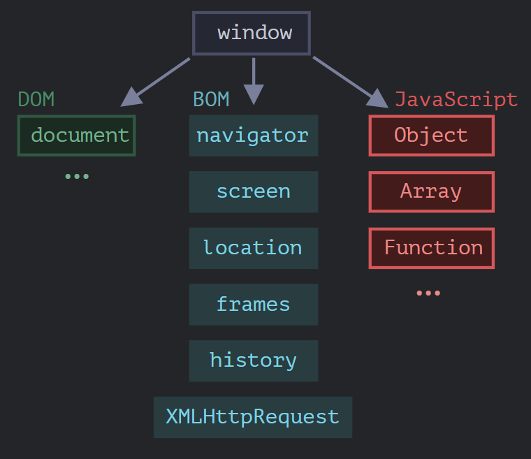
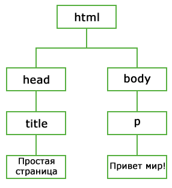

# Браузерное окружение, спецификации

Язык JavaScript изначально создавался для веб-браузеров, но со временем он превратился в кроссплатформенный язык программирования, применяемый для широкого круга задач. Сегодня JavaScript работает в браузере, на веб-сервере и даже в кофейных машинах. <mark>Каждая среда предоставляет собственную функциональность, которую спецификация JavaScript называет **окружением**.</mark>

> Окружение — <mark>среда выполнения JavaScript-кода, предоставляющая собственные объекты и дополнительные функции помимо базовых языковых возможностей.</mark>

Браузеры, например, дают средства для управления веб-страницами, Node.js предоставляет серверные возможности и так далее. На рисунке ниже в общих чертах показано, что доступно для JavaScript в браузерном окружении.



**Рис. 1** — Общая схема браузерного окружения JavaScript

## Корневой объект window

Как видно из схемы, <mark>существует корневой объект `window`, который выступает в двух ролях:</mark>

1. <mark>Это глобальный объект для JavaScript-кода (подробнее — в главе «Глобальный объект»).</mark>
2. <mark>Это окно браузера, располагающее методами для управления им.</mark>

Пример использования `window` как глобального объекта:

```js
function sayHi() {
  alert("Hello");
}

// глобальные функции доступны как методы глобального объекта:
window.sayHi();
```

Пример использования `window` как объекта окна браузера:

```js
alert(window.innerHeight); // внутренняя высота окна браузера
```

<mark>Существует гораздо больше свойств и методов для управления окном браузера — они рассматриваются далее.</mark>

## DOM (Document Object Model)

> DOM (Document Object Model) — <mark>объектная модель документа, представляющая всё содержимое страницы в виде объектов, которые можно изменять.</mark>

> document — <mark>основная «входная точка» для работы с содержимым страницы.</mark>

С помощью `document` можно создавать или менять что-либо на странице. Например:

```js
// заменим цвет фона на красный,
document.body.style.background = "red";

// а через секунду вернём как было
setTimeout(() => document.body.style.background = "", 1000);
```

В примере использован только `document.body.style`, но возможности по управлению страницей намного шире. Различные свойства и методы описаны в спецификации:

- DOM Living Standard — https://dom.spec.whatwg.org

### DOM — не только для браузеров

<mark>Спецификация DOM описывает структуру документа и предоставляет объекты для манипуляций со страницей. Существуют и другие, отличные от браузеров, инструменты, использующие DOM. Например, серверные скрипты, которые загружают и обрабатывают HTML-страницы, также могут использовать DOM, при этом они могут поддерживать спецификацию не полностью.</mark>

### Дерево узлов DOM

<mark>В DOM всё содержимое страницы (элементы и текст) представляется как иерархия узлов.</mark> Рассмотрим следующий код:

```html
<html>
  <head>
    <title>Простая страница</title>
  </head>
  <body>
    <p>Привет Мир!</p>
  </body>
</html>
```

Этот код можно изобразить с помощью DOM как иерархию узлов.



**Рис. 2** — Представление HTML-документа в виде дерева узлов

<mark>Представляя документ в виде дерева узлов, DOM API предоставляет разработчикам полный контроль над содержимым и структурой веб-страницы.</mark>

При описании древовидной структуры DOM используется терминология, заимствованная у генеалогических деревьев:

> Родительский узел — <mark>узел, расположенный непосредственно над данным узлом.</mark>

> Дочерние узлы — <mark>узлы, расположенные на один уровень ниже данного узла.</mark>

> Сестринские узлы (братья) — <mark>узлы, находящиеся на одном уровне и имеющие одного и того же родителя.</mark>

> Потомки — <mark>узлы, расположенные на любое число уровней ниже данного узла.</mark>

> Предки — <mark>родительские, прародительские и любые другие узлы, расположенные на любое число уровней выше данного узла.</mark>

Справочник по DOM содержит описание объектов `Document`, `Element`, `Event` и `NodeList`, включая их методы и свойства:

- HTML Document
- HTML Element
- HTML Event
- NodeList

## CSSOM для стилей

> CSSOM (CSS Object Model) — отдельная спецификация, описывающая, как правила стилей CSS представляются в виде объектов, как их читать и писать.

Правила стилей CSS структурированы иначе, чем HTML, поэтому для них существует отдельная спецификация. CSSOM используется вместе с DOM при изменении стилей документа. В реальности CSSOM требуется редко, обычно правила CSS статичны. Мы редко добавляем или удаляем стили из JavaScript, но и это возможно.

Подробнее: https://www.w3.org/TR/cssom-1/

## BOM (Browser Object Model)

> BOM (Browser Object Model, объектная модель браузера) — <mark>дополнительные объекты, предоставляемые браузером (окружением) для работы со всем, кроме документа.</mark>

> BOM — <mark>интерфейс доступа к окну браузера, позволяющий манипулировать им и его элементами независимо от контента веб-страницы.</mark>

<mark>BOM-объекты обеспечивают доступ к функционалу браузера независимо от содержимого веб-страницы.</mark> Тема BOM одновременно интересна и сложна: из-за длительного отсутствия спецификации производители браузеров свободно расширяли BOM по своему усмотрению. Многие схожие в разных браузерах элементы стали стандартами де-факто, соблюдаемыми по сей день из соображений взаимной совместимости. Чтобы стандартизировать эти фундаментальные аспекты JavaScript, консорциум W3C определил основные BOM-элементы в спецификации HTML5.

Основные объекты BOM:

> navigator — объект, дающий информацию о самом браузере и операционной системе. Ключевые свойства: `navigator.userAgent` (информация о текущем браузере) и `navigator.platform` (информация о платформе, помогающая понять, в какой ОС открыт браузер — Windows/Linux/Mac и так далее).

> location — объект, позволяющий получить текущий URL и перенаправить браузер по новому адресу.

Пример использования `location`:

```js
alert(location.href); // показывает текущий URL
if (confirm("Перейти на Wikipedia?")) {
  location.href = "https://wikipedia.org"; // перенаправляет браузер на другой URL
}
```

Функции `alert`/`confirm`/`prompt` тоже являются частью BOM: они не относятся непосредственно к странице, но представляют собой методы объекта окна браузера для коммуникации с пользователем.

Справочник BOM содержит описание всех свойств и методов каждого из объектов:

- Объект Window
- Объект Navigator
- Объект Screen
- Объект History
- Объект Location

## Спецификации

<mark>BOM является частью общей спецификации HTML.</mark> Спецификация HTML по адресу https://html.spec.whatwg.org не только про «язык HTML» (теги, атрибуты) — она также покрывает целое множество объектов, методов и специфичных для каждого браузера расширений DOM. Это всё «HTML в широком смысле». Для некоторых вещей есть отдельные спецификации, перечисленные на https://spec.whatwg.org.

Итого, говоря о стандартах, у нас есть:

> Спецификация DOM — <mark>описывает структуру документа, манипуляции с контентом и события. Подробнее: https://dom.spec.whatwg.org.</mark>

> Спецификация CSSOM — описывает файлы стилей, правила написания стилей и манипуляций с ними, а также то, как это всё связано со страницей. Подробнее: https://www.w3.org/TR/cssom-1/.

> Спецификация HTML — <mark>описывает язык HTML (например, теги) и BOM (объектную модель браузера) — разные функции браузера: `setTimeout`, `alert`, `location` и так далее. Подробнее: https://html.spec.whatwg.org. За основу берётся спецификация DOM и расширяется дополнительными свойствами и методами.</mark>

Кроме того, некоторые классы описаны отдельно на https://spec.whatwg.org/.

Стоит запомнить эти ссылки: по ним содержится очень много информации, которую невозможно изучить полностью и держать в уме. Когда нужно прочитать о каком-то свойстве или методе, справочник на сайте Mozilla https://developer.mozilla.org/ru/ — тоже очень хороший ресурс, хотя ничто не сравнится с чтением спецификации: она сложная и объёмная, но сделает знания максимально полными.

Для поиска чего-либо обычно удобно использовать интернет-поиск со словами «WHATWG [термин]» или «MDN [термин]», например:

- https://google.com?q=whatwg+localstorage
- https://google.com?q=mdn+localstorage

## Справочник JavaScript: объекты, DOM, BOM

### Справочник объектов JavaScript

Справочник содержит описание всех свойств и методов стандартных встроенных объектов JavaScript:

- JavaScript Array
- JavaScript Boolean
- JavaScript Date
- JavaScript Math
- JavaScript Number
- JavaScript String
- JavaScript RegExp
- JavaScript Global
- JavaScript Object

### Объектная модель документа

> DOM (Document Object Model) — <mark>интерфейс программирования приложений (API) для XML, расширенный также для работы с HTML.</mark>

> API (Application Programming Interface) — интерфейс программирования приложений, набор методов и правил взаимодействия с программной системой.

## Итого

Говоря о стандартах браузерного окружения, выделяют:

1. **Спецификацию DOM** — структура документа, манипуляции с контентом и события.
2. **Спецификацию CSSOM** — стили, правила их написания и связи со страницей.
3. **Спецификацию HTML** — язык HTML и BOM (объектная модель браузера): `setTimeout`, `alert`, `location` и другие функции браузера.
4. **Отдельные спецификации классов** — https://spec.whatwg.org/.

А теперь перейдём к изучению DOM, так как страница — это основа всего.

## FAQ

**Что такое окружение в JavaScript?**
Среда выполнения кода, предоставляющая дополнительные объекты и функции помимо базовых языковых (браузер, Node.js и т. д.).

**Чем отличается DOM от BOM?**
DOM — модель документа (содержимое страницы), BOM — модель браузера (всё, кроме документа: окно, навигация, история, экран).

**Какие две роли выполняет объект `window`?**
Глобального объекта для JavaScript-кода и окна браузера с методами управления им.

**Что такое CSSOM и когда он нужен?**
Объектная модель CSS. Нужна для чтения и изменения стилей из JavaScript; на практике требуется редко, так как стили обычно статичны.

**Входит ли BOM в спецификацию HTML?**
Да. Основные BOM-элементы стандартизированы в спецификации HTML5 (WHATWG HTML).

**Где искать информацию о свойствах и методах?**
В спецификациях WHATWG (https://spec.whatwg.org/), на MDN (https://developer.mozilla.org/ru/) и через поиск «WHATWG [термин]» или «MDN [термин]».

**Почему спецификации стоит читать, несмотря на сложность?**
Они дают максимально полные и точные знания, недоступные при чтении только справочников.