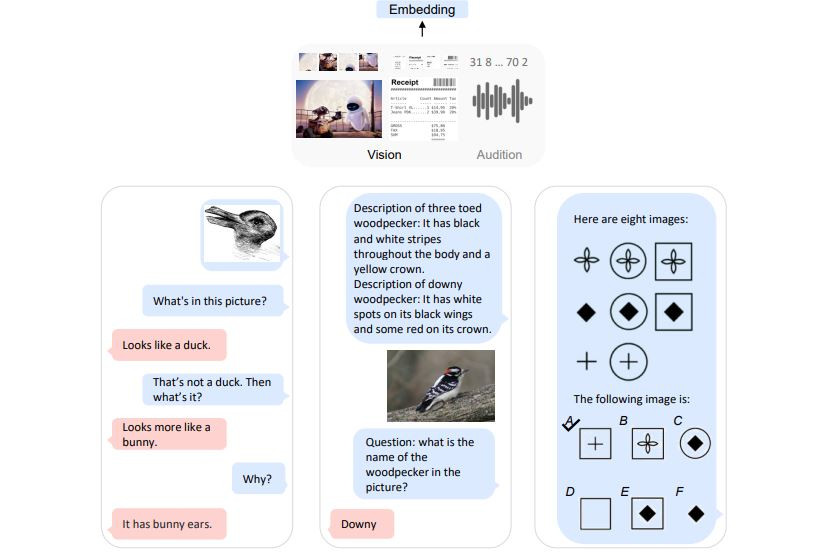
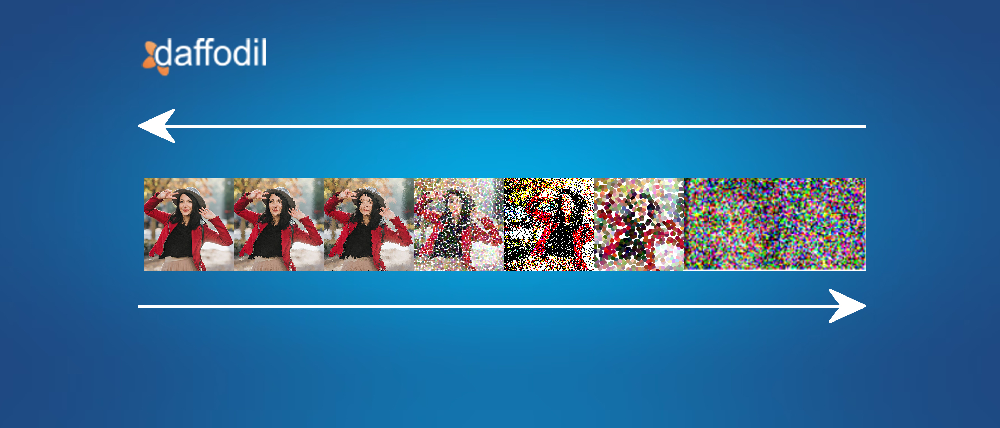
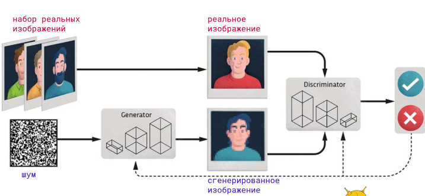

# ПОВТОРЕНИЕ

## 0. Что такое промт

Промпт (от англ. prompt — «подсказка, побуждение») — это текстовый запрос или инструкция, которую вы даёте нейросети, чтобы получить нужный результат.

## 1. Как правильно произносится Qwen

**Qwen** произносится как **«Куэн»** (примерно как английское *"Kwen"*). Это название китайской языковой модели от Alibaba. Иногда встречается произношение «Кьюэн», но официально ближе к «Куэн».

## 2. Что такое мультимодальная нейросеть?

**Мультимодальная нейросеть** — это модель ИИ, которая способна работать одновременно с **несколькими типами данных (модальностями)**: текстом, изображениями, аудио, видео и т.д. Например, она может анализировать картинку и описывать её текстом, или генерировать изображение по текстовому запросу.



---

## 3. Что такое Diffusion model?

**Diffusion model (диффузионная модель)** — это класс генеративных нейросетей, которые обучаются путём постепенного «зашумления» данных и последующего обучения обратному процессу — восстановлению чистого изображения из шума. Именно на этой технологии работают Stable Diffusion, Midjourney, DALL-E и др.



Да, **на выходе — изображение**, но не всё так просто. На входе не просто «шум», а **случайный шум + текстовый промпт (условие)**. Модель постепенно «очищает» шум, шаг за шагом превращая его в картинку.

### Как это работает — по шагам

#### Обучение (тренировка модели)
1. Берут реальное изображение (например, фото кота).
2. Постепенно добавляют к нему шум — за много шагов (обычно 1000) картинка превращается в **чистый случайный шум**.
3. Модель учится **обратному процессу**: по зашумлённой версии предсказать, какой шум был добавлен, и «отнять» его.

#### Генерация (когда вы пишете промпт)
1. На вход подаётся **чистый случайный шум** (тензор из случайных чисел).
2. Модель делает **много маленьких шагов** (20–50 обычно), на каждом чуть-чуть убирая шум.
3. Постепенно из шума **проявляется изображение**.
4. Текстовый промпт влияет на **направление** очистки — модель «подсказывает» себе, что именно должно проявиться.

### Аналогия

Представьте **скульптора**, который смотрит на глыбу мрамора (шум) и **постепенно отсекает лишнее**, пока не проявится статуя. Только здесь «отсекание» — это математическое вычитание шума на каждом шаге.

### Важные нюансы

- **Не за один проход**, а за десятки итераций — поэтому генерация занимает секунды.
- **Промпт** — это не «входное изображение», а условие, которое направляет денойзинг (через механизм attention, как в трансформерах).
- **Скрытое пространство (latent space):** в Stable Diffusion шум живёт не в пикселях, а в сжатом латентном представлении — это ускоряет работу.

---

## 4. Что такое GAN?

**GAN (Generative Adversarial Network, генеративно-состязательная сеть)** — архитектура из двух нейросетей: **генератора** (создаёт изображения) и **дискриминатора** (отличает настоящие от поддельных). Они обучаются в соревновании друг с другом, что позволяет генерировать реалистичные изображения.

генератор создаёт, дискриминатор оценивает. Но это не «начальник и подчинённый», а соперники в игре, которые постоянно подтягивают друг друга.



Дискриминатор не «отсматривает» готовые картинки как редактор. Он — часть обучающего механизма и нужен только во время тренировки. После обучения генератор работает сам, а дискриминатор можно выбросить.

Дискриминатор не даёт команды «переделай». Он просто выдаёт число — вероятность, что картинка настоящая (например, 0.1 — «скорее фейк», 0.9 — «скорее настоящее»). Это число превращается в ошибку, и через неё генератор обновляет свои веса, чтобы в следующий раз обмануть лучше.

енератор чуть-чуть меняет свои параметры так, чтобы в следующий раз дискриминатор с большей вероятностью сказал «настоящее».

Важно: генератор не знает, что именно не так с картинкой. Он не получает подсказку «ухо не там» или «слишком размыто». Он просто двигает веса в сторону «обмануть дискриминатора».

## 5. Что такое композиция?

**Композиция** — это правило расположения объектов в кадре, при котором элементы изображения выстраиваются так, чтобы взгляд зрителя двигался по нужному маршруту, а кадр выглядел гармонично и сбалансированно.

## 6. Каким бывает план?

План — это масштаб объекта в кадре: насколько крупно он показан и сколько окружающего пространства попадает в изображение.

- **Крупный план** — объект занимает большую часть кадра (лицо, деталь).
- **Средний план** — объект показан по пояс или в полный рост в окружении.
- **Общий план** — объект показан целиком вместе с окружающей обстановкой.
  (Сверхкрупный, дальний)

Также выделяют: **деталь**, **сверхкрупный**, **дальний план**.

## 7. Что такое готовое освещение?

**Готовое освещение** — это описание уже сформированной схемы света в кадре: например, «мягкий рассеянный свет», «контровой свет», «золотой час», «свет из окна слева». В промпте оно задаёт атмосферу и объём.

## 8. Какие правила композиции вы знаете?

Правила композиции — это набор проверенных приёмов, которые помогают расположить объекты в кадре так, чтобы изображение выглядело гармонично, а взгляд зрителя двигался по задуманному автором маршруту.

- Правило третей
- Золотое сечение
- Диагонали и направляющие линии
- Ритм и повтор
- Контраст (тональный, цветовой, масштабный)
- Симметрия и асимметрия
- Рамка в рамке
- Баланс и равновесие
- Точка фокуса (акцент)

## 9. Что относится к ключевым компонентам продвинутого промпта?

- Субъект (главный объект)
- Действие / сцена
- Стиль (художественный, фото, 3D и т.д.)
- Композиция и план
- Освещение
- Цветовая палитра
- Камера / оптика (объектив, ракурс)
- Качество / детализация (8K, hyperrealistic)

## 10. Что относится к деталям?

- Текстуры (кожа, ткань, металл)
- Мелкие элементы (украшения, узоры, морщины)
- Выражение лица, эмоции
- Погодные и средовые детали (пыль, дождь, пар)
- Материалы и их свойства

## 11. Что относится к дополнительной информации?

- Настроение и атмосфера
- Референсы (в стиле художника X)
- Технические параметры (соотношение сторон, разрешение)
- Негативный промпт (что исключить)
- Версия модели / стилевые пресеты


## Компоненты промпта vs Детали vs Дополнительная информация

### 1. Ключевые компоненты (каркас промпта)

Это **обязательная основа** — то, без чего промпт не работает. Отвечают на вопрос: **«Что, как и где изображено?»**

| Компонент | Что описывает | Пример |
|---|---|---|
| Субъект | Кто/что в кадре | «девушка», «дракон» |
| Действие/сцена | Что происходит | «стоит на скале» |
| Стиль | Художественный язык | «кибербанк, фотореализм» |
| Композиция/план | Как построен кадр | «крупный план, правило третей» |
| Освещение | Схема света | «контровой свет, закат» |
| Камера/оптика | Технические параметры | «85mm, f/1.8, вид сверху» |

### 2. Детали (уточнение внутри компонентов)

Это **конкретика**, которая «наполняет плотью» уже заданные компоненты. Отвечают на вопрос: **«А как именно?»**

| Что уточняют | Пример |
|---|---|
| Текстуры | «веснушки», «потёртая кожа», «мокрая ткань» |
| Мелкие элементы | «серьга с изумрудом», «царапина на щеке» |
| Эмоции | «лёгкая полуулыбка», «нахмуренные брови» |
| Материалы | «бархат», «ржавый металл», «шёлк» |
| Средовые мелочи | «капли дождя на стекле», «пылинки в воздухе» |

**Итог:** детали **не самостоятельны** — они всегда привязаны к компоненту. Нельзя сказать «веснушки» без «лица».

### 3. Дополнительная информация (модификаторы)

Это **служебный слой**, который не описывает сцену напрямую, а **управляет генерацией**. Отвечает на вопрос: **«При каких условиях и с какими ограничениями?»**

| Что сюда входит | Пример |
|---|---|
| Настроение/атмосфера | «мрачно», «уютно», «эпично» |
| Референсы | «в стиле Густава Климта» |
| Технические параметры | «соотношение 16:9, 8K, ray tracing» |
| Негативный промпт | «без размытия, без лишних рук» |
| Версия модели / пресеты | «Midjourney v6, cinematic preset» |

**Итог:** это **не про содержание кадра**, а про **то, как модель должна его генерировать**.

### Наглядный пример одного промпта

> **«Портрет старого рыбака, крупный план, драматичный контровой свет, 85mm»** — *компоненты*
> **«морщинистая кожа, седая борода, шрам на щеке, усталые глаза»** — *детали*
> **«меланхоличное настроение, в стиле Рембрандта, 8K, соотношение 3:4»** — *доп. информация*

### Главное правило

- **Компоненты** → *что рисуем*
- **Детали** → *насколько подробно*
- **Доп. информация** → *как именно генерировать*


## Что такое Few-shot prompting? Что такое Chain-of-Thought (СОТ)? Что такое ReAct?

Это три техники промптинга для больших языковых моделей (LLM). Они помогают получать более точные и сложные ответы.

### 1. Few-shot prompting (обучение на нескольких примерах)

Даёшь модели **несколько примеров** — и она делает по образцу.
> «Спасибо» → «Thank you»
> «Привет» → «Hello»
> «Пока» → ?
**Зачем:** задать формат и стиль.

Вы даёте модели несколько примеров того, как нужно выполнить задачу, а потом просите выполнить её для нового входа. Модель «по образцу» понимает формат и логику.

Модель по примерам понимает формат и стиль ответа.

Когда:

- Когда формат ответа нестандартный.
- Когда задача специфичная (классификация по своим правилам).

### 2. Chain-of-Thought (CoT) — цепочка рассуждений

Техника, при которой модель рассуждает пошагово, прежде чем дать ответ. Вместо «сразу ответ» — «шаг 1 → шаг 2 → шаг 3 → ответ».

«Let's think step by step» / «Давай рассуждать пошагово»
Эта магическая фраза резко повышает качество на математике, логике, анализе.

Зачем нужен
- Математика, логика, планирование.
- Многошаговые задачи.
- Задачи, где важен процесс, а не только ответ.

Пример:

В магазине 3 коробки по 12 яблок. 5 яблок съели. Сколько осталось?
Ответ: 31 ❌ (ошибка)

С CoT:

Давай решим пошагово.
- 3 коробки × 12 = 36 яблок.
- Съели 5 → 36 − 5 = 31.
- Ответ: 31 ✅

### 3. Техника, объединяющая рассуждение (Reasoning) и действие (Acting). Модель не просто думает, а взаимодействует с внешними инструментами: поиском, калькулятором, API, базами данных.

**Рассуждение + действие.** Модель думает, вызывает инструмент (поиск, калькулятор), смотрит результат, повторяет.
> Thought → Action → Observation → Ответ
**Зачем:** актуальные данные, агенты, внешние инструменты.

Пример

> **Вопрос:** Какая сейчас погода в Токио и стоит ли брать зонт?
>
> **Thought:** Мне нужны актуальные данные о погоде.
> **Action:** search("погода в Токио сейчас")
> **Observation:** Токио, +18°C, дождь, влажность 85%.
> **Thought:** Идёт дождь → зонт нужен.
> **Answer:** В Токио сейчас +18°C и дождь. Зонт стоит взять.

Зачем нужен

- Задачи, требующие **актуальных данных** (погода, новости, курсы).
- **Математика** (калькулятор точнее, чем LLM).
- **Многошаговые задачи** с внешними зависимостями.
- Агенты, которые **сами решают**, какой инструмент использовать.

## Мотивация 

И получают средненькую картинку. Потому что они говорят с нейросетью на уровне "хочу красиво". А нейросеть — это гениальный, но буквальный исполнитель. Она не читает мысли.
Продвинутый промптинг — это умение говорить с моделью на её языке. И вот тут начинается магия.

## Теория

### 14 Слайды

#### Главная проблема: ИИ не понимает буквы

Компьютер **не умеет работать со словами напрямую**. Он умеет работать с **числами**. Поэтому первая задача любой нейросети — **превратить текст в числа**.

Но если просто заменить каждое слово номером:
- «кот» = 1
- «кошка» = 2
- «мяу» = 3

то ИИ **не поймёт**, что «кот» и «кошка» — близкие понятия. Для него это будут **случайные числа**.

**Эмбеддинг** решает эту проблему.

#### Что это?

**Эмбеддинг** (embedding) — это **вектор чисел**, который описывает слово так, чтобы **близкие по смыслу слова** имели **близкие координаты**.

Проще говоря: каждое слово превращается в **точку в многомерном пространстве**, и положение этой точки **отражает смысл слова**.

#### Аналогия с GPS

**Эмбеддинг** — это **GPS-координаты слова** на этой карте.

Когда вы пишете промпт, ИИ:
1. Превращает каждое слово в координаты.
2. Смотрит, **где на карте** оказалась ваша фраза.
3. Ищет **ближайшие образы**, которые видел раньше.
4. Генерирует изображение **из этой зоны**.

### Почему роботы оказались одинаковыми?

Вернёмся к вашему примеру с **думающим роботом**.

Когда вы написали «робот», Qwen:
1. Превратила слово в вектор.
2. Вектор попал в **область «роботов»** — туда, где лежат **все роботы**, которые модель видела при обучении.
3. Модель нарисовала **что-то среднее** из всех них.

**Как получить разное?**
Добавить **уточнения**, которые сдвинут вектор в нужную сторону:
- «ржавый робот-механик с гаечным ключом»
- «робот-балерина в пачке»
- «робот-самурай с катаной»

Каждое слово **сдвигает координаты**, и модель попадает в **другую зону** пространства.

Каждое слово уточнает координату

### Слайд 15

Эмбеддинг — это **не 2–3 числа**, а **сотни чисел**:

- 300 — в старых моделях (Word2Vec, GloVe)
- 768 — в BERT
- 1024, 2048, 4096 — в современных LLM

**Почему так много?**
Потому что **смысл слова многогранен**: род, число, стиль, эмоция, контекст, ассоциации. Каждое измерение ловит **свою грань**.

Мы не можем прочитать вектор

Вот пример эмбеддинга слова «кот» (упрощённо):

```
[0.23, -0.87, 0.45, 1.12, -0.33, ...]
```

**Что означает первое число?** Никто не знает точно. Мы **не можем сказать**:
- «первое число — пушистость»,
- «второе — размер»,
- «третье — громкость мяу».

Но **ИИ может**. Он **обучен** так, что каждое измерение ловит **какую-то абстрактную грань смысла**. И вместе они дают **полное описание слова**.


### Слайд 16

Давайте посмотрим на **схему распределения слов**:

**Что мы видим:**

1. **Близкие по смыслу слова** → рядом:
  - «кот», «кошка», «мяу» — тесная группа.
  - «собака», «щенок» — рядом, но **другой вид**.
2. **Ассоциативные связи** → тоже рядом:
  - «когтеточка», «диван» — в зоне «дома», потому что связаны с котом.
3. **Далёкие связи** → далеко:
  - «мышь», «лес» — дальше от центра.
4. **Абстрактные понятия** → выше по оси Y:
  - «ласка» — абстрактнее, чем «кот».

> **Эмбеддинг** — это цифровой код (вектор), в котором зашифрован **смысл слова**.
> ИИ **не понимает буквы** — он понимает **координаты**.
> Чем точнее вы опишете, что хотите, тем **точнее координаты** → тем **ближе результат** к задуманному.


### Слайд 17

Эмбеддинг позволяет нам вычислять слова, по правилам математики: ( векторная арифметика смыслов)

**Эмбеддинги позволяют делать арифметику со смыслами.**

```
король − мужчина + женщина ≈ королева
```

В векторном пространстве есть **направления**, которые кодируют **смысловые отношения**:

- Направление **«пол»** → мужчина ↔ женщина.
- Направление **«монархия»** → король ↔ королева.

Когда вы делаете:
```
король − мужчина + женщина
```
вы:
1. **Убираете** из «короля» компоненту «мужчина».
2. **Добавляете** компоненту «женщина».
3. Остаётся **«королева»** — тот же смысл, но женского пола.

### Слайд 18

**Логика:**
- «Кисть» = «инструмент» + «художник»
- Убираем «художник» → «инструмент»
- Добавляем «дворник» → «инструмент дворника» = **метла**

### Слайд 19

**Логика:**
- «Слон» = «большое животное»
- Убираем «большой» → «животное»
- Добавляем «маленький» → «маленькое животное» = **мышь**

В векторном пространстве:
- «Слон» лежит в зоне **крупных животных**.
- «Мышь» — в зоне **мелких животных**.
- Ось **«размер»** связывает их.

### Слайд 20

Это техника промптинга для больших языковых моделей (LLM). Они помогают получать более точные и сложные ответы.

### 1. Few-shot prompting (обучение на нескольких примерах)

Даёшь модели **несколько примеров** — и она делает по образцу.

Наша задача показать, что мы хотим, а не просто попросить.

Подходит ли нам простой промт : Нарисуй героя? Мы видим, что герой есть, а что если мы хотели героя в стиле BrawlStar?

Мы видим, что герой есть, но вдруг мне нужен герой в стиле Brawl Stars?!
В таком случае, я загружу в ИИ несколько изображений с персонажами из игры и напишу промпт: "Нарисуй нового персонажа в стиле Brawl Stars на основе примеров персонажей" При таком подходе ИИ точно может понять, как именно нужно нарисовать.

### Слайд 22


> Как это работает, спросите вы. На слайде мы видим, как в модель добавляют изображения для примера.
>
> ИИ **не просто копирует** картинки из примеров. Он **внимательно их рассматривает** и **анализирует**, выявляя важные общие детали. Например:
> - цветовую палитру,
> - уровень детализации,
> - толщину линий,
> - общую стилистику,
> - композицию и ракурс.
>
> После этого нейросеть применяет эти детали — или, как их ещё называют, **«паттерны»** — к новому запросу. ИИ рисует **что-то своё**, но соблюдает при этом **паттерны** примеров.
>
> Ребят, а как вы думаете, **любые картинки подойдут** для примеров?

### Слайд 23

> **Конечно, нет! Молодцы!**
>
> Важное правило при добавлении примеров — **консистентность**. Это означает, что **все примеры должны быть выдержаны в одном стиле**, как это показано на слайде.
>
> Любая нейросеть — это **алгоритм**, который ищет **математические закономерности**. То есть если смешаете всё в кучу, ИИ попросту **не поймёт вашу творческую задумку**. Именно поэтому важно соблюдать **единство контента**.

**Научное пояснение:**
> Консистентность примеров напрямую влияет на **качество in-context learning**. Если примеры принадлежат **разным распределениям** (стилям), модель не может выделить **общий паттерн** — кластеры «размазываются», и результат становится **непредсказуемым**.
>
> В терминах машинного обучения: **низкая внутриклассовая вариативность** примеров → **высокая точность** генерации.


### Слайд 24

Чтож, теперь все, что я рассказываю конечно же интересно, но давайте теперь попробуем все это сами сделать и посмотреть, что получится.

### Слайд 25

Заходим в ЛК и переходим в Qwen: должно получиться как на экране

### Слайд 40

