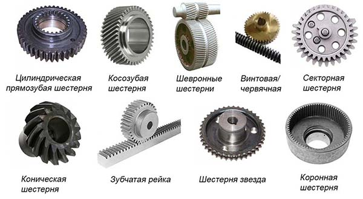
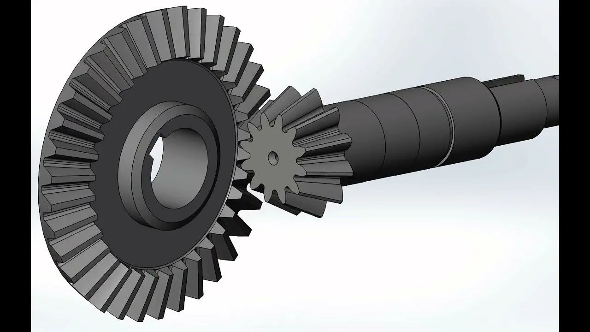

Зубчатая передача — это механизм, который передаёт вращательное движение между валами с помощью зацепления зубчатых колёс (шестерён). Зубья одного колеса входят во впадины другого, и за счёт этого движение передаётся без проскальзывания.

Передаточное число зубчатой передачи — это отношение числа зубьев ведомого колеса к числу зубьев ведущего колеса (или отношение частот вращения ведущего вала к ведомому).

Коническая зубчатая передача — механизм для передачи крутящего момента между валами с пересекающимися осями.

**Зубчатая передача** — это механизм, который передаёт вращательное движение между валами с помощью зацепления зубчатых колёс (шестерён). Зубья одного колеса входят во впадины другого, и за счёт этого движение передаётся без проскальзывания.

### Из чего состоит

- **Ведущее колесо (шестерня)** — то, от которого передаётся движение.
- **Ведомое колесо** — то, которое принимает движение.
- **Зубья** — выступы на ободе, обеспечивающие зацепление.
- **Вал** — ось, на которой крепится колесо.

### Основные виды зубчатых передач

1. **Цилиндрическая** — оси валов параллельны. Самая распространённая (прямозубая, косозубая, шевронная).
2. **Коническая** — оси валов пересекаются (обычно под углом 90°).
3. **Червячная** — состоит из червяка (винта) и червячного колеса; оси скрещиваются под углом 90°.
4. **Реечная** — преобразует вращательное движение в поступательное (шестерня + зубчатая рейка).
5. **Планетарная** — включает солнечное колесо, сателлиты и коронную шестерню; позволяет получать большие передаточные числа в компактном корпусе.

### Зачем нужна

- **Изменение крутящего момента и скорости** — понижающие передачи увеличивают момент, повышающие — скорость.
- **Передача движения на расстояние** между валами.
- **Изменение направления вращения** (через паразитное колесо или коническую пару).
- **Точная синхронизация** — зубья обеспечивают постоянное передаточное отношение без проскальзывания (в отличие от ремённых и фрикционных передач).

### Ключевые характеристики

- **Передаточное число** \( u = z_2 / z_1 \) — отношение чисел зубьев.
- **Модуль** \( m \) — основной параметр, определяющий размер зуба; \( m = d / z \), где \( d \) — делительный диаметр.
- **КПД** — у цилиндрических передач высокий (0,97–0,99), у червячных ниже (0,7–0,9 в зависимости от числа заходов).

### Где применяется

Коробки передач автомобилей, редукторы, часы, станки, роботы, бытовая техника, велосипеды — практически везде, где нужно точно передавать вращение с изменением момента или скорости.

Если хотите, могу подробнее рассказать про какой-то конкретный тип (например, червячную или планетарную) или про то, как выбирают модуль и число зубьев.