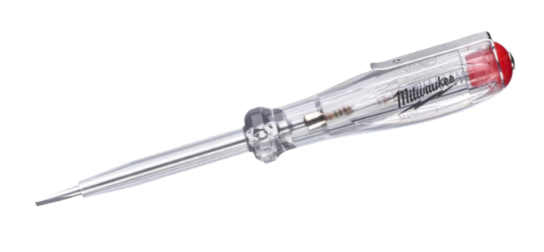
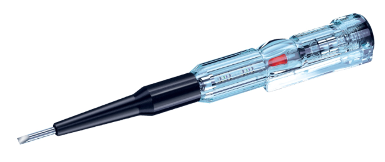
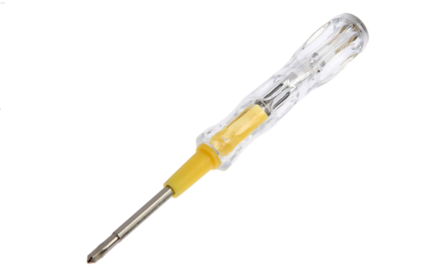
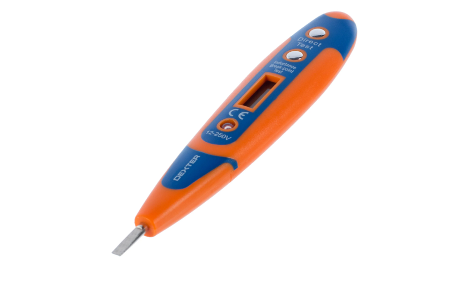
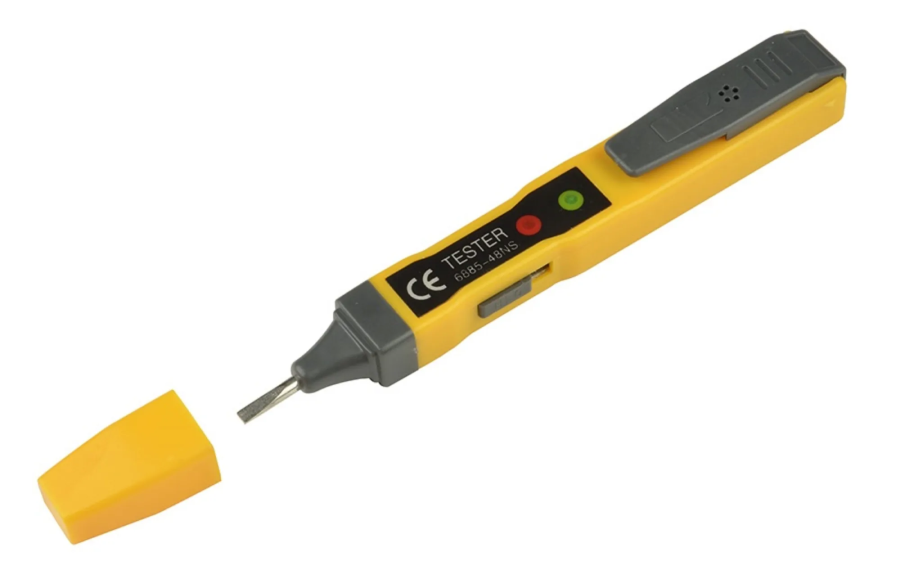
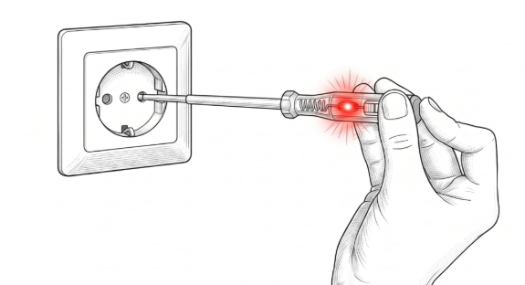
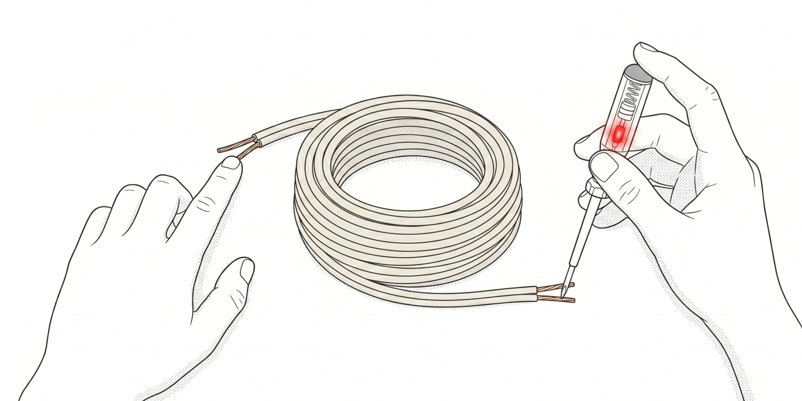
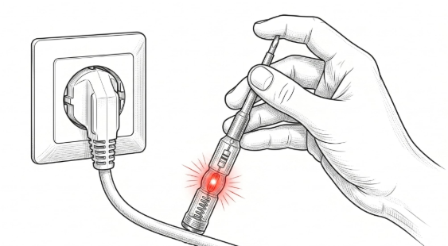
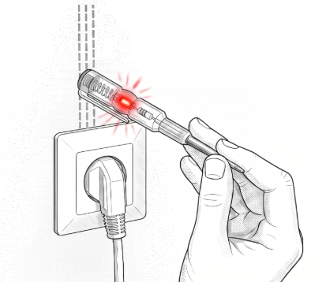

# Индикаторная отвёртка: устройство, назначение и правила использования

> Индикаторная отвёртка — <mark><strong>ручной электроизмерительный инструмент для контактного или бесконтактного обнаружения фазного напряжения, прозвонки цепей, поиска обрыва кабеля и скрытой проводки.</strong></mark>

> Пассивный пробник — индикаторная отвёртка без источника питания, в которой цепь замыкается через тело человека; индикатором служит неоновая лампа.

> Активный пробник — индикаторная отвёртка со светодиодом и батарейкой, реагирующая на напряжение и электрическое поле без замыкания цепи через человека.

> Контактный режим (О) — режим, при котором цепь замыкается через тело человека: палец прикладывается к токопроводящей клемме на торце рукоятки, а щуп — к проверяемому проводу.

> Бесконтактный режим (L) — режим, при котором инструмент реагирует на электромагнитное поле проводника под напряжением без гальванического контакта с токоведущей частью.

> Высокочувствительный режим (H) — бесконтактный режим с пониженным порогом срабатывания, позволяющий обнаруживать слабые электрические поля, например скрытую проводку.

> Заземление — дополнительная группа контактов розетки, соединённая с контуром заземления и обеспечивающая безопасную работу электроустановки.

Индикаторная отвёртка — незаменимый инструмент для поиска неполадок с электрикой. <mark>С её помощью можно выявить причину поломки электроприбора, проверить напряжение в сети, обнаружить обрыв фазного провода и найти скрытую проводку в стене.</mark> Ниже рассмотрено, как устроена индикаторная отвёртка, как ею пользоваться в типовых сценариях и какие меры предосторожности соблюдать.

# Виды индикаторных отвёрток и их устройство

<mark>По режиму работы индикаторные отвёртки делятся на три вида.</mark>

## Отвёртка без батареек с неоновой лампочкой (тип О). ПАССИВНАЯ

Инструмент контактного типа. Состоит из прозрачного пластикового корпуса с неоновой лампочкой и токопроводящей клеммой на конце, изолированного стержня резистора, металлического щупа и контактной пружины.

Такая отвёртка позволяет определить фазу и ноль в цепи переменного тока. Применяется при подключении электросчётчиков, предохранителей и выключателей. <mark>Работает только при напряжении выше $60\ \text{В}$.</mark>

## Отвёртка-тестер на батарейках со светодиодом (тип L). АКТИВНАЯ

Инструмент бесконтактного типа. Помимо корпуса, щупа, резистора и контактной пружины, содержит биполярный транзистор и батарейку; индикатором служит светодиод.

Инструмент функциональнее предыдущего: <mark>им можно тестировать сети с напряжением менее $60\ \text{В}$.</mark>

## Электронная индикаторная отвёртка (типы О, L, H)

Многофункциональный инструмент, работающий в контактном, бесконтактном и высокочувствительном режимах. Оснащён жидкокристаллическим дисплеем, отображающим величину напряжения. При обнаружении фазы загорается световой индикатор и включается звуковой сигнал.

Устройство содержит микросхему и переключатель режимов. <mark>С его помощью можно находить обрывы в цепи и скрытую проводку в стенах.</mark>

# Как работает индикаторная отвёртка в разных режимах

Принцип тестирования сетей и оборудования в разных режимах имеет отличия.

| Режим | Способ проверки | Особенности | img |
|---|---|---|-----|
| Контактный (О) | Цепь замыкается пальцем, щуп прикладывается к проводу | Поверхностный результат: фиксирует наличие или отсутствие напряжения |     |
| Бесконтактный (L) | К объекту прикладывается контактная часть | Реагирует на электрическое поле; яркий световой индикатор; работает при низком напряжении |     |
| Высокочувствительный (H) | Бесконтактная проверка с низким порогом срабатывания | Быстрый поиск скрытой электропроводки; подходит новичкам, но стоит дороже простых моделей |     |

# Определение фазы

Такая проверка позволяет понять, <mark>какой из контактов или проводов находится под напряжением</mark>, перед заменой розетки, установкой люстры или выключателя. Кроме того, <mark>это лучший способ убедиться, что линия действительно обесточена после отключения автомата в щитке.</mark>

1. Вставьте щуп отвёртки в отверстие розетки или коснитесь зачищенного провода.
2. Если индикатор пассивный, обязательно прижмите палец к металлическому контакту на торце рукоятки. Загоревшаяся лампа подтвердит наличие фазы.
3. Если отвёртка активная (с батарейками), касаться пальцем контакта на рукоятке не нужно — светодиод сам загорится при наличии напряжения.
4. Если индикатор не светится, то это не фаза, а ноль. Либо напряжение на провод не подаётся.

## Как найти фазу и ноль на зачищенных проводах

1. Обесточьте оба провода, отключив их от электросети.
2. Снимите с проводов $1$–$2\ \text{см}$ изоляции.
3. Разведите зачищенные провода, чтобы избежать короткого замыкания при соприкосновении.
4. Включите автомат, чтобы подать напряжение на провода.
5. Проведите измерение индикаторной отвёрткой: индикатор загорится при наличии фазы.
6. Запрещается брать отвёртку за части ниже пластикового корпуса — это может привести к поражению электрическим током.

# Прозвонка цепи

<mark>Эта проверка позволяет узнать, цел внутренний проводник или перегорел. Важное условие: проверяемый элемент должен быть полностью обесточен и извлечён из сети. Для этой процедуры подходит только активная отвёртка (с батарейками).</mark>

1. Возьмите неподключённый в сеть кабель и коснитесь пальцем одной из жил на одном конце.
2. Жалом отвёртки дотроньтесь до этой же жилы на другом конце кабеля. Обязательно держите палец на металлическом контакте на рукоятке отвёртки.
3. Если светодиод загорелся, кабель целый. Если нет — где-то внутри обрыв. Либо вы прикоснулись не к той жиле: в этом случае дотроньтесь до другой.

Таким же способом можно проверять утюги, ТЭНы, предохранители и другие приборы, которые в исправном состоянии имеют замкнутую цепь. Например, для прозвонки лампы накаливания (светодиодная не подойдёт) возьмитесь рукой за резьбу цоколя, а жалом отвёртки коснитесь центрального контакта на донышке. Если спираль цела, индикатор загорится.

# Поиск обрыва кабеля

Этот способ позволяет найти конкретное место повреждения внутри изолированного провода под напряжением. Например, во вставленном в розетку, но не работающем удлинителе. Для этого теста также <mark> понадобится активная индикаторная отвёртка.</mark>

1. Вставьте вилку удлинителя в розетку.
2. Возьмите активную отвёртку за жало и медленно ведите рукояткой вдоль провода, касаясь его металлическим контактом на торце.
3. Светодиод будет ярко гореть, пока вы ведёте инструмент вдоль целого участка. В месте, где индикатор погаснет или начнёт светить заметно слабее, и находится обрыв.

<mark>Важно: по жиле, которую вы проверяете, должна идти именно фаза. Если вилка вставлена так, что по проблемному проводнику идёт ноль, тест не получится. В этом случае переверните вилку в розетке на $180^\circ$.</mark>

# Поиск скрытой проводки

<mark>Активную индикаторную отвёртку можно использовать как простейший детектор проводки</mark>, чтобы не попасть сверлом в провод при монтаже полки или карниза. Но учитывайте, что <mark>это не профессиональный прибор: он видит кабель только под тонким слоем штукатурки или за гипсокартоном и не даёт стопроцентной гарантии.</mark>

1. Включите в розетку на проверяемой стене мощный электроприбор вроде чайника или обогревателя. Чем выше нагрузка, тем сильнее электромагнитное поле провода.
2. Возьмите активную отвёртку пальцами за металлическую часть щупа и медленно водите торцевой частью рукоятки по стене.
3. В месте, где проходит провод под напряжением, светодиод начнёт светиться.

Имейте в виду, что этот способ не поможет, если штукатурка ещё свежая или сама стена влажная — она будет «светиться» по всей поверхности. Если провод находится на глубине более $1\ \text{см}$ и обесточен, прибор может его не обнаружить.

# Проверка заземления в розетке

Розетки имеют заземление, обеспечивающее их безопасную работу. В розетках предусмотрена дополнительная группа контактов, которые соединены с заземлением.

1. Прикоснитесь пальцем к токопроводящей клемме отвёртки.
2. Поочерёдно прикоснитесь щупом к каждому контакту розетки. При соприкосновении с фазой загорится индикатор.

Если фазный проводник подключён неправильно или провода перепутаны в распределительном щитке, индикатор будет гореть и при касании заземляющего контакта.

Оставьте индикатор в гнезде с фазным проводом, а отрезком изолированного провода соедините токопроводящую клемму с оставшимися контактами розетки. Если клемма заземления не подключена, индикатор светиться не будет.

# Проверка кабеля бытового прибора

Прикоснитесь индикаторной отвёрткой к корпусу неисправного бытового прибора, чтобы исключить повреждение изоляции. Индикатор загорится при обнаружении фазы на корпусе. Пробой фазы на корпус опасен для жизни: отключите прибор от электросети и обратитесь в сервисный центр.

# Меры предосторожности

Работа с электричеством всегда связана с риском, поэтому соблюдайте максимальную осторожность. Перед любой проверкой убедитесь, что прибор исправен. Коснитесь отвёрткой места, где напряжение точно есть, — например, заведомо рабочей розетки. В активных моделях дополнительно проверьте батарейки, зажав пальцами одновременно жало и контакт на рукоятке, — светодиод должен ярко гореть. Если этого не произошло, вы рискуете принять фазу за обесточенный провод.

Кроме того, всегда помните:

- Нельзя касаться жала пальцами, когда вставляете отвёртку в розетку или прижимаете к проводу. Держите инструмент строго за изолированную рукоятку, иначе рискуете получить удар током.
- Индикатор предназначен только для бытовых сетей до $250\ \text{В}$. Не используйте его в высоковольтных щитах — изоляция на это не рассчитана.
- Корпус должен быть идеально сухим и целым. Любая трещина на пластике или влага на поверхности могут привести к удару током.
- Индикаторная отвёртка — измерительный прибор, а не полноценный инструмент. Не пытайтесь выкручивать ею саморезы: жало легко гнётся, а полый корпус может лопнуть прямо в руке.

# Какую индикаторную отвёртку выбрать

Индикаторная отвёртка — полезный инструмент в каждом доме. Устройство не требует особых навыков, но позволяет легко выявить проблемы в электропроводке квартиры. В магазинах Лемана ПРО помогут выбрать тип отвёртки под планируемую область применения и дадут советы по использованию.

# FAQ

**Чем пассивный пробник отличается от активного?**
Пассивный работает без батарейки: цепь замыкается через палец, прижатый к контакту на рукоятке, а индикатором служит неоновая лампа. Активный содержит батарейку и светодиод и реагирует на напряжение и поле без замыкания цепи через человека.

**Чем отличается контактная отвёртка от бесконтактной?**
Контактная (тип О) замыкает цепь через тело человека и работает при напряжении выше $60\ \text{В}$; бесконтактная (тип L) реагирует на электромагнитное поле и работает при низком напряжении.

**Почему неоновая лампочка не загорается при касании провода?**
Возможные причины: провод обесточен, напряжение ниже $60\ \text{В}$ или не прижат палец к токопроводящей клемме.

**Можно ли прозвонить цепь пассивной отвёрткой?**
Нет. Для прозвонки обесточенной цепи подходит только активная отвёртка с батарейкой.

**Почему не удаётся найти обрыв кабеля в удлинителе?**
Скорее всего, по проверяемой жиле идёт ноль, а не фаза. Переверните вилку в розетке на $180^\circ$ и повторите тест.

**Можно ли электронной отвёрткой найти провод в стене?**
Да, в высокочувствительном режиме (H) — при условии, что провод под напряжением и залегает не глубже $1\ \text{см}$.

**Почему стена «светится» по всей поверхности?**
Свежая или влажная штукатурка создаёт помехи. Дождитесь высыхания стены или используйте профессиональный детектор проводки.

**Опасно ли пользоваться индикаторной отвёрткой?**
При соблюдении правил — нет: резистор ограничивает ток до безопасной величины. Запрещается касаться частей ниже пластикового корпуса и жала при работе под напряжением.

**Как проверить исправность активной отвёртки перед работой?**
Зажмите пальцами одновременно жало и контакт на рукоятке — светодиод должен ярко гореть. Дополнительно проверьте батарейки и коснитесь отвёрткой заведомо рабочей розетки.

**Как проверить, есть ли заземление в розетке?**
Поочерёдно коснитесь щупом контактов розетки, прижав палец к клемме: свечение на заземляющем контакте указывает на неправильное подключение или перепутанные провода.