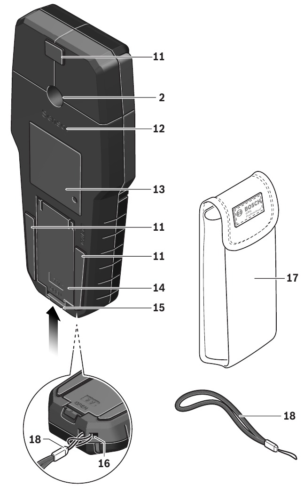
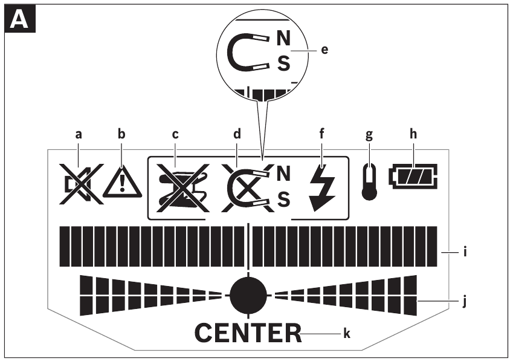
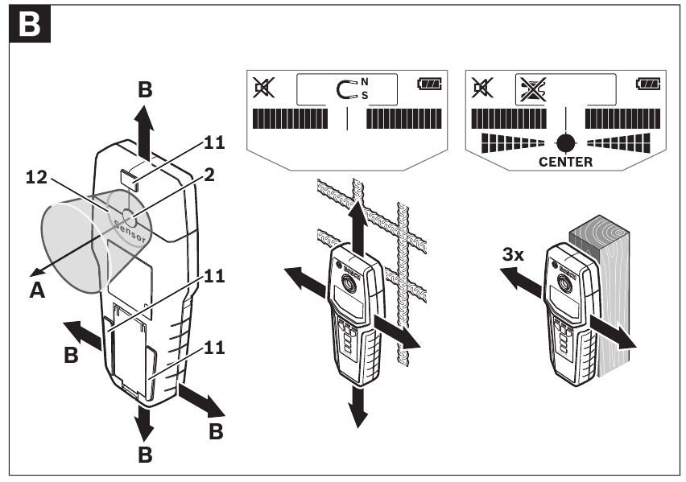
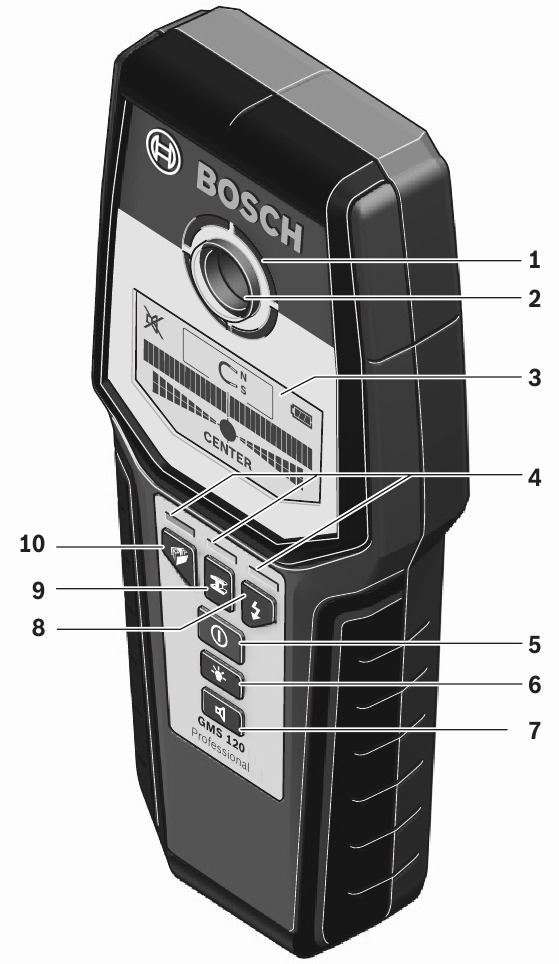
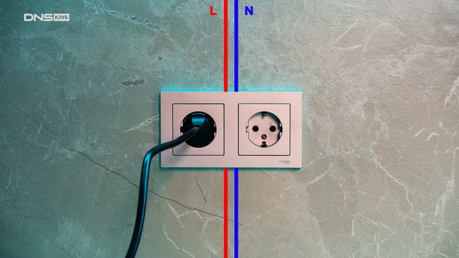
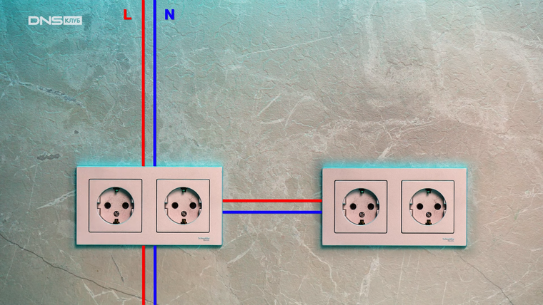

# Детектор проводки: назначение, устройство и методика работы

> Детектор проводки — электронный измерительный инструмент для бесконтактного обнаружения металлических объектов, деревянных балок и проводников под напряжением в стенах, потолках и полах.

> Основной материал — материал стены, потолка или пола (бетон, гипсокартон, гипсостружечная плита), в котором выполняется поиск объектов.

> Область датчика — зона на корпусе инструмента, через которую выполняется сканирование поверхности; прибор фиксирует объекты, отличающиеся по свойствам от основного материала.

> Контактные площадки — элементы на задней стороне инструмента, которые должны постоянно соприкасаться с поверхностью во время измерения.

> Индикатор измерения — шкала на дисплее, отображающая амплитуду сигнала: она растёт при приближении к объекту и падает при удалении.

Зачастую домашние мастера не обращают внимания на то, что в стене могут проходить коммуникации. При попадании бура в проводку можно получить короткое замыкание и поражение электрическим током. Поэтому перед сверлением и штроблением стен нужно убедиться, что на пути бура не окажутся проводка, арматура или труба. В идеале следует изучить схему коммуникаций, но такая возможность есть не всегда. В этом случае применяют детектор проводки.

# Назначение и характеристики

Измерительный инструмент предназначен для обнаружения металлов (чёрных и цветных, например арматуры), балок и проводов/проводников под напряжением в стенах, потолках и полах.

## Характеристики продукта

1. Подсвеченное кольцо
2. Отверстие для маркировки
3. Дисплей
4. Индикация режима работы
5. Кнопка включения/выключения
6. Кнопка подсветки дисплея
7. Кнопка звукового сигнала
8. Кнопка для обнаружения проводников под напряжением / режим работы "Power cable" (Силовой кабель)
9. Кнопка для обнаружения металла / режим работы "Metal" (Металл)
10. Кнопка для обнаружения деревянных и металлических балок / режим работы "Drywall" (Гипсокартон)

11. Контактные площадки
12. Область датчика
13. Табличка с типом
14. Крышка батарейного отсека
15. Защёлка крышки батарейного отсека
16. Крепление для ремня для переноски
17. Защитный чехол
18. Ремень для переноски

Показанные или описанные принадлежности не входят в стандартный комплект поставки изделия. Полный обзор принадлежностей можно найти в программе принадлежностей производителя.

## Элементы дисплея (см. рисунок A)

- a — индикатор выключенного звукового сигнала
- b — индикатор предупреждающей функции
- c — индикация типа объекта "Non-metal object" (Неметаллический объект)
- d — индикация типа объекта "Non-magnetic metal" (Немагнитный металл)
- e — индикация типа объекта "Magnetic metal" (Магнитный металл)
- f — индикация типа объекта "Live conductor" (Проводник под напряжением)
- g — индикатор контроля температуры
- h — индикатор батареи
- i — индикатор измерения
- j — точная (мелкая) шкала
- k — индикация "CENTER" (ЦЕНТР)

# Метод работы

Инструмент проверяет основной материал области датчика 12 в направлении измерения A на максимальную глубину обнаружения (см. «Технические данные»). Обнаруживаются объекты, которые отличаются от материала стены.

<mark><strong>Всегда перемещайте инструмент по поверхности по прямой линии, слегка нажимая, не отрывая его и не меняя давление. Во время измерения контактные площадки 11 всегда должны контактировать с поверхностью.</strong></mark>

## Процедура измерения

1. <mark>Поместите инструмент на обнаруживаемую поверхность или напротив неё и перемещайте его в направлении B.</mark>
2. <mark>Когда инструмент приближается к объекту, амплитуда на индикаторе измерения i увеличивается, и кольцо 1 загорается жёлтым цветом; когда он удаляется от объекта, амплитуда уменьшается.</mark>
3. <mark>Индикатор измерения i показывает максимальную амплитуду над центром объекта; кольцо 1 загорается красным цветом и звучит звуковой сигнал. Для небольших или глубоко встроенных объектов кольцо 1 может продолжать светиться жёлтым цветом, а звуковой сигнал отсутствует.</mark>

Широкие объекты не отображаются светящимся кольцом или звуковым сигналом по всей их ширине.

<mark>Чтобы точнее локализовать объект, несколько раз (3 раза) перемещайте инструмент вперёд и назад над объектом.</mark> Мелкая шкала j автоматически активируется во всех режимах работы. Мелкая шкала j показывает полную амплитуду, когда объект находится под центром датчика или когда достигнута максимальная амплитуда индикатора измерения i. В режимах работы "Drywall" и "Metal" дополнительно загорается индикация "CENTER" k.

Более широкие объекты в основном материале обнаруживаются по непрерывной высокой амплитуде индикаторов измерения i и j. Кольцо 1 загорается жёлтым цветом. Продолжительность высокой амплитуды приблизительно соответствует ширине объекта.

<mark>Когда ищут очень маленькие или глубоко встроенные объекты и индикатор измерения i реагирует лишь незначительно, несколько раз перемещайте инструмент над объектом в горизонтальном и вертикальном направлении.</mark> Обращайте внимание на амплитуду мелкой шкалы j, а в режимах "Drywall" и "Metal" — дополнительно на индикацию "CENTER" k, которая позволяет произвести точное обнаружение.

## Режимы работы

<mark>Наилучшие результаты измерений достигаются при правильном выборе режима работы. Максимальная глубина обнаружения металлических объектов достигается в режиме "Metal". Максимальная глубина обнаружения проводников под напряжением — в режиме "Power cable".</mark> Выбранный режим работы всегда распознаётся по зелёной подсвеченной индикации режима работы 4.

### Drywall (Гипсокартон)

<mark>Режим "Drywall" подходит для обнаружения деревянных или металлических объектов в гипсокартонных стенах.</mark>

1. Нажмите кнопку 10, чтобы активировать режим "Drywall". Индикация режима работы 4 над кнопкой 10 загорается зелёным цветом.
2. Как только инструмент будет расположен на основном материале, который необходимо обнаружить, кольцо 1 загорится зелёным цветом и сигнализирует о готовности к работе.

В режиме "Drywall" обнаруживаются и отображаются все типы объектов:

- неметаллические, например деревянная балка;
- магнитные, например арматурная сталь;
- немагнитные, но металлические, например медь;
- «под напряжением», например проводник под напряжением.

> Примечания. <mark>В режиме "Drywall" также обнаруживаются другие объекты помимо деревянных, металлических и проводников под напряжением, такие как пластиковые трубки, заполненные водой. Для таких объектов на дисплее 3 отображается индикация c для неметаллических объектов.</mark>
>
> <mark>Гвозди и шурупы в основном материале могут привести к тому, что деревянная балка будет отображаться на дисплее как металлический объект.</mark>
>
> Когда дисплей 3 показывает непрерывно высокую амплитуду индикатора измерения i и мелкой шкалы j, перезапустите процедуру измерения, расположив инструмент в другом месте на основном материале.
>
> Если светящееся кольцо 1 не сигнализирует о готовности к работе при размещении инструмента на обнаруживаемом основном материале, инструмент не может правильно обнаружить основной материал. <mark>Нажмите и удерживайте кнопку 10, пока светящееся кольцо не загорится зелёным цветом.</mark>
>
> <mark>При запуске новой процедуры измерения и размещении инструмента на другой стене или поверхности необходимо кратковременно нажать кнопку 10.</mark>
>
> В редких случаях инструмент может не обнаружить основной материал, потому что сторона с областью датчика 12 и фирменной табличкой 13 загрязнена. Очистите инструмент сухой мягкой тканью и перезапустите процедуру измерения.

### Metal (Металл)

<mark>Режим "Metal" подходит для обнаружения магнитных и немагнитных объектов независимо от материала стены.</mark>

1. Нажмите кнопку 9, чтобы активировать режим "Metal". Светящееся кольцо 1 и индикация 4 над кнопкой 9 загораются зелёным цветом.
2. Когда обнаруженный металлический объект сделан из магнитного металла (например, железа), на дисплее 3 отображается символ e. Для немагнитных металлов отображается символ d. Чтобы различать типы металлов, инструмент необходимо расположить над обнаруженным металлическим объектом (кольцо 1 горит красным).

> Примечание. Для арматурной стальной сетки и стали в исследуемом основном материале амплитуда отображается по всей поверхности индикатора измерения i. Для арматурной стальной сетки типично, что символ e для магнитного металла отображается на дисплее непосредственно над железными стержнями, тогда как между железными стержнями появится символ d для немагнитного металла.

### Power cable (Силовой кабель)

<mark>Режим "Power cable" подходит только для обнаружения проводников под напряжением ($110$–$230\ \text{В}$).</mark>

1. Нажмите кнопку 8, чтобы активировать режим "Power cable". Светящееся кольцо 1 и индикация 4 над кнопкой 8 загораются зелёным цветом.
2. Когда обнаруживается проводник под напряжением, на дисплее 3 появляется индикация f. Несколько раз переместите инструмент по области, чтобы точнее локализовать проводник. После нескольких перемещений по проводнику его можно указать очень точно. Когда инструмент находится очень близко к проводнику, светящееся кольцо 1 мигает красным цветом и звуковой сигнал быстро подаёт звуковой сигнал.

> Примечания.
>
> - <mark>Проводники под напряжением отображаются в любом режиме работы.</mark>
> - <mark>Проводники под напряжением легче обнаружить, когда к искомому проводнику подключены и включены потребители электроэнергии</mark> (например, лампы, машины).
> - <mark>При определённых условиях (например, под металлическими поверхностями или за поверхностями с высоким содержанием воды) проводники под напряжением невозможно надёжно обнаружить.</mark> Сила сигнала проводника зависит от положения кабеля. Поэтому применяйте дополнительные измерения в непосредственной близости или используйте другие источники информации, чтобы проверить наличие проводника под напряжением.
> - Проводники без напряжения можно обнаружить как металлические объекты в режиме "Metal". Это не относится к многожильным проводникам (в отличие от цельных проводников или кабелей).
> - Статическое электричество может привести к неточной индикации электрических линий, например в большом диапазоне. <mark><strong>Чтобы улучшить индикацию, положите свободную руку плашмя на стену рядом с инструментом, чтобы удалить статическое электричество.</strong></mark>

## Рекомендации по работе

<mark>На значения измерений могут влиять определённые условия окружающей среды: близость другого оборудования, создающего сильные магнитные или электромагнитные поля, влага, металлические строительные материалы, изоляционные материалы, покрытые фольгой, проводящие обои или плитка. Поэтому перед сверлением, пилением или фрезерованием стен, потолков или полов ознакомьтесь также с другими источниками информации (например, строительными планами).</mark>

## Маркировка объектов

<mark>При необходимости обнаруженные объекты можно пометить. Выполните измерение как обычно. Как только вы найдёте границы или центр объекта, отметьте искомое место через отверстие для маркировки 2.</mark>

## Контроль температуры

<mark>Инструмент оснащён индикатором контроля температуры, поскольку точные измерения возможны только до тех пор, пока температура внутри инструмента остаётся постоянной.</mark>

Когда загорается индикатор контроля температуры g, инструмент находится вне диапазона рабочих температур или подвергся большим перепадам температуры. Выключите инструмент и дайте ему адаптироваться к температуре окружающей среды, прежде чем снова включать его.

## Предупреждающая функция

|   |   |
|---|---|

<mark>Когда на дисплее 3 загорается индикатор b и над кнопкой 10 мигает индикация 4, необходимо перезапустить измерение. Снимите инструмент со стены и поместите его на основной материал в другом месте.</mark>

Когда на дисплее 3 мигает индикатор b, отправьте инструмент в прилагаемом защитном чехле авторизованному агенту по обслуживанию клиентов.

## Повторная калибровка

<mark>Когда индикатор измерения i показывает непрерывно высокую амплитуду в режиме "Metal", даже если рядом с инструментом нет металлического объекта, инструмент можно повторно откалибровать вручную.</mark>

1. <mark>Выключите инструмент.</mark>
2. <mark>Удалите все объекты рядом с инструментом, которые можно обнаружить, включая наручные часы или кольца из металла, и поднимите инструмент вверх.</mark>
3. Убедитесь, что индикатор заряда батареи h показывает не менее $1/3$ ёмкости.
4. <mark>Держите инструмент так, чтобы фирменная табличка 13 была обращена к земле.</mark> <mark>Не допускайте попадания ярких источников света или прямых солнечных лучей на области 12 и 13, не закрывая эти области.</mark>
5. Нажмите и удерживайте кнопки 5 и 7, пока светящееся кольцо 1 не загорится красным цветом. Затем отпустите обе кнопки.

6. Когда калибровка будет выполнена успешно, инструмент автоматически запустится через несколько секунд и снова будет готов к работе.

> Примечание. <mark>Если инструмент не запускается автоматически, повторите повторную калибровку. Если инструмент по-прежнему не запускается, отправьте его в прилагаемом защитном чехле авторизованному агенту по обслуживанию клиентов.</mark>

# Практика: реальные тесты и тонкости использования

## Поиск проводки без детектора

Примерное расположение электрокоммуникаций можно определить на глаз. Ориентируйтесь на выключатели и розетки: обычно провода к ним подводят строго вертикально — сверху или снизу. Если пара розеток расположена на одной стене, у них будет общее соединение по горизонтали.

<mark>Однако вероятность повредить кабель остаётся — часто их прокладывают с нарушениями норм. Всё зависит от добросовестности электрика. Чтобы однозначно определить, можно ли сверлить отверстие в конкретном месте, нужен детектор.</mark>

## Приложение для смартфона

Существует мнение, что кабель легко обнаружить обычным приложением для телефона. Проверка показывает: это не так. Смартфон может найти лишь стальной профиль под гипсокартоном, с поиском цветных металлов он не справляется. Провода делают в основном из алюминия и меди, найти их приложением не получится. Так что детектор проводки всё-таки нужен.

## Виды детекторов

<mark>Модели отличаются чувствительностью, глубиной обнаружения и списком детектируемых материалов. Есть детекторы, которые ищут провода под напряжением: в этом случае розетки не обесточивают, а наоборот, включают мощный электроприбор (обогреватель или чайник).</mark>

Большинство детекторов ищут металл: как обычный кабель, так и стальной профиль. Топовые приборы способны обнаружить дерево и даже пластик. Бюджетные модели могут распознать лишь обрыв кабеля. Выбор модели должен зависеть от характера предстоящей работы.

## Как пользоваться

1. <mark>Снимите статическое напряжение: приложите руку к стене, затем включите детектор.</mark>
2. <mark>После автоматической калибровки прибором можно пользоваться.</mark>
3. <mark>Если прибор ведёт себя странно, обратите внимание на окружающие предметы: снимите кольца, часы, цепочки и другие металлические украшения.</mark>
4. <mark>Изучите инструкцию — только там можно узнать нюансы работы конкретной модели.</mark>

## Почему детектор может не работать

Основная причина сбоев — материал стены.

- ГСП (гипсостружечную плиту) толщиной $10\ \text{мм}$ «пробивают» даже самые бюджетные модели. Большинство детекторов легко находят металл, дерево и кабель под напряжением.
- В бетоне на глубине около $4\ \text{мм}$ все детекторы видят стальной пруток. А вот цветной металл (провод с поливинилхлоридной изоляцией) обнаружит лишь топовый прибор.
- Замена кабеля на более массивный не влияет на результат — среднебюджетные детекторы так ничего и не видят.
- Пластик распознаётся лишь через ГСП — даже самыми дорогими моделями. Зато такой прибор видит туннель, где уложена труба.

Негативные отзывы пишут не просто так: в некоторых случаях детектор действительно справляется не очень хорошо. Для начала стоит изучить, в каких условиях придётся использовать прибор.

## Детектор обрыва проводки

Отдельный вариант — кабель-трекер, состоящий из генератора и приёмника. Функция у прибора только одна — поиск обрыва проводки. Он пригодится, если нужно обнаружить место нарушения контакта за стеной. С гипсокартоном детектор обрыва справляется хорошо, но практически бесполезен, если кабель находится в бетоне.

Перед использованием все провода нужно обесточить. В многоквартирном доме будет мешать сигнал от кабелей соседей — особенно если стены тонкие.

## Выводы

Недорогие детекторы хорошо работают с гипсокартоном и подобными материалами: они находят не только проводку, но также пластик, сталь и дерево. С бетоном у них большие проблемы. Дорогие устройства способны «пробивать» бетон и находить всё, кроме пластика. В целом модель легко подобрать под свои задачи. Читайте отзывы о товаре перед покупкой и не забывайте о технике безопасности.

# Обслуживание и сервис

## Техническое обслуживание и очистка

- Проверяйте инструмент перед каждым использованием. В случае видимых повреждений или ослабленных компонентов внутри безопасная работа больше не может быть гарантирована.
- Содержите инструмент в чистоте и сухости, чтобы обеспечить надлежащую и безопасную работу.
- Не погружайте инструмент в воду или другие жидкости.
- Удаляйте мусор или загрязнения сухой мягкой тканью. Не используйте чистящие средства или растворители. Чтобы не повлиять на функцию измерения, наклейки или таблички с названиями, особенно металлические, не должны прикрепляться в области датчика 12 на передней или задней стороне инструмента.
- Не удаляйте контактные площадки 11 на задней стороне инструмента.
- Если инструмент выйдет из строя, несмотря на тщательность изготовления и тестирования, ремонт должен выполняться авторизованным сервисным центром электроинструментов Bosch. Не открывайте инструмент самостоятельно.
- Во всех письмах и заказах запасных частей всегда указывайте 10-значный артикульный номер, указанный на заводской табличке инструмента.
- Храните и транспортируйте инструмент только в прилагаемом защитном чехле.
- В случае ремонта отправьте инструмент, упакованный в его защитный чехол 17.

## Послепродажное обслуживание и помощь клиентам

Служба послепродажного обслуживания ответит на вопросы, касающиеся технического обслуживания и ремонта продукта, а также запасных частей. Чертежи в разобранном виде и информацию о запасных частях можно найти по адресу: www.bosch-pt.com.

Представители службы поддержки клиентов могут ответить на вопросы, касающиеся возможных применений и регулировки продуктов и принадлежностей.

# FAQ

**Чем детектор проводки отличается от индикаторной отвёртки?**
Индикаторная отвёртка определяет наличие фазы в точке контакта, а детектор проводки сканирует поверхность и показывает положение объекта в стене — металла, балки или проводника под напряжением.

**Почему детектор не видит провод в бетоне?**
Бетон и глубина залегания ослабляют сигнал. На глубине около $4\ \text{мм}$ все детекторы видят стальной пруток, а цветной металл в бетоне обнаруживает лишь топовая модель.

**Можно ли найти проводку приложением для смартфона?**
Нет. Приложение находит только стальной профиль под гипсокартоном, но не цветные металлы, из которых делают провода.

**Что делать, если прибор ведёт себя странно?**
Снимите статическое напряжение (приложите руку к стене), уберите металлические украшения, проверьте заряд батареи и изучите инструкцию конкретной модели.

**Как найти центр объекта?**
Несколько раз (3 раза) переместите инструмент вперёд и назад над объектом и ориентируйтесь на мелкую шкалу j и индикацию "CENTER" k в режимах "Drywall" и "Metal".

**Почему детектор показывает непрерывно высокую амплитуду без объекта?**
Возможно, требуется повторная калибровка в режиме "Metal": выключите инструмент, уберите металлические предметы, нажмите и удерживайте кнопки 5 и 7 до красного свечения кольца 1.

**Как проверить наличие проводника под напряжением?**
Включите режим "Power cable", включите в искомую линию мощный потребитель и перемещайте инструмент по области: при приближении к проводнику кольцо 1 мигает красным и звучит быстрый звуковой сигнал.

**Почему детектор обрыва бесполезен в бетоне?**
Сигнал генератора сильно затухает в бетоне, поэтому кабель-трекер эффективен в гипсокартоне, но не в бетонных стенах; кроме того, мешают сигналы от кабелей соседей.