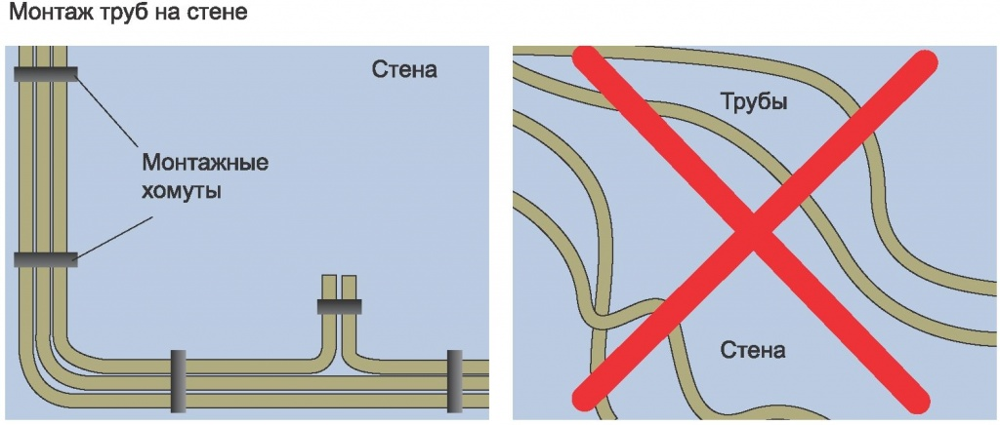
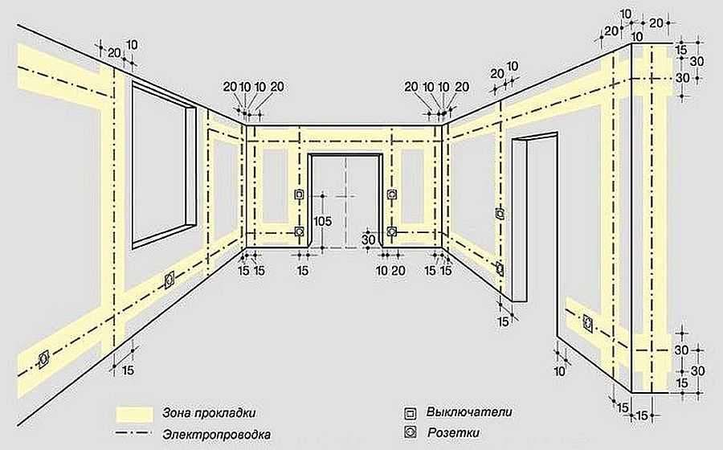
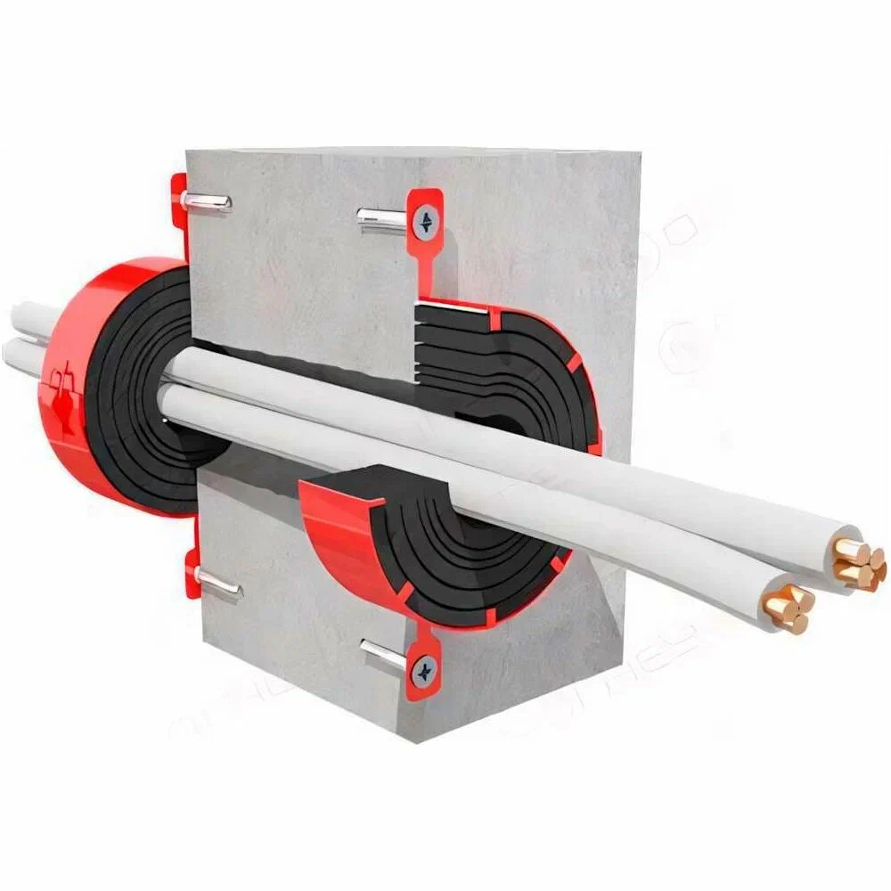

# Монтаж силовых кабелей в стене: требования и нюансы

> **ПУЭ** — Правила устройства электроустановок: основной нормативный документ, регламентирующий требования к электропроводкам, в том числе к прокладке силовых кабелей в стенах.

> **СП 76.13330.2016** — свод правил (актуализированная редакция СНиП 3.05.06-85), устанавливающий требования к электротехническим устройствам, включая монтаж кабельных линий.

> **СП 256.1325800.2016** — свод правил, регламентирующий проектирование и монтаж электроустановок жилых и общественных зданий.

Монтаж силовых кабелей в стене строго регламентирован. Основные требования к такому монтажу прописаны в нескольких нормативных документах: ПУЭ, СП 76.13330.2016 и СП 256.1325800.2016.

---

## Основные требования

### 1. Направление трассы

Кабели должны прокладываться строго горизонтально, вертикально или параллельно кромкам стен помещения.

> **Диагональная трасса** — прокладка кабеля под углом к горизонтали и вертикали; запрещена, так как повышает риск повреждения кабеля при сверлении стен в будущем.

### 2. Отступы от элементов конструкции

Нормативы устанавливают минимальные расстояния:

- от углов помещений, дверных и оконных проёмов — не менее 100–150 мм;
- от потолка при горизонтальной трассе — 50–150 мм (рекомендуется 100–150 мм для удобства монтажа);
- от пола при горизонтальной трассе — 50–100 мм (в промышленных зданиях — от 200 мм для защиты от повреждений).

### 3. Защита и выбор кабеля

> **Негорючие материалы** — строительные материалы, не поддерживающие горение (кирпич, бетон, газоблок).

> **Сгораемые конструкции** — конструкции, выполненные из материалов, поддерживающих горение (например, дерево).

- Если строительные конструкции здания выполнены из негорючих материалов (кирпич, бетон, газоблок), допускается несменяемая замоноличенная прокладка в бороздах стен кабелем или изолированными проводами в защитной оболочке (например, ВВГнг(А)-LS, NYM).
- В сгораемых конструкциях (например, в деревянных домах) скрытая прокладка в обычной ПВХ- или ПНД-гофре запрещена. Требуется использовать металлические трубы с подтверждённой локализационной способностью.

> **Локализационная способность** — способность конструкции (например, металлической трубы) ограничивать распространение огня и продуктов горения за пределы места возникновения пожара в течение нормируемого времени.

- Кабели должны быть в защитной оболочке. Одиночные жилы без общей оболочки (например, ПУГВ или ПУВ) в замоноличивании не допускаются.

### 4. Толщина защитного слоя

При скрытой прокладке в бороздах слой штукатурки или другого несгораемого материала над кабелем должен быть не менее 10 мм.

### 5. Проходка через конструкции

При прокладке сквозь стены, перекрытия и т.п. необходимо использовать кабельные проходки, соответствующие ГОСТ Р 53310.

> **Кабельная проходка** — конструкция, обеспечивающая проход кабеля через ограждающую конструкцию с сохранением требуемого предела огнестойкости.

> **Предел огнестойкости** — время, в течение которого конструкция сохраняет несущую и (или) ограждающую способность при пожаре.

Узлы пересечения ограждающих конструкций должны иметь предел огнестойкости не ниже требуемого для этих конструкций.

### 6. Крепление и фиксация

Кабели должны быть надёжно закреплены. Шаг крепления зависит от типа кабеля:

- для жёстких кабелей (ВВГ, NYM) — 500–700 мм по горизонтали и 700–1000 мм по вертикали;
- для гибких кабелей и гофры — 250–400 мм.

В начале и конце трассы, у каждого поворота и у распределительных коробок крепление обязательно.

### 7. Разделение силовых и слаботочных линий

Силовые и слаботочные кабели должны прокладываться раздельно. Минимальное горизонтальное расстояние между ними зависит от способа прокладки:

- в кабель-каналах — 0,2 м;
- при открытой прокладке без экранов — 0,5 м.

> **Слаботочные линии** — кабельные линии, передающие сигналы малой мощности (связь, интернет, сигнализация, видеонаблюдение и т.п.).

### 8. Запрет на горизонтальное штробление несущих конструкций

В панельных домах запрещено горизонтальное штробление несущих железобетонных стен и плит перекрытий, так как это нарушает статическую устойчивость здания.

> **Штробление** — вырезание канавок (борозд) в стене для прокладки кабеля или труб.

### 9. Герметизация вводов

Вводы кабелей в стены должны герметизироваться негорючими уплотнениями и огнестойкими композициями по ГОСТ 30247.0.

### 10. Температурный режим монтажа

Кабели должны монтироваться при температурах, указанных в стандарте или документах изготовителя.

---

## Важные нюансы

- Перед началом работ обязательно разрабатывается проектная документация с привязкой трассы к базовым стенам.
- После монтажа обязательна проверка сопротивления изоляции и другие испытания.
- В деревянных домах скрытая прокладка в сгораемых конструкциях в обычной гофре запрещена — требуются металлические трубы.
- Перед началом работ рекомендуется свериться с актуальной редакцией ПУЭ и СП, так как требования могут уточняться.
- Если есть сомнения в своих силах, лучше привлечь специалиста.

---

# FAQ

**Какими документами регламентирован монтаж силовых кабелей в стене?**
ПУЭ, СП 76.13330.2016 (актуализированная редакция СНиП 3.05.06-85) и СП 256.1325800.2016.

**Можно ли прокладывать кабель по диагонали?**
Нет, диагональные трассы запрещены: кабели прокладываются строго горизонтально, вертикально или параллельно кромкам стен.

**Какие минимальные отступы от элементов конструкции нужно соблюдать?**
От углов, дверных и оконных проёмов — не менее 100–150 мм; от потолка — 50–150 мм (рекомендуется 100–150 мм); от пола — 50–100 мм (в промышленных зданиях — от 200 мм).

**Можно ли прокладывать кабель в обычной гофре в деревянном доме?**
Нет, в сгораемых конструкциях скрытая прокладка в обычной ПВХ- или ПНД-гофре запрещена. Требуются металлические трубы с подтверждённой локализационной способностью.

**Какая толщина защитного слоя над кабелем при скрытой прокладке?**
Не менее 10 мм штукатурки или другого несгораемого материала.

**Что нужно использовать при проходке кабеля через стены и перекрытия?**
Кабельные проходки, соответствующие ГОСТ Р 53310, с пределом огнестойкости не ниже требуемого для этих конструкций.

**С каким шагом крепятся кабели?**
Для жёстких кабелей (ВВГ, NYM) — 500–700 мм по горизонтали и 700–1000 мм по вертикали; для гибких кабелей и гофры — 250–400 мм. В начале и конце трассы, у каждого поворота и у распределительных коробок крепление обязательно.

**Какое расстояние должно быть между силовыми и слаботочными линиями?**
В кабель-каналах — 0,2 м, при открытой прокладке без экранов — 0,5 м.

**Можно ли штробить несущие стены горизонтально?**
Нет, в панельных домах горизонтальное штробление несущих железобетонных стен и плит перекрытий запрещено — это нарушает статическую устойчивость здания.

**Чем герметизируются вводы кабелей в стены?**
Негорючими уплотнениями и огнестойкими композициями по ГОСТ 30247.0.

**При какой температуре можно монтировать кабели?**
При температурах, указанных в стандарте или документах изготовителя.

**Что нужно сделать перед началом работ?**
Разработать проектную документацию с привязкой трассы к базовым стенам.

**Что проверяется после монтажа?**
Сопротивление изоляции и другие обязательные испытания.